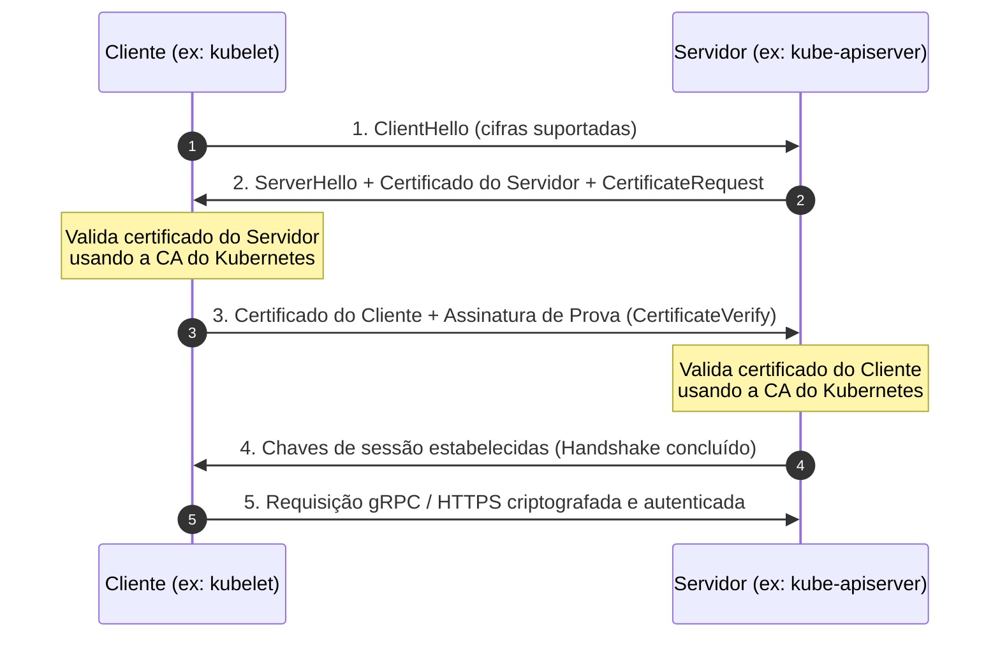
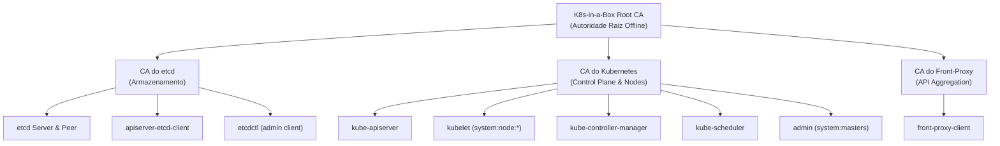
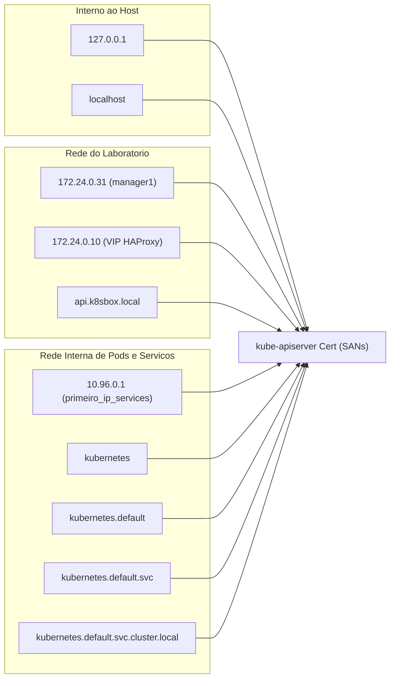

No post anterior, preparamos o sistema base das nossas VMs AlmaLinux: desativamos o swap, carregamos os módulos do kernel e ajustamos as variáveis de rede no sysctl. Com as máquinas padronizadas na faixa privada `172.24.0.0/24`, o próximo passo na construção do cluster é definir a identidade de cada serviço.

Diferente de uma aplicação monolítica protegida pela memória do sistema operacional, o Kubernetes opera como um conjunto de processos distribuídos trocando mensagens via HTTP e gRPC. Para que o control plane, os nós e o banco de dados conversem entre si de forma confiável em uma rede compartilhada, cada componente precisa provar quem é por meio de conexões criptografadas de ponta a ponta.

Antes de rodar qualquer playbook, vamos dissecar a PKI do cluster: mTLS entre processos, as três CAs separadas, RBAC via certificado e por que cravamos validade de 30 dias no lab.

> [!NOTE] Nota da Série e Contexto de Laboratório
> Este post faz parte da série **"Kubernetes in a Box"**, onde dissecamos e construímos, do zero e de forma totalmente reproduzível via Ansible, um cluster Kubernetes completo, com alta disponibilidade, armazenamento persistente, rede moderna e observabilidade. Todo o código do projeto está disponível no repositório parceiro [vndmtrx/k8s-in-a-box](https://github.com/vndmtrx/k8s-in-a-box).
>
> **Aviso de escopo:** as decisões de arquitetura e parâmetros deste projeto foram pensadas sob medida para a nossa realidade de laboratório local em estações Linux com Vagrant e KVM/Libvirt. Elas priorizam aprendizado profundo e reprodutibilidade rápida sobre convenções corporativas de produção. O cluster foi originalmente projetado em versões anteriores e recentemente atualizado para o **Kubernetes v1.37.0**.



## O problema da identidade em sistemas distribuídos

Imagine o cenário clássico de um cluster multinodo: temos duas ou três máquinas atuando como control plane (managers) e outras duas como nós de trabalho (workers). Quando você digita `kubectl get pods` no seu terminal, o comando envia uma requisição HTTPS para a porta `6443` do `kube-apiserver`. O apiserver processa a solicitação, abre uma conexão gRPC na porta `2379` com o cluster `etcd` para consultar o estado do banco, devolve a resposta e, se você pediu a criação de um Pod, despacha uma instrução para a porta `10250` do `kubelet` na máquina de destino.

Em uma arquitetura corporativa antiga, era comum encontrar administradores confiando exclusivamente na rede de perímetro: bastava isolar as máquinas em uma VLAN fechada e liberar portas no firewall. Se alguém conseguisse alcançar o IP, estava dentro.

No Kubernetes, essa postura não é apenas perigosa: ela não para de pé no modelo do cluster, onde convivem agentes de naturezas distintas:

1. Daemons de infraestrutura do sistema rodando como root no nó do host.
2. Componentes centrais de controle que gerenciam o ciclo de vida do cluster.
3. Contêineres de usuários finais compartilhando a mesma malha de rede interna.

Se confiássemos apenas em endereços IP, qualquer contêiner mal configurado ou atacante que conseguisse escapar de um namespace poderia disparar chamadas contra a API do etcd e assumir o controle absoluto de todas as cargas de trabalho.

```
+-------------------------------------------------------------------------+
|                              REDE PRIVADA                               |
|                                                                         |
|  [ kubectl / admin ] ----(1)----> [ kube-apiserver :6443 ]              |
|                                         |                               |
|                                        (2)                              |
|                                         v                               |
|                                 [ etcd cluster :2379 ]                  |
|                                         ^                               |
|                                        (3)                              |
|                                         |                               |
|  [ Pod invasor ] x x x x x x x x x x x x                                |
|  (Bloqueado no handshake: não possui certificado de cliente confiável)  |
+-------------------------------------------------------------------------+
```

Precisamos de uma barreira criptográfica rígida em cada ponto de contato. Cada componente precisa provar a sua identidade em cada chamada de rede, sem que dependamos de senhas estáticas em arquivos de configuração compartilhados.

Para os fundamentos matemáticos e a estrutura conceitual de pares de chaves assimétricas, CSRs e certificados X.509, recomendo a leitura prévia do post . Aqui, vamos direto à forma como o Kubernetes utiliza essa engrenagem para governar o cluster.

## Autenticação mútua (mTLS): a via de mão dupla

Quando você acessa o site do seu banco no navegador, acontece uma sessão TLS unidirecional tradicional: o seu navegador recebe o certificado do servidor web, confere se ele foi emitido por uma autoridade confiável do sistema operacional e confirma que o domínio confere. O servidor, por sua vez, não faz ideia de quem você é no nível criptográfico; ele apenas entrega a página pública e delega a sua autenticação para um formulário com usuário e senha.

No Kubernetes, isso seria inaceitável. O `kube-apiserver` não pode simplesmente entregar dados para qualquer um que aceite o seu certificado HTTPS. Ele precisa saber com certeza matemática absoluta se quem está chamando é o `kube-controller-manager`, o `kube-scheduler`, um nó específico ou o operador com a chave de administrador.

É aqui que entra o **mTLS (Mutual TLS)**.



No mTLS, o aperto de mão exige que ambas as partes apresentem credenciais válidas:

1. O cliente inicia a conexão e recebe o certificado do servidor. Ele valida se o servidor é quem diz ser contra a autoridade certificadora que ele tem gravada no disco.
2. O servidor envia uma mensagem explícita de `CertificateRequest`.
3. O cliente envia o seu próprio certificado e uma assinatura digital gerada com a sua chave privada para comprovar a posse dessa identidade.
4. O servidor valida o certificado do cliente contra a mesma cadeia de confiança. Se o certificado estiver expirado, assinado por uma CA desconhecida ou corrompido, a conexão TCP é sumariamente encerrada antes de qualquer byte de aplicação transitar.

Na prática, o próprio canal de rede já entrega para a aplicação uma identidade verificada e inalterável.

## Por que três autoridades certificadoras e não apenas uma?

Uma das primeiras perguntas de quem olha o diretório de certificados do Kubernetes pela primeira vez é: por que diabos existem tantas CAs? Não seria muito mais simples gerar uma única autoridade raiz, assinar tudo com ela e economizar parâmetros no Ansible?

Seria mais simples, com certeza. Mas seria um desastre de segurança.

No projeto k8s-in-a-box, estruturamos a hierarquia com uma autoridade raiz offline (Root CA) e **três autoridades certificadoras intermediárias**, cada uma com um propósito estrito e intransferível.



Vamos entender o isolamento de cada uma dessas três vias.

### 1. A CA do etcd: o cofre blindado

O etcd guarda o estado completo de todos os objetos do cluster: secrets em base64, descritores de Pods, políticas de segurança e tokens de contas de serviço. Qualquer um que leia ou escreva direto no etcd assume controle irrestrito sobre o ambiente, passando por cima de toda política de RBAC configurada no Kubernetes.

Por essa razão, o cluster etcd roda em uma ilha criptográfica própria:

- Ele só aceita conexões assinadas pela **CA do etcd**.
- Os únicos clientes legítimos dessa autoridade são o próprio processo do `kube-apiserver` (que precisa persistir o estado) e a ferramenta administrativa de manutenção `etcdctl` em situações de emergência.

Se usássemos uma única CA para todo o cluster, o certificado que emitimos para o kubelet de um nó worker seria assinado pela mesma autoridade. Se aquele nó fosse comprometido, o atacante poderia pegar o certificado do kubelet e conversar diretamente com o etcd na porta 2379. Com a separação de CAs, o etcd examina o emissor, percebe que o certificado veio da CA do Kubernetes e fecha a conexão na cara do invasor.

### 2. A CA do Kubernetes: a espinha dorsal de controle

Esta autoridade cuida de toda a orquestração do dia a dia. Ela assina os certificados de identidade de todos os componentes que gravitam ao redor do `kube-apiserver`:

- Os próprios servidores do `kube-apiserver`.
- Os clientes internos: `kube-controller-manager` e `kube-scheduler`.
- Os kubelets de cada nó manager e worker.
- O kubeconfig do administrador (`kubernetes-admin`).

Quando o controller-manager quer verificar o status de um nó, ele usa um certificado assinado por essa CA. Quando o kubelet reporta a saúde dos seus contêineres locais, ele faz o mesmo.

### 3. A CA do Front-Proxy: agregando APIs sem vazar credenciais

O Kubernetes permite que desenvolvedores estendam as APIs nativas do cluster registrando servidores adicionais via *API Aggregation Layer*. O exemplo mais comum e vital no dia a dia é o **Metrics Server**: ele não faz parte do binário central do `kube-apiserver`, mas quando você roda `kubectl top nodes`, é o apiserver quem recebe a sua requisição e a repassa silenciosamente para o Metrics Server.

Como o Metrics Server valida se aquela chamada veio mesmo de um usuário legítimo e não de um impostor?

O `kube-apiserver` atua como um proxy reverso autenticador:

1. O apiserver autentica o usuário original (você).
2. Ele monta uma requisição interna para o servidor de extensão (Metrics Server).
3. Ele injeta cabeçalhos HTTP especiais informando quem é o usuário requisitante: `X-Remote-User`, `X-Remote-Group`.
4. Ele assina essa conexão usando um certificado emitido especificamente pela **CA do Front-Proxy**.

O servidor de métricas confia cegamente nesses cabeçalhos HTTP porque a conexão foi travada com um certificado que só a CA do Front-Proxy poderia ter gerado. Se o certificado do apiserver vazasse ou se misturasse com a CA principal, qualquer processo interno poderia forjar cabeçalhos `X-Remote-User: admin` e se passar pelo dono do cluster.

## Metadados com poder de comando: CN e Organization

Em sistemas convencionais, a autenticação diz quem você é e a autorização consulta uma tabela de permissões no banco de dados para decidir o que você pode fazer. No Kubernetes, para os componentes de infraestrutura, esses dois papéis estão fundidos dentro do próprio certificado digital.

Quando o `kube-apiserver` valida o certificado de um cliente via mTLS, ele extrai os dados do campo `Subject` do X.509 e os converte imediatamente em identidade de usuário e grupos para o mecanismo de RBAC (Role-Based Access Control) [^1]:

- O campo **CN (Common Name)** é mapeado diretamente para o **Nome de Usuário (User)**.
- O campo **O (Organization)** é mapeado para um ou mais **Grupos de Usuário (Groups)**.

Essa equivalência gera comportamentos fundamentais na arquitetura:

### O bypass supremo do sistema: system:masters

Observe o certificado administrativo que geramos para o operador do cluster:

```
Subject: O = system:masters, CN = kubernetes-admin
```

O grupo `system:masters` possui um tratamento especial embutido no código-fonte do Kubernetes: ele está associado por padrão à ClusterRole `cluster-admin`, que possui privilégios totais e irrestritos sobre qualquer recurso, em qualquer namespace.

Não existe nenhum arquivo de configuração ou comando no `kubectl` capaz de revogar as permissões de um certificado com `O = system:masters` sem desativar a própria autorização RBAC do cluster. Quem possui a chave privada desse certificado é o proprietário incontestável do ambiente.

### Autorização de nós: Node Authorizer

Agora examine o certificado que o Ansible gera individualmente para o kubelet de cada nó:

```
Subject: O = system:nodes, CN = system:node:worker1
```

O prefixo `system:node:` no Common Name e o grupo `system:nodes` ativam um autorizador especializado dentro do API Server chamado **Node Authorization** [^2].

Esse autorizador impede que nós comprometidos causem estragos no resto do cluster:

- O nó `worker1` só tem permissão para ler informações sobre os Pods que o scheduler agendou expressamente para rodar nele.
- Ele só pode ler as Secrets e ConfigMaps associadas a esses mesmos Pods.
- Ele não pode reportar status em nome de outro nó (`worker2`) nem ler segredos de workloads que estão rodando nos managers.

Um único erro de digitação na task do Ansible trocando o `CN` por apenas `worker1` sem o prefixo faria com que o nó subisse, mas fosse incapaz de se registrar perante o control plane, gerando erros crípticos de autorização no log do kubelet.

## Subject Alternative Names (SANs): o labirinto de nomes do API Server

Se você já configurou certificados TLS para a web, está acostumado a preencher o SAN (Subject Alternative Name) com um domínio e talvez um wildcard: `exemplo.com.br` e `*.exemplo.com.br`.

No Kubernetes, o certificado do `kube-apiserver` precisa de uma lista extensa de nomes e endereços IP. Se faltar um único registro nessa lista, qualquer cliente que tente se conectar usando aquele endereço rejeitará a conexão com o clássico erro:

```
x509: certificate is valid for 172.24.0.31, not 172.24.0.10
```

Por que o API Server tem tantas identidades?

Porque ele precisa ser alcançado de dezenas de perspectivas de rede totalmente diferentes ao mesmo tempo:



Vamos rastrear cada uma dessas origens:

1. **Loopback local (`127.0.0.1`, `localhost`):** Daemons locais rodando no próprio nó manager (como probes de saúde do kubelet ou o controller-manager) frequentemente falam com o apiserver apontando para o localhost.
2. **Endereço físico do nó (`172.24.0.31`, `manager1.k8sbox.local`):** Comunicação ponto a ponto direta entre nós durante tarefas de bootstrap.
3. **Ponto de entrada de alta disponibilidade (`172.24.0.10`, `api.k8sbox.local`):** O IP flutuante (VIP) do Keepalived gerenciado pelo balanceador HAProxy. É este o endereço que o seu `kubectl` no host e os nós workers usam como destino padrão.
4. **O IP de Serviço do cluster (`10.96.0.1` ou `10.32.0.1`):** Todo cluster Kubernetes reserva o primeiro IP utilizável da sua faixa de serviços (`service-cluster-ip-range`) para expor a API internamente. Quando um Pod quer conversar com a API sem saber a topologia física das VMs, ele atira no IP do serviço `kubernetes`.
5. **Nomes DNS internos do cluster:** O CoreDNS resolve os nomes `kubernetes`, `kubernetes.default`, `kubernetes.default.svc` e `kubernetes.default.svc.cluster.local` exatamente para o IP do serviço citado acima. Qualquer aplicação interna que use a biblioteca cliente do Kubernetes precisa que o certificado responda por esses nomes FQDN.

Se omitíssemos o IP do serviço na lista de SANs, todo Pod dentro do cluster que tentasse consultar a API falharia sumariamente na validação TLS.

## Key Usage e restrições de propósito

Não basta que um certificado tenha o nome certo e seja assinado pela autoridade correta; ele precisa especificar exatamente para quais funções criptográficas pode ser empregado por meio das extensões X.509 [^3]:

### basicConstraints

Define se o certificado é uma autoridade certificadora capaz de emitir outros certificados (`CA:TRUE`) ou se é uma ponta final de aplicação (`CA:FALSE`).

Nas nossas CAs intermediárias, usamos além do `CA:TRUE` a diretiva `pathlen:0`. Isso garante matematicamente que aquela CA intermediária só pode assinar certificados finais; ela está impedida de criar outras CAs abaixo dela. Se alguém obtiver acesso indevido à chave da CA do Kubernetes, não conseguirá criar uma sub-CA invisível para expandir o ataque.

### keyUsage e extendedKeyUsage

O aperto de mão TLS distingue com rigor os papéis de cliente e servidor:

- **`extendedKeyUsage: serverAuth`**: Habilita o certificado para ser apresentado por um daemon aguardando conexões (como o `kube-apiserver` na porta 6443 ou o `etcd` na porta 2379).
- **`extendedKeyUsage: clientAuth`**: Habilita o certificado para ser apresentado por quem inicia a chamada (como o `kubectl`, o `kubelet` ou o `kube-scheduler`).

Alguns componentes precisam de ambos. O `kubelet`, por exemplo, precisa de `clientAuth` quando envia atualizações de pods para o API Server, mas precisa de `serverAuth` quando o próprio API Server se conecta na porta 10250 do kubelet para coletar logs com `kubectl logs` ou abrir um terminal interativo com `kubectl exec`.

Tentar autenticar como cliente usando um certificado emitido com apenas `serverAuth` faz o OpenSSL abortar a sessão no ato, gerando falhas de conexão opacas nos logs do cluster.

## A escolha criptográfica: ECDSA secp256r1 vs. RSA

Durante muitos anos, o padrão de mercado para certificados X.509 foi o algoritmo RSA com chaves de 2048 ou 4096 bits. No projeto k8s-in-a-box, tomamos a decisão deliberada de padronizar toda a PKI do cluster em curvas elípticas: **ECDSA** utilizando a curva NIST P-256 (`secp256r1`) [^4].

```
+--------------------------------------------------------------------------+
|                        COMPARATIVO CRIPTOGRÁFICO                         |
+--------------------------+-----------------------+-----------------------+
| Métrica                  | RSA (3072 bits)       | ECDSA (secp256r1)     |
+--------------------------+-----------------------+-----------------------+
| Tamanho da Chave         | 3072 bits             | 256 bits              |
| Nível de Segurança       | ~128 bits             | ~128 bits             |
| Tamanho do Certificado   | ~1.5 KB a 2.5 KB      | ~600 B a 900 B        |
| Custo de CPU no Handshake| Elevado na assinatura | Baixo e eficiente     |
| Velocidade de Geração    | Lenta (busca de primos| Instantânea           |
+--------------------------+-----------------------+-----------------------+
```

As vantagens no laboratório e na operação prática são evidentes:

1. **Performance e throughput de conexões:** O handshake TLS com ECDSA consome significativamente menos ciclos de clock de CPU. Em um cluster onde dezenas de daemons abrem e fecham túneis gRPC simultaneamente, o consumo de recursos das VMs cai de forma perceptível.
2. **Payload de rede reduzido:** Certificados ECDSA são muito mais compactos. Como os certificados viajam pelo fio em cada novo aperto de mão TLS, economizamos largura de banda e tempo de trânsito.
3. **Agilidade na automação:** Gerar uma chave privada ECDSA leva milissegundos, enquanto gerar chaves RSA fortes no Ansible pode causar pausas perceptíveis durante o provisionamento.

### A exceção necessária: tokens de Service Account

Existe uma única exceção em toda a nossa infraestrutura que não segue a curva elíptica: o par de chaves das **Service Accounts** (`sa.key` e `sa.pub`).

Esse par de chaves não é um certificado X.509 e não participa do handshake TLS da rede. O `kube-controller-manager` e o `kube-apiserver` o usam internamente só para assinar e validar tokens JWT (JSON Web Tokens) injetados dentro dos Pods para autenticação das aplicações na API.

Por legado e compatibilidade com a especificação OIDC e os validadores padrão da biblioteca cliente do Kubernetes, esse par de chaves nasce em formato **RSA de 2048 ou 4096 bits**. Na Parte 6, veremos como o Ansible trata essa chave de forma isolada das demais.

## O ciclo de vida curto: 30 dias de validade como ferramenta de aprendizado

Se você inicializar um cluster utilizando o assistente padrão `kubeadm`, ele gerará certificados de componentes com validade fixa de **1 ano (365 dias)** [^5].

Para produção, faz sentido buscar janelas previsíveis ou automações completas de rotação via `cert-manager`. Só que em laboratório, a validade de 1 ano funciona como uma anestesia perigosa: você configura o cluster em janeiro, esquece como os certificados foram emitidos e, em janeiro do ano seguinte, acorda com o cluster parado porque os certificados expiraram em silêncio.

No k8s-in-a-box, decidimos encurtar as rédeas:

- **Root CA:** Válida por **5 anos (1825 dias)**.
- **CAs Intermediárias:** Válidas por **1 ano (365 dias)**.
- **Certificados de Componentes e Clientes:** Válidos por apenas **30 dias**.
- **Janela de alerta para renovação no Ansible:** **7 dias**.

Essa restrição deliberada força o administrador a exercitar o ciclo de manutenção. Se a sua automação de renovação não for confiável e reproduzível, o laboratório cobrará a conta em 30 dias. É a garantia de que ninguém sairá da série tratando certificados como um passe de mágica que se configura uma única vez e se esquece para sempre.

## Diagnóstico e Troubleshooting

Para consolidar a teoria antes de começarmos a disparar playbooks no próximo artigo, vamos aprender a inspecionar e interrogar certificados utilizando comandos padrão do `openssl`.

Você pode testar estes comandos imediatamente no terminal de qualquer uma das suas VMs AlmaLinux ou na sua própria estação de trabalho, inspecionando certificados locais do sistema.

### Inspecionar metadados completos de um certificado

Para visualizar o emissor, o dono, as validades e as extensões habilitadas:

```bash
$ openssl x509 -in /etc/pki/tls/certs/ca-bundle.crt -text -noout | head -40
```

Se você quiser filtrar apenas o Subject (dono) e o Issuer (emissor):

```bash
$ openssl x509 -in cert.pem -noout -subject -issuer
subject=CN = kube-apiserver
issuer=CN = K8s-in-a-Box Kubernetes Intermediate CA, O = K8s-in-a-Box
```

### Conferir os Subject Alternative Names (SANs)

Quando desconfiar que uma chamada de API está falhando por divergência de hostname ou IP, examine a extensão SAN:

```bash
$ openssl x509 -in cert.pem -noout -ext subjectAltName
X509v3 Subject Alternative Name: 
    IP Address:127.0.0.1, DNS:localhost, IP Address:172.24.0.10, DNS:api.k8sbox.local, IP Address:172.24.0.31, DNS:manager1.k8sbox.local, DNS:kubernetes, DNS:kubernetes.default, DNS:kubernetes.default.svc, DNS:kubernetes.default.svc.cluster.local, IP Address:10.96.0.1
```

### Calcular a data exata de expiração

Para verificar se um certificado já atingiu a janela de 7 dias de alerta de renovação:

```bash
$ openssl x509 -in cert.pem -noout -dates
notBefore=Oct 14 20:00:00 2026 GMT
notAfter=Nov 13 20:00:00 2026 GMT

# Teste lógico direto: o certificado já expirou?
$ openssl x509 -in cert.pem -noout -checkend 0
Certificate will not expire

# O certificado expira dentro dos próximos 7 dias (604800 segundos)?
$ openssl x509 -in cert.pem -noout -checkend 604800
Certificate will expire
```

### Problemas comuns de entendimento conceitual

| Sintoma Teórico | Raiz do Problema | Onde a Teoria Explica |
|:---|:---|:---|
| `x509: certificate signed by unknown authority` | O cliente não possui o certificado público da CA intermediária correta em seu trust store | Falta do bundle da CA do Kubernetes ou da CA do etcd nos parâmetros do binário |
| `x509: certificate is valid for X, not Y` | O IP ou hostname usado na URL de acesso não está presente na lista de SANs | Acesso ao apiserver por um IP secundário ou DNS não cadastrado no template de SAN |
| `remote error: tls: bad certificate` | O cliente apresentou um certificado que o servidor não aceita, ou não apresentou certificado algum | Servidor exige mTLS e a conexão foi disparada por um cliente não autenticado |
| `certificate specifies incompatible key usage` | O certificado de cliente só possui `serverAuth` (ou vice-versa) | Diretiva `extendedKeyUsage` no CSR restringiu o papel criptográfico indevidamente |
| `User "system:node:worker1" cannot list resource` | O nó tentou acessar recursos fora do seu escopo de agendamento local | Mecanismo de Node Authorization fazendo o bloqueio baseado no prefixo do CN |

## Conclusão

Desenhamos no papel a espinha dorsal de segurança do nosso cluster. Agora sabemos exatamente por que o Kubernetes se recusa a rodar com um certificado genérico de servidor web: ele depende de autoridades certificadoras isoladas para proteger o etcd, de autenticação mútua para blindar as chamadas entre processos, de extensões X.509 detalhadas para habilitar as funções de rede e dos campos Subject para alimentar as permissões administrativas do cluster sem senhas.

Com toda essa base conceitual sedimentada, podemos voltar para a prática com total segurança.

No próximo post (), vamos abrir o código da role `infra-pki` no repositório parceiro, dissecar cada uma das 18 tasks do Ansible, entender como funcionam os pipes de geração de CSR em memória e ver o Ansible forjar e distribuir toda a cadeia de certificados do nosso laboratório de forma 100% automatizada e idempotente.

## Referências

[^1]: **Using RBAC Authorization** {*Kubernetes Documentation*} ([Link](https://kubernetes.io/docs/reference/access-authn-authz/rbac/))

[^2]: **Using Node Authorization** {*Kubernetes Documentation*} ([Link](https://kubernetes.io/docs/reference/access-authn-authz/node/))

[^3]: **RFC 5280: Internet X.509 Public Key Infrastructure Certificate and Certificate Revocation List (CRL) Profile** {*IETF Datatracker*} ([Link](https://datatracker.ietf.org/doc/html/rfc5280))

[^4]: **FIPS PUB 186-4: Digital Signature Standard (DSS)** {*NIST*} ([Link](https://csrc.nist.gov/publications/detail/fips/186/4/final))

[^5]: **PKI certificates and requirements** {*Kubernetes Documentation*} ([Link](https://kubernetes.io/docs/setup/best-practices/certificates/))
