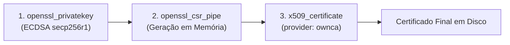

No post anterior, cobrimos o desenho arquitetural da PKI do Kubernetes: a necessidade de autenticação mútua (mTLS) entre processos, a divisão em três autoridades certificadoras intermediárias, a integração de metadados X.509 com o RBAC e o ciclo de vida intencionalmente curto de 30 dias para os certificados do laboratório.

Com a arquitetura estabelecida, o passo seguinte é viabilizar a emissão e a manutenção contínua dessas credenciais. Um cluster completo envolve mais de duas dezenas de certificados com diferentes papéis, extensões e listas detalhadas de SANs. Em vez de rodar sequências manuais de comandos OpenSSL, estruturamos todo esse processo em código declarativo para que a geração seja previsível e reproduzível.

Hora de abrir a role `infra-pki`: geração local da cadeia via Ansible, idempotência por comparação de SKI/AKI e validação dos certificados antes de subir o cluster.

> [!NOTE] Nota da Série e Contexto de Laboratório
> Este post faz parte da série **"Kubernetes in a Box"**, onde dissecamos e construímos, do zero e de forma totalmente reproduzível via Ansible, um cluster Kubernetes completo, com alta disponibilidade, armazenamento persistente, rede moderna e observabilidade. Todo o código do projeto está disponível no repositório parceiro [vndmtrx/k8s-in-a-box](https://github.com/vndmtrx/k8s-in-a-box).
>
> **Aviso de escopo:** as decisões de arquitetura e parâmetros deste projeto foram pensadas sob medida para a nossa realidade de laboratório local em estações Linux com Vagrant e KVM/Libvirt. Elas priorizam aprendizado profundo e reprodutibilidade rápida sobre convenções corporativas de produção. O cluster foi originalmente projetado em versões anteriores e recentemente atualizado para o **Kubernetes v1.37.0**.



## A estratégia de geração local: delegate to localhost

A primeira decisão arquitetural da role [infra-pki](https://github.com/vndmtrx/k8s-in-a-box/tree/main/ansible/infra-pki) é simples: onde os certificados nascem?

Em muitos tutoriais de internet, é comum ver o Ansible se conectando via SSH no primeiro nó manager e disparando comandos OpenSSL remotos por lá. No k8s-in-a-box, adotamos uma postura muito mais estrita de segurança: toda a geração da PKI roda exclusivamente na máquina do operador (o seu host local), aproveitando `delegate_to: localhost` e a conexão local da playbook `cluster.yml` [^1]:

```yaml
- name: Criação local dos CAs e certificados do projeto
  hosts: localhost
  connection: local
  become: false
  gather_facts: false
  roles:
    - role: infra-pki
      tags:
        - cluster-pki
        - cluster
```

Essa abordagem traz três vantagens operacionais imediatas:

1. **A chave privada da Root CA nunca toca a rede:** A autoridade raiz nasce e permanece guardada no diretório de artefatos da sua estação de trabalho. Nenhuma máquina virtual do cluster recebe a chave privada da Root CA.
2. **Geração limpa e isolada:** Não precisamos instalar ferramentas de compilação ou utilitários extras de criptografia dentro das VMs mínimas do AlmaLinux.
3. **Distribuição seletiva sob medida:** As chaves privadas dos nós só são enviadas para a máquina específica que precisa delas. O nó `worker1` jamais toma conhecimento da chave privada do `manager1` ou da chave da CA do etcd.

## Estrutura de dados e parâmetros da role

Toda a parametrização criptográfica está centralizada no arquivo de variáveis padrão da role `ansible/infra-pki/defaults/main.yml` e no inventário global [^2]:


```yaml
# ansible/infra-pki/defaults/main.yml
# Valores técnicos
pki_cifra_tipo: "ECC"
pki_cifra_algo: "secp256r1" # Opções: secp256r1; secp384r1; secp521r1
pki_algoritmo_hash: "sha256"

# Validades (em dias)
pki_validade:
  root: 1825           # 5 anos
  intermediario: 365   # 1 ano
  certificado: 30      # 1 mês
  alerta: 7            # 1 semana
```


No arquivo global `inventario/group_vars/all.yml`, organizamos os caminhos dos arquivos em disco em três pastas fundamentais:

- `pki_pastas.ca`: Guarda os pares de chaves das autoridades certificadoras (Root CA e as três intermediárias).
- `pki_pastas.etcd`: Guarda os certificados do cluster etcd e de seus clientes diretos.
- `pki_pastas.k8s`: Guarda os certificados do control plane do Kubernetes, dos nós kubelet e dos administradores.

A organização das tarefas segue uma convenção numérica rigorosa dentro do diretório `tasks/`:

```
ansible/infra-pki/tasks/
├── 01-setup.yml
├── 101-root-ca.yml
├── 102-ca-etcd.yml
├── 103-ca-kubernetes.yml
├── 104-ca-front-proxy.yml
├── 201-cert-etcd-server.yml
├── 202-cert-etcd-peer.yml
├── 203-cert-etcd-cli.yml
├── 211-cert-kube-apiserver.yml
├── 212-cert-kube-apiserver-etcd-cli.yml
├── 213-cert-kube-apiserver-kubelet-cli.yml
├── 214-cert-kube-controller-manager.yml
├── 215-cert-kube-scheduler.yml
├── 221-cert-kubelet.yml
├── 223-cert-service-account.yml
├── 224-cert-admin-account.yml
├── 231-cert-front-proxy-cli.yml
└── main.yml
```

As tarefas `10x` geram as autoridades certificadoras. As tarefas `20x` cuidam do subsistema etcd. As tarefas `21x` geram os certificados do control plane. As tarefas `22x` forjam as credenciais dos nós workers, contas de serviço e administradores. Por fim, a `231` cria o cliente do front-proxy.

## Idempotência real: a dança entre SKI e AKI

Se você já tentou automatizar PKI com scripts shell, sabe o pesadelo que é garantir idempotência: se o script rodar de novo, ele não pode recriar chaves privadas à toa, caso contrário todos os daemons em execução perdem a conexão. Por outro lado, se um certificado expirou ou se a CA pai foi recriada, ele precisa ter a inteligência de regerar o certificado automaticamente.

No k8s-in-a-box, resolvemos isso inspecionando duas extensões fundamentais do padrão X.509 através da coleção `community.crypto` [^3]:

- **SKI (Subject Key Identifier):** O identificador único da chave pública presente no certificado da autoridade certificadora.
- **AKI (Authority Key Identifier):** O identificador gravado no certificado filho apontando qual chave pública de CA o assinou.

Observe o bloco de tomada de decisão presente em quase todas as tarefas da role (aqui exemplificado no certificado do API Server):


```yaml
- name: Verificar informações do certificado do kube-apiserver existente ({{ manager_host }})
  community.crypto.x509_certificate_info:
    path: "{{ pki_certs.kube_apiserver.path_cert | format(manager_host) }}"
  register: kube_apiserver_info
  when: kube_apiserver_arquivos.results[1].stat.exists
  delegate_to: localhost

- name: Verificar SKI do CA do Kubernetes vigente ({{ manager_host }})
  community.crypto.x509_certificate_info:
    path: "{{ pki_certs.kube_apiserver.ca_pai.path_cert }}"
  register: ca_k8s_ski_info
  when: kube_apiserver_arquivos.results[1].stat.exists
  delegate_to: localhost

- name: Decidir se certificado do kube-apiserver deve ser gerado ({{ manager_host }})
  ansible.builtin.set_fact:
    pki_deve_gerar_kube_apiserver: >-
      {{
        not kube_apiserver_arquivos.results[0].stat.exists
        or not kube_apiserver_arquivos.results[1].stat.exists
        or (kube_apiserver_info.expired | default(false))
        or (kube_apiserver_info.not_after is defined and
            ((kube_apiserver_info.not_after | to_datetime('%Y%m%d%H%M%SZ')) - now()).days
            < pki_validade.alerta | int)
        or (kube_apiserver_info.authority_key_identifier | default(none) is not none and
            ca_k8s_ski_info.subject_key_identifier | default(none) is not none and
            kube_apiserver_info.authority_key_identifier != ca_k8s_ski_info.subject_key_identifier)
      }}
  delegate_to: localhost
```


Essa expressão booleana avalia quatro condições antes de encostar no disco:

1. A chave privada ou o certificado ainda não existem? **Gera.**
2. O certificado existente já expirou? **Gera.**
3. O certificado está a menos de 7 dias de expirar (`pki_validade.alerta`)? **Renova antecipadamente.**
4. O AKI do certificado final é diferente do SKI atual da CA pai? **Regenera.**

A quarta condição é um primor de engenharia de automação: se você rodar o Ansible com a flag `-e pki_regerar_certs=true`, a Root CA e as intermediárias são apagadas e recriadas. Como a chave da nova CA terá um novo SKI, na próxima etapa todos os certificados finais percebem a orfandade criptográfica e se auto-regeneram, sem deixar nenhum certificado assinado por uma autoridade fantasma para trás.

## A esteira de emissão: chaves, pipes e certificados

Uma vez tomada a decisão de gerar o certificado, o Ansible executa uma esteira de três passos altamente otimizada:



### 1. Criando a chave privada ECDSA

Utilizamos o módulo `community.crypto.openssl_privatekey` para esculpir a chave na curva `secp256r1`:


```yaml
- name: Criar chave privada do certificado para o kube-apiserver ({{ manager_host }})
  community.crypto.openssl_privatekey:
    path: "{{ pki_certs.kube_apiserver.path_chave | format(manager_host) }}"
    type: "{{ pki_cifra_tipo }}"
    curve: "{{ pki_cifra_algo }}"
    state: "present"
    force: true
  when: pki_deve_gerar_kube_apiserver
  delegate_to: localhost
```


### 2. A mágica do openssl_csr_pipe

Geralmente, a geração de certificados exige criar um arquivo temporário de CSR (`.csr`), salvá-lo em disco, chamar a assinatura e depois lembrar de apagar o resíduo.

Para evitar sujeira no sistema de arquivos, usamos o módulo `community.crypto.openssl_csr_pipe`. Ele gera a requisição de assinatura diretamente em um fluxo de memória e a devolve em uma variável registrada do Ansible:


```yaml
- name: Gerar CSR do certificado para o kube-apiserver ({{ manager_host }})
  community.crypto.openssl_csr_pipe:
    privatekey_path: "{{ pki_certs.kube_apiserver.path_chave | format(manager_host) }}"
    digest: "{{ pki_algoritmo_hash }}"
    subject:
      CN: kube-apiserver
    use_common_name_for_san: false
    basic_constraints:
      - "CA:FALSE"
    basic_constraints_critical: true
    key_usage:
      - digitalSignature
    key_usage_critical: true
    extended_key_usage:
      - serverAuth
    extended_key_usage_critical: true
    subject_alt_name: "{{ lookup('template', '211-san-kube-apiserver.j2') | from_yaml }}"
  when: pki_deve_gerar_kube_apiserver
  delegate_to: localhost
  register: kube_apiserver_csr
```


Observe a precisão dos parâmetros:
- `basic_constraints: ["CA:FALSE"]` marcado como crítico.
- `key_usage: [digitalSignature]` marcado como crítico.
- `extended_key_usage: [serverAuth]` restringindo a atuação para servidor TLS.
- O campo `subject_alt_name` lendo o template dinâmico Jinja2 e convertendo a lista YAML em tempo real.

### 3. Assinando com a autoridade intermediária (ownca)

Com o CSR em memória dentro da variável `kube_apiserver_csr.csr`, acionamos o módulo `community.crypto.x509_certificate` usando o provedor `ownca`:


```yaml
- name: Assinar certificado para o kube-apiserver com o respectivo CA intermediário ({{ manager_host }})
  community.crypto.x509_certificate:
    path: "{{ pki_certs.kube_apiserver.path_cert | format(manager_host) }}"
    csr_content: "{{ kube_apiserver_csr.csr }}"
    provider: ownca
    ownca_path: "{{ pki_certs.kube_apiserver.ca_pai.path_cert }}"
    ownca_privatekey_path: "{{ pki_certs.kube_apiserver.ca_pai.path_chave }}"
    ownca_digest: "{{ pki_algoritmo_hash }}"
    ownca_not_after: "+{{ pki_validade.certificado | default(30) }}d"
    mode: "0644"
    force: true
  when: pki_deve_gerar_kube_apiserver
  delegate_to: localhost
```


O módulo lê a chave privada e o certificado da CA pai (a CA intermediária do Kubernetes), aplica a validade calculada de 30 dias (`+30d`) e grava o certificado final no disco com permissões seguras.

## Dissecando os templates de SAN

Como vimos na Parte 5, o `kube-apiserver` e os membros do `etcd` precisam de certificados com múltiplos nomes alternativos para responder corretamente a requisições locais, conexões via Load Balancer e chamadas vindas de dentro da malha de Pods.

Vamos analisar o template `ansible/infra-pki/templates/211-san-kube-apiserver.j2`:


```jinja2
# IPs e nomes locais
- IP:127.0.0.1
- DNS:localhost

# Load Balancer
- IP:{{ keepalived_vip_ip }}
- DNS:{{ vip_api_fqdn }}

# Nome e IP do nó atual
- IP:{{ hostvars[manager_host].ansible_host }}
- DNS:{{ hostvars[manager_host].fqdn }}

# Nome do serviço do Kubernetes
- DNS:kubernetes
- DNS:kubernetes.default
- DNS:kubernetes.default.svc
- DNS:kubernetes.default.svc.cluster
- DNS:kubernetes.default.svc.cluster.local

# IP do serviço Kubernetes (primeiro IP do CIDR de serviços)
- IP:{{ primeiro_ip_services }}
```


Quando o Ansible itera sobre o grupo `managers` executando essa task para o nó `manager1`, o Jinja2 expande esse template resultando em uma estrutura precisa:

- `IP:127.0.0.1` e `DNS:localhost` para probes de monitoramento locais do kubelet.
- `IP:172.24.0.10` e `DNS:api.k8sbox.local` para requisições que chegam pelo Keepalived/HAProxy.
- `IP:172.24.0.31` e `DNS:manager1.k8sbox.local` para tráfego direto de administração.
- Os 5 nomes DNS clássicos do serviço interno do cluster.
- `IP:10.96.0.1` (o `primeiro_ip_services` calculado a partir da nossa faixa `10.96.0.0/12`), garantindo que Pods acessando a API interna não tomem erro TLS.

O mesmo cuidado se repete no certificado do `kubelet` (`221-san-kubelet.j2`):


```jinja2
# IPs e nomes locais
- IP:127.0.0.1
- DNS:localhost

# Nome e IP do nó atual
- IP:{{ hostvars[node_host].ansible_host }}
- DNS:{{ hostvars[node_host].fqdn }}
```


E o certificado do kubelet recebe o Subject moldado sob medida para o Node Authorizer:


```yaml
subject:
  O: system:nodes
  CN: "system:node:{{ node_host }}"
```


## A exceção das Service Accounts

Na tarefa `223-cert-service-account.yml`, encontramos o único ponto do projeto que rompe intencionalmente a padronização de curvas elípticas.

Como o Kubernetes utiliza esse par de chaves para assinar e validar os tokens JWT gerados para as contas de serviço (`ServiceAccount`) montadas dentro dos contêineres, ele exige compatibilidade com assinaturas RSA [^4]:


```yaml
- name: Criar chave privada do certificado para o Service Account
  community.crypto.openssl_privatekey:
    path: "{{ pki_certs.service_account.path_chave }}"
    type: "{{ pki_cifra_tipo }}"
    curve: "{{ pki_cifra_algo }}"
    state: "present"
    force: true
  when: pki_deve_gerar_service_account
  delegate_to: localhost
```


Embora o módulo permita gerar chaves ECC para a ServiceAccount a partir das versões modernas do Kubernetes, mantemos a task padronizada em nossa estrutura para que o `kube-controller-manager` receba a chave privada via flag `--service-account-private-key-file` e o `kube-apiserver` receba a chave pública através de `--service-account-key-file`.

## Como os certificados chegam aos nós

Depois que a role `infra-pki` conclui a sua execução, o diretório local de artefatos do host contém todo o arcabouço criptográfico pronto:

```
build/artefatos/pki/
├── CAs/
│   ├── root-ca-cert.pem
│   ├── root-ca-priv.pem
│   ├── ca-etcd-cert.pem
│   ├── ca-etcd-priv.pem
│   ├── ca-k8s-cert.pem
│   ├── ca-k8s-priv.pem
│   ├── ca-front-proxy-cert.pem
│   └── ca-front-proxy-priv.pem
├── etcd/
│   ├── manager1-etcd-node-server-cert.pem
│   ├── manager1-etcd-node-server-priv.pem
│   ├── manager1-etcd-node-peer-cert.pem
│   ├── manager1-etcd-node-peer-priv.pem
│   └── etcd-cli-cert.pem ...
└── k8s/
    ├── manager1-kube-apiserver-cert.pem
    ├── manager1-kube-apiserver-priv.pem
    ├── worker1-kubelet-cert.pem
    ├── worker1-kubelet-priv.pem
    ├── admin-account-cert.pem ...
```

Quando as etapas seguintes do cluster entram em ação (como a role `k8s-cluster-base` e as roles dos Static Pods), cada nó recebe apenas o estritamente necessário para o seu papel [^5]:

1. **Todas as máquinas do cluster** recebem os certificados públicos das três CAs intermediárias em `/etc/kubernetes/pki/` para confiar nas conexões da rede.
2. **Os nós managers** recebem seus certificados de servidor etcd, apiserver, controller-manager e scheduler.
3. **Os nós workers** recebem exclusivamente o par de chaves do seu próprio kubelet (`system:node:workerX`). Eles nunca recebem a chave da CA do Kubernetes, nem as chaves do etcd, nem a chave da Root CA.

Se um nó worker for invadido ou sequestrado, o atacante não encontra nenhuma autoridade certificadora ou chave de control plane guardada no disco para escalar privilégios.

## Diagnóstico e Troubleshooting

Com a role executada e os arquivos gerados no diretório local, podemos rodar uma bateria de testes com comandos do OpenSSL para garantir que a cadeia está íntegra antes de provisionar qualquer serviço.

### 1. Validar a cadeia de confiança com OpenSSL verify

Para ter certeza de que o certificado do API Server foi assinado corretamente pela CA do Kubernetes e que a CA intermediária é filha legítima da Root CA:

```bash
# Criar o bundle da cadeia completa para o teste
$ cat build/artefatos/pki/CAs/root-ca-cert.pem \
      build/artefatos/pki/CAs/ca-k8s-cert.pem > /tmp/k8s-chain.pem

# Verificar a validade da assinatura do certificado do manager1
$ openssl verify -CAfile /tmp/k8s-chain.pem \
      build/artefatos/pki/k8s/manager1-kube-apiserver-cert.pem
build/artefatos/pki/k8s/manager1-kube-apiserver-cert.pem: OK
```

Se o comando retornar `OK`, a árvore criptográfica está perfeita.

### 2. Confirmar as SANs geradas para o apiserver

Verifique se todos os IPs e FQDNs do seu inventário foram incluídos:

```bash
$ openssl x509 -in build/artefatos/pki/k8s/manager1-kube-apiserver-cert.pem \
      -noout -ext subjectAltName
X509v3 Subject Alternative Name: 
    IP Address:127.0.0.1, DNS:localhost, IP Address:172.24.0.10, DNS:api.k8sbox.local, IP Address:172.24.0.31, DNS:manager1.k8sbox.local, DNS:kubernetes, DNS:kubernetes.default, DNS:kubernetes.default.svc, DNS:kubernetes.default.svc.cluster, DNS:kubernetes.default.svc.cluster.local, IP Address:10.96.0.1
```

### 3. Teste prático de mTLS com s_client

Quando o cluster etcd estiver no ar nos próximos posts, você poderá validar a comunicação segura mTLS em tempo real diretamente da sua estação ou do nó bastion (kubox):

```bash
$ openssl s_client -connect 172.24.0.31:2379 \
      -cert build/artefatos/pki/etcd/etcd-cli-cert.pem \
      -key build/artefatos/pki/etcd/etcd-cli-priv.pem \
      -CAfile build/artefatos/pki/CAs/ca-etcd-cert.pem
```

Se o handshake for concluído com sucesso, você verá a mensagem `Verify return code: 0 (ok)` e o terminal aguardará comandos do protocolo etcd.

### Problemas comuns e soluções

| Sintoma na Execução | Causa Provável | Solução Prática |
|:---|:---|:---|
| `fatal: [localhost]: FAILED! => {"msg": "The cryptography module is required"}` | O interpretador Python do Ansible não possui o pacote `cryptography` instalado | Instalar o pacote no host com `pip install cryptography` ou `dnf install python3-cryptography` |
| `openssl verify` falha com `unable to get local issuer certificate` | A cadeia intermediária não foi passada para o comando de verificação | Incluir a Root CA e a CA intermediária no arquivo de validação com `-CAfile` |
| O Ansible sempre recria os certificados mesmo sem alterações | Divergência de fuso horário ou formato de data no parsing do `not_after` | Checar a sincronização NTP do host ou verificar se a variável `pki_regerar_certs` está como `true` |
| `permission denied` ao tentar ler os certificados nas VMs | O usuário do serviço (ex: `kubernetes` ou `etcd`) não tem permissão no diretório | Verificar os modos de permissão na role `k8s-cluster-base` (`mode: '0640'`, grupo correto) |
| Falha no handshake TLS do etcd: `bad certificate` | Tentativa de conexão usando um certificado assinado pela CA do Kubernetes | Usar o certificado `etcd-cli-cert.pem` assinado expressamente pela CA do etcd |

## Conclusão

Transformamos a teoria da PKI em código limpo, auditável e idempotente. Nenhuma chave privada trafegou desprotegida pela rede, a Root CA permanece offline e segura na estação de gerenciamento, cada componente recebeu exatamente as credenciais necessárias para o seu papel e o Ansible possui inteligência suficiente para renovar certificados prestes a expirar sem intervenção manual.

Com os certificados forjados e os nós do sistema operacional preparados, temos a base necessária para erguer a infraestrutura de rede que receberá o tráfego do cluster.

No próximo post (), vamos configurar as máquinas virtuais do grupo `loadbalancers`: implementaremos o VIP flutuante `172.24.0.10` com Keepalived e o proxy reverso TCP com HAProxy para balancear as requisições entre os futuros managers do control plane.

## Referências

[^1]: **Repositório parceiro: Role infra-pki** {*GitHub*} ([Link](https://github.com/vndmtrx/k8s-in-a-box/tree/main/ansible/infra-pki))

[^2]: **Variáveis globais do k8s-in-a-box (all.yml)** {*GitHub*} ([Link](https://github.com/vndmtrx/k8s-in-a-box/blob/main/inventario/group_vars/all.yml))

[^3]: **Ansible community.crypto collection** {*Ansible Documentation*} ([Link](https://docs.ansible.com/ansible/latest/collections/community/crypto/index.html))

[^4]: **Authenticating with Service Account Tokens** {*Kubernetes Documentation*} ([Link](https://kubernetes.io/docs/reference/access-authn-authz/service-accounts-admin/))

[^5]: **Manual PKI creation for Kubernetes** {*Kubernetes Documentation*} ([Link](https://kubernetes.io/docs/setup/best-practices/certificates/#manual-pki-creation))
