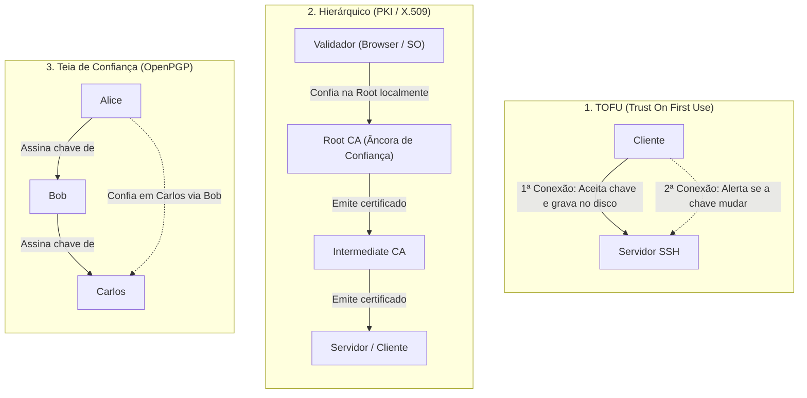
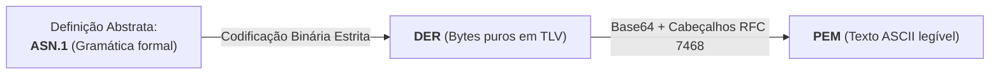
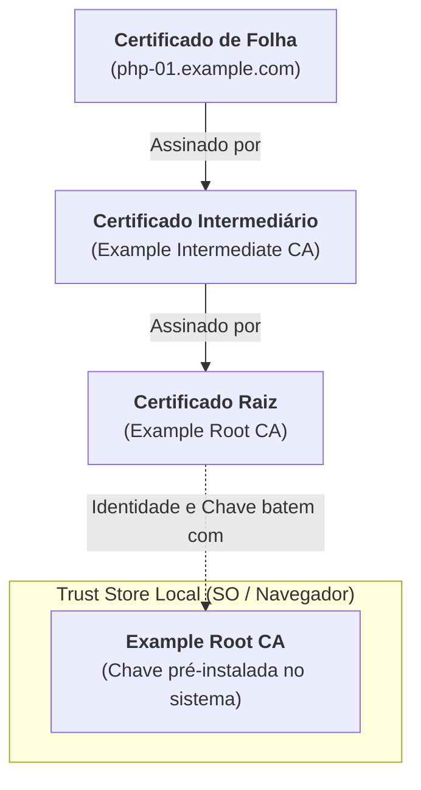

Quando publiquei o guia sobre , eu fiz questão de colocar um aviso bem chamativo logo nos primeiros parágrafos: certificados SSH não são X.509 (e a gente deveria agradecer aos deuses do Unix por isso todos os dias). Naquele momento, fugir do assunto foi pura autodefesa. O ecossistema do OpenSSH foi esperto o bastante pra criar um formato binário enxuto, sem firula, sem árvores genealógicas de CAs intermediárias e sem carregar o fardo jurássico dos comitês de telecomunicações dos anos 1980. Só que eu deixei uma promessa no ar: uma hora a gente teria que encarar a temida sopa de letrinhas do X.509 de frente (ASN.1, DER, PEM, CSR, SAN, EKU e todo aquele zoológico de extensões que faz sysadmin veterano chorar em posição fetal).

Pois é. Esse dia chegou. Acabou o recreio.

Goste você ou não dessa complexidade quase bizantina, o X.509 é o que impede a internet de virar uma feira livre de impersonação. Se você abre o app do banco no celular, espeta dois microsserviços conversando via mTLS, assina imagem de contêiner ou assiste os componentes do seu cluster Kubernetes trocarem telemetria, você está pisando no asfalto quente da Infraestrutura de Chaves Públicas (PKI). E quando essa engrenagem emperra às 23h de uma sexta-feira porque alguém esqueceu um certificado intermediário de pé quebrado no meio do caminho, não adianta rezar: você precisa saber exatamente o que está acontecendo ali dentro.

Neste primeiro capítulo da nossa trilogia, vamos abrir o capô do X.509 sem medo de sujar a mão de graxa criptográfica. Vamos entender por que a matemática pura é sumariamente burra quando o assunto é identidade, como os modelos de confiança do mercado se comparam de verdade, como um punhado de bytes em ASN.1 vira o bloco de texto que você cola no config do Nginx e como debugar uma cadeia inteira no terminal sem precisar apelar pra superstição.



## O Problema que Ninguém Resolve com Matemática Pura

Muita gente que tá começando na área (e um bocado de gerente que assistiu palestra de 15 minutos de vendedor de firewall) adora acreditar que a criptografia assimétrica, por si só, resolve qualquer parada no mundo da segurança. "Ah, se tem chave pública e chave privada, então a gente tá 100% blindado!".

Não tá. Sinto muito estragar o seu café.

A matemática das curvas elípticas ou do RSA entrega duas garantias espetaculares, inegáveis e elegantes: sigilo (só o dono da chave privada consegue decifrar o que cifraram com a chave pública dele) e autenticidade de origem (só quem tem a chave privada consegue gerar uma assinatura que a chave pública correspondente valida).

Mas tem uma pergunta cruel que a matemática se recusa terminantemente a responder: **de quem diabos é essa chave pública?**

A matemática é agnóstica a ponto de ser ingênua. Ela te entrega um ponto elegante numa curva elíptica ou um número primo monumental de 600 dígitos, olha pra sua cara e diz: "Os cálculos fecharam com precisão de nanossegundo, meu chefe!". Só que ela não faz a menor ideia se aquela sequência impecável de bits pertence ao servidor do seu internet banking ou a um adolescente entediado na Romênia que subiu um rogue access point no Wi-Fi da praça de alimentação do shopping. A matemática garante que a fechadura é indestrutível; ela só não sabe se quem acabou de te entregar a chave foi o chaveiro credenciado ou o próprio ladrão que arrombou a janela dos fundos.

Pensa no nosso clássico João (o desenvolvedor júnior que adora um atalho perigoso). O João abre o terminal e tenta se conectar no servidor `php-01.example.com`. Ele recebe uma chave pública pela rede. A chave é linda, perfeita, matematicamente irrepreensível. O handshake TLS roda liso, sem nenhum erro de paridade. O João agora tem um canal perfeitamente cifrado, íntegro e à prova de bisbilhoteiros com... alguém.

O problema é que esse "alguém" pode ser o Antônio (nosso QA pentester malandro) sentado no meio do caminho (*Man-in-the-Middle*, ou MITM). O Antônio interceptou os pacotes na rede local, entregou a própria chave pública pro João, abriu outra ponta cifrada com o servidor real e agora tá lendo cada senha e payload que o João envia enquanto toma um refrigerante e dá risada. Pro João, o terminal tá verde e os cálculos fecharam com louvor. A criptografia funcionou perfeitamente; a identidade foi pro ralo.

Antes de avançarmos para as soluções desse problema, precisamos alinhar três primitivas criptográficas essenciais e desmontar um mito perigoso que ainda sobrevive em apostilas antigas:

1. **Função Hash Criptográfica:** Um algoritmo determinístico unidirecional (como SHA-256 ou SHA-384) que transforma qualquer volume de dados em um resumo de tamanho fixo. Qualquer alteração em um único bit da entrada altera drasticamente o resumo resultante.
2. **Assinatura Digital:** A combinação do hash de uma mensagem com uma operação assimétrica usando a chave privada. Aqui vive o mito: *assinar digitalmente NÃO é cifrar o hash com a chave privada*. Essa analogia só fazia algum sentido didático no algoritmo RSA de livro didático da década de 1980. Em esquemas modernos de curvas elípticas (como ECDSA ou Ed25519), a assinatura é calculada através de equações algébricas dedicadas (geração de pontos na curva e números aleatórios efêmeros), e não por uma inversão da operação de cifragem. A assinatura prova autoria e integridade: quem tem a chave pública correspondente verifica o cálculo matemático, mas ninguém cifra ou decifra nada nesse processo.
3. **Troca de Chaves Efêmera:** Mecanismos como ECDHE (*Elliptic Curve Diffie-Hellman Ephemeral*). O cliente e o servidor geram pares temporários de chaves a cada conexão, trocam suas parcelas públicas e calculam um segredo compartilhado idêntico sem nunca transmitir esse segredo pela rede. Isso garante o sigilo para a frente (*Forward Secrecy*): mesmo que a chave de longo prazo do servidor seja roubada no futuro, gravações antigas de tráfego de rede não poderão ser decifradas retroativamente.

Com as primitivas alinhadas, voltamos ao dilema central: como vincular uma chave pública a um nome de máquina, endereço de e-mail ou ser humano no mundo real?

## Três Respostas para a Mesma Pergunta: Modelos de Confiança

A computação desenvolveu três abordagens consolidadas para associar chaves públicas a identidades. Cada uma reflete um conjunto particular de prioridades operacionais, custos de gestão e tolerância a riscos.



### 1. TOFU (Trust On First Use)
O modelo clássico do arquivo `known_hosts` do SSH. Na primeira vez que você acessa um servidor, o cliente avisa que a autenticidade do host não pôde ser confirmada e exibe o fingerprint da chave pública. Se você der "yes", o cliente confia cegamente naquela chave e a grava localmente no disco. 

Nas conexões subsequentes, o cliente exige que a chave recebida seja idêntica à gravada. O TOFU funciona muito bem para redes pequenas ou administradores cuidadosos, mas é vulnerável no instante exato do primeiro contato (se houver um MITM na primeira conexão, você grava a chave do atacante) e escala pessimamente em parques com centenas de servidores dinâmicos.

### 2. Modelo Hierárquico (PKI / X.509)
Em vez de confiar em cada servidor individualmente, você escolhe confiar previamente em uma entidade terceira respeitada: a Autoridade Certificadora (*Certificate Authority*, ou CA). 

A CA inspeciona a solicitação de uma entidade, confere se ela realmente tem o direito sobre aquele nome de domínio e carimba um documento digital (o certificado) ligando a chave pública ao nome do solicitante. Se o seu sistema operacional ou navegador já conhece e confia na chave pública da CA Raiz (*Root CA*), qualquer certificado assinado diretamente por ela, ou por uma cadeia de CAs intermediárias autorizadas por ela, herda essa confiança automaticamente. 

Mesmo o ecossistema de certificados SSH que exploramos anteriormente adota uma variante simplificada desse modelo: uma CA de um único nível que assina chaves de hosts e usuários.

### 3. Teia de Confiança (Web of Trust)
O modelo descentralizado concebido pelo PGP e padronizado pelo OpenPGP. Aqui inexiste a figura de uma autoridade central com poder supremo de homologação. Em vez disso, cada participante assina a chave pública dos seus conhecidos diretos após checar sua identidade pessoalmente. 

Se Alice confia na avaliação de Bob, e Bob assinou a chave de Carlos, Alice pode inferir que a chave de Carlos é autêntica. Embora seja filosoficamente elegante e imune ao controle governamental ou corporativo monopolista, a teia de confiança exige alto grau de maturidade técnica dos participantes e mostrou-se de difícil assimilação para o usuário comum em escala de massa.

Não existe almoço grátis em nenhum desses três caminhos. O TOFU é imediato (mas ingênuo na largada), a teia de confiança é democrática (mas quase ninguém fora da comunidade hacker consegue operar no dia a dia) e o modelo hierárquico é burocrático e engessado (mas é o único que sustenta o comércio eletrônico e a navegação mundial sem desabar a cada cinco minutos). E como a Web e as empresas abraçaram o modelo hierárquico, é nele que vamos nos aprofundar.

## O que É, de Fato, uma PKI

Uma **Infraestrutura de Chaves Públicas** (*Public Key Infrastructure*, ou PKI) costuma ser confundida com os próprios certificados que ela cospe. Dizer que PKI é um diretório cheio de arquivos `.crt` é a mesma coisa que dizer que o sistema judiciário é um monte de folha sulfite com carimbo do cartório. O arquivo é só o pedaço de papel digital; a mágica (e a burocracia infernal) está em toda a estrutura institucional e operacional ao redor que garante que aquele carimbo tem fé pública e que bota medo em quem tentar falsificar.

Uma PKI é um ecossistema abrangente composto por pessoas, políticas formais, governança, procedimentos de auditoria, hardware criptográfico e sistemas de software dedicados a emitir, distribuir, renovar e revogar identidades digitais.

Dentro de uma arquitetura PKI tradicional, diversos papéis bem definidos operam em conjunto:

- **Autoridade Certificadora (CA - Certificate Authority):** A chefe da operação. É a entidade que atesta a identidade de terceiros. Sua função principal e sagrada é assinar digitalmente certificados e Listas de Revogação de Certificados (CRLs) utilizando sua chave privada de altíssima criticidade.
- **Autoridade de Registro (RA - Registration Authority):** O balcão de atendimento e conferência. É quem checa se o solicitante realmente tem legitimidade sobre a identidade declarada (por exemplo, conferindo se você realmente manda na zona DNS daquele domínio). A RA valida as credenciais, mas não toca na caneta de assinar; ela apenas aprova o pedido e encaminha pra CA emitir. Em ferramentas menores (como o nosso lab com OpenSSL), CA e RA vivem juntas no mesmo script.
- **Autoridade de Validação (VA - Validation Authority):** O serviço público responsável por responder se um certificado específico ainda presta ou se foi cancelado antes do vencimento. Tradicionalmente opera através de responders OCSP (*Online Certificate Status Protocol*) ou servidores HTTP servindo arquivos de CRL.
- **Assinante (Subscriber):** A entidade (o servidor web, o desenvolvedor, o contêiner ou o roteador) que gerou um par de chaves e recebeu o certificado assinado pela CA.
- **Parte Confiante (Relying Party):** O software que recebe o certificado na outra ponta (o navegador do visitante, o seu script Python com `requests`, o `curl`) e decide se confia no que recebeu ou se cospe um erro vermelho na cara do usuário.

Para que uma CA não vire a casa da mãe Joana, organizações formais documentam cada mínimo detalhe de seus processos através de dois calhamaços técnicos definidos pela RFC 3647[^1]: a **Declaração de Práticas de Certificação** (*Certification Practice Statement* - CPS) e a **Política de Certificados** (*Certificate Policy* - CP). É ali que a CA jura solenemente desde o nível de blindagem física do cofre onde guarda a chave até quais algoritmos aceita processar.

No mundo selvagem da Web pública (a famosa *Web PKI*), as regras do jogo são ditadas pelo **CA/Browser Forum** (CA/B Forum). Trata-se de um consórcio onde representantes da Google, Apple, Mozilla, Microsoft e as maiores CAs comerciais do planeta se reúnem para aprovar as *Baseline Requirements*[^2]. São eles que decidem as diretrizes mundiais de segurança (e que adoram aprovar reduções drásticas na validade máxima dos certificados apenas para ver os engenheiros de DevOps correrem atrás de automação). Se uma CA pisar na bola ou emitir certificados fora do padrão, os fabricantes dos navegadores simplesmente removem a chave raiz dela da noite pro dia, destruindo o negócio da empresa em escala planetária.

## Anatomia de um Certificado X.509 v3

O formato de certificado que usamos hoje é o **X.509 versão 3**, padronizado para a Internet pela RFC 5280[^3]. 

A primeira vez que alguém digita `openssl x509 -text` no terminal e vê duzentas linhas de texto hermético rolando na tela, a reação quase universal é de susto. Parece que um modem dial-up dos anos 1990 sofreu um infarto e cuspiu os registradores de memória na sua cara:

```bash
$ openssl s_client -connect example.com:443 -showcerts </dev/null 2>/dev/null | openssl x509 -noout -text
```

Mas respire com calma. Se você separar o joio do trigo, a anatomia de qualquer certificado X.509 v3 resume-se a apenas três blocos fundamentais:

```text
Certificate
├── Data (tbsCertificate - "To Be Signed")
│   ├── Version (v3)
│   ├── Serial Number
│   ├── Signature Algorithm
│   ├── Issuer (Quem emitiu e assinou)
│   ├── Validity (notBefore / notAfter)
│   ├── Subject (Quem é o dono)
│   ├── Subject Public Key Info (Algoritmo e bytes da chave pública)
│   └── X509v3 extensions (Políticas, SAN, EKU, restrições)
├── Signature Algorithm (Qual algoritmo a CA usou pra assinar)
└── Signature Value (A assinatura criptográfica da CA sobre o bloco Data)
```

Olha a lógica engenhosa desse arranjo: o miolo principal chama-se formalmente `tbsCertificate` (abreviação carinhosa de *To Be Signed*, ou "dados a serem assinados"). A CA junta os dados de identidade, as datas de vigência, a chave pública do titular e a lista de extensões técnicas dentro desse grande bloco de dados. 

Em seguida, a CA calcula o hash criptográfico desse bloco inteiro e aplica sua chave privada sobre o resultado. O valor gerado é anexado no final do arquivo como `Signature Value`. 

Quem recebe esse certificado só precisa recalcular o hash daquele mesmo bloco `Data` e conferir se a conta fecha com a chave pública da CA. Se um invasor tentar alterar uma única letra do Subject ou esticar a data de validade por um segundo sequer, o hash muda e a assinatura quebra na hora.

Vamos aos campos que realmente importam no dia a dia:

- **Version:** Quase invariavelmente `3 (0x2)`. A versão 1 original dos anos 1980 não suportava extensões customizadas (era rígida demais); a versão 2 tentou introduzir identificadores legados que ninguém usou; a versão 3 finalmente acertou na flexibilidade e é o padrão absoluto do TLS moderno.
- **Serial Number:** O número de série único atribuído pela CA. O CA/B Forum exige que ele contenha ao menos 64 bits de pura entropia aleatória, pra evitar que atacantes explorem colisões de hash forjando seriais previsíveis.
- **Issuer:** O nome completo da Autoridade Certificadora que assinou o documento.
- **Validity:** Duas marcas de tempo implacáveis: `Not Before` (a partir de quando vale) e `Not After` (quando vira abóbora).
- **Subject:** O nome da entidade dona do certificado.
- **Subject Public Key Info:** Especifica o algoritmo matemático (ex.: `id-ecPublicKey` com curva `secp384r1`, ou o velho `rsaEncryption`) e carrega os bytes da chave pública.
- **X509v3 extensions:** Onde reside toda a inteligência e as regras de negócio modernas.

## ASN.1, DER, PEM e o Zoológico de Formatos

Se tem uma coisa capaz de deflagrar discussões homéricas em canais de Slack de infraestrutura é o zoológico de extensões: `.crt`, `.pem`, `.cer`, `.key`, `.der`, `.p12`, `.pfx`. 

Quem nunca viu um desenvolvedor pegar um arquivo binário `.der`, renomear no desespero pra `.crt` e depois abrir chamado jurando de pés juntos que o Nginx "enlouqueceu e não lê mais certificados"? (Por favor, não faça isso).

Pra gente não se perder nessa floresta, precisamos separar claramente duas coisas distintas: a **notação abstrata dos dados** e a **codificação física em disco**[^4].



### ASN.1 (Abstract Syntax Notation One)
Desenvolvido em 1984 pela ITU-T, o ASN.1 é uma linguagem formal para modelar estruturas de dados independentemente de plataforma, sistema operacional ou endianness de processador. A RFC 5280 descreve a estrutura de um certificado X.509 inteiramente em ASN.1. 

Pense no ASN.1 como o tataravô do Protocol Buffers ou do JSON Schema: ele define que tipos de campos existem e como eles se relacionam, mas não se mete em como os bits serão gravados no HD.

### DER (Distinguished Encoding Rules)
Se o ASN.1 é o projeto da casa, o DER é a alvenaria. O DER define as regras matemáticas estritas para transformar aquela estrutura abstrata do ASN.1 em uma sequência de bytes no disco. Ele opera no modelo canônico **TLV** (*Tag - Length - Value*):
- **Tag:** Um byte que identifica o tipo do dado (ex.: `0x02` pra INTEGER, `0x06` pra OBJECT IDENTIFIER, `0x30` pra SEQUENCE).
- **Length:** Quantos bytes o valor ocupa.
- **Value:** Os bytes da carga útil propriamente dita.

O DER é determinístico e inequívoco: um mesmo objeto ASN.1 sempre resultará rigorosamente nos mesmos bytes sob DER. E é exatamente por isso que a assinatura digital é calculada sobre os bytes brutos em DER. 

Se bater a curiosidade mórbida de enxergar as entranhas binárias de um certificado, você pode pedir pro OpenSSL dissecar a árvore TLV:

```bash
$ openssl asn1parse -in certificado.pem -i | head -n 20
```

A flag `-i` indenta os níveis hierárquicos, mostrando visualmente as caixas dentro de caixas que compõem o arquivo.

### PEM (Privacy-Enhanced Mail)
Arquivos binários DER são ótimos pra computadores, mas um pesadelo pra humanos. Você não consegue copiar um arquivo binário via terminal, colar numa issue do Jira, embutir num arquivo YAML de Secret do Kubernetes ou mandar no corpo de um e-mail sem corromper caracteres de controle.

Na década de 1990, criaram o formato **PEM** (formalizado na RFC 7468[^5]): pegamos os bytes em DER, codificamos tudo em texto Base64, quebramos em linhas de 64 caracteres e colocamos cabeçalhos claros avisando onde começa e onde termina:

```text
-----BEGIN CERTIFICATE-----
MIIB/zCCAaWgAwIBAgIUWVH0YKPJ2JmOdxRAWFCTy20BHmMwCgYIKoZIzj0EAwIw
... (conteúdo em Base64) ...
q/f5tqjgXQ==
-----END CERTIFICATE-----
```

### O Guia Definitivo de Extensões de Arquivo

Pra você imprimir, colar na parede do data center e nunca mais se confundir:

| Extensão | Codificação Típica | O que realmente tem dentro |
|---|---|---|
| `.pem` | Texto (Base64) | Qualquer coisa envelopada com `-----BEGIN ...-----` (certificados, chaves privadas, CSRs, bundles). |
| `.crt` / `.cer` | Texto ou Binário | Quase sempre um certificado público X.509. No ecossistema Linux/Unix quase sempre é texto PEM; no Windows e em appliances antigos frequentemente é DER binário. |
| `.key` | Texto (Base64) | Chave privada (geralmente em formato PEM). Mantenha as permissões desse cara em `chmod 600` ou chore mais tarde. |
| `.csr` | Texto (Base64) | Requisição de Assinatura de Certificado (*Certificate Signing Request*, PKCS#10). É o que você manda pra CA carimbar. |
| `.der` | Binário puro | Dados X.509 ou chaves em codificação DER bruta, sem conversão Base64. |
| `.p12` / `.pfx` | Binário puro | Formato **PKCS#12**[^6]. Um contêiner protegido por senha que empacota a chave privada, o certificado da folha e toda a cadeia intermediária num pacote só. Padrão pra instalar certificados de clientes em browsers. |
| `.p7b` / `.p7c` | Texto ou Binário | Formato **PKCS#7** (CMS). Usado pra transportar cadeias inteiras de certificados públicos, sem carregar chaves privadas. |

> [!NOTE] A Extensão Não Altera a Realidade
> No Linux, extensões de arquivo são apenas rótulos amigáveis pra humanos. Se você renomear `meu-servidor.crt` para `meu-servidor.pastel`, pro Nginx e pro OpenSSL não faz a menor diferença. O software inspeciona os bytes iniciais do arquivo e descobre na hora se está lidando com texto PEM ou binário DER.

### O Zoológico das Chaves Privadas
Até as chaves privadas têm seus próprios dialetos de cabeçalho:
- `BEGIN RSA PRIVATE KEY`: Formato legado **PKCS#1**, exclusivo de RSA das antigas.
- `BEGIN EC PRIVATE KEY`: Formato **SEC1**, específico de curvas elípticas legadas.
- `BEGIN PRIVATE KEY`: Formato moderno **PKCS#8** (RFC 5958[^7]) sem senha. É o padrão do OpenSSL 3.x pra qualquer algoritmo moderno.
- `BEGIN ENCRYPTED PRIVATE KEY`: Formato **PKCS#8** protegido por senha usando algoritmos de derivação de chave.

## Distinguished Names e o Fim do Common Name

Nos primórdios do X.509, a identificação das máquinas e pessoas foi emprestada do modelo de diretórios **X.500** de 1988 (o tataravô do LDAP). O sujeito era identificado por um **Distinguished Name** (DN), uma sequência de atributos com sabor burocrático de repartição pública:

```text
/C=BR/ST=Sao Paulo/L=Sao Paulo/O=Example Corp/OU=Engenharia/CN=php-01.example.com
```

Os campos clássicos representavam:
- `C` (*Country*): País ISO de 2 letras (BR).
- `ST` (*State*): Estado ou UF.
- `L` (*Locality*): Cidade.
- `O` (*Organization*): Nome da empresa.
- `OU` (*Organizational Unit*): Departamento interno.
- `CN` (*Common Name*): Nome comum de identificação.

Historicamente, todo mundo colocava o hostname do servidor no campo `Common Name` (ex.: `CN=www.example.com`). E durante anos, isso funcionou. 

Só que a Web explodiu. Um mesmo servidor passou a atender dez domínios diferentes, balancear tráfego por múltiplos hostnames e responder por endereços IP literais. O pobre do `Common Name` só aceitava uma única string simples, com limite arbitrário de 64 caracteres e sem nenhuma tipagem que dissesse se aquilo era um DNS, um IP ou o apelido do cachorro do administrador.

A RFC 6125 e a recente **RFC 9525**[^8] decretaram o óbito formal: **o Common Name foi sumariamente depreciado para validação de nomes de domínio e deve ser solenemente ignorado pelos clientes TLS**.

Em 2017, o Google Chrome 58 chegou chutando a porta: se o certificado não tivesse a extensão SAN preenchida, o navegador simplesmente recusava a conexão com tela vermelha de aviso, mesmo que o CN estivesse perfeito. Foi um festival de intranets e portais internos quebrando numa segunda-feira de manhã porque ninguém lia as RFCs.

> [!IMPORTANT] Onde o CN e o O Ainda Mandam no Pedaço
> Embora o Common Name tenha sido banido da validação de domínios na Web, ele continua vivíssimo na infraestrutura interna de muita ferramenta moderna. No Kubernetes, por exemplo, o `kube-apiserver` não usa o CN como hostname; ele usa o campo `CN` para identificar o nome do usuário chamador (ex.: `CN=admin`) e usa os campos `O` (*Organization*) para atribuir os grupos de acesso no RBAC (ex.: `O=system:masters`). O CN perdeu a vaga de hostname, mas virou crachá de controle de acesso.

## Extensões X.509: Onde Mora a Política

A versão 3 do X.509 introduziu a seção de extensões, que transformou certificados de meros crachás de cartório em regras ativas de tráfego e política de segurança.

O X.509 versão 1 original era inocente demais. Ele basicamente dizia: "Essa chave pública pertence ao João e eu, a CA, confirmo isso". Ponto final. Não havia nenhum mecanismo pra dizer se o João era um servidor web, um usuário humano ou se ele tinha poderes pra sair emitindo certificados pra empresa inteira no almoço de domingo. Aí veio a versão 3 e disse: "Chega de anarquia, vamos botar rédeas e regras duras aqui dentro".

Toda extensão possui três elementos fundamentais: um identificador de objeto numérico único (OID), uma flag booleana de criticidade (`critical`) e o valor da extensão codificado em DER binário.

A regra de ouro da criticidade é simples e impiedosa: **se uma extensão estiver marcada como `critical` e o validador não reconhecer ou não souber como processar aquele OID específico, ele DEVE obrigatoriamente abortar e rejeitar o certificado inteiro**. 

Esse comportamento é o exato equivalente às *Critical Options* dos certificados SSH que estudamos no post passado: se uma opção crítica não for honrada, a conexão cai antes de começar.

Vejamos as principais extensões padronizadas pela RFC 5280:

### 1. basicConstraints
A extensão que impede o estagiário de virar uma Autoridade Certificadora global por engano:
```ini
basicConstraints = critical, CA:true, pathlen:0
```
- Se `CA:false` (ou se for omitida), o certificado é uma folha final de aplicação (*end-entity*) e não pode assinar absolutamente nada.
- Se `CA:true`, a entidade tem poderes divinos de CA para assinar outros certificados.
- O parâmetro opcional `pathlen` é a coleira de profundidade. Um `pathlen:0` em uma CA Intermediária significa: "você pode emitir certificados para os nossos servidores e clientes finais, mas se tentar bancar a mãe de outra CA abaixo de você, a cadeia inteira desmorona com erro de validação".

### 2. keyUsage
Restringe os propósitos criptográficos fundamentais daquela chave:
- `digitalSignature`: Autoriza o uso da chave para assinar mensagens e trocas efêmeras (essencial para servidores e clientes modernos com ECDSA).
- `keyCertSign`: Obrigatório para CAs, autoriza a assinar certificados subordinados.
- `cRLSign`: Obrigatório para quem gera Listas de Revogação de Certificados (CRLs).
- `keyEncipherment`: Usado historicamente para permitir que um cliente cifre um segredo diretamente com a chave pública do servidor. Esta extensão é comum em certificados RSA antigos, mas **deve ser sumariamente omitida** em certificados modernos baseados em curvas elípticas (ECDSA). Por que? Porque no TLS moderno a gente não cifra dados com chave pública; a gente assina e negocia segredos efêmeros com ECDHE. Colocar `keyEncipherment` em certificado ECDSA é atestado formal de que você copiou um snippet mofado do StackOverflow de 2011 sem saber o que estava fazendo.

### 3. extendedKeyUsage (EKU)
Refina o escopo de aplicação prática do certificado no nível da camada de transporte ou aplicação:
- `serverAuth`: Autenticação de servidor web/TLS (o servidor prova quem é pro cliente).
- `clientAuth`: Autenticação mútua de cliente (mTLS: o usuário ou agente prova quem é pro servidor).
- `codeSigning`: Assinatura digital de binários, drivers ou pacotes de código.
- `OCSPSigning`: Autoriza um responder OCSP a assinar respostas de status em nome de uma CA.

> [!NOTE] A Virada de 2025/2026 na Web PKI
> Em maio de 2025, a Let's Encrypt puxou o freio de mão e encerrou a farra: nada mais de `clientAuth` nas folhas públicas gratuitas emitidas por ela[^9]. A decisão foi técnica e protetiva: certificado público automatizado existe pra colocar cadeado verde em site perante o público geral, e não pra servir de crachá de autenticação interna de microsserviços corporativos. Com essa mudança, quem quiser fazer mTLS sério entre serviços internos precisa arregaçar as mangas e gerenciar sua própria PKI privada (que é exatamente o laboratório que vamos construir no próximo post).

### 4. subjectAltName (SAN)
O substituto obrigatório e oficial do Common Name. Permite empilhar uma lista inteira de identidades válidas em um mesmo certificado:
- Entradas DNS (`DNS:php-01.example.com`, `DNS:*.example.com`).
- Endereços IP literais (`IP:10.0.0.10`, `IP:192.168.1.1`).
- Endereços de e-mail (`email:joao@example.com`).
- Identificadores URI padronizados (`URI:urn:uuid:f81d4fae-7dec-11d0-a765-00a0c91e6bf6` ou URLs SPIFFE em service meshes).

### 5. subjectKeyIdentifier (SKI) e authorityKeyIdentifier (AKI)
A linha e a agulha que costuram a cadeia de confiança de forma determinística. 

O `subjectKeyIdentifier` armazena um hash (geralmente SHA-1 ou SHA-256) da chave pública daquele certificado. 

Quando esse certificado emite e assina uma folha subordinada, a folha recebe um `authorityKeyIdentifier` exatamente com o mesmo valor de hash da chave da CA mãe. Quando o validador percorre a cadeia, ele usa o AKI para cravar sem pestanejar qual CA assinou aquele elo, eliminando qualquer dúvida se houver mais de um certificado com o mesmo nome emitido pela empresa.

### 6. nameConstraints
A extensão mais poderosa e criminosamente subestimada em infraestruturas corporativas. Permite que uma CA Raiz delegue autoridade para uma CA Intermediária, mas coloque uma cerca elétrica ao redor do que aquela subordinada pode emitir. 

Uma CA com `nameConstraints = critical, permitted;DNS:.example.com` só tem poder de assinar certificados para domínios que terminem estritamente em `.example.com`. Se essa CA intermediária for comprometida ou se alguém lá dentro tentar emitir um certificado desonesto para `google.com` ou `banco.com`, qualquer navegador ou validador rejeitará o certificado imediatamente com o erro `permitted subtree violation`.

### 7. crlDistributionPoints e authorityInfoAccess
Ponteiros de rede que indicam onde a parte confiante pode obter informações dinâmicas sobre o ciclo de vida do certificado:
- `crlDistributionPoints` (CDP): A URL HTTP onde o validador baixa a lista binária de certificados revogados mais recente daquela autoridade.
- `authorityInfoAccess` (AIA): Carrega a URL do servidor OCSP para consultas instantâneas e o endereço para download do certificado da CA emissora intermediária (facilitando a vida de clientes quando o servidor esquece de enviar a cadeia completa).

## A Cadeia de Confiança e a Validação de Caminho

Como um computador decide se confia no certificado que acabou de receber de um servidor remoto? Através do algoritmo de **Validação de Caminho de Certificação** (*Certification Path Validation Algorithm*), formalizado na seção 6 da RFC 5280.



O processo opera em duas etapas distintas:

1. **Construção do Caminho (Path Building):** O cliente recebe o certificado do servidor e inspeciona quem é o emissor (`Issuer` e `AKI`). Ele procura esse emissor na lista de intermediárias entregues pelo servidor ou em seu cache local. O processo se repete recursivamente até encontrar uma **Âncora de Confiança** (*Trust Anchor*), que é um certificado gravado previamente na sua *Trust Store* local.
2. **Validação do Caminho (Path Validation):** Encontrada a âncora, o validador percorre o caminho de volta, nó a nó, da raiz até a folha, checando uma série implacável de regras:
   - A data atual está rigorosamente dentro do intervalo `notBefore` e `notAfter` de cada nó?
   - A assinatura criptográfica de cada certificado foi realmente gerada pela chave pública do nó pai?
   - A extensão `basicConstraints` do nó intermediário declara `CA:true`? O limite de profundidade `pathlen` foi respeitado?
   - O `keyUsage` da autoridade contém a permissão `keyCertSign`?
   - As restrições de nomes (`nameConstraints`) foram violadas por algum nó abaixo?
   - O certificado da folha atende aos propósitos do cliente (ex.: possui `serverAuth` em um acesso HTTPS)?
   - O hostname ou IP requisitado está explicitamente coberto pelo `subjectAltName` da folha?
   - Algum nó da cadeia consta como revogado via CRL ou OCSP?

Se todas as verificações forem satisfeitas, a cadeia é declarada válida. Se uma única checagem falhar em qualquer nó intermediário, a conexão é sumariamente interrompida.

### O Paradoxo da Assinatura da Root CA
Você já parou pra pensar nisso com calma? A Root CA emite um certificado autoassinado. Ela mesma assina a si própria. Ela olha no espelho, bate no próprio peito e diz: "Eu confio em mim mesma e ponto final!". 

Do ponto de vista puramente matemático, qualquer pessoa com um computador portátil gera uma chave privada e emite um certificado autoassinado declarando-se "Autoridade Suprema da Galáxia" em exatos três segundos.

Por que o seu navegador cospe fogo na tela se você tentar usar uma Root dessas em um site, mas aceita a Root da Let's Encrypt ou da DigiCert de braços abertos?

Porque a assinatura de uma Root CA é matematicamente irrelevante para a confiança. **A confiança na Root não decorre de cálculos criptográficos, mas de um ato político e social prévio**: a chave pública daquela autoridade passou por auditorias caras, foi homologada e incluída fisicamente dentro do pacote de certificados confiáveis do seu sistema operacional ou navegador. Uma Âncora de Confiança é confiável porque alguém com autoridade sobre aquele computador decidiu gravá-la lá antes de você iniciar a conexão.

No Linux Debian, esse repositório global fica consolidado no diretório `/etc/ssl/certs/` e é gerenciado pelo pacote `ca-certificates`. No Firefox, a Mozilla mantém seu próprio repositório interno de raízes dentro do motor NSS, desacoplado do sistema operacional.

## Servidores Web na Prática: Nginx, Apache e a Anatomia do Bundle

Toda essa teoria de validação de caminho culmina em um momento muito pragmático: a hora em que você abre o arquivo de configuração do seu servidor web (Nginx, Apache, Envoy, Traefik ou Caddy) e precisa indicar onde estão os arquivos criptográficos.

E é exatamente aqui que muita gente boa se perde, vítima de duas décadas de tutoriais desatualizados, nomes de diretivas ambíguos e arquivos com nomes misteriosos como `gs_root.pem` ou `ca-bundle.crt`.

### A Anatomia do Arquivo de Cadeia (fullchain.pem)

Quando você solicita um certificado para a Web (seja via Let's Encrypt ou comprando de uma autoridade comercial), você nunca recebe apenas um arquivo solto. Você lida com três peças:

1. **A Chave Privada (`privkey.pem` ou `.key`):** O segredo sagrado que nunca sai do servidor. Mantenha em `chmod 600`.
2. **O Certificado de Folha (`cert.pem`):** O certificado emitido especificamente para o seu domínio (`php-01.example.com`).
3. **Os Certificados Intermediários (`chain.pem`):** Os elos emitidos pela Root CA que autorizam a autoridade intermediária a assinar a sua folha.

Para que o navegador do visitante consiga construir o caminho até a âncora de confiança, o servidor web precisa entregar a folha e os intermediários juntos no mesmo handshake TLS. Isso é feito concatenando os arquivos em um único bloco de texto PEM:

```text
-----BEGIN CERTIFICATE-----
(Certificado da Folha: php-01.example.com)
-----END CERTIFICATE-----
-----BEGIN CERTIFICATE-----
(Certificado da Autoridade Intermediária)
-----END CERTIFICATE-----
```

> [!IMPORTANT] A Ordem dos Fatores Altera o Produto
> A ordem dentro do arquivo concatenado (`fullchain.pem`) é estrita e mandatória: **o certificado da sua folha DEVE ser o primeiro bloco do arquivo**. Os certificados intermediários vêm logo em seguida, na ordem hierárquica (intermediária emissora direta primeiro, intermediárias superiores depois). Se você inverter e colocar a intermediária no topo do arquivo, o Nginx não adivinha: ele tentará negociar a chave privada do seu domínio contra a chave pública da intermediária, falhando na inicialização com erro de incompatibilidade de par de chaves.

> [!WARNING] O Que Vai no Pacote: Por Que Você NUNCA Deve Enviar a Root CA no Servidor Web
> Se a cadeia de confiança precisa chegar até a Root CA para ser válida, por que ferramentas conceituadas como o SSL Labs da Qualys reclamam com *"Chain issues: Contains anchor"* e tiram pontos da sua avaliação se você incluir o certificado da raiz no arquivo de certificados do seu servidor web?
> 
> "Ué, Dudu, estão me enganando? Se o navegador precisa da raiz para validar o caminho, por que eu não posso mandar ela junto no pacote?".
> 
> A resposta é direta: **porque mandar a Root CA pela rede é completamente inútil e desperdiça banda**. Lembre-se da regra de ouro: uma Âncora de Confiança só tem valor se ela já estiver previamente gravada na Trust Store local da máquina do visitante. Se o cliente já tem a raiz instalada no sistema operacional, você acabou de gastar kilobytes preciosos do handshake TLS à toa para entregar algo que ele já possui. E se o cliente NÃO tem essa raiz instalada previamente, receber a chave da raiz enviada pelo próprio servidor suspeito não gera um pingo de confiança (um atacante sentado no meio da rede poderia simplesmente cuspir a própria raiz forjada e dizer: "olha aqui, pode confiar em mim!").
> 
> O pacote entregue pelo servidor web (o seu arquivo `fullchain.pem` no Nginx ou Apache) deve conter **estritamente o certificado da folha seguido das CAs intermediárias**. A raiz fica quieta na máquina do cliente, jamais viajando pelo fio sem necessidade.

### A Grande Pegadinha do Apache: SSLCACertificateFile vs SSLCertificateFile

Se você já configurou o módulo `mod_ssl` do Apache, provavelmente já se deparou com a diretiva `SSLCACertificateFile` e pensou: *"Pronto! É aqui que eu digo pro Apache qual é o certificado da CA do meu domínio!"*.

Não faça isso. Esse é um dos maiores mal-entendidos operacionais da história da infraestrutura.

O Apache separa categoricamente duas coisas: **o que o servidor apresenta para provar quem ele é** versus **o que o servidor exige para deixar alguém entrar**.

1. **`SSLCertificateFile` (O que você apresenta ao mundo):**
   Nas versões modernas do Apache (>= 2.4.8), esta é a única diretiva necessária para certificados. Você aponta diretamente para o seu bundle concatenado (`fullchain.pem`), exatamente igual ao `ssl_certificate` do Nginx:
   ```apache
   SSLCertificateFile    /etc/ssl/certs/php-01.fullchain.pem
   SSLCertificateKeyFile /etc/ssl/private/php-01.key
   ```
2. **`SSLCACertificateFile` (A lista de quem você autoriza em mTLS):**
   Esta diretiva **NÃO serve para enviar certificados para o visitante**. Ela configura a *Trust Store* interna do Apache para validar **certificados de clientes** quando você exige autenticação mútua (mTLS com `SSLVerifyClient require`). Se você colocar a CA da Web ali em um site comum, não serve para absolutamente nada; e se você ligar a verificação de cliente por engano, ninguém mais conseguirá abrir o seu site.
3. **O fantasma do `SSLCertificateChainFile` (Apache < 2.4.8):**
   Em versões antigas do Apache (início dos anos 2010), o `SSLCertificateFile` só aceitava o certificado da folha. Para enviar as intermediárias, existia uma diretiva separada chamada `SSLCertificateChainFile`. Naquela época, autoridades como a GlobalSign ou Comodo forneciam pacotes chamados `gs_root.pem` ou `ca-bundle.crt` que continham a intermediária misturada com a raiz. Milhares de tutoriais na internet mandavam apontar o `SSLCertificateChainFile` para esse arquivo, e o Apache passava a cuspir a raiz na rede sem necessidade (disparando o aviso do SSL Labs). Essa diretiva foi formalmente depreciada.

### Onde a Raiz Realmente Entra: OCSP Stapling e Proxy Reverso

Se a Root CA não deve viajar no bundle entregue ao usuário, em quais situações um servidor web precisa conhecer um certificado raiz? Em duas situações operacionais bem específicas:

- **OCSP Stapling (`ssl_trusted_certificate` no Nginx):** Quando você ativa o grampeamento de OCSP, o próprio Nginx conecta no responder da CA em segundo plano para obter o comprovante de que o certificado não foi revogado. Para que o Nginx tenha certeza de que a resposta do OCSP não foi forjada por um atacante antes de repassá-la aos visitantes, ele mesmo precisa validar a cadeia do OCSP localmente. No Nginx, você aponta para a raiz (ou cadeia completa) com `ssl_trusted_certificate /etc/ssl/certs/root.crt`. Note a sutileza: o Nginx usa esse arquivo internamente para conferir a resposta; ele não envia esse arquivo para os clientes HTTPS.
- **Apache/Nginx como Proxy Reverso para Backends Internos:** Quando o seu servidor web recebe HTTPS do público e despacha a requisição via HTTPS para outro microsserviço interno (`proxy_pass https://backend.interno` ou `ProxyPass https://...`), ele troca de papel: ele deixa de ser o servidor e passa a atuar como **cliente TLS**. Para que ele confie no certificado do backend interno (assinado pela PKI privada da empresa), você precisa configurar `SSLProxyCACertificateFile` (no Apache) ou `proxy_ssl_trusted_certificate` (no Nginx).

### Tabela Comparativa de Diretivas de Servidores Web

Para fixar de vez no seu checklist de implantação:

| Finalidade Operacional | Nginx | Apache (>= 2.4.8) | O que colocar no arquivo |
|---|---|---|---|
| **Certificado do Site + Intermediárias** | `ssl_certificate` | `SSLCertificateFile` | Folha primeiro, depois intermediárias (NUNCA a raiz). |
| **Chave Privada do Site** | `ssl_certificate_key` | `SSLCertificateKeyFile` | Chave privada correspondente (`chmod 600`). |
| **Validação de Clientes (mTLS)** | `ssl_client_certificate` | `SSLCACertificateFile` | A CA raiz/intermediária que emitiu os crachás dos clientes permitidos. |
| **Validação para OCSP Stapling** | `ssl_trusted_certificate` | Bundle de CA do SO | Certificado raiz + intermediárias para o servidor validar o responder. |
| **Confiança em Proxy Reverso (Backend)** | `proxy_ssl_trusted_certificate` | `SSLProxyCACertificateFile` | A CA raiz que assinou os certificados dos microsserviços internos. |

## Algoritmos Criptográficos: RSA, ECDSA e o Paradoxo do Ed25519

Ao desenhar uma PKI moderna, a escolha do algoritmo de chave afeta diretamente a segurança, o consumo de CPU durante os handshakes e o tamanho dos pacotes de rede transmitidos.

O NIST (na recomendação SP 800-57[^10]) define níveis de segurança criptográfica equivalentes:

| Algoritmo | Tamanho da Chave | Nível de Segurança Estimado | Desempenho Relativo de Assinatura |
|---|---|---|---|
| **RSA** | 2048 bits | 112 bits | Lento para assinar, rápido para verificar |
| **RSA** | 3072 bits | 128 bits | Muito pesado para assinaturas em volume |
| **RSA** | 4096 bits | ~140 bits | Extremamente oneroso para CPUs |
| **ECDSA** (P-256) | 256 bits | 128 bits | Muito rápido, chaves minúsculas |
| **ECDSA** (P-384) | 384 bits | 192 bits | Excelente balanceamento para CAs e raízes |
| **Ed25519** | 256 bits | 128 bits | Desempenho de topo e imune a timing attacks |

### O Paradoxo do Ed25519: Por que a Recomendação Muda?
Eu sei exatamente o que você deve estar berrando contra a tela agora: "Peraí, Eduardo! Você passou o post inteiro de SSH me convencendo a tatuar Ed25519 no braço, e agora vem me dizer que no X.509 eu tenho que usar ECDSA?! Você virou a casaca?".

Calma. Guarda a tocha e o ancinho que eu explico a treta política do ecossistema.

Não se trata de limitação matemática. A RFC 8410[^11] padronizou formalmente identificadores de algoritmo para o uso de Ed25519 e Ed448 em certificados X.509, e bibliotecas como o OpenSSL suportam a criação dessas folhas perfeitamente. 

O obstáculo reside no **ecossistema público de partes confiantes**. As normas de base do CA/Browser Forum e os programas de raiz da Mozilla, Google e Microsoft não autorizam a emissão e validação irrestrita de certificados TLS públicos com chaves Ed25519 para a Web geral. A imensa maioria dos navegadores web, clientes embutidos em hardwares legados e stacks TLS de linguagens de programação históricas foram construídos e testados para validar exclusivamente certificados RSA e curvas elípticas NIST (secp256r1/secp384r1).

Em uma PKI estritamente privada, onde você controla 100% dos clientes e servidores, o uso de Ed25519 é viável. Mas para qualquer arquitetura híbrida ou que precise dialogar com ferramentas padrão da indústria, a curva **ECDSA P-384** (para autoridades) e **ECDSA P-256** (para serviços e agentes) é o padrão de excelência consensual: entrega segurança de alto nível, consome frações do processamento do RSA antigo e garante compatibilidade universal sem quebrar o cliente de ninguém.

## X.509 vs Certificados SSH vs OpenPGP

Para consolidar o modelo mental da série, a tabela a seguir estabelece o paralelo definitivo entre os três ecossistemas de confiança baseados em criptografia assimétrica:

| Dimensão de Comparação | PKI / X.509 (TLS) | Certificados OpenSSH | Web of Trust (OpenPGP) |
|---|---|---|---|
| **Modelo de Confiança** | Hierárquico recursivo (Root -> Intermediárias -> Folhas) | Hierárquico plano de nível único (CA direta para a chave) | Descentralizado em rede de pares (*peer-to-peer*) |
| **Codificação dos Dados** | ASN.1 serializado em binário DER, transportado em PEM | Formato binário proprietário do OpenSSH (`ssh-keygen`) | Pacotes binários padronizados (RFC 9580[^12]) em armadura ASCII |
| **Definição de Identidade** | Distinguished Name estruturado + Subject Alternative Name (SAN) | Lista de *Principals* (`-n`) e identificador livre de chave (`-I`) | User IDs vinculados (Nome completo + e-mail) |
| **Restrições de Uso** | Extensões `keyUsage`, `extendedKeyUsage` e `nameConstraints` | Flag de tipo (`-h` para host, padrão para user), *Critical Options* | Flags de capacidade criptográfica nas subchaves (C/S/E/A) |
| **Vigência Temporal** | Datas estritas `notBefore` e `notAfter` no corpo do certificado | Janela de validade explícita (`-V valid_after:valid_before`) | Data de expiração na chave primária e assinaturas |
| **Revogação** | Listas de Revogação (CRL), OCSP e validade ultracurta | Arquivo compilado de Revogação de Chaves (KRL - `RevokedKeys`) | Certificados de revogação emitidos previamente e distribuídos |
| **Configuração de Confiança** | Repositório de Certificados Raiz do SO (`/etc/ssl/certs`) e navegadores | Diretivas `@cert-authority` no `known_hosts` e `TrustedUserCAKeys` | Banco local de reputação (*ownertrust*) e assinaturas validadas |
| **Quem Atesta** | A Autoridade Certificadora pública ou privada | A chave privada da autoridade de infraestrutura interna | Qualquer participante da rede que conheça e assine sua chave |
| **Casos de Uso Dominantes** | HTTPS, mTLS, Kubernetes, S/MIME, assinatura de código | Acesso administrativo e automação a servidores Unix | Assinatura de e-mails, commits do Git, pacotes Debian |

Olha a impressionante equivalência funcional entre as opções do `ssh-keygen` que aprendemos no post de SSH e as extensões que vimos agora no X.509:
- O parâmetro `-n alice,deploy` do SSH equivale diretamente ao `subjectAltName = DNS:...` do X.509.
- O parâmetro `-h` (certificado de máquina) versus certificado de usuário equivale ao `extendedKeyUsage = serverAuth` versus `clientAuth`.
- O parâmetro de tempo `-V +52w` equivale à janela `Validity`.
- O arquivo binário KRL (*Key Revocation List*) gerado por `ssh-keygen -k` equivale diretamente à CRL (*Certificate Revocation List*) gerada pelo `openssl ca -gencrl`.

As fundações conceituais são rigorosamente as mesmas. O que muda radicalmente são os protocolos de transporte e os formatos de codificação.

## Diagnóstico e Troubleshooting

Inspecionar e diagnosticar certificados no terminal não exige interfaces gráficas nem ferramentas externas. O próprio utilitário `openssl` resolve quase qualquer dúvida de campo:

### 1. Inspecionar uma Folha Remota com o Handshake Completo
Para verificar qual cadeia um servidor está realmente entregando e checar se ele não esqueceu o certificado intermediário:

```bash
$ openssl s_client -connect php-01.example.com:443 -servername php-01.example.com -showcerts </dev/null
```
O parâmetro `-servername` injeta o cabeçalho SNI (*Server Name Indication*). Sem ele, servidores que hospedam múltiplos domínios virtuais no mesmo IP podem devolver o certificado padrão incorreto.

### 2. Filtrar Apenas Informações Decisivas de um Arquivo Local
Em vez de poluir a tela com as centenas de linhas do comando `openssl x509 -text`, filtre diretamente os campos essenciais:

```bash
# Validar emissor e sujeito
$ openssl x509 -in certificado.pem -noout -issuer -subject

# Validar datas de vigência
$ openssl x509 -in certificado.pem -noout -dates

# Validar extensões SAN e Propósitos de Uso
$ openssl x509 -in certificado.pem -noout -ext subjectAltName,extendedKeyUsage,basicConstraints

# Conferir o fingerprint criptográfico para batimento rápido
$ openssl x509 -in certificado.pem -noout -fingerprint -sha256
```

### 3. Testar a Validação da Cadeia de Forma Determinística
Para testar como o validador do sistema operacional vai se comportar diante de um arquivo de certificado antes de instalá-lo em produção:

```bash
$ openssl verify -show_chain -CAfile root.crt -untrusted intermediate.crt servidor.crt
```
- `-CAfile`: Aponta para a âncora de confiança que simula estar instalada na máquina cliente.
- `-untrusted`: Aponta para os elos intermediários que o cliente recebe durante a conexão para montar o caminho.

Se a cadeia for aceita, o OpenSSL exibe `servidor.crt: OK` acompanhado da árvore hierárquica resolvida nó a nó.

## Exercícios

Para fixar os fundamentos conceituais antes de montarmos nosso laboratório de CA no próximo capítulo, execute os desafios práticos abaixo no seu terminal Linux:

**1. Dissecação de um Certificado Real em Produção**

Utilize o utilitário `openssl s_client` para extrair o certificado público de um serviço web corporativo que você utilize no dia a dia (ou use `google.com:443`). Salve o bloco de dados para um arquivo local `site.pem` e responda com base nos comandos do OpenSSL:
- Qual é o algoritmo de assinatura e a curva elíptica ou tamanho da chave pública?
- O emissor é uma Root CA ou uma Intermediária? Como você comprova isso inspecionando a extensão `authorityKeyIdentifier`?
- Quantos hostnames ou padrões wildcard estão declarados dentro da extensão `subjectAltName`?

<details markdown="1">
<summary>Ver resposta</summary>

Para extrair e analisar o certificado sem depender de navegador:

```bash
# 1. Extrair o certificado da folha direto do handshake TLS
$ openssl s_client -connect google.com:443 -servername google.com </dev/null 2>/dev/null | openssl x509 -out site.pem

# 2. Inspecionar o algoritmo de assinatura e os dados da chave
$ openssl x509 -in site.pem -noout -text | grep -E "(Signature Algorithm|Public Key Algorithm|Public-Key:)"
# Saída típica em ECDSA:
# Signature Algorithm: ecdsa-with-SHA256 (ou ecdsa-with-SHA384)
# Public Key Algorithm: id-ecPublicKey
# Public-Key: (256 bit)

# 3. Comprovar se é folha e inspecionar o AKI
$ openssl x509 -in site.pem -noout -ext basicConstraints,authorityKeyIdentifier
# X509v3 Basic Constraints:
#     CA:FALSE
# X509v3 Authority Key Identifier:
#     keyid:E8:B5:...
```

A flag `CA:FALSE` atesta que este certificado é uma ponta final (*end-entity*) e não tem permissão para emitir certificados subordinados. O valor `keyid` do `authorityKeyIdentifier` aponta exatamente para o `subjectKeyIdentifier` da CA intermediária emissora, permitindo ao validador localizar a autoridade correta na cadeia entregue pelo servidor.

Para contar os domínios atendidos pela extensão SAN:

```bash
$ openssl x509 -in site.pem -noout -ext subjectAltName | tr ',' '\n' | grep "DNS:" | wc -l
```

Serviços de grande porte frequentemente consolidam dezenas de domínios sob a mesma folha para economizar handshakes e simplificar o roteamento em CDNs.

</details>

**2. A Morte do Common Name na Prática**

Gere um certificado autoassinado de teste onde o hostname `meu-servidor.local` seja colocado exclusivamente no campo `CN` do Subject DN, sem configurar nenhuma extensão `subjectAltName`. Em seguida, teste a verificação desse hostname pelo OpenSSL usando o parâmetro `-verify_hostname meu-servidor.local`. O que o verificador responde e por quê?

<details markdown="1">
<summary>Ver resposta</summary>

Gerando um certificado com o padrão obsoleto da década de 1990:

```bash
# Gerar certificado autoassinado contendo apenas CN, sem SAN
$ openssl req -x509 -newkey ec -pkeyopt ec_paramgen_curve:prime256v1 -nodes \
    -keyout sem-san.key -out sem-san.crt -days 1 \
    -subj "/CN=meu-servidor.local" 2>/dev/null

# Testar a verificação de hostname segundo as normas modernas
$ openssl verify -CAfile sem-san.crt -verify_hostname meu-servidor.local sem-san.crt
```

A resposta do terminal é categórica:

```text
CN = meu-servidor.local
error 62 at 0 depth lookup: Hostname mismatch
error sem-san.crt: verification failed
```

Mesmo que o certificado seja a própria raiz confiável (`-CAfile sem-san.crt`) e o Subject exiba explicitamente `CN = meu-servidor.local`, o validador moderno do OpenSSL (em conformidade rigorosa com a RFC 6125 e a RFC 9525) recusa a conexão com `error 62: Hostname mismatch`. 

Para validação de hostnames em TLS, clientes modernos ignoram solenemente o campo Common Name. Se a identidade não constar expressamente em uma entrada `DNS:` ou `IP:` dentro do `subjectAltName`, a conexão é abortada sumariamente.

*Para limpar os arquivos de teste: `rm -f sem-san.key sem-san.crt`.*

</details>

**3. Enxergando os Bytes TLV com ASN.1 Parse**

Converta um certificado PEM local para o formato binário DER com o comando `openssl x509 -in site.pem -outform DER -out site.der`. Execute o dissecador ASN.1 nativo do OpenSSL com indentação hierárquica (`openssl asn1parse -in site.der -inform DER -i`). Localize na árvore de dados as tags que armazenam a janela de vigência temporal (`Validity`) e identifique: qual tipo de dado ASN.1 foi utilizado para codificar essas datas?

<details markdown="1">
<summary>Ver resposta</summary>

Executando a conversão e o parsing estrutural em baixo nível:

```bash
# 1. Converter PEM para DER binário
$ openssl x509 -in site.pem -outform DER -out site.der

# 2. Localizar o bloco de datas na árvore ASN.1
$ openssl asn1parse -in site.der -inform DER -i | grep -B 2 -A 3 -E "(UTCTIME|GENERALIZEDTIME)"
```

A saída exibirá uma estrutura semelhante a:

```text
   45:d=3  hl=2 l=  30 cons: SEQUENCE
   47:d=4  hl=2 l=  13 prim:  UTCTIME           :261024130000Z
   62:d=4  hl=2 l=  13 prim:  UTCTIME           :261124130000Z
```

A RFC 5280 define uma regra temporal estrita: certificados com data de expiração até o ano 2049 DEVEM utilizar o tipo ASN.1 `UTCTIME` (que armazena o ano com apenas 2 dígitos, no padrão `YYMMDDHHMMSSZ`). Para datas a partir do ano 2050, a norma exige obrigatoriamente o tipo `GENERALIZEDTIME` (com 4 dígitos para o ano, `YYYYMMDDHHMMSSZ`), prevenindo ambiguidades no estouro do século.

Na notação do comando, `d=3` indica o nível de profundidade na árvore (*depth*), `hl=2` é o tamanho do cabeçalho da tag (*header length* em bytes) e `l=13` é o comprimento da carga útil (*length*).

*Para remover o arquivo temporário: `rm -f site.der`.*

</details>

**4. Prova Real do Par de Chaves (Key Matching)**

Sabe aquele momento clássico em que alguém mexe no servidor, renomeia arquivos em `/etc/ssl/` e você precisa descobrir qual chave privada `.key` pertence a qual certificado `.crt`? Demonstre como comprovar matematicamente no terminal que uma chave privada e um certificado formam rigorosamente o mesmo par, sem precisar reiniciar o serviço web nem tentar na sorte.

<details markdown="1">
<summary>Ver resposta</summary>

A prova definitiva consiste em extrair a chave pública bruta de ambos os arquivos e comparar o hash SHA-256 gerado:

```bash
# 1. Extrair a chave pública da chave privada e calcular o hash
$ openssl pkey -in servidor.key -pubout -outform PEM 2>/dev/null | sha256sum

# 2. Extrair a chave pública de dentro do certificado e calcular o hash
$ openssl x509 -in servidor.crt -pubkey -noout 2>/dev/null | sha256sum
```

Se ambos os comandos retornarem rigorosamente o mesmo hash de 64 caracteres hexadecimais:

```text
3b84f3c0e812d02c...  -
3b84f3c0e812d02c...  -
```

Os dois arquivos formam um par matematicamente perfeito. 

Como o certificado X.509 nada mais é do que a chave pública envelopada em metadados e assinada pela autoridade, a chave pública residente no `.crt` precisa ser idêntica àquela derivada do arquivo `.key`. Se houver divergência em um único caractere do hash, o Nginx ou Apache recusará inicializar com o erro `SSL_CTX_use_PrivateKey_file: key values mismatch`.

</details>

**5. Identificando Extensões Críticas e Regras de Bloqueio**

Por que uma extensão marcada com a flag `critical` causa a rejeição imediata da conexão se o validador não a compreender, enquanto uma extensão sem essa flag pode ser ignorada? Inspecione um certificado com `openssl x509 -in site.pem -noout -text` e liste quais extensões estão marcadas como críticas. Qual é o perigo de marcar `subjectAltName` como não-crítica em certificados legados?

<details markdown="1">
<summary>Ver resposta</summary>

Para filtrar diretamente as extensões com marcação de criticidade:

```bash
$ openssl x509 -in site.pem -noout -text | grep -B 1 "critical"
```

Em autoridades certificadoras ou certificados bem estruturados, a saída destaca:

```text
X509v3 Basic Constraints: critical
    CA:TRUE, pathlen:0
X509v3 Key Usage: critical
    Digital Signature, Certificate Sign, CRL Sign
```

Segundo a seção 4.2 da RFC 5280, a regra de criticidade é mandatória: se um validador encontrar uma extensão marcada como `critical` com um OID que ele desconhece ou não sabe aplicar, ele **DEVE** abortar a validação e rejeitar o certificado. 

Extensões como `basicConstraints` e `keyUsage` precisam ser críticas para impedir desvios graves de segurança (por exemplo, impedir que um cliente trate uma CA intermediária com restrição `pathlen:0` como se ela tivesse poderes irrestritos para criar novas CAs filhas). 

Já no caso do `subjectAltName`, historicamente a RFC 5280 permitia marcá-lo como não-crítico caso o certificado ainda mantivesse um `Subject Common Name` preenchido para compatibilidade com clientes antigos. Em certificados modernos onde o `Subject DN` é deixado vazio ou carrega apenas metadados organizacionais, o SAN DEVE ser marcado como crítico, forçando qualquer validador a honrar exclusivamente as identidades declaradas na lista de alternativas.

</details>

## Conclusão

Criptografia aplicada não opera no vácuo de equações matemáticas isoladas; ela depende de arquiteturas de governança para atestar identidade.

Neste primeiro capítulo, exploramos como os modelos de confiança respondem à incerteza da autenticidade, dissecamos o encadeamento estrutural do X.509 v3, compreendemos o papel do ASN.1 e do binário DER por trás das embalagens PEM e analisamos as extensões técnicas que governam restrições de caminho, escopos de nomes e finalidades de chaves.

Entender a teoria da validação de caminho é indispensável, mas a engenharia só se consolida na prática do terminal.

No próximo post, vamos colocar as mãos na massa: construiremos uma Infraestrutura de Chaves Públicas corporativa completa em duas camadas (Root offline e Intermediária com restrições severas de namespace) utilizando exclusivamente comandos nativos do OpenSSL, emitiremos credenciais para servidores e operadores com mTLS, instalaremos a âncora no sistema operacional e reproduziremos em laboratório cada uma das principais falhas de verificação que derrubam conexões em ambientes de produção.

## Referências

[^1]: **Internet X.509 Public Key Infrastructure Certificate Policy and Certification Practices Framework** {*IETF RFC 3647*} ([RFC 3647](https://datatracker.ietf.org/doc/html/rfc3647))
[^2]: **Baseline Requirements for the Issuance and Management of Publicly-Trusted Certificates** {*CA/Browser Forum*} ([Documentação Oficial](https://cabforum.org/working-groups/server/baseline-requirements/documents/))
[^3]: **Internet X.509 Public Key Infrastructure Certificate and Certificate Revocation List (CRL) Profile** {*IETF RFC 5280*} ([RFC 5280](https://datatracker.ietf.org/doc/html/rfc5280))
[^4]: **A Warm Welcome to ASN.1 and DER** {*Let's Encrypt Documentation*} ([Let's Encrypt Docs](https://letsencrypt.org/docs/a-warm-welcome-to-asn1-and-der/))
[^5]: **Textual Encodings of PKIX, PKCS, and CMS Structures** {*IETF RFC 7468*} ([RFC 7468](https://datatracker.ietf.org/doc/html/rfc7468))
[^6]: **PKCS #12: Personal Information Exchange Syntax v1.1** {*IETF RFC 7292*} ([RFC 7292](https://datatracker.ietf.org/doc/html/rfc7292))
[^7]: **Asymmetric Key Packages (PKCS #8)** {*IETF RFC 5958*} ([RFC 5958](https://datatracker.ietf.org/doc/html/rfc5958))
[^8]: **Service Identity in the Transport Layer Security (TLS)** {*IETF RFC 9525*} ([RFC 9525](https://datatracker.ietf.org/doc/html/rfc9525))
[^9]: **Ending TLS Client Authentication Certificate Support** {*Let's Encrypt Blog*} ([Let's Encrypt Blog](https://letsencrypt.org/2025/05/14/ending-tls-client-authentication/))
[^10]: **Recommendation for Key Management: Part 1 - General** {*NIST Special Publication 800-57 Part 1 Revision 5*} ([NIST CSRC](https://csrc.nist.gov/pubs/sp/800/57/pt1/r5/final))
[^11]: **Algorithm Identifiers for Ed25519, Ed448, X25519, and X448 for Use in the Internet X.509 Public Key Infrastructure** {*IETF RFC 8410*} ([RFC 8410](https://datatracker.ietf.org/doc/html/rfc8410))
[^12]: **OpenPGP** {*IETF RFC 9580*} ([RFC 9580](https://datatracker.ietf.org/doc/html/rfc9580))
