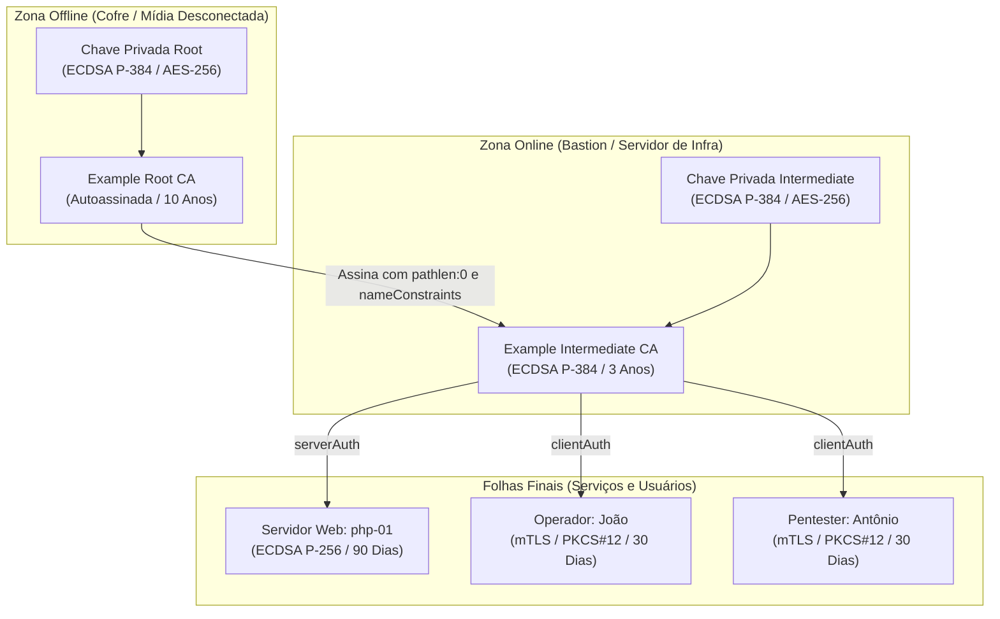

No , desossamos a teoria do X.509: entendemos a árvore genealógica das autoridades certificadoras, a gramática do ASN.1 por trás dos arquivos PEM, o zoológico de extensões e por que mandar a Root CA no bundle do seu servidor web é um atestado solene de desperdício de banda.

Agora, o recreio acabou de vez. Chegou a hora de vestir o macacão de operador, abrir o terminal Linux e construir uma Infraestrutura de Chaves Públicas corporativa completa em duas camadas (Root offline e Intermediária operacional), utilizando rigorosamente os utilitários nativos do OpenSSL.

Vamos emitir credenciais com Subject Alternative Names (SAN) para servidores, gerar crachás de acesso mútuo (mTLS) para a nossa equipe, instalar a âncora de confiança no sistema operacional e reproduzir em laboratório cada um dos erros clássicos de verificação que derrubam conexões em produção.



## Por Que Subir uma CA Própria em Pleno Século XXI

Com a popularização massiva do Let's Encrypt e de gerenciadores automatizados de certificados (cert-manager, Caddy, Traefik), é legítimo perguntar: por que diabos alguém ainda precisa criar e operar sua própria Autoridade Certificadora privada?

A resposta tem duas frentes: uma arquitetural e outra estritamente educacional.

A primeira razão é que a Web PKI pública não atende (e nunca teve a intenção de atender) ao tráfego interno dos seus sistemas. Em maio de 2025, o Let's Encrypt encerrou formalmente o suporte à emissão de certificados com `clientAuth`[^1]. Certificados públicos existem para colocar o cadeado verde no navegador do usuário comum, validando nomes de domínio roteáveis publicamente. Eles não servem para colocar crachá de autenticação mútua (mTLS) entre a sua API e o seu banco de dados, nem para emitir certificados em redes internas sem DNS público exposto. Se você precisa de segurança de transporte em microsserviços, telemetria protegida no Kubernetes ou autenticação corporativa de operadores, a gestão da PKI privada é problema seu.

A segunda razão é de sobrevivência profissional. No mundo corporativo de larga escala, você provavelmente usará ferramentas de automação como HashiCorp Vault, Smallstep (`step-ca`) ou CFSSL. Mas nenhuma dessas ferramentas reinventou a roda da criptografia: todas elas implementam exatamente a mesma máquina de estados, o mesmo controle de seriais e as mesmas regras de extensões X.509 que o utilitário nativo `openssl ca` gerencia. Quem só sabe apertar botão em painel web entra em pânico quando uma cadeia quebra; quem aprendeu a construir uma CA no braço com OpenSSL sabe exatamente em qual elo o cabo arrebentou e como consertar.



A regra de ouro da nossa arquitetura é a segregação estrita: a Root CA emite apenas um único certificado na vida (o da Intermediária) e volta imediatamente para o cofre offline. Todas as emissões cotidianas de servidores e clientes são executadas exclusivamente pela Intermediária.

## A Arquitetura Física e os Arquivos de Configuração

Ao contrário do comando simples `openssl x509 -req` (que atua como um carimbador cego sem memória), o utilitário `openssl ca` opera como uma verdadeira autoridade de certificação: ele mantém um banco de dados transacional em disco, rastreia números de série únicos para impedir duplicidades e gerencia revogações formais.

Para organizar essa estrutura, criaremos dois diretórios isolados no seu ambiente de laboratório: `root` e `intermediate`.

### 1. Criando o Esqueleto de Diretórios

Execute no seu terminal:

```bash
mkdir -p ~/pki-lab/{root,intermediate}/{certs,crl,newcerts,private}
mkdir -p ~/pki-lab/intermediate/csr
chmod 700 ~/pki-lab/{root,intermediate}/private

cd ~/pki-lab

# Inicializar os bancos de dados de estado
touch root/index.txt intermediate/index.txt

# Inicializar os números de série (números hexadecimais de início)
echo 1000 > root/serial
echo 2000 > intermediate/serial

# Inicializar os números de versão de CRL
echo 1000 > root/crlnumber
echo 2000 > intermediate/crlnumber
```

O arquivo `index.txt` é o banco de dados em texto plano da CA. Cada certificado emitido, expirado ou revogado recebe uma linha nesse arquivo. O arquivo `serial` carrega o próximo número de série hexadecimal a ser gravado no certificado da folha. As pastas `private` recebem permissão estrita `chmod 700` para que nenhum outro usuário do sistema operacional possa ler as chaves privadas.

### 2. O Arquivo de Configuração da Raiz (root.cnf)

O comportamento do comando `openssl ca` é governado por arquivos de configuração no formato INI[^2]. Salve o conteúdo a seguir como `~/pki-lab/root.cnf`:

```ini
[ ca ]
default_ca = CA_default

[ CA_default ]
dir               = ./root
certs             = $dir/certs
crl_dir           = $dir/crl
new_certs_dir     = $dir/newcerts
database          = $dir/index.txt
serial            = $dir/serial
RANDFILE          = $dir/private/.rand

private_key       = $dir/private/root.key
certificate       = $dir/certs/root.crt

crlnumber         = $dir/crlnumber
crl               = $dir/crl/root.crl
crl_extensions    = crl_ext
default_crl_days  = 30

default_md        = sha384
name_opt          = ca_default
cert_opt          = ca_default
default_days      = 3650
preserve          = no
policy            = policy_strict

[ policy_strict ]
countryName             = match
organizationName        = match
organizationalUnitName  = optional
commonName              = supplied
emailAddress            = optional

[ req ]
default_bits        = 384
default_md          = sha384
string_mask         = utf8only
utf8                = yes
distinguished_name  = req_distinguished_name
prompt              = no

[ req_distinguished_name ]
countryName                     = BR
organizationName                = Example Corp
commonName                      = Example Root CA

[ v3_root_ca ]
subjectKeyIdentifier = hash
authorityKeyIdentifier = keyid:always,issuer
basicConstraints = critical, CA:true
keyUsage = critical, digitalSignature, cRLSign, keyCertSign

[ v3_intermediate_ca ]
subjectKeyIdentifier = hash
authorityKeyIdentifier = keyid:always,issuer
basicConstraints = critical, CA:true, pathlen:0
keyUsage = critical, digitalSignature, cRLSign, keyCertSign
nameConstraints = critical, permitted;DNS:.example.com, permitted;DNS:example.com, permitted;email:example.com, permitted;email:.example.com

[ crl_ext ]
authorityKeyIdentifier=keyid:always
```

Preste muita atenção na seção `[ v3_intermediate_ca ]`. É aqui que a mágica da segurança defensiva acontece:
- `basicConstraints = critical, CA:true, pathlen:0`: O `pathlen:0` estipula que a autoridade intermediária pode assinar certificados para servidores e clientes finais, mas **NÃO pode criar outras CAs subordinadas** abaixo dela. Se alguém tentar criar uma sub-CA com ela, a cadeia quebra.
- `nameConstraints = critical, permitted;DNS:...`: Cria uma cerca elétrica implacável. Essa intermediária só tem autorização criptográfica para emitir certificados cujos hostnames pertençam ao sufixo `.example.com` ou endereços de e-mail `@example.com`[^3]. Se a chave dela vazar e alguém tentar assinar um certificado para `google.com` ou `banco.com`, qualquer validador moderno abortará a conexão na hora.

### 3. O Arquivo de Configuração da Intermediária (intermediate.cnf)

Salve o conteúdo a seguir como `~/pki-lab/intermediate.cnf`:

```ini
[ ca ]
default_ca = CA_default

[ CA_default ]
dir               = ./intermediate
certs             = $dir/certs
crl_dir           = $dir/crl
new_certs_dir     = $dir/newcerts
database          = $dir/index.txt
serial            = $dir/serial
RANDFILE          = $dir/private/.rand

private_key       = $dir/private/intermediate.key
certificate       = $dir/certs/intermediate.crt

crlnumber         = $dir/crlnumber
crl               = $dir/crl/intermediate.crl
crl_extensions    = crl_ext
default_crl_days  = 30

default_md        = sha384
name_opt          = ca_default
cert_opt          = ca_default
default_days      = 90
preserve          = no
policy            = policy_loose
copy_extensions   = copy

[ policy_loose ]
countryName             = optional
stateOrProvinceName     = optional
localityName            = optional
organizationName        = optional
organizationalUnitName  = optional
commonName              = supplied
emailAddress            = optional

[ req ]
default_bits        = 384
default_md          = sha384
string_mask         = utf8only
utf8                = yes
distinguished_name  = req_distinguished_name
prompt              = no

[ req_distinguished_name ]
countryName                     = BR
organizationName                = Example Corp
commonName                      = Example Intermediate CA

[ server_cert ]
basicConstraints = critical, CA:FALSE
subjectKeyIdentifier = hash
authorityKeyIdentifier = keyid,issuer:always
keyUsage = critical, digitalSignature
extendedKeyUsage = critical, serverAuth
crlDistributionPoints = URI:http://crl.example.com/intermediate.crl
authorityInfoAccess = OCSP;URI:http://ocsp.example.com:2560

[ client_cert ]
basicConstraints = critical, CA:FALSE
subjectKeyIdentifier = hash
authorityKeyIdentifier = keyid,issuer:always
keyUsage = critical, digitalSignature
extendedKeyUsage = critical, clientAuth
crlDistributionPoints = URI:http://crl.example.com/intermediate.crl
authorityInfoAccess = OCSP;URI:http://ocsp.example.com:2560

[ crl_ext ]
authorityKeyIdentifier=keyid:always
```

> [!WARNING] O Perigo Oculto de `copy_extensions = copyall`
> Note que configuramos `copy_extensions = copy`. Isso instrui o OpenSSL a preservar extensões passadas na solicitação (como o `subjectAltName` vindo do CSR). Nunca, sob hipótese alguma, utilize `copy_extensions = copyall` em uma CA de produção. O modo `copyall` copia cegamente qualquer extensão que o solicitante injetar no CSR, permitindo que um usuário mal-intencionado mande um pedido contendo `basicConstraints = CA:TRUE` e transforme seu certificado comum de desenvolvedor em uma autoridade certificadora plena sem o seu consentimento.

> [!TIP] Do INI do OpenSSL ao JSON do CFSSL
> Repare em como segregamos as seções `[ server_cert ]` e `[ client_cert ]`. Cada uma fixa prazos, regras de extensões e flags de `extendedKeyUsage` específicas para cada tipo de cliente. Guarde bem esse modelo mental: quando chegarmos no post dedicado ao CFSSL da Cloudflare, você verá que essa mesma lógica é traduzida de forma limpa em blocos JSON de *signing profiles*, sem precisar decorar a sintaxe árida dos arquivos `.cnf`.

## Passo 1: Construindo a Root CA

A Root CA é a âncora de todo o castelo. Para garantir alta segurança com excelente desempenho, utilizaremos a curva elíptica NIST P-384 (`secp384r1`) com hash SHA-384, protegendo a chave privada em disco com AES-256 e senha mestra[^4].

### 1. Gerando a Chave Privada da Raiz
Execute o comando `openssl genpkey`:

```bash
$ openssl genpkey -algorithm EC -pkeyopt ec_paramgen_curve:P-384 -aes-256-cbc \
    -out root/private/root.key -pass pass:rootsecret
```

Aqui definimos a senha de teste `rootsecret` via parâmetro `-pass` para fins de laboratório. Em um ambiente real, omita o `-pass` e digite uma frase secreta longa interativamente.

### 2. Emitindo o Certificado Autoassinado Raiz
Com a chave gerada, emitimos o certificado autoassinado com vigência de 10 anos (3650 dias):

```bash
$ openssl req -config root.cnf -key root/private/root.key -new -x509 -days 3650 -sha384 \
    -extensions v3_root_ca -out root/certs/root.crt \
    -subj '/C=BR/O=Example Corp/CN=Example Root CA' -passin pass:rootsecret
```

### 3. Inspecionando o Certificado da Raiz
Vamos conferir se as extensões foram gravadas com precisão:

```bash
$ openssl x509 -in root/certs/root.crt -noout -text
```

Saída real gerada no terminal:

```text
Certificate:
    Data:
        Version: 3 (0x2)
        Serial Number:
            55:51:f4:60:a3:c9:d8:99:8e:77:14:40:58:50:93:cb:6d:01:1e:63
        Signature Algorithm: ecdsa-with-SHA384
        Issuer: C=BR, O=Example Corp, CN=Example Root CA
        Validity
            Not Before: Oct 17 20:14:16 2026 GMT
            Not After : Oct 14 20:14:16 2036 GMT
        Subject: C=BR, O=Example Corp, CN=Example Root CA
        Subject Public Key Info:
            Public Key Algorithm: id-ecPublicKey
                Public-Key: (384 bit)
                ASN1 OID: secp384r1
                NIST CURVE: P-384
        X509v3 extensions:
            X509v3 Subject Key Identifier: 
                B9:B2:52:84:AA:AB:FF:A2:B1:08:46:D1:43:67:3A:F1:3C:AF:4D:07
            X509v3 Authority Key Identifier: 
                B9:B2:52:84:AA:AB:FF:A2:B1:08:46:D1:43:67:3A:F1:3C:AF:4D:07
            X509v3 Basic Constraints: critical
                CA:TRUE
            X509v3 Key Usage: critical
                Digital Signature, Certificate Sign, CRL Sign
    Signature Algorithm: ecdsa-with-SHA384
```

Observe que `Issuer` e `Subject` são rigorosamente idênticos (o certificado é autoassinado). A extensão `basicConstraints` marca `CA:TRUE` como crítica, e `keyUsage` habilita explicitamente `Certificate Sign` e `CRL Sign`.

A partir deste instante, em um cenário de produção sério, a máquina onde essa chave reside teria sua placa de rede desativada ou seria desligada fisicamente, sendo guardada em cofre protegido até o dia em que uma nova intermediária precisasse ser assinada.

## Passo 2: Construindo a Intermediate CA

A Intermediate CA é o braço operacional da empresa. Ela fará todo o trabalho pesado do dia a dia, assinando certificados para novos servidores e desenvolvedores.

### 1. Gerando a Chave Privada da Intermediária
Geramos outra chave na curva P-384, protegida com a senha `intsecret`:

```bash
$ openssl genpkey -algorithm EC -pkeyopt ec_paramgen_curve:P-384 -aes-256-cbc \
    -out intermediate/private/intermediate.key -pass pass:intsecret
```

### 2. Gerando a Requisição de Assinatura (CSR)
A autoridade intermediária não assina a si mesma; ela cria uma solicitação formal (PKCS#10) para ser submetida à apreciação da autoridade raiz:

```bash
$ openssl req -config intermediate.cnf -new -sha384 \
    -key intermediate/private/intermediate.key \
    -out intermediate/csr/intermediate.csr \
    -subj '/C=BR/O=Example Corp/CN=Example Intermediate CA' -passin pass:intsecret
```

### 3. Assinando a Intermediária com a Root CA
Agora a autoridade raiz entra em ação para chancelar a intermediária, aplicando o bloco de extensões `v3_intermediate_ca` com validade de 3 anos (1095 dias):

```bash
$ openssl ca -config root.cnf -extensions v3_intermediate_ca -days 1095 -notext -md sha384 \
    -in intermediate/csr/intermediate.csr -out intermediate/certs/intermediate.crt \
    -batch -passin pass:rootsecret
```

O parâmetro `-batch` roda a emissão de forma não-interativa (sem pedir confirmação `y/n` para cada parâmetro), o que é essencial para pipelines automatizados.

### 4. Inspecionando as Restrições da Intermediária
Vamos inspecionar o certificado gerado para conferir se a coleira de segurança foi aplicada:

```bash
$ openssl x509 -in intermediate/certs/intermediate.crt -noout -text
```

Trecho fundamental da saída:

```text
X509v3 extensions:
    X509v3 Subject Key Identifier: 
        15:D3:66:1C:FC:6F:F7:22:16:C6:90:41:29:A0:02:E7:E4:AB:00:06
    X509v3 Authority Key Identifier: 
        B9:B2:52:84:AA:AB:FF:A2:B1:08:46:D1:43:67:3A:F1:3C:AF:4D:07
    X509v3 Basic Constraints: critical
        CA:TRUE, pathlen:0
    X509v3 Key Usage: critical
        Digital Signature, Certificate Sign, CRL Sign
    X509v3 Name Constraints: critical
        Permitted:
          DNS:.example.com
          DNS:example.com
          email:example.com
          email:.example.com
```

Olha que estrutura:
1. O `Authority Key Identifier` da Intermediária (`B9:B2...`) bate perfeitamente com o `Subject Key Identifier` da Root CA. O elo criptográfico está soldado.
2. `pathlen:0` está ativo: esta CA não pode delegar poderes a terceiros.
3. `Name Constraints` está marcada como crítica: ela só emite para o namespace `.example.com`.

### 5. Criando o Bundle de Cadeia da CA (ca-chain.pem)
Para permitir que clientes e validadores verifiquem caminhos completos, criamos o arquivo de cadeia concatenando a intermediária e a raiz:

```bash
$ cat intermediate/certs/intermediate.crt root/certs/root.crt > intermediate/certs/ca-chain.pem
```

## Passo 3: Emitindo Certificados de Servidor (SAN)

Com a autoridade intermediária operando, vamos emitir o certificado do nosso primeiro servidor de aplicação interna: o `php-01.example.com`, que também atende pelo IP `10.0.0.10`.

Para servidores e aplicações de ponta, utilizamos a curva **ECDSA P-256** (`prime256v1`): ela consome pouquíssima CPU durante o aperto de mão TLS e entrega excelente segurança de 128 bits.

### 1. Gerando a Chave Privada do Servidor
Chaves de servidores web em produção geralmente não possuem senha em disco (para permitir que o serviço reinicie automaticamente sem intervenção humana após um reboot):

```bash
$ openssl genpkey -algorithm EC -pkeyopt ec_paramgen_curve:P-256 \
    -out intermediate/private/php-01.key
```

### 2. Gerando o CSR com Subject Alternative Names (SAN)
Conforme aprendemos no post anterior, o campo Common Name não é utilizado para validação de nomes de domínio. O hostname e o endereço IP devem constar expressamente dentro da extensão SAN:

```bash
$ openssl req -new -key intermediate/private/php-01.key -out intermediate/csr/php-01.csr \
    -subj '/C=BR/O=Example Corp/CN=php-01.example.com' \
    -addext 'subjectAltName = DNS:php-01.example.com, IP:10.0.0.10'
```

### 3. Assinando com a Intermediate CA
Emitimos o certificado com perfil `server_cert` e validade curta de 90 dias (alinhada aos padrões modernos de segurança):

```bash
$ openssl ca -config intermediate.cnf -extensions server_cert -days 90 -notext -md sha384 \
    -in intermediate/csr/php-01.csr -out intermediate/certs/php-01.crt -batch -passin pass:intsecret
```

### 4. Inspecionando o Certificado da Folha
Ao inspecionar o arquivo gerado:

```bash
$ openssl x509 -in intermediate/certs/php-01.crt -noout -text
```

A saída confirma o perfil perfeito de folha:
- `basicConstraints = critical, CA:FALSE`: Impossível usar este certificado para assinar nada.
- `extendedKeyUsage = critical, TLS Web Server Authentication`: Exclusivo para atuar como servidor.
- `X509v3 Subject Alternative Name: DNS:php-01.example.com, IP Address:10.0.0.10`: Totalmente compatível com conexões via DNS ou IP literal.

### 5. Montando o Pacote do Servidor (fullchain.pem)
Relembrando o aviso que destacamos no capítulo anterior: o servidor web deve entregar sua folha seguida da intermediária, **sem a raiz**:

```bash
$ cat intermediate/certs/php-01.crt intermediate/certs/intermediate.crt > intermediate/certs/php-01.fullchain.pem
```

## Passo 4: Emitindo Certificados de Cliente (mTLS)

Agora vamos emitir as credenciais dos nossos operadores para autenticação mútua (mTLS). Criaremos crachás digitais para o João (desenvolvedor), a Maria (DBA) e o Antônio (nosso QA pentester).

### 1. Gerando a Chave e o CSR do João
O certificado do João terá seu e-mail registrado no SAN:

```bash
$ openssl genpkey -algorithm EC -pkeyopt ec_paramgen_curve:P-256 \
    -out intermediate/private/joao.key

$ openssl req -new -key intermediate/private/joao.key -out intermediate/csr/joao.csr \
    -subj '/C=BR/O=Example Corp/CN=joao' \
    -addext 'subjectAltName = email:joao@example.com'
```

### 2. Assinando com o Perfil client_cert
Emitimos o certificado com validade de 30 dias utilizando o perfil de cliente:

```bash
$ openssl ca -config intermediate.cnf -extensions client_cert -days 30 -notext -md sha384 \
    -in intermediate/csr/joao.csr -out intermediate/certs/joao.crt -batch -passin pass:intsecret
```

Observe a diferença capital em relação ao certificado do servidor: aqui a extensão `extendedKeyUsage` grava estritamente `TLS Web Client Authentication`. O João pode autenticar perante servidores, mas não pode usar esse certificado para subir um site falso.

### 3. Empacotando em PKCS#12 (.p12)
Arquivos `.crt` e `.key` separados são ótimos no terminal Linux, mas um terror para instalar no navegador do usuário comum ou em clientes de teste. O padrão de intercâmbio **PKCS#12** resolve isso empacotando a chave privada, o certificado pessoal e toda a cadeia da CA em um único arquivo binário protegido por senha:

```bash
$ openssl pkcs12 -export -out intermediate/certs/joao.p12 \
    -inkey intermediate/private/joao.key \
    -in intermediate/certs/joao.crt \
    -certfile intermediate/certs/ca-chain.pem \
    -passout pass:joaosecret
```

O arquivo `joao.p12` resultante pode ser importado com dois cliques nas configurações de certificados do Chrome, Firefox ou chaveiro do macOS.

Repita o processo para a Maria (`maria@example.com`) e para o Antônio (`antonio@example.com`), pois utilizaremos a credencial do Antônio para os testes de quebra e revogação.

## Passo 5: Confiando na Raiz no Sistema Operacional (Debian)

Como fazemos as ferramentas do nosso sistema operacional (como `curl`, `git` ou scripts Python) confiarem automaticamente no nosso servidor `php-01.example.com` sem precisarmos passar flags inseguras como `--insecure` ou `-k`?

Instalando a **Root CA** no repositório confiável do sistema.

No Debian GNU/Linux e distribuições derivadas, o procedimento padrão é extremamente limpo:

```bash
# 1. Copiar a raiz pública (e SOMENTE ela) para o diretório de certificados locais
$ sudo cp ~/pki-lab/root/certs/root.crt /usr/local/share/ca-certificates/example-root.crt

# 2. Atualizar os hashes e links simbólicos do sistema
$ sudo update-ca-certificates
```

Saída no terminal:

```text
Updating certificates in /etc/ssl/certs...
1 added, 0 removed; done.
Running hooks in /etc/ca-certificates/update.d...
done.
```

O utilitário `update-ca-certificates`[^5] lê o arquivo, valida a sintaxe e cria links simbólicos correspondentes dentro de `/etc/ssl/certs/`, atualizando também o bundle consolidado `/etc/ssl/certs/ca-certificates.crt`. 

A partir deste instante, qualquer aplicação que consulte a Trust Store padrão do sistema operacional aceitará os certificados emitidos pela nossa intermediária de forma 100% transparente.

> [!NOTE] Equivalência com Certificados SSH
> Compare esse mecanismo com o post de SSH: adicionar a Root CA em `/usr/local/share/ca-certificates/` equivale exatamente a adicionar a diretiva `@cert-authority *.example.com ssh-ed25519 AAAAC3...` no arquivo `known_hosts` do OpenSSH. Em ambos os casos, você instala uma âncora confiável uma única vez; a partir daí, centenas de servidores novos são aceitos automaticamente sem alertas de confirmação.

## Passo 6: mTLS na Prática (Hands-on no Terminal)

Vamos colocar o nosso laboratório à prova simulando uma conexão TLS mútua real no terminal, utilizando exclusivamente os utilitários de diagnóstico do OpenSSL.

### 1. Subindo o Servidor mTLS de Teste
Abra um terminal e inicie o utilitário `openssl s_server` simulando o servidor `php-01`:

```bash
$ openssl s_server -accept 8443 \
    -cert intermediate/certs/php-01.crt \
    -key intermediate/private/php-01.key \
    -CAfile intermediate/certs/ca-chain.pem \
    -Verify 2 -www
```

Entendendo os parâmetros:
- `-accept 8443`: Abre a porta TCP 8443 para escuta.
- `-cert` e `-key`: O certificado e a chave do servidor.
- `-CAfile ca-chain.pem`: A lista de autoridades que o servidor aceita para autenticar os clientes que baterem à porta.
- `-Verify 2`: Exige obrigatoriamente que o cliente apresente um certificado válido e interrompe o aperto de mão se a validação falhar.
- `-www`: Devolve uma página de diagnóstico com status TLS caso a conexão HTTP seja bem-sucedida.

### 2. Conectando com o Cliente do João
Abra outro terminal e dispare uma conexão simulando o João:

```bash
$ openssl s_client -connect localhost:8443 \
    -cert intermediate/certs/joao.crt \
    -key intermediate/private/joao.key \
    -CAfile root/certs/root.crt
```

Durante o handshake, você verá a troca simétrica de credenciais:
1. O servidor apresenta o certificado do `php-01` e prova a posse da sua chave privada. O cliente valida a cadeia do servidor contra a sua `root.crt`.
2. O servidor envia uma mensagem `CertificateRequest`, listando as autoridades aceitas.
3. O cliente envia o certificado do `joao.crt` acompanhado de uma assinatura digital feita com a chave privada `joao.key`.
4. O servidor valida a assinatura do João contra a `ca-chain.pem` e confere se o certificado não expirou.

O terminal exibe:

```text
Verify return code: 0 (ok)
[...]
Acceptable client certificate CA names
/C=BR/O=Example Corp/CN=Example Intermediate CA
/C=BR/O=Example Corp/CN=Example Root CA
[...]
```

O canal mTLS foi estabelecido com louvor: criptografia ponta a ponta com autenticação mútua rigorosa baseada em chaves assimétricas.

### 3. Testando via cURL
Também podemos validar a mesma transação com o utilitário `curl`:

```bash
$ curl --cacert root/certs/root.crt \
       --cert intermediate/certs/joao.crt \
       --key intermediate/private/joao.key \
       https://localhost:8443/
```

O `curl` processa a resposta perfeitamente, sem emitir um único aviso de erro.

## O Laboratório do Caos: Simulando 6 Falhas Reais de Verificação

Aprender como tudo funciona no caminho feliz é fácil. O diferencial técnico de um engenheiro de infraestrutura reside em saber interpretar a saída de erro enigmática do terminal quando as coisas dão errado.

Vamos reproduzir intencionalmente no terminal as 6 falhas de validação mais frequentes do mundo corporativo, documentando os códigos numéricos de retorno exatos emitidos pelo OpenSSL[^6].

### Erro 1: Cadeia Incompleta (Missing Intermediate)
Você configurou o servidor para entregar apenas o certificado de folha e esqueceu de anexar a autoridade intermediária no bundle:

```bash
$ openssl verify -CAfile root/certs/root.crt intermediate/certs/php-01.crt
```

Saída real:
```text
error 20 at 0 depth lookup: unable to get local issuer certificate
error intermediate/certs/php-01.crt: verification failed
```
- **Código:** `error 20` (exit code 2).
- **Causa:** O validador conhece a raiz, mas não faz ideia de quem é a autoridade intermediária que assinou a folha, pois o servidor não a entregou na conexão.
- **Solução:** Concatene o certificado intermediário no arquivo de certificado do servidor (`fullchain.pem`).

### Erro 2: Hostname Mismatch
O cliente tenta acessar o servidor por um nome que não consta no certificado:

```bash
$ openssl verify -CAfile root/certs/root.crt -untrusted intermediate/certs/intermediate.crt \
    -verify_hostname evil.example.com intermediate/certs/php-01.crt
```

Saída real:
```text
error 62 at 0 depth lookup: hostname mismatch
error intermediate/certs/php-01.crt: verification failed
```
- **Código:** `error 62`.
- **Causa:** O certificado é criptograficamente perfeito e válido, mas nenhum dos registros da extensão `subjectAltName` corresponde a `evil.example.com`.
- **Solução:** Reemita o CSR incluindo todos os hostnames e wildcards necessários no SAN.

### Erro 3: Inversão de Propósito de EKU (Unsuitable Purpose)
O João pega o certificado pessoal dele de cliente mTLS e tenta utilizá-lo para subir um servidor HTTPS:

```bash
$ openssl verify -CAfile root/certs/root.crt -untrusted intermediate/certs/intermediate.crt \
    -purpose sslserver intermediate/certs/joao.crt
```

Saída real:
```text
error 26 at 0 depth lookup: unsuitable certificate purpose
error intermediate/certs/joao.crt: verification failed
```
- **Código:** `error 26`.
- **Causa:** O certificado possui `extendedKeyUsage = clientAuth`, mas a conexão exige `serverAuth`.
- **Solução:** Respeite a segregação de papéis. Emita certificados com o perfil correto para cada tipo de carga.

### Erro 4: Violação de Name Constraints (Permitted Subtree Violation)
Um administrador desonesto (ou invasor) assume o controle da nossa Intermediate CA e tenta emitir um certificado para `evil.org`, fora do domínio corporativo autorizado:

```bash
# Gerar CSR para domínio não autorizado
$ openssl req -new -newkey ec -pkeyopt ec_paramgen_curve:P-256 -nodes \
    -keyout /tmp/evil.key -out /tmp/evil.csr -subj '/CN=evil.org' \
    -addext 'subjectAltName = DNS:evil.org' 2>/dev/null

# Assinar com a Intermediate CA
$ openssl ca -config intermediate.cnf -extensions server_cert -days 10 -notext \
    -in /tmp/evil.csr -out /tmp/evil.crt -batch -passin pass:intsecret 2>/dev/null

# Tentar validar a cadeia perante a Root
$ openssl verify -CAfile root/certs/root.crt -untrusted intermediate/certs/intermediate.crt /tmp/evil.crt
```

Saída real:
```text
error 47 at 0 depth lookup: permitted subtree violation
error /tmp/evil.crt: verification failed
```
- **Código:** `error 47`.
- **Causa:** A extensão `nameConstraints` da Root CA impôs rédea curta na intermediária (`permitted;DNS:.example.com`). Quando o validador encontra `evil.org`, a conexão é sumariamente bloqueada.
- **Solução:** O sistema de segurança funcionou exatamente como planejado. A emissão ilegítima foi neutralizada.

### Erro 5: Certificado Expirado (Certificate Has Expired)
Simulamos o avanço no tempo utilizando a flag `-attime` para um timestamp no futuro:

```bash
$ openssl verify -CAfile root/certs/root.crt -untrusted intermediate/certs/intermediate.crt \
    -attime 1850000000 intermediate/certs/php-01.crt
```

Saída real:
```text
error 10 at 0 depth lookup: certificate has expired
error intermediate/certs/php-01.crt: verification failed
```
- **Código:** `error 10`.
- **Causa:** A data de conferência ultrapassou o carimbo `Not After` do certificado.
- **Solução:** Renove o certificado emitindo uma nova folha com a mesma chave ou novo par de chaves.

### Erro 6: O Antônio Tenta Burlar o mTLS com CA Não Autorizada
O Antônio tenta forjar um certificado de cliente utilizando uma CA falsa criada por ele mesmo no laptop, tentando acessar o servidor `s_server` que deixamos rodando:

```bash
# Antônio cria sua própria CA falsa
$ openssl req -x509 -newkey ec -pkeyopt ec_paramgen_curve:P-256 -nodes \
    -keyout /tmp/fake_ca.key -out /tmp/fake_ca.crt -days 1 -subj '/CN=Fake Root' 2>/dev/null

# Antônio emite um certificado falso para si mesmo
$ openssl req -new -newkey ec -pkeyopt ec_paramgen_curve:P-256 -nodes \
    -keyout /tmp/fake_antonio.key -out /tmp/fake_antonio.csr -subj '/CN=antonio' 2>/dev/null
$ openssl x509 -req -in /tmp/fake_antonio.csr -CA /tmp/fake_ca.crt -CAkey /tmp/fake_ca.key \
    -CAcreateserial -out /tmp/fake_antonio.crt -days 1 2>/dev/null

# Antônio tenta conectar no servidor
$ openssl s_client -connect localhost:8443 \
    -cert /tmp/fake_antonio.crt -key /tmp/fake_antonio.key -CAfile root/certs/root.crt </dev/null
```

Na tela do servidor `s_server`, a tentativa de fraude é abatida imediatamente:

```text
ERROR
Verification error: unable to get local issuer certificate
4048...:error:0A000086:SSL routines:tls_post_process_client_certificate:certificate verify failed
```

Como o certificado do Antônio não descende da cadeia configurada no `-CAfile ca-chain.pem` do servidor, o handshake é abortado antes que qualquer payload seja trafegado.

### Resumo Diagnóstico de Erros do OpenSSL Verify

| Código | Mensagem de Erro | Causa Raiz Típica | Ação Corretiva |
|---|---|---|---|
| **20** | `unable to get local issuer certificate` | Servidor esqueceu de enviar a CA intermediária | Concatenar intermediária no `fullchain.pem` |
| **62** | `hostname mismatch` | Nome acessado não consta no Subject Alternative Name | Adicionar entrada `DNS:...` no SAN |
| **26** | `unsuitable certificate purpose` | Conflito de EKU (`clientAuth` vs `serverAuth`) | Emitir com a extensão de uso apropriada |
| **47** | `permitted subtree violation` | Intermediária tentou emitir fora do namespace | Restrição deliberada de segurança da Root |
| **10** | `certificate has expired` | Data atual ultrapassou a validade `Not After` | Renovar o certificado |
| **23** | `certificate revoked` | Certificado cancelado na CRL ou no responder OCSP | Descartar credencial e emitir nova |

## Diagnóstico e Troubleshooting

Para inspecionar e debugar problemas de certificados no dia a dia sem depender de ferramentas gráficas:

### 1. Validando Cadeias Locais com Passo a Passo Completo
Para ver cada degrau da árvore genealógica sendo resolvido:

```bash
$ openssl verify -show_chain -CAfile root/certs/root.crt \
    -untrusted intermediate/certs/intermediate.crt intermediate/certs/php-01.crt
```

A flag `-show_chain` imprime a hierarquia completa com as profundidades:
```text
intermediate/certs/php-01.crt: OK
Chain:
depth=0: C=BR, O=Example Corp, CN=php-01.example.com (untrusted)
depth=1: C=BR, O=Example Corp, CN=Example Intermediate CA (untrusted)
depth=2: C=BR, O=Example Corp, CN=Example Root CA
```

### 2. Depurando o Handshake TLS ao Vivo
Para enxergar as mensagens cruas de protocolo trocadas durante o aperto de mão e identificar exatamente em qual pacote a conexão falhou:

```bash
$ openssl s_client -connect php-01.example.com:443 -servername php-01.example.com -tlsextdebug -msg
```

As flags `-msg` e `-tlsextdebug` mostram a listagem em hexadecimal de cada registro TLS, incluindo as extensões SNI, ALPN e a solicitação de certificados de cliente.

## Exercícios

Para fixar a construção e operação de autoridades certificadoras na prática, execute os desafios abaixo no seu ambiente de testes:

**1. Emissão de Folha com Validade Ultracurta**

O mercado e o CA/Browser Forum estão reduzindo drasticamente a validade dos certificados TLS. Como você configuraria e emitiria um certificado de servidor para `db-01.example.com` com validade de exatamente 48 horas utilizando o comando `openssl ca`?

<details markdown="1">
<summary>Ver resposta</summary>

Gere a chave e o CSR correspondentes:

```bash
$ openssl genpkey -algorithm EC -pkeyopt ec_paramgen_curve:P-256 -out intermediate/private/db-01.key
$ openssl req -new -key intermediate/private/db-01.key -out intermediate/csr/db-01.csr \
    -subj '/C=BR/O=Example Corp/CN=db-01.example.com' \
    -addext 'subjectAltName = DNS:db-01.example.com'
```

Para emitir com 48 horas (2 dias), utilize o parâmetro `-days 2`:

```bash
$ openssl ca -config intermediate.cnf -extensions server_cert -days 2 -notext -md sha384 \
    -in intermediate/csr/db-01.csr -out intermediate/certs/db-01.crt -batch -passin pass:intsecret
```

Conferindo as datas no certificado emitido:

```bash
$ openssl x509 -in intermediate/certs/db-01.crt -noout -dates
```

As datas `notBefore` e `notAfter` exibirão um intervalo exato de 48 horas. Em arquiteturas com emissão automatizada via ACME, certificados de curta duração minimizam a necessidade de infraestrutura pesada de revogação.

</details>

**2. Testando o Limite de Profundidade com pathlen:0**

Nossa Intermediate CA foi emitida com `basicConstraints = critical, CA:true, pathlen:0`. O que acontece se tentarmos criar uma sub-CA intermediária (uma "neta" da Root) assinada por ela? Crie um CSR de uma suposta sub-CA e tente assinar utilizando a Intermediate CA. O que o validador responde?

<details markdown="1">
<summary>Ver resposta</summary>

Crie a chave e o CSR para a sub-CA:

```bash
$ openssl genpkey -algorithm EC -pkeyopt ec_paramgen_curve:P-384 -out /tmp/subca.key
$ openssl req -new -key /tmp/subca.key -out /tmp/subca.csr \
    -subj '/C=BR/O=Example Corp/CN=Sub Intermediate CA'
```

Se a Intermediate tentar assinar esse CSR aplicando o perfil de CA (`v3_intermediate_ca`), a emissão pode até ocorrer no OpenSSL (caso o profile permita), mas ao testar a validação da cadeia de 3 níveis:

```bash
$ openssl verify -CAfile root/certs/root.crt -untrusted intermediate/certs/intermediate.crt /tmp/subca.crt
```

O validador interrompe o processo com:

```text
error 25 at 1 depth lookup: path length constraint exceeded
error /tmp/subca.crt: verification failed
```

A restrição `pathlen:0` atuou com precisão no elo intermediário: nenhuma autoridade abaixo dela tem permissão para atuar como CA.

</details>

**3. Extração e Inspeção de Contêineres PKCS#12**

Você recebeu o arquivo `joao.p12` gerado no laboratório e precisa inspecionar seu conteúdo no terminal sem precisar instalá-lo no navegador. Qual comando do OpenSSL permite extrair os certificados públicos e a chave privada desse pacote?

<details markdown="1">
<summary>Ver resposta</summary>

Utilize o utilitário `openssl pkcs12`:

```bash
# Para visualizar apenas os certificados contidos no pacote:
$ openssl pkcs12 -in intermediate/certs/joao.p12 -nokeys -info -passin pass:joaosecret

# Para extrair a chave privada decifrada:
$ openssl pkcs12 -in intermediate/certs/joao.p12 -nocerts -nodes -passin pass:joaosecret
```

O comando disseca os metadados do pacote, revelando o algoritmo de cifra simétrica utilizado no empacotamento, os certificados da cadeia e a chave privada do titular.

</details>

**4. Conversão de Formatos com OpenSSL puro**

Converta o certificado `php-01.crt` para o formato PKCS#7 (`.p7b`). Em seguida, inspecione o arquivo `.p7b` no terminal e explique qual é a diferença fundamental entre um contêiner PKCS#7 e um contêiner PKCS#12.

<details markdown="1">
<summary>Ver resposta</summary>

Para empacotar em PKCS#7:

```bash
$ openssl crl2pkcs7 -nocrl -certfile intermediate/certs/php-01.fullchain.pem -out intermediate/certs/php-01.p7b
```

Para inspecionar:

```bash
$ openssl pkcs7 -in intermediate/certs/php-01.p7b -print_certs -noout
```

A diferença crucial é de segurança: o contêiner PKCS#7 (`.p7b` ou CMS) transporta **exclusivamente certificados públicos e cadeias**, sendo incapaz de armazenar chaves privadas. O PKCS#12 (`.p12`), por sua vez, é um contêiner seguro concebido especificamente para armazenar a chave privada do titular protegida por derivação de senha.

</details>

**5. Prova de Fogo do mTLS com curl e Nome de Domínio**

Configure uma entrada no seu arquivo `/etc/hosts` apontando `php-01.example.com` para `127.0.0.1`. Em seguida, execute uma requisição `curl` autenticada com o certificado do João utilizando o hostname oficial em vez de `localhost`. Qual parâmetro adicional do curl se torna desnecessário quando a Root CA já está instalada no sistema operacional?

<details markdown="1">
<summary>Ver resposta</summary>

Adicione no `/etc/hosts`:
```text
127.0.0.1 php-01.example.com
```

Como instalamos a `example-root.crt` em `/usr/local/share/ca-certificates/` no Passo 5, o parâmetro `--cacert` se torna completamente desnecessário. O `curl` confia no servidor automaticamente:

```bash
$ curl --cert intermediate/certs/joao.crt \
       --key intermediate/private/joao.key \
       https://php-01.example.com:8443/
```

A requisição fecha o handshake com sucesso instantâneo, validando o SAN pelo hostname real e autenticando o cliente via mTLS.

</details>

## Conclusão

Construir uma Infraestrutura de Chaves Públicas corporativa no braço desmistifica completamente a operação de certificados digitais.

Neste segundo capítulo, montamos uma arquitetura completa de duas camadas com OpenSSL 3.5:
- Blindamos a Root CA offline com curvas elípticas P-384.
- Limitamos os poderes da Intermediate CA aplicando `pathlen:0` e cerca de domínio com `nameConstraints`.
- Emitimos folhas para servidores com extensões modernas de SAN e perfis estritos de EKU.
- Criamos crachás de acesso mTLS para operadores e empacotamos tudo em PKCS#12.
- Reproduzimos os 6 principais erros de verificação do OpenSSL e aprendemos a interpretar suas mensagens de falha.

Emitir certificados é a parte fácil e gratificante da engenharia. O desafio hercúleo de verdade começa quando algo dá errado.

No próximo post, vamos encarar o pesadelo de todo administrador de infraestrutura: **o Antônio cometeu uma barbeiragem e vazou sua chave privada**. Como revogamos esse acesso no mundo real? Como funcionam Listas de Revogação de Certificados (CRLs) e servidores OCSP? Por que a indústria está aposentando o OCSP? E como nos preparamos para a criptografia pós-quântica (PQC) com os novos algoritmos ML-DSA no OpenSSL?

## Referências

[^1]: **Ending TLS Client Authentication Certificate Support** {*Let's Encrypt Blog*} ([Let's Encrypt Blog](https://letsencrypt.org/2025/05/14/ending-tls-client-authentication/))
[^2]: **OpenSSL: x509v3_config(5)** {*OpenSSL Documentation*} ([OpenSSL Docs](https://docs.openssl.org/3.5/man5/x509v3_config/))
[^3]: **Internet X.509 Public Key Infrastructure Certificate and Certificate Revocation List (CRL) Profile** {*IETF RFC 5280*} ([RFC 5280](https://datatracker.ietf.org/doc/html/rfc5280))
[^4]: **OpenSSL: openssl-genpkey(1)** {*OpenSSL Documentation*} ([OpenSSL Docs](https://docs.openssl.org/3.5/man1/openssl-genpkey/))
[^5]: **update-ca-certificates(8)** {*Debian Manpages*} ([Debian Manpages](https://manpages.debian.org/trixie/ca-certificates/update-ca-certificates.8.en.html))
[^6]: **OpenSSL: openssl-verification-options(1)** {*OpenSSL Documentation*} ([OpenSSL Docs](https://docs.openssl.org/3.5/man1/openssl-verification-options/))
