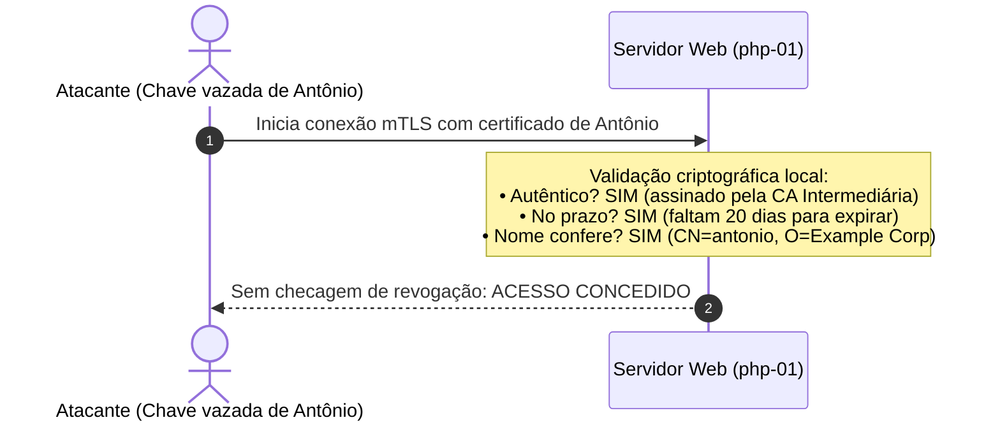
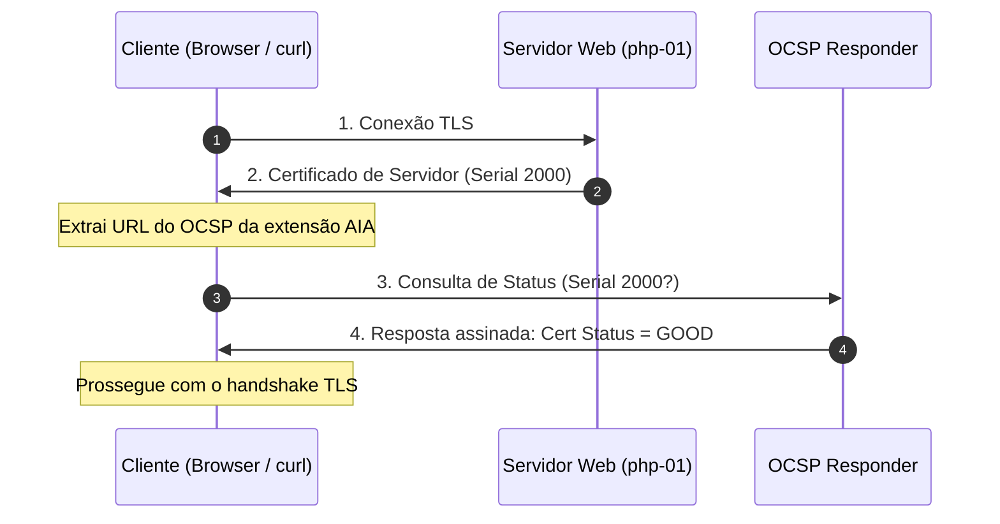
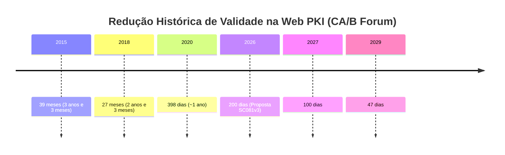
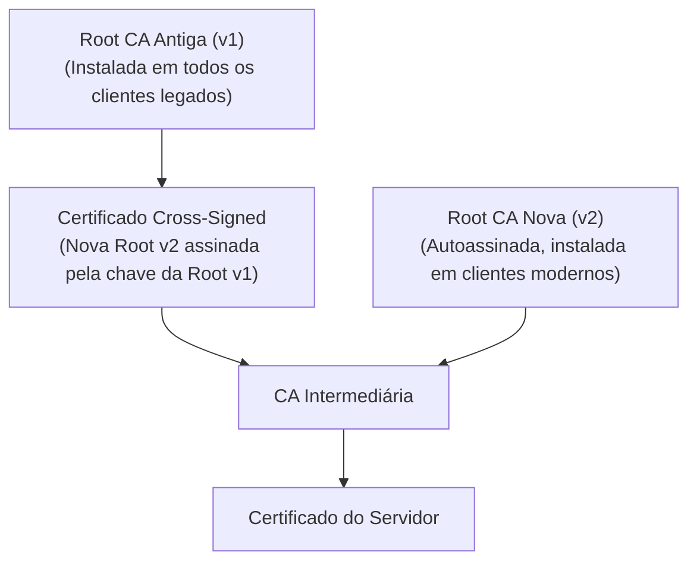
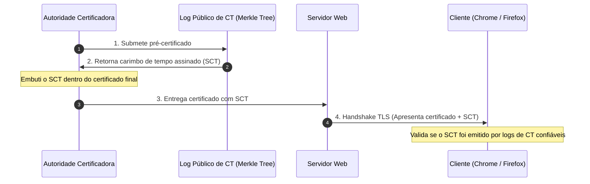

Nos capítulos anteriores desta série, construímos a base da nossa infraestrutura: no , desvendamos a gramática do padrão X.509 e os algoritmos de validação de caminho; no , montamos um laboratório com Autoridade Certificadora em duas camadas, emitindo certificados para os servidores `php-01` e `db-01` e gerando credenciais de acesso mútuo (mTLS) para a nossa equipe.

Com certificados válidos nas mãos, tudo parece resolvido. Os serviços conversam por túneis criptografados, o navegador exibe a conexão segura e o tráfego interno flui protegido.

No entanto, em segurança da informação, a emissão é apenas a etapa inaugural. O teste real de uma PKI acontece no ciclo de vida: quando uma chave privada é comprometida em um laptop extraviado, quando um certificado atinge o prazo de expiração, quando a própria autoridade intermediária precisa ser substituída ou quando precisamos auditar se nenhuma autoridade pública emitiu certificados falsos para o nosso domínio.

Agora atacamos o lado operacional da criptografia: vamos simular o comprometimento da credencial do Antônio, revogar o acesso via CRL e OCSP, entender a virada para certificados de validade curta, ver como o protocolo ACME automatiza esse ciclo, dissecar o Certificate Transparency e testar no terminal os algoritmos pós-quânticos (PQC) do OpenSSL 3.5 LTS.



## O incidente: chave comprometida e o desafio da revogação

Para ilustrar o desafio operacional, vamos resgatar o cenário do nosso laboratório. Na Parte 2, emitimos três certificados de cliente para operadores acessarem os bancos e aplicações internas via mTLS: João (desenvolvedor), Maria (DBA) e Antônio (analista de testes).

Imagine que, durante um teste em um ambiente externo, Antônio copiou sua chave privada `antonio.key` para uma máquina compartilhada ou subiu acidentalmente o arquivo em um repositório público. O certificado de cliente do Antônio tem validade de 30 dias.



A matemática dos certificados X.509 é descentralizada: uma vez assinado pela chave da CA intermediária, o certificado é autocontido. Qualquer servidor em qualquer lugar da rede que possua o certificado público da CA conseguirá validar a assinatura digital de Antônio sem precisar consultar a CA.

No SSH, como vimos no post sobre , a revogação é resolvida de forma simples: o administrador gera uma lista compacta de revogação de chaves (KRL), envia esse pequeno arquivo para os servidores destino e o daemon `sshd` consulta a lista localmente.

No ecossistema X.509, resolver essa mesma pergunta de forma distribuída gerou décadas de debates, protocolos complexos e soluções de engenharia que moldaram a segurança da internet moderna.

## Listas de Revogação de Certificados (CRL)

A abordagem clássica para revogação em PKIs é a **CRL (Certificate Revocation List)**, definida na RFC 5280 [^1]. A lógica é direta: a autoridade certificadora mantém uma lista assinada contendo os números de série de todos os certificados que foram invalidados antes da data de expiração original.

### Revogando o certificado no banco de dados

No nosso laboratório, a autoridade intermediária mantém o estado de emissão no arquivo `index.txt`. Para invalidar o certificado do Antônio, utilizamos o comando `openssl ca -revoke`, informando a justificativa técnica pelo parâmetro `-crl_reason`:

```bash
$ openssl ca -config intermediate.cnf \
    -revoke intermediate/certs/antonio.crt \
    -crl_reason keyCompromise \
    -passin pass:intsecret
Using configuration from intermediate.cnf
Revoking Certificate 2004.
Database updated
```

Os motivos de revogação padronizados pela RFC 5280 incluem:
- `unspecified` (motivo não declarado)
- `keyCompromise` (chave privada vazada ou roubada)
- `CACompromise` (chave da autoridade foi violada)
- `affiliationChanged` (colaborador trocou de cargo ou saiu da empresa)
- `superseded` (certificado substituído por uma nova versão)
- `cessationOfOperation` (serviço ou domínio desativado)

Ao inspecionar o arquivo `intermediate/index.txt`, vemos a mudança de estado imediata:

```text
V	270115201416Z		2000	unknown	/C=BR/O=Example Corp/CN=php-01.example.com
V	270115201416Z		2001	unknown	/C=BR/O=Example Corp/CN=db-01.example.com
V	261116201416Z		2002	unknown	/C=BR/O=Example Corp/CN=joao
V	261116201416Z		2003	unknown	/C=BR/O=Example Corp/CN=maria
R	261116201417Z	261017201417Z,keyCompromise	2004	unknown	/C=BR/O=Example Corp/CN=antonio
```

A linha correspondente ao serial `2004` mudou o status de `V` (Valid) para `R` (Revoked), registrando a data do cancelamento e o motivo `keyCompromise`.

### Gerando e inspecionando o arquivo de CRL

Atualizar o banco de dados interno da CA não afeta os servidores em produção. Precisamos compilar o arquivo assinado da CRL e publicá-lo em um servidor web acessível por toda a infraestrutura:

```bash
$ openssl ca -config intermediate.cnf -gencrl \
    -out intermediate/crl/intermediate.crl \
    -passin pass:intsecret
```

Podemos inspecionar o conteúdo da CRL gerada com `openssl crl`:

```bash
$ openssl crl -in intermediate/crl/intermediate.crl -text -noout
Certificate Revocation List (CRL):
        Version 2 (0x1)
        Signature Algorithm: ecdsa-with-SHA384
        Issuer: C=BR, O=Example Corp, CN=Example Intermediate CA
        Last Update: Oct 17 20:14:17 2026 GMT
        Next Update: Nov 16 20:14:17 2026 GMT
        CRL extensions:
            X509v3 Authority Key Identifier: 
                15:D3:66:1C:FC:6F:F7:22:16:C6:90:41:29:A0:02:E7:E4:AB:00:06
            X509v3 CRL Number: 
                8192
Revoked Certificates:
    Serial Number: 2004
        Revocation Date: Oct 17 20:14:17 2026 GMT
        CRL entry extensions:
            X509v3 CRL Reason Code: 
                Key Compromise
```

A CRL possui campos fundamentais:
- `Last Update` e `Next Update`: Janela temporal de validade da própria lista. Se a lista expirar, os clientes que validam estritamente rejeitarão conexões.
- `CRL Number`: Número sequencial incremental que permite aos clientes identificarem se possuem a versão mais recente.
- `Revoked Certificates`: Relação dos números de série invalidados, data da revogação e motivo.

Para que os clientes saibam onde encontrar essa lista, os certificados emitidos pela intermediária devem conter a extensão `cRLDistributionPoints` apontando para o endpoint HTTP corporativo (por exemplo, `URI:http://crl.example.com/intermediate.crl`).

### Validando a revogação na prática

Vamos testar o comportamento do OpenSSL ao verificar o certificado do Antônio contra a CRL:

```bash
$ openssl verify -CAfile root/certs/root.crt \
    -untrusted intermediate/certs/intermediate.crt \
    -CRLfile intermediate/crl/intermediate.crl \
    -crl_check intermediate/certs/antonio.crt
intermediate/certs/antonio.crt: verification failed
error 23 at 0 depth lookup: certificate revoked
```

O código de retorno `23` (`certificate revoked`) confirma que o validador cruzou o serial `2004` com a lista e abortou a validação antes de permitir o acesso.

### As limitações operacionais da CRL

Embora funcional, a CRL apresenta três problemas estruturais em redes corporativas de grande escala:

1. **Crescimento acumulativo:** Uma autoridade que emite milhares de certificados acumulará uma lista cada vez maior. Clientes precisam baixar a lista inteira, mesmo que queiram validar apenas um único certificado.
2. **Latência de rede e cache:** O cliente precisa fazer download periódico do arquivo `.crl`. Se a CRL for cacheada por 24 horas, existe uma janela de 24 horas onde um certificado recém-revogado continuará sendo aceito como legítimo.
3. **Disponibilidade e resiliência:** Se o servidor HTTP que hospeda a CRL cair, clientes que operam em modo rígido (*hard-fail*) deixarão de confiar em todos os certificados válidos da rede.

## O protocolo OCSP: checagem sob demanda

Para contornar o peso das listas completas, o IETF padronizou na RFC 6960 o **OCSP (Online Certificate Status Protocol)** [^2]. Em vez de baixar uma lista quilométrica de seriais, o cliente envia uma consulta pontual perguntando: *"O certificado serial 2004 emitido pela intermediária X ainda é válido?"*.

O servidor OCSP (conhecido como *OCSP Responder*) responde em milissegundos com um bilhete assinado contendo um de três status: `good` (válido), `revoked` (revogado) ou `unknown` (desconhecido).



### Configurando um Responder OCSP no laboratório

No OpenSSL, podemos transformar nossa estrutura em um responder OCSP funcional. Primeiro, emitimos um certificado dedicado para o responder assinado pela própria autoridade intermediária:

```bash
# 1. Gerar chave privada para o responder
$ openssl genpkey -algorithm EC -pkeyopt ec_paramgen_curve:P-256 \
    -out intermediate/private/ocsp.key

# 2. Gerar requisição de certificado
$ openssl req -new -key intermediate/private/ocsp.key \
    -out intermediate/csr/ocsp.csr \
    -subj '/C=BR/O=Example Corp/CN=Example OCSP Responder'

# 3. Assinar aplicando a extensão de OCSP
$ openssl ca -config intermediate.cnf -extensions ocsp_cert \
    -days 365 -notext -md sha384 \
    -in intermediate/csr/ocsp.csr \
    -out intermediate/certs/ocsp.crt \
    -batch -passin pass:intsecret
```

No arquivo `intermediate.cnf`, a seção `[ ocsp_cert ]` contém duas diretivas essenciais:

```ini
[ ocsp_cert ]
basicConstraints = CA:FALSE
keyUsage = critical, digitalSignature
extendedKeyUsage = critical, OCSPSigning
noCheck = null
```

A diretiva `noCheck` é um mecanismo de segurança vital: ela informa aos clientes que eles não precisam validar o status de revogação do próprio certificado do responder OCSP. Sem o `noCheck`, o cliente entraria em um loop recursivo infinito tentando consultar o status do certificado do servidor que responde sobre status de certificados.

### Subindo o responder nativo do OpenSSL

Podemos iniciar o daemon de testes do OpenSSL na porta 2560 lendo diretamente o nosso banco de dados `index.txt`:

```bash
$ openssl ocsp -index intermediate/index.txt \
    -port 2560 \
    -CA intermediate/certs/ca-chain.pem \
    -rsigner intermediate/certs/ocsp.crt \
    -rkey intermediate/private/ocsp.key \
    -text
```

### Consultando o status em tempo real

Em outro terminal, consultamos o status do certificado válido do João (`serial 2002`):

```bash
$ openssl ocsp -issuer intermediate/certs/intermediate.crt \
    -cert intermediate/certs/joao.crt \
    -url http://127.0.0.1:2560 \
    -CAfile intermediate/certs/ca-chain.pem \
    -resp_text | grep -A 3 'Cert Status:'
    Cert Status: good
    This Update: Oct 17 20:14:17 2026 GMT
```

Agora consultamos o certificado revogado do Antônio (`serial 2004`):

```bash
$ openssl ocsp -issuer intermediate/certs/intermediate.crt \
    -cert intermediate/certs/antonio.crt \
    -url http://127.0.0.1:2560 \
    -CAfile intermediate/certs/ca-chain.pem \
    -resp_text | grep -A 4 'Cert Status:'
    Cert Status: revoked
    Revocation Time: Oct 17 20:14:17 2026 GMT
    Revocation Reason: keyCompromise (0x1)
    This Update: Oct 17 20:14:17 2026 GMT
```

O responder confirma a revogação instantaneamente, sem que o cliente precise processar listas inteiras.

### O declínio do OCSP na Web pública e o papel do OCSP Stapling

Se o OCSP é tão eficiente, por que a Web pública está abandonando esse protocolo?

Historicamente, o OCSP enfrentou três problemas graves na internet aberta:

1. **Vazamento de privacidade:** Toda vez que um usuário acessa um site, o navegador precisa consultar o responder da CA para saber se o certificado daquele site é válido. O operador da CA passa a ter um registro em tempo real de quais domínios cada endereço IP está navegando.
2. **Latência de conexão:** Fazer uma consulta HTTP extra antes de fechar o handshake TLS atrasa o carregamento de qualquer aplicação.
3. **O dilema do Soft-Fail:** Se o servidor OCSP da CA sair do ar por sobrecarga ou ataque DDoS, o que o navegador deve fazer? Se bloquear a navegação (*hard-fail*), derruba metade da internet; se ignorar a falha e prosseguir (*soft-fail*), um atacante em posição de Man-in-the-Middle só precisa bloquear a porta 2560 para tornar a revogação inútil. Quase todos os navegadores adotaram o *soft-fail*, tornando a checagem meramente cosmética contra atacantes reais.

Para resolver a latência e a privacidade, a indústria criou o **OCSP Stapling** (RFC 6066) [^3]. O próprio servidor web consulta o responder da CA de tempos em tempos, guarda a resposta assinada com carimbo de tempo recente e "grampeia" (*staples*) essa prova dentro do handshake TLS para o cliente.

Apesar do avanço do Stapling, a complexidade e o custo levaram o CA/Browser Forum a aprovar a resolução **Ballot SC-063**, que tornou o OCSP opcional para autoridades públicas. Em agosto de 2025, o **Let's Encrypt desligou seus serviços de OCSP**, concentrando esforços em listas compactas embutidas nos navegadores (como o CRLite da Mozilla e o CRLSet do Google).

Na nossa **PKI privada corporativa**, a conta fecha de outro jeito: em rede fechada, **CRL enxuta + validade curta** continua imbatível.

## Validade curta como mecanismo de segurança

Se revogar um certificado distribuído é um processo complexo e sujeito a falhas de rede, a melhor solução de engenharia é diminuir o impacto do problema: **encurtar o tempo de vida do certificado**.

Se um certificado expira em 7 dias ou em 24 horas, o administrador não precisa se preocupar em manter responders OCSP de alta disponibilidade ou listas CRL globais para clientes normais. Se uma credencial vazar, ela deixará de funcionar espontaneamente em poucas horas ou dias.

Essa filosofia rege a transição moderna da indústria:



O Ballot SC081v3 do CA/Browser Forum estabelece a redução progressiva da validade máxima para certificados públicos: de 398 dias para 200 dias em 2026, 100 dias em 2027 e alcançando **47 dias em 2029**.

No universo dos servidores Linux, já aplicamos esse conceito:
- No OpenSSH, os certificados temporários emitidos com a flag `-V +12w` ou `-V +1d` expiram rapidamente, tornando listas KRL necessárias apenas para emergências graves.
- No projeto **k8s-in-a-box**, configuramos a validade de certificados de componentes para apenas **30 dias**, forçando a automação de rotação a atuar de forma contínua.

## Automação de ciclo de vida com ACME

Certificados de 47 ou 30 dias tornam o gerenciamento manual impossível: nenhum operador humano consegue gerar CSRs, assinar arquivos e reiniciar servidores web a cada poucas semanas sem cometer erros ou esquecer sistemas críticos.

A resposta da indústria para a validade curta foi a padronização do protocolo **ACME (Automated Certificate Management Environment)**, formalizado na RFC 8555 [^4].

O ACME define um fluxo padronizado de automação baseado em desafios criptográficos:

1. O cliente ACME (como `certbot`, `lego` ou `acme.sh`) entra em contato com o servidor da autoridade certificadora e solicita um certificado para um determinado domínio.
2. A autoridade devolve um desafio que comprova que o solicitante tem controle legítimo sobre o domínio:
   - **HTTP-01:** O cliente precisa publicar um token criptográfico específico em uma rota web previsível (`/.well-known/acme-challenge/<token>`).
   - **DNS-01:** O cliente precisa criar um registro TXT no servidor DNS autoritativo do domínio (`_acme-challenge.exemplo.com.br`).
3. O servidor da CA valida o desafio externamente.
4. Validado o controle, o cliente envia um CSR assinado e recebe o certificado pronto via API.

```
+-------------------------------------------------------------------------+
|                  FLUXO DE AUTOMAÇÃO COM ACME PRIVADO                    |
|                                                                         |
|  [ Servidor da Aplicação ]                                              |
|      |                                                                  |
|     (1) Solicita certificado (CN=php-01.example.com)                    |
|      v                                                                  |
|  [ Servidor ACME Privado (ex: step-ca) ]                                |
|      |                                                                  |
|     (2) Retorna desafio HTTP-01 ou DNS-01                               |
|      v                                                                  |
|  [ Servidor da Aplicação ]                                              |
|      |                                                                  |
|     (3) Publica token no diretório web local                            |
|      v                                                                  |
|  [ Servidor ACME Privado ]                                              |
|      |                                                                  |
|     (4) Valida token, assina o certificado e devolve para o nó          |
+-------------------------------------------------------------------------+
```

Em redes corporativas fechadas, é comum subir servidores ACME privados (como o `step-ca` da Smallstep ou o `boulder` do Let's Encrypt). O servidor interno assume o papel de CA intermediária e os hosts Linux renovam seus certificados via cron ou systemd timers de forma autônoma.

## Estratégias de rotação de CAs e Cross-Signing

Se renovar certificados finais de servidores é uma rotina trivial com ACME, o que acontece quando a própria autoridade intermediária ou a Root CA atinge o fim da sua vida útil?

Existem três níveis de rotação em uma PKI:

### 1. Rotação de CA Intermediária com janela de sobreposição

Quando uma autoridade subordinada se aproxima do vencimento, nunca devemos substituí-la bruscamente. A boa prática é criar uma **janela de sobreposição (overlap)**:

1. A Root CA emite uma nova CA intermediária (`Intermediate CA v2`).
2. Durante um período de transição (por exemplo, 60 dias), os servidores continuam aceitando certificados emitidos pela intermediária antiga (`v1`) e pela nova (`v2`).
3. As automações passam a emitir novas credenciais exclusivamente sob a `v2`.
4. Quando todos os certificados da `v1` expirarem, a intermediária antiga é desativada com segurança.

### 2. Rotação de Root CA e o mecanismo de Cross-Signing

Substituir uma Root CA é o procedimento mais delicado de uma infraestrutura. Como a Root CA é uma âncora de confiança autoassinada gravada dentro de milhares de sistemas operacionais, navegadores e dispositivos embarcados, você não consegue simplesmente "atualizar" o arquivo de um dia para o outro em toda a frota de clientes do mundo.

Para resolver essa transição sem quebrar a conectividade de clientes legados, a indústria utiliza a técnica de **Cross-Signing (Assinatura Cruzada)**.



O caso histórico mais famoso ocorreu em **30 de setembro de 2021**, quando o certificado raiz clássico do Let's Encrypt, a **DST Root CA X3** (mantida pela IdenTrust), expirou [^5].

Para evitar que milhões de celulares Android antigos parassem de navegar, o Let's Encrypt utilizou assinatura cruzada: a nova raiz própria da organização, a **ISRG Root X1**, recebeu uma assinatura digital gerada pela chave privada da velha DST Root CA X3. Como os dispositivos Android legados não validavam a expiração de âncoras de confiança presentes em seu próprio trust store quando havia um caminho alternativo, a cadeia continuou válida para aparelhos antigos enquanto clientes atualizados já confiavam diretamente na ISRG Root X1.

No OpenSSL, fazer uma assinatura cruzada é conceitualmente idêntico a emitir uma CA intermediária: pegamos o CSR da nova Root CA e assinamos utilizando o certificado e a chave privada da Root antiga com a flag `basicConstraints = critical, CA:true`.

## Certificate Transparency: auditoria pública global

Em uma PKI tradicional, o modelo de confiança é cego: se uma autoridade certificadora legítima for invadida por um governo ou por criminosos e emitir um certificado falso para o seu domínio corporativo (`exemplo.com.br`), o seu navegador aceitará a conexão sem qualquer aviso, pois a assinatura matemática da CA confere perfeitamente.

Isso não é ficção teórica. Em 2011, a autoridade holandesa **DigiNotar** sofreu uma intrusão profunda onde invasores emitiram certificados fraudulentos para domínios como `*.google.com`, utilizados para interceptar comunicações de centenas de milhares de usuários no Irã [^6]. Em 2017 e 2018, auditorias revelaram que a Symantec havia emitido milhares de certificados de teste não autorizados, o que culminou na desconfiança total e banimento das raízes da Symantec pelo Google Chrome e Mozilla [^7].

A resposta para esse risco sistêmico foi o **Certificate Transparency (CT)**, formalizado na RFC 6962 e RFC 9162 [^8].

O princípio do CT é simples: **nenhum certificado emitido na Web pública deve ser mantido em segredo**.



O funcionamento do CT baseia-se em pilares criptográficos:

1. **Logs públicos append-only:** Servidores de CT mantêm registros públicos e imutáveis baseados em estruturas de dados de **Árvores de Merkle**. Uma vez registrado um certificado em um log, ele jamais pode ser apagado ou adulterado sem invalidar a raiz criptográfica da árvore.
2. **SCT (Signed Certificate Timestamp):** Quando a CA vai emitir um certificado, ela envia primeiro um *pré-certificado* para múltiplos logs de CT operados por entidades independentes (Google, Cloudflare, Let's Encrypt). Cada log devolve uma promessa assinada chamada SCT, comprovando que aquele certificado será incluído no registro público.
3. **Auditoria em tempo real:** Como todos os certificados emitidos na internet caem em logs públicos em segundos, os proprietários de domínios utilizam ferramentas de monitoramento para receber alertas automáticos toda vez que qualquer CA do planeta emitir um certificado para o seu domínio.

Podemos inspecionar o histórico público de qualquer domínio corporativo utilizando a ferramenta pública [crt.sh](https://crt.sh/), que agrega entradas de logs de Certificate Transparency do mundo inteiro.

## Proteção física e lógica de chaves: de HSMs a PKCS#11

Em ambientes profissionais, manter chaves privadas de autoridades certificadoras salvas como arquivos de texto (`.key`) em diretórios do Linux protegidos apenas por permissões `0600` viola praticamente todas as normas de conformidade (PCI-DSS, ISO 27001, SOC 2).

Se o sistema operacional for comprometido ou se um backup não criptografado vazar, a chave da autoridade vai junto.

A proteção padrão da indústria exige **HSMs (Hardware Security Modules)**: dispositivos físicos resistentes a violação que guardam chaves em chips dedicados e executam assinaturas dentro do silício. A chave privada nunca sai do hardware; você envia o hash do CSR e recebe de volta apenas a assinatura.

Quem faz a ponte entre o software e esse hardware é o padrão **PKCS#11 (Cryptographic Token Interface)** [^9].

Desde o OpenSSL 3.0, a arquitetura de providers conecta utilitários do sistema operacional a HSMs e smart cards via `pkcs11-provider`:

```bash
# Exemplo de comando OpenSSL operando diretamente com chave em token PKCS#11
$ openssl ca -config intermediate.cnf \
    -keyform engine -engine pkcs11 \
    -keyfile "pkcs11:token=CA_Token;object=IntermediateKey;type=private" \
    -in csr.pem -out cert.pem
```

Para laboratórios e pequenas operações de infraestrutura, dispositivos portáteis como chaves de segurança FIDO2 com suporte a **YubiKey PIV** permitem implementar essa mesma blindagem: a chave da CA intermediária reside no chip criptográfico da chave USB e cada operação de assinatura de certificados exige que o operador digite um PIN no terminal.

## Vulnerabilidades em parsers ASN.1: a lição das CVEs

A complexidade da arquitetura de certificados não vem apenas da matemática dos algoritmos assimétricos, mas da sua camada de codificação. Como vimos na Parte 1, a estrutura de certificados X.509 é definida em **ASN.1** e empacotada em binário **DER**.

Parsers de formatos hierárquicos e flexíveis escritos em linguagens de baixo nível como C são alvos clássicos de vulnerabilidades de corrupção de memória.

Um exemplo marcante recente ocorreu no final de 2022 com a publicação das vulnerabilidades **CVE-2022-3602** e **CVE-2022-3786** no OpenSSL 3.0.0 até 3.0.6 [^10]. O problema residia na rotina de decodificação de punycode ao processar restrições de nomes de e-mail na extensão `nameConstraints`. Um invasor podia forjar um certificado malicioso com um endereço de e-mail especialmente formatado que, ao ser validado por um cliente ou servidor vulnerável, causava um transbordamento de buffer (*buffer overflow*) na pilha durante o parsing da extensão.

A lição arquitetural para operadores de infraestrutura é clara: a segurança de uma PKI depende tanto da matemática quanto da manutenção contínua e atualização ágil das bibliotecas de parsing do sistema operacional.

## Criptografia pós-quântica no OpenSSL 3.5 LTS

Todo o modelo de segurança que construímos até aqui repousa sobre a dificuldade computacional de dois problemas matemáticos: a fatoração de inteiros gigantes (para RSA) e o logaritmo discreto em curvas elípticas (para ECDSA).

Um computador quântico de grande escala equipado com o algoritmo de Shor conseguirá quebrar chaves RSA e ECDSA em questão de horas.

Esse risco deu origem ao conceito **"Harvest Now, Decrypt Later"**: agentes maliciosos e agências de inteligência já estão gravando e armazenando tráfego TLS criptografado trafegando pela internet hoje para descriptografá-lo no futuro, quando computadores quânticos viáveis estiverem operacionais.

Para responder a essa ameaça, o NIST (National Institute of Standards and Technology) publicou em agosto de 2024 os primeiros padrões oficiais de **Criptografia Pós-Quântica (PQC)** [^11]:
- **FIPS 203 (ML-KEM):** encapsulamento e troca de chaves baseado em reticulados (*Kyber*).
- **FIPS 204 (ML-DSA):** assinaturas digitais e certificados derivados do *Dilithium*, principal candidato para substituir ECDSA/RSA em PKI.
- **FIPS 205 (SLH-DSA):** alternativa *stateless* baseada em árvores de hash (*SPHINCS+*), mais conservadora para cenários em que você não quer depender apenas da matemática de reticulados.

A versão **OpenSSL 3.5 LTS** traz suporte nativo e experimental completo a esses algoritmos no Linux. Podemos testar e comprovar esse suporte diretamente no nosso terminal.

### Inspecionando algoritmos de assinatura pós-quântica

Podemos listar os algoritmos de assinatura pós-quânticos suportados pelo provedor nativo do OpenSSL:

```bash
$ openssl list -signature-algorithms | grep -E 'ML-DSA|SLH-DSA'
  { 2.16.840.1.101.3.4.3.17, id-ml-dsa-44, ML-DSA-44, MLDSA44 } @ default
  { 2.16.840.1.101.3.4.3.18, id-ml-dsa-65, ML-DSA-65, MLDSA65 } @ default
  { 2.16.840.1.101.3.4.3.19, id-ml-dsa-87, ML-DSA-87, MLDSA87 } @ default
  { 2.16.840.1.101.3.4.3.20, id-slh-dsa-sha2-128s, SLH-DSA-SHA2-128s } @ default
  { 2.16.840.1.101.3.4.3.21, id-slh-dsa-sha2-128f, SLH-DSA-SHA2-128f } @ default
  { 2.16.840.1.101.3.4.3.22, id-slh-dsa-sha2-192s, SLH-DSA-SHA2-192s } @ default
  { 2.16.840.1.101.3.4.3.23, id-slh-dsa-sha2-192f, SLH-DSA-SHA2-192f } @ default
  { 2.16.840.1.101.3.4.3.24, id-slh-dsa-sha2-256s, SLH-DSA-SHA2-256s } @ default
  { 2.16.840.1.101.3.4.3.25, id-slh-dsa-sha2-256f, SLH-DSA-SHA2-256f } @ default
  { 2.16.840.1.101.3.4.3.26, id-slh-dsa-shake-128s, SLH-DSA-SHAKE-128s } @ default
  { 2.16.840.1.101.3.4.3.27, id-slh-dsa-shake-128f, SLH-DSA-SHAKE-128f } @ default
  { 2.16.840.1.101.3.4.3.28, id-slh-dsa-shake-192s, SLH-DSA-SHAKE-192s } @ default
  { 2.16.840.1.101.3.4.3.29, id-slh-dsa-shake-192f, SLH-DSA-SHAKE-192f } @ default
  { 2.16.840.1.101.3.4.3.30, id-slh-dsa-shake-256s, SLH-DSA-SHAKE-256s } @ default
  { 2.16.840.1.101.3.4.3.31, id-slh-dsa-shake-256f, SLH-DSA-SHAKE-256f } @ default
```

### Emitindo um certificado raiz com ML-DSA-65

Vamos emitir um par de chaves e um certificado de CA autoassinado utilizando o algoritmo pós-quântico **ML-DSA-65** (nível de segurança NIST correspondente a AES-192):

```bash
# 1. Gerar chave privada ML-DSA-65
$ openssl genpkey -algorithm ML-DSA-65 -out pqc/mldsa65_root.key

# 2. Emitir certificado raiz pós-quântico
$ openssl req -new -x509 -key pqc/mldsa65_root.key \
    -out pqc/mldsa65_root.crt -days 3650 \
    -subj '/C=BR/O=Example Corp/CN=Example PQC Root CA'
```

### O impacto prático: a discrepância de tamanho

Quando comparamos o certificado pós-quântico com o nosso certificado clássico em curva elíptica ECDSA P-384 gerado na Parte 2, nos deparamos com o maior desafio operacional da migração para PQC:

```bash
$ ls -l pqc/mldsa65_root.* root/certs/root.crt root/private/root.key
```

```text
7643 bytes - pqc/mldsa65_root.crt
5604 bytes - pqc/mldsa65_root.key
 794 bytes - root/certs/root.crt
 477 bytes - root/private/root.key
```

O comparativo de grandezas é expressivo:
- **Chave Privada:** 477 bytes (ECDSA P-384) vs 5.604 bytes (ML-DSA-65) -> **~11,7 vezes maior**.
- **Certificado X.509:** 794 bytes (ECDSA P-384) vs 7.643 bytes (ML-DSA-65) -> **~9,6 vezes maior**.

Esse aumento de tamanho tem impacto direto no transporte de rede: certificados com mais de 7 KB não cabem na janela inicial do protocolo TCP (o *Initial Congestion Window* clássico de cerca de 10 pacotes MTU de 1500 bytes), forçando múltiplas viagens de ida e volta (*round-trips*) durante o aperto de mão TLS.

### Troca de chaves híbrida no TLS 1.3

Por conta do tamanho avantajado das assinaturas ML-DSA, a indústria começou a transição pós-quântica pela camada que sofre com a gravação passiva de tráfego: **a troca de chaves**.

Navegadores modernos (Google Chrome, Firefox) e servidores web atuais já adotam o modelo **híbrido** `X25519MLKEM768`: o cliente e o servidor negociam chaves combinando a curva clássica X25519 com o mecanismo quântico ML-KEM-768. Para decifrar o tráfego no futuro, um atacante precisará quebrar matematicamente ambos os algoritmos em simultâneo.

Podemos verificar os grupos KEM híbridos suportados pelo OpenSSL 3.5:

```bash
$ openssl list -kem-algorithms | grep -E 'ML-KEM|MLKEM'
  { 2.16.840.1.101.3.4.4.1, id-alg-ml-kem-512, ML-KEM-512, MLKEM512 } @ default
  { 2.16.840.1.101.3.4.4.2, id-alg-ml-kem-768, ML-KEM-768, MLKEM768 } @ default
  { 2.16.840.1.101.3.4.4.3, id-alg-ml-kem-1024, ML-KEM-1024, MLKEM1024 } @ default
  X25519MLKEM768 @ default
  X448MLKEM1024 @ default
  SecP256r1MLKEM768 @ default
  SecP384r1MLKEM1024 @ default
```

## A ponte para o OpenPGP: o utilitário gpgsm

Ao longo desta trilogia, estudamos o modelo hierárquico das CAs X.509. Mas o que acontece quando queremos aplicar criptografia e certificados no ecossistema do GnuPG?

Geralmente associamos o comando `gpg` à teia descentralizada de confiança do OpenPGP. No entanto, o pacote GnuPG inclui um utilitário especializado chamado **`gpgsm` (GnuPG for S/MIME)** [^12].

O `gpgsm` atua como a ponte entre os dois universos: ele permite importar certificados X.509 da nossa autoridade certificadora e gerenciar chaves no mesmo formato hierárquico utilizado para assinatura de e-mails corporativos (S/MIME) e documentos CMS.

Podemos inspecionar e importar a CA raiz do nosso laboratório no chaveiro do `gpgsm`:

```bash
$ gpgsm --import root/certs/root.crt
gpgsm: certificate imported
gpgsm: total number processed: 1
gpgsm:               imported: 1
```

Essa convivência encerra perfeitamente a reflexão iniciada na Parte 1: enquanto o X.509 ancora a confiança na assinatura estrita de uma autoridade centralizada, o OpenPGP ancora a confiança na validação entre pares e na reputação social distribuída.

## Diagnóstico e Troubleshooting

Para apoiar a operação no dia a dia, reunimos os comandos indispensáveis para diagnosticar e validar ciclos de vida de PKI.

### 1. Verificar revogação de certificado via CRL local

```bash
$ openssl verify -CAfile root/certs/root.crt \
    -untrusted intermediate/certs/intermediate.crt \
    -CRLfile intermediate/crl/intermediate.crl \
    -crl_check <certificado.crt>
```

Se você precisar validar toda a cadeia (incluindo possíveis revogações de intermediárias), adicione a flag `-crl_check_all`.

### 2. Validar resposta de responder OCSP sem depender do navegador

```bash
$ openssl ocsp -issuer intermediate/certs/intermediate.crt \
    -cert <certificado.crt> \
    -url http://<host-do-ocsp>:2560 \
    -CAfile intermediate/certs/ca-chain.pem \
    -resp_text
```

### 3. Inspecionar carimbos SCT de Certificate Transparency em servidores HTTPS

```bash
$ openssl s_client -connect example.com:443 -status -tls1_3 2>&1 | grep -A 10 "Signed Certificate Timestamp"
```

### 4. Tabela de códigos de retorno de validação do OpenSSL

| Código de Erro | Mensagem do OpenSSL | Causa Raiz | Ação Operacional |
|:---|:---|:---|:---|
| `error 10` | `certificate has expired` | O certificado ultrapassou a data `notAfter` | Disparar rotação/renovação de certificado de folha |
| `error 20` | `unable to get local issuer certificate` | O cliente não recebeu o bundle com a CA intermediária | Configurar o servidor com o arquivo `ca-chain.pem` ou `fullchain.pem` |
| `error 23` | `certificate revoked` | O número de série consta na lista CRL ativa | Acesso barrado corretamente; emitir nova credencial se legítimo |
| `error 26` | `unsuitable certificate purpose` | Violação de `extendedKeyUsage` (ex: usar `clientAuth` em porta de servidor) | Corrigir as extensões no CSR e reemitir com o profile correto |
| `error 47` | `permitted subtree violation` | A CA intermediária tentou emitir para domínio fora do escopo de `nameConstraints` | Verificar o campo `nameConstraints` no arquivo `.cnf` da autoridade |
| `error 62` | `hostname mismatch` | O nome acessado não consta nos SANs do certificado | Reemitir o certificado incluindo o IP ou DNS no template de SAN |

## Exercícios

Para fixar a operação prática dos ciclos de vida, execute estes 5 exercícios no ambiente construído na Parte 2:

### Exercício 1: Revogação da credencial da Maria
A operadora Maria trocou de setor na empresa. Revogue o certificado `intermediate/certs/maria.crt` utilizando o motivo de revogação `affiliationChanged`. Regenere o arquivo `intermediate.crl` e confirme com o comando `openssl verify -crl_check` que a validação retorna o código de erro `23`.

<details>
<summary>Ver solução</summary>

```bash
$ openssl ca -config intermediate.cnf -revoke intermediate/certs/maria.crt \
    -crl_reason affiliationChanged -passin pass:intsecret

$ openssl ca -config intermediate.cnf -gencrl \
    -out intermediate/crl/intermediate.crl -passin pass:intsecret

$ openssl verify -CAfile root/certs/root.crt \
    -untrusted intermediate/certs/intermediate.crt \
    -CRLfile intermediate/crl/intermediate.crl \
    -crl_check intermediate/certs/maria.crt
```
</details>

### Exercício 2: Consulta e inspeção direta da CRL
Inspecione o arquivo `intermediate.crl` gerado no Exercício 1 e identifique:
1. O número serial da Maria e a data exata da revogação registrada.
2. O novo número de versão da CRL (`CRL Number`).

<details>
<summary>Ver solução</summary>

```bash
$ openssl crl -in intermediate/crl/intermediate.crl -text -noout | grep -A 6 "Serial Number"
```
O campo `CRL Number` terá sido incrementado para `8193` e a entrada da Maria constará com o motivo `Affiliation Changed`.
</details>

### Exercício 3: Teste do responder OCSP com certificado revogado
Inicie o responder OCSP do OpenSSL na porta `2560` apontando para o seu banco `index.txt`. Em outro terminal, envie uma consulta OCSP solicitando o status do certificado da Maria e confirme a resposta com `Cert Status: revoked`.

<details>
<summary>Ver solução</summary>

```bash
# Terminal 1: Iniciar daemon OCSP
$ openssl ocsp -index intermediate/index.txt -port 2560 \
    -CA intermediate/certs/ca-chain.pem \
    -rsigner intermediate/certs/ocsp.crt \
    -rkey intermediate/private/ocsp.key -text

# Terminal 2: Consulta de status
$ openssl ocsp -issuer intermediate/certs/intermediate.crt \
    -cert intermediate/certs/maria.crt \
    -url http://127.0.0.1:2560 \
    -CAfile intermediate/certs/ca-chain.pem
```
</details>

### Exercício 4: Auditoria de Certificate Transparency de domínio público
Utilize o navegador ou o utilitário `curl` para consultar a API pública do `crt.sh` para o domínio `debian.org`. Identifique quais autoridades certificadoras públicas emitiram certificados para o projeto nos últimos meses.

<details>
<summary>Ver solução</summary>

```bash
$ curl -s "https://crt.sh/?q=debian.org&output=json" | jq '.[0:5] | .[] | {name: .name_value, issuer: .issuer_name, logged: .entry_timestamp}'
```
</details>

### Exercício 5: Emissão e comparação de chaves pós-quânticas
Crie um diretório de testes e gere uma chave privada com o algoritmo pós-quântico `ML-DSA-44` e outra com `ML-DSA-87`. Compare o tamanho em bytes de cada chave privada com a chave padrão ECDSA P-384 gerada no laboratório.

<details>
<summary>Ver solução</summary>

```bash
$ openssl genpkey -algorithm ML-DSA-44 -out mldsa44.key
$ openssl genpkey -algorithm ML-DSA-87 -out mldsa87.key
$ ls -l mldsa44.key mldsa87.key root/private/root.key
```
A chave ML-DSA-44 terá cerca de 2.560 bytes e a ML-DSA-87 ultrapassará 4.800 bytes, contrastando fortemente com os 477 bytes da chave ECDSA.
</details>

## Conclusão

Com este terceiro capítulo, encerramos a trilogia central de PKI com OpenSSL:
- Na **Parte 1**, aprendemos a dissecar a gramática dos certificados X.509, as árvores de extensões e os modelos teóricos de confiança.
- Na **Parte 2**, vestimos o macacão de operador e montamos uma CA funcional de duas camadas, emitindo credenciais para servidores e operadores com mTLS.
- Na **Parte 3**, enfrentamos a realidade da sustentação: revogamos acessos com CRL e OCSP, entendemos o movimento global rumo a certificados de validade curta, analisamos a automação com ACME, exploramos o papel auditor do Certificate Transparency e experimentamos os primeiros passos práticos da criptografia pós-quântica com o OpenSSL 3.5.

Operar uma infraestrutura completa baseado em arquivos INI do OpenSSL, comandos imperativos e manipulação manual de arquivos `index.txt` nos dá uma compreensão visceral de cada parafuso da engrenagem. Mas no dia a dia corporativo e em pipelines modernas de CI/CD, precisamos de abordagens mais ágeis.

No próximo post (), daremos o salto evolutivo: abandonaremos os arquivos de configuração arcaicos do OpenSSL para abraçar o **CFSSL** da Cloudflare, construindo CAs declarativas através de perfis em formato JSON e integrando a emissão de certificados via API REST diretamente nas nossas automações.

## Referências

[^1]: **RFC 5280: Internet X.509 Public Key Infrastructure Certificate and Certificate Revocation List (CRL) Profile** {*IETF Datatracker*} ([Link](https://datatracker.ietf.org/doc/html/rfc5280))

[^2]: **RFC 6960: X.509 Internet Public Key Infrastructure Online Certificate Status Protocol - OCSP** {*IETF Datatracker*} ([Link](https://datatracker.ietf.org/doc/html/rfc6960))

[^3]: **RFC 6066: Transport Layer Security (TLS) Extensions: Extension Definitions (OCSP Stapling)** {*IETF Datatracker*} ([Link](https://datatracker.ietf.org/doc/html/rfc6066))

[^4]: **RFC 8555: Automatic Certificate Management Environment (ACME)** {*IETF Datatracker*} ([Link](https://datatracker.ietf.org/doc/html/rfc8555))

[^5]: **DST Root CA X3 Expiration** {*Let's Encrypt Documentation*} ([Link](https://letsencrypt.org/docs/dst-root-ca-x3-expiration-september-2021/))

[^6]: **DigiNotar Compromise Investigation Report** {*Fox-IT / Rijksoverheid*} ([Link](https://www.rijksoverheid.nl/documenten/rapporten/2012/06/18/black-tulip-update))

[^7]: **Chrome's Plan to Distrust Symantec Certificates** {*Google Security Blog*} ([Link](https://security.googleblog.com/2017/09/chromes-plan-to-distrust-symantec.html))

[^8]: **RFC 9162: Certificate Transparency Version 2.0** {*IETF Datatracker*} ([Link](https://datatracker.ietf.org/doc/html/rfc9162))

[^9]: **PKCS #11 Cryptographic Token Interface Base Specification** {*OASIS Standards*} ([Link](https://docs.oasis-open.org/pkcs11/pkcs11-base/v2.40/pkcs11-base-v2.40.html))

[^10]: **OpenSSL Security Advisory [01-Nov-2022]: CVE-2022-3602 and CVE-2022-3786** {*OpenSSL Foundation*} ([Link](https://www.openssl.org/news/secadv/20221101.txt))

[^11]: **NIST Releases First 3 Finalized Post-Quantum Encryption Standards (FIPS 203, FIPS 204, FIPS 205)** {*NIST News*} ([Link](https://www.nist.gov/news-events/news/2024/08/nist-releases-first-3-finalized-post-quantum-encryption-standards))

[^12]: **GPGSM - The GnuPG S/MIME Tool** {*GnuPG Documentation*} ([Link](https://gnupg.org/documentation/manuals/gnupg/gpgsm.html))
