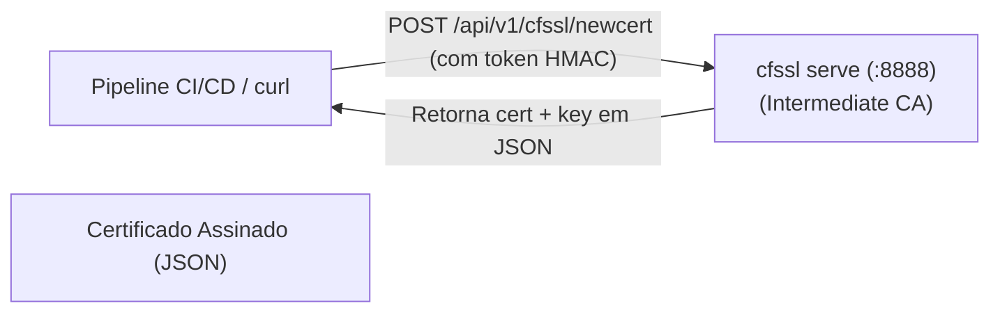

Ao longo dos três primeiros posts desta série, construímos e operamos uma Autoridade Certificadora completa utilizando estritamente os utilitários nativos do OpenSSL: entendemos os fundamentos do X.509 (), montamos a hierarquia de duas camadas no laboratório () e navegamos pelos ciclos operacionais de revogação, rotação e transição pós-quântica ().

Se você acompanhou a prática até aqui, adquiriu uma compreensão detalhada de cada engrenagem interna da criptografia de chaves públicas. Mas também sentiu na pele o custo de manutenção da abordagem clássica: sintaxes arcaicas em arquivos `.cnf` no formato INI, controle frágil de concorrência em bancos de dados de texto plano (`index.txt`), manipulação manual de seriais hexadecimais e comandos imperativos que não se integram com facilidade a esteiras modernas de CI/CD.

Para superar essa complexidade na escala da internet moderna, a equipe de engenharia da Cloudflare desenvolveu e abriu o código do **CFSSL (Cloudflare's PKI and TLS toolkit)** [^1].

O CFSSL reimagina o gerenciamento de certificados sob a ótica de engenharia de software: toda a configuração é declarativa em JSON, as extensões são agrupadas em perfis reutilizáveis (*profiles*), os utilitários operam de forma nativa com fluxos Unix e a ferramenta pode rodar como um microserviço HTTP oferecendo uma API REST para assinatura de certificados sob demanda.

Hora de aposentar os arquivos de configuração arcaicos e construir uma infraestrutura declarativa completa com CFSSL: Root e Intermediária em JSON, emissão com profiles dedicados para `php-01` e `db-01`, CA em modo daemon com API REST protegida por HMAC e cadeias empacotadas com `cfssl bundle`.



## Por que o CFSSL mudou o jogo da automação

Para entender o valor do CFSSL, basta comparar o fluxo de trabalho clássico do OpenSSL com a abordagem moderna:

```
+-------------------------------------------------------------------------+
|                        OPENSSL vs CFSSL                                 |
+------------------------------------+------------------------------------+
| OpenSSL (Clássico)                 | CFSSL (Cloudflare)                 |
+------------------------------------+------------------------------------+
| Arquivos de configuração INI       | Configuração declarativa em JSON   |
| Base de dados em texto (index.txt) | Stateless ou banco SQL robusto     |
| Serial controlado em arquivo plano | Seriais aleatórios de 128 bits     |
| Múltiplos passos manuais (CSR->CRT)| Um único comando via pipeline      |
| Sem interface de rede nativa       | API REST embutida (cfssl serve)    |
| Montagem manual de bundles         | Verificador e bundler automático   |
+------------------------------------+------------------------------------+
```

Quando o ecossistema de contêineres e orquestração de infraestrutura explodiu com o surgimento do Kubernetes, o CFSSL tornou-se a ferramenta de escolha de projetos seminais como o *Kubernetes The Hard Way* de Kelsey Hightower [^2]. Em vez de dezenas de arquivos `.cnf` cheios de seções obscuras, o administrador precisa de apenas dois arquivos JSON: um para descrever a autoridade (`ca-config.json`) e outro para solicitar o certificado (`ca-csr.json`).

Escrito em Go, o CFSSL ainda compila num único binário estático, instalado em qualquer servidor Linux sem arrastar dependências extras de sistema.

## Instalando o toolkit no Linux

O conjunto de ferramentas do CFSSL é composto por dois utilitários complementares:
1. `cfssl`: O motor principal de criptografia, geração de chaves, assinatura e servidor HTTP.
2. `cfssljson`: O utilitário auxiliar responsável por ler a saída JSON do `cfssl` e separar as chaves privadas, certificados e CSRs em arquivos individuais no disco.

Podemos instalar os binários diretamente no Debian ou Ubuntu através do gerenciador de pacotes ou baixando os executáveis oficiais do repositório no GitHub:

```bash
# Opção via apt (Debian/Ubuntu)
$ sudo apt update && sudo apt install -y golang-cfssl

# Ou instalação direta dos binários oficiais
$ CFSSL_VER="v1.6.5"
$ sudo curl -sLo /usr/local/bin/cfssl \
    "https://github.com/cloudflare/cfssl/releases/download/${CFSSL_VER}/cfssl_1.6.5_linux_amd64"
$ sudo curl -sLo /usr/local/bin/cfssljson \
    "https://github.com/cloudflare/cfssl/releases/download/${CFSSL_VER}/cfssljson_1.6.5_linux_amd64"
$ sudo chmod +x /usr/local/bin/cfssl /usr/local/bin/cfssljson

# Validar instalação
$ cfssl version
Version: 1.6.5
Runtime: go1.20
```

## O arquivo central de políticas: ca-config.json

No OpenSSL, para mudar a validade de um certificado ou alternar entre papéis de servidor e cliente, você precisa editar seções complexas dentro do arquivo `.cnf` ou criar múltiplos arquivos de configuração separados.

No CFSSL, todas as regras de negócio de emissão da autoridade residem em um único arquivo de configuração estruturado: o `ca-config.json`.

Vamos criar o nosso diretório de trabalho `~/cfssl-lab` e salvar a configuração corporativa de referência da nossa empresa fictícia `Example Corp`:

```bash
$ mkdir -p ~/cfssl-lab && cd ~/cfssl-lab
```

Crie o arquivo `ca-config.json`:

```json
{
  "signing": {
    "default": {
      "expiry": "8760h"
    },
    "profiles": {
      "intermediate": {
        "usages": [
          "signing",
          "digital signature",
          "crl sign"
        ],
        "expiry": "26280h",
        "ca_constraint": {
          "is_ca": true,
          "max_path_len": 0
        }
      },
      "server": {
        "usages": [
          "signing",
          "digital signature",
          "key encipherment",
          "server auth"
        ],
        "expiry": "2160h"
      },
      "client": {
        "usages": [
          "signing",
          "digital signature",
          "client auth"
        ],
        "expiry": "720h"
      },
      "peer": {
        "usages": [
          "signing",
          "digital signature",
          "key encipherment",
          "server auth",
          "client auth"
        ],
        "expiry": "720h"
      }
    }
  }
}
```

A estrutura desse JSON expressa com clareza as políticas de segurança:

1. **`signing.default`**: A política padrão aplicada caso nenhum perfil específico seja solicitado na linha de comando ou requisição de API. No nosso caso, define a expiração padrão para 8.760 horas (1 ano).
2. **Perfis de Assinatura (`profiles`)**:
   - **`intermediate`**: Perfil restrito para emissão de CAs subordinadas. A diretiva `ca_constraint` define `is_ca: true` e `max_path_len: 0`, garantindo matematicamente que a intermediária não poderá criar outras autoridades abaixo dela. Validade de 3 anos (26.280 horas).
   - **`server`**: Habilita a extensão `server auth` com validade de 90 dias (2.160 horas) para servidores web como o `php-01.example.com`.
   - **`client`**: Habilita a extensão `client auth` com validade de 30 dias (720 horas) para os certificados de acesso de João, Maria e Antônio.
   - **`peer`**: Habilita simultaneamente `server auth` e `clientAuth` para nós distribuídos que operam em mão dupla (como membros de um cluster etcd ou nós managers no Kubernetes).

## Criando a Root CA de forma declarativa

Agora precisamos emitir a nossa autoridade raiz. Em vez de prompts interativos no terminal respondendo país, estado e cidade, definimos os metadados do certificado em um arquivo chamado `root-csr.json`:

```json
{
  "CN": "Example Root CA",
  "key": {
    "algo": "ecdsa",
    "size": 384
  },
  "names": [
    {
      "C": "BR",
      "ST": "Minas Gerais",
      "L": "Uberlandia",
      "O": "Example Corp",
      "OU": "Segurança da Informação"
    }
  ],
  "ca": {
    "expiry": "87600h"
  }
}
```

Observe a concisão:
- `key.algo: "ecdsa"` e `key.size: 384` padronizam a geração na curva elíptica NIST P-384.
- `ca.expiry: "87600h"` define a validade de 10 anos para a âncora de confiança raiz.

Para gerar a chave privada e o certificado autoassinado da raiz, disparamos um único comando encadeado via pipe:

```bash
$ cfssl gencert -initca root-csr.json | cfssljson -bare root-ca
2026/12/05 10:00:00 [INFO] generating a new CA key and certificate from CSR
2026/12/05 10:00:00 [INFO] generate received request
2026/12/05 10:00:00 [INFO] received CSR
2026/12/05 10:00:00 [INFO] generating key: ecdsa-384
2026/12/05 10:00:00 [INFO] encoded CSR
2026/12/05 10:00:00 [INFO] signed certificate with serial: 41285038192837461928374619283746192837
```

O comando gerou três arquivos imediatamente prontos no disco:
- `root-ca-key.pem`: A chave privada ECDSA da Root CA (que deve receber `chmod 600` e ser guardada offline).
- `root-ca.pem`: O certificado público autoassinado da Root CA.
- `root-ca.csr`: A requisição original em formato PEM.

Podemos inspecionar o certificado gerado pelo CFSSL usando o comando `openssl x509`:

```bash
$ openssl x509 -in root-ca.pem -text -noout | head -25
Certificate:
    Data:
        Version: 3 (0x2)
        Serial Number:
            41:28:50:38:19:28:37:46:19:28:37:46:19:28:37
        Signature Algorithm: ecdsa-with-SHA384
        Issuer: C = BR, ST = Minas Gerais, L = Uberlandia, O = Example Corp, OU = Segurança da Informação, CN = Example Root CA
        Validity
            Not Before: Dec  5 10:00:00 2026 GMT
            Not After : Dec  2 10:00:00 2036 GMT
        Subject: C = BR, ST = Minas Gerais, L = Uberlandia, O = Example Corp, OU = Segurança da Informação, CN = Example Root CA
        Subject Public Key Info:
            Public Key Algorithm: id-ecPublicKey
                Public-Key: (384 bit)
                ASN1 OID: secp384r1
                NIST CURVE: P-384
```

O CFSSL gerou um número de série de 128 bits aleatório, eliminando a dependência de arquivos sequenciais `serial` do OpenSSL.

## Criando e assinando a CA Intermediária

Seguindo as boas práticas que estudamos na Parte 2, a Root CA nunca deve assinar certificados de servidores diretamente no dia a dia. Precisamos erguer a autoridade subordinada (**Intermediate CA**).

Crie o arquivo `intermediate-csr.json`:

```json
{
  "CN": "Example Intermediate CA",
  "key": {
    "algo": "ecdsa",
    "size": 384
  },
  "names": [
    {
      "C": "BR",
      "ST": "Minas Gerais",
      "L": "Uberlandia",
      "O": "Example Corp",
      "OU": "Operações de Infraestrutura"
    }
  ]
}
```

Aqui entra a elegância do modelo declarativo. A geração da chave da intermediária e a assinatura pela Root CA acontecem em um único pipeline:

```bash
$ cfssl gencert \
    -ca root-ca.pem \
    -ca-key root-ca-key.pem \
    -config ca-config.json \
    -profile intermediate \
    intermediate-csr.json | cfssljson -bare intermediate-ca
```

Ao inspecionarmos o arquivo gerado `intermediate-ca.pem`, confirmamos que o profile `intermediate` aplicou perfeitamente as restrições:

```bash
$ openssl x509 -in intermediate-ca.pem -noout -text | grep -A 3 "X509v3 Basic Constraints"
X509v3 Basic Constraints: critical
    CA:TRUE, pathlen:0
```

Para fechar o elo de confiança, criamos o arquivo de cadeia concatenando o certificado da intermediária com o da raiz:

```bash
$ cat intermediate-ca.pem root-ca.pem > ca-chain.pem
```

## Emissão declarativa de servidores e clientes

Com a autoridade intermediária operacional, emitir novos certificados para aplicações e pessoas leva apenas alguns segundos.

### 1. Certificado de Servidor para php-01.example.com

No CFSSL, os Subject Alternative Names (SANs) não exigem templates complexos de texto: eles podem ser passados diretamente em uma lista `hosts` no JSON ou através da flag `-hostname` na linha de comando.

Crie o descritor `php-01-csr.json`:

```json
{
  "CN": "php-01.example.com",
  "hosts": [
    "php-01.example.com",
    "www.example.com",
    "10.0.0.10",
    "127.0.0.1"
  ],
  "key": {
    "algo": "ecdsa",
    "size": 256
  },
  "names": [
    {
      "C": "BR",
      "O": "Example Corp"
    }
  ]
}
```

Dispare a emissão utilizando o profile `server`:

```bash
$ cfssl gencert \
    -ca intermediate-ca.pem \
    -ca-key intermediate-ca-key.pem \
    -config ca-config.json \
    -profile server \
    php-01-csr.json | cfssljson -bare php-01
```

O comando produz os arquivos `php-01.pem` (certificado) e `php-01-key.pem` (chave privada). Podemos validar imediatamente a presença dos SANs:

```bash
$ openssl x509 -in php-01.pem -noout -ext subjectAltName
X509v3 Subject Alternative Name: 
    DNS:php-01.example.com, DNS:www.example.com, IP Address:10.0.0.10, IP Address:127.0.0.1
```

### 2. Certificado de Cliente mTLS para o João

Para emitir a credencial do operador João, criamos o descritor `joao-csr.json` omitindo o campo `hosts` (já que clientes não respondem por endereços de rede):

```json
{
  "CN": "joao",
  "key": {
    "algo": "ecdsa",
    "size": 256
  },
  "names": [
    {
      "C": "BR",
      "O": "Example Corp",
      "OU": "Desenvolvimento"
    }
  ]
}
```

Emitimos utilizando o profile `client`:

```bash
$ cfssl gencert \
    -ca intermediate-ca.pem \
    -ca-key intermediate-ca-key.pem \
    -config ca-config.json \
    -profile client \
    joao-csr.json | cfssljson -bare joao
```

Ao inspecionar a extensão `extendedKeyUsage`, comprovamos a aplicação da restrição:

```bash
$ openssl x509 -in joao.pem -noout -ext extendedKeyUsage
X509v3 Extended Key Usage: 
    TLS Web Client Authentication
```

Se precisarmos entregar a credencial para o João instalar em seu navegador ou sistema desktop, geramos o contêiner PKCS#12 com senha:

```bash
$ openssl pkcs12 -export -out joao.p12 \
    -inkey joao-key.pem -in joao.pem \
    -certfile ca-chain.pem -passout pass:joaosecret
```

## A CA como microserviço: modo daemon e API REST

Até aqui, usamos o CFSSL como ferramenta de linha de comando. Mas o recurso mais poderoso do utilitário é o comando `cfssl serve`: a capacidade de expor a Autoridade Certificadora como um microserviço web leve através de uma API REST nativa [^3].



### Configurando autenticação por token HMAC

Em um ambiente corporativo, você não quer que qualquer pessoa da rede consiga solicitar certificados para a sua CA sem controle. O CFSSL suporta autenticação por tokens criptográficos HMAC SHA-256.

Vamos criar uma chave de autenticação compartilhada em hexadecimal:

```bash
# Gerar chave HMAC de 16 bytes em hex
$ openssl rand -hex 16
e8b9f7a2d3c4e5f6a1b2c3d4e5f60718
```

Atualizamos o arquivo `ca-config.json` para adicionar o bloco de autenticação associado ao perfil `server`:

```json
{
  "signing": {
    "default": {
      "expiry": "8760h"
    },
    "profiles": {
      "server": {
        "usages": [
          "signing",
          "digital signature",
          "key encipherment",
          "server auth"
        ],
        "expiry": "2160h",
        "auth_key": "ci-pipeline-key"
      }
    }
  },
  "auth_keys": {
    "ci-pipeline-key": {
      "type": "standard",
      "key": "e8b9f7a2d3c4e5f6a1b2c3d4e5f60718"
    }
  }
}
```

### Iniciando o daemon da CA

Iniciamos o servidor na porta local `8888` carregando a autoridade intermediária:

```bash
$ cfssl serve \
    -address 127.0.0.1 \
    -port 8888 \
    -ca intermediate-ca.pem \
    -ca-key intermediate-ca-key.pem \
    -config ca-config.json
2026/12/05 10:15:00 [INFO] Now listening on https://127.0.0.1:8888
```

O endpoint `/api/v1/cfssl/newcert` passa a aceitar requisições HTTP POST para geração de certificados em tempo real.

### Solicitando certificados via curl

Para consumir a API em uma esteira de deploy ou script Bash, montamos uma requisição JSON contendo o token de autenticação e os metadados do host:

```bash
# Payload com solicitação para o nó db-01
$ cat << 'EOF' > req-db01.json
{
  "profile": "server",
  "token": "e8b9f7a2d3c4e5f6a1b2c3d4e5f60718",
  "request": {
    "CN": "db-01.example.com",
    "hosts": ["db-01.example.com", "10.0.0.20"],
    "key": {
      "algo": "ecdsa",
      "size": 256
    },
    "names": [
      {
        "C": "BR",
        "O": "Example Corp"
      }
    ]
  }
}
EOF

# Disparar requisição contra o daemon
$ curl -s -X POST http://127.0.0.1:8888/api/v1/cfssl/newcert \
    -d @req-db01.json | cfssljson -bare db-01
```

O comando envia a requisição HTTP, o CFSSL valida o token HMAC, emite o certificado na hora e o `cfssljson` grava os arquivos `db-01.pem` e `db-01-key.pem` localmente.

Essa arquitetura elimina o transporte de chaves privadas pela rede: o cliente gera o CSR localmente e chama só o endpoint de assinatura (`/api/v1/cfssl/sign`), garantindo que a chave privada da aplicação jamais saia da máquina de destino.

## O utilitário cfssl bundle: resolvendo o drama das cadeias incompletas

Um dos erros mais comuns e irritantes em sustentação de servidores web é o envio de cadeias incompletas de certificados (o clássico `unable to get local issuer certificate` que vimos nos posts anteriores). Muitas vezes o operador cola apenas o certificado final no Nginx e esquece de incluir as autoridades intermediárias no bundle.

O CFSSL inclui um comando especializado chamado **`cfssl bundle`** [^4].

Ele lê um certificado de folha e, automaticamente:
1. Inspeciona a extensão AIA (Authority Information Access) do certificado para identificar a autoridade emissora.
2. Faz o download das CAs necessárias na rede ou busca em um repositório local de certificados confiáveis.
3. Monta e valida a ordem exata da cadeia criptográfica (`leaf -> intermediate -> root`).
4. Identifica certificados expirados ou chaves comprometidas no caminho.

Podemos testar o comando contra o certificado do nosso servidor:

```bash
$ cfssl bundle \
    -cert php-01.pem \
    -ca-bundle ca-chain.pem \
    -flavor optimal
2026/12/05 10:20:00 [INFO] Bundler: loading certs and keys
2026/12/05 10:20:00 [INFO] Bundler: building bundle
{
  "bundle": "-----BEGIN CERTIFICATE-----\n...\n-----END CERTIFICATE-----\n-----BEGIN CERTIFICATE-----\n...\n-----END CERTIFICATE-----",
  "crt": "-----BEGIN CERTIFICATE-----\n...\n-----END CERTIFICATE-----",
  "crl": "",
  "expires": "2027-03-05T10:00:00Z",
  "hostnames": [
    "php-01.example.com",
    "www.example.com",
    "10.0.0.10",
    "127.0.0.1"
  ],
  "issuer": "CN=Example Intermediate CA,O=Example Corp,C=BR",
  "signature": "SHA384withECDSA",
  "subject": "CN=php-01.example.com,O=Example Corp,C=BR",
  "status": {
    "expiring_SKIs": null,
    "untrusted_root_stores": null,
    "messages": null
  }
}
```

O parâmetro `-flavor optimal` garante que a cadeia inclua estritamente os certificados intermediários necessários, omitindo a raiz (já que navegadores e clientes devem possuir a raiz em seu próprio trust store). Se salvarmos a saída do campo `.bundle`, temos o `fullchain.pem` pronto para ser entregue ao Nginx, Apache ou HAProxy.

## Comparativo arquitetural: OpenSSL vs CFSSL vs HashiCorp Vault

Para que o time de engenharia tome a decisão correta de ferramenta, montamos uma matriz de decisão comparativa:

| Característica | OpenSSL 3.5 | CFSSL | HashiCorp Vault (PKI Engine) |
| :--- | :--- | :--- | :--- |
| **Paradigma** | Imperativo e CLI clássica | Declarativo (JSON) e CLI/API | Secrets Management e API-First |
| **Configuração** | Arquivos `.cnf` (INI) | Arquivos `.json` com profiles | Políticas HCL e endpoints HTTP |
| **Armazenamento de Estado** | `index.txt` e `serial` (Texto) | Stateless / SQLite / MySQL / PG | Raft Storage / Consul distribuído |
| **API de Rede Nativa** | Não (requer scripts CGI/wrap) | Sim (`cfssl serve` em Go) | Sim (API Enterprise completa) |
| **Curva de Aprendizado** | Média a Alta | Baixa | Média |
| **Melhor Caso de Uso** | Laboratório educacional e debug | Bootstraps de clusters e CI/CD | Produção corporativa em larga escala |

A regra prática é transparente:
- Use **OpenSSL** para dissecar certificados, debugar handshakes de rede no terminal e entender o funcionamento do X.509 em profundidade.
- Use **CFSSL** para automações de infraestrutura leve, provisionamento de laboratórios com Ansible/Vagrant, pipelines de CI/CD e esteiras de Kubernetes.
- Use **HashiCorp Vault** quando a sua infraestrutura corporativa exigir auto-rotação de credenciais de curtíssima duração (horas ou minutos), auditoria RBAC enterprise e integração com nuvens híbridas.

## Diagnóstico e Troubleshooting com CFSSL

Comandos essenciais para diagnosticar certificados e testar configurações declarativas:

### 1. Inspecionar e validar um arquivo de CSR sem gerar certificado

Para validar se o JSON de um CSR foi escrito corretamente antes de assinar:

```bash
$ cfssl genkey php-01-csr.json | cfssljson -bare test-key
$ openssl req -in test-key.csr -text -noout | grep -A 5 "Requested Extensions"
```

### 2. Validar a sintaxe do arquivo de profiles JSON

Se houver uma vírgula sobrando ou erro de sintaxe no `ca-config.json`, o CFSSL falhará na inicialização. Você pode validar o JSON rapidamente com `jq`:

```bash
$ jq . ca-config.json > /dev/null && echo "JSON Válido"
```

### 3. Verificar a cadeia montada de um certificado externo com cfssl certinfo

O CFSSL inclui o utilitário `cfssl certinfo` para inspecionar certificados remotos ou locais em formato JSON estruturado:

```bash
$ cfssl certinfo -cert php-01.pem | jq '{subject: .subject, sans: .sans, not_after: .not_after}'
```

```json
{
  "subject": {
    "common_name": "php-01.example.com",
    "names": [
      "php-01.example.com"
    ]
  },
  "sans": [
    "php-01.example.com",
    "www.example.com",
    "10.0.0.10",
    "127.0.0.1"
  ],
  "not_after": "2027-03-05T10:00:00Z"
}
```

## Exercícios

Para dominar a automação com CFSSL, complete os 5 desafios práticos a seguir:

### Exercício 1: Criando um perfil de certificado para VPN com CFSSL
Edite o arquivo `ca-config.json` e adicione um novo profile chamado `vpn-client` com validade de 24 horas (`24h`), configurado estritamente com os usages `signing`, `digital signature` e `client auth`.

<details>
<summary>Ver solução</summary>

No bloco `signing.profiles` do arquivo `ca-config.json`:

```json
"vpn-client": {
  "usages": [
    "signing",
    "digital signature",
    "client auth"
  ],
  "expiry": "24h"
}
```
</details>

### Exercício 2: Emissão declarativa de credencial para o Carlos
O consultor Carlos precisa de acesso temporário. Crie um arquivo `carlos-csr.json` com `CN: "carlos"` e emita o certificado utilizando o profile `vpn-client` criado no Exercício 1. Verifique a data de expiração calculada com `openssl x509 -dates`.

<details>
<summary>Ver solução</summary>

Crie `carlos-csr.json`:
```json
{
  "CN": "carlos",
  "key": {
    "algo": "ecdsa",
    "size": 256
  },
  "names": [
    {
      "C": "BR",
      "O": "Example Corp",
      "OU": "Consultoria Externa"
    }
  ]
}
```

Emita e valide:
```bash
$ cfssl gencert -ca intermediate-ca.pem -ca-key intermediate-ca-key.pem \
    -config ca-config.json -profile vpn-client carlos-csr.json | cfssljson -bare carlos

$ openssl x509 -in carlos.pem -noout -dates
```
A data `notAfter` será exatamente 24 horas posterior ao `notBefore`.
</details>

### Exercício 3: Testando a rejeição de requisição com token HMAC inválido
Inicie o daemon `cfssl serve` na porta 8888. Envie uma requisição via `curl` utilizando um token HMAC incorreto (`"token": "senha-falsa"`) e capture o código de erro HTTP e a mensagem devolvida pelo servidor.

<details>
<summary>Ver solução</summary>

```bash
$ curl -s -X POST http://127.0.0.1:8888/api/v1/cfssl/newcert \
    -d '{"profile": "server", "token": "senha-falsa", "request": {"CN": "teste"}}'
```
O servidor devolverá uma resposta JSON com `"success": false` e a mensagem de erro `{"code": 1100, "message": "Authentication failed"}`.
</details>

### Exercício 4: Auditoria de bundle com cfssl bundle
Utilize o comando `cfssl bundle` para verificar a cadeia do certificado de um domínio público na internet (por exemplo, `cloudflare.com` ou `kernel.org`) e inspecione a saída em JSON identificando se a cadeia foi classificada como `optimal`.

<details>
<summary>Ver solução</summary>

```bash
$ cfssl bundle -remote cloudflare.com:443 -flavor optimal | jq '{subject: .subject, issuer: .issuer, expires: .expires}'
```
</details>

### Exercício 5: Conversão de chave RSA para ECDSA no CSR
Crie um arquivo de CSR solicitando uma chave RSA de 2048 bits em vez de curva elíptica. Emita o certificado com o profile `server` e confirme com `openssl x509 -text` que o certificado resultante possui `Public Key Algorithm: rsaEncryption`.

<details>
<summary>Ver solução</summary>

No arquivo `legacy-server-csr.json`:
```json
{
  "CN": "legacy.example.com",
  "hosts": ["legacy.example.com"],
  "key": {
    "algo": "rsa",
    "size": 2048
  }
}
```

```bash
$ cfssl gencert -ca intermediate-ca.pem -ca-key intermediate-ca-key.pem \
    -config ca-config.json -profile server legacy-server-csr.json | cfssljson -bare legacy
$ openssl x509 -in legacy.pem -noout -text | grep "Public Key Algorithm"
```
</details>

## Conclusão

Neste post, deixamos para trás o mundo analógico dos arquivos INI e entramos de cabeça na automação moderna de certificados. Vimos como o CFSSL da Cloudflare transforma a gestão de uma Autoridade Certificadora em código versionável, como os profiles em JSON garantem a aplicação padronizada de políticas corporativas e como a API REST embutida viabiliza a emissão de credenciais sob demanda em pipelines contínuas.

Com o domínio do OpenSSL e do CFSSL, você agora possui o ferramental completo para construir, operar e automatizar qualquer infraestrutura baseada no modelo hierárquico tradicional de Autoridades Certificadoras X.509.

No próximo e último post da série (), vamos fechar o mapa mental da criptografia moderna dando uma guinada de paradigma: abandonaremos o conceito de autoridades centrais para explorar o ecossistema peer-to-peer do **OpenPGP**, aprendendo a criar chaves primárias offline, gerenciar subchaves na YubiKey e assinar digitalmente o nosso código no Git sem depender de nenhuma CA.

## Referências

[^1]: **CFSSL: Cloudflare's PKI and TLS toolkit** {*GitHub*} ([Link](https://github.com/cloudflare/cfssl))

[^2]: **Kubernetes The Hard Way (Kelsey Hightower)** {*GitHub*} ([Link](https://github.com/kelseyhightower/kubernetes-the-hard-way))

[^3]: **CFSSL API Documentation** {*Cloudflare*} ([Link](https://github.com/cloudflare/cfssl/tree/master/doc))

[^4]: **Bundling Certificates with CFSSL** {*Cloudflare Blog*} ([Link](https://blog.cloudflare.com/bundling-certificates-with-cfssl/))
