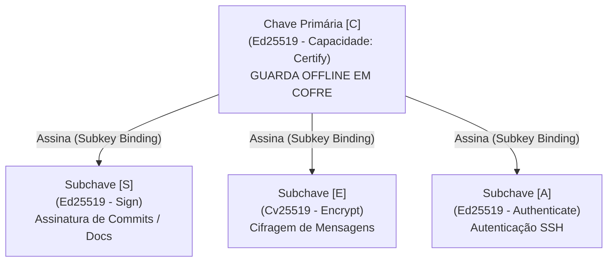
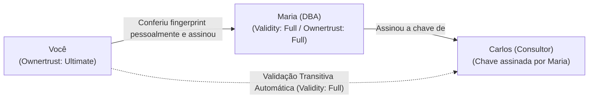

Durante os quatro primeiros capítulos desta série, vivemos sob o império da autoridade centralizada: aprendemos como a hierarquia do X.509 valida caminhos de confiança (), montamos autoridades operacionais no terminal com OpenSSL (), enfrentamos o desafio da revogação e rotação () e automatizamos a emissão declarativa com o CFSSL da Cloudflare ().

Em todos esses cenários, a premissa de segurança é a mesma: existe uma entidade soberana (a Autoridade Certificadora Raiz) em quem todo mundo concorda em confiar. Se a Root CA disser que um certificado pertence ao servidor `db-01` ou ao operador João, a rede inteira aceita a afirmação como verdade absoluta.

Mas o que acontece quando você não quer (ou não pode) depender de uma autoridade central?

Em comunicações interpessoais, no ativismo por direitos civis, na troca de mensagens entre desenvolvedores open source ou na assinatura de commits de código do kernel Linux, entregar a custódia da confiança para uma empresa privada ou para um governo é inaceitável. Se uma autoridade puder ser coagida, invadida ou corrompida, toda a cadeia de autenticidade desmorona.

É exatamente para responder a essa pergunta que existe o **OpenPGP**.

Neste quinto e último post da série, vamos dar uma guinada completa de paradigma: abandonaremos as autoridades certificadoras para explorar a **Teia de Confiança (Web of Trust)**. Vamos entender a matemática e a arquitetura das chaves OpenPGP modernas, aprender a separar a chave primária offline de subchaves operacionais, configurar a assinatura criptográfica de commits no Git, transformar o `gpg-agent` em autenticador SSH e compreender como a distribuição de chaves públicas evoluiu dos antigos keyservers envenenados para o moderno protocolo **WKD (Web Key Directory)**.



## OpenPGP vs GnuPG: padrão e implementação

Antes de abrirmos o terminal, vale alinhar a nomenclatura para evitar confusões clássicas:

- **PGP (*Pretty Good Privacy*):** software pioneiro criado por Phil Zimmermann em 1991, tão incômodo para o governo estadunidense que rendeu investigação por "exportação ilegal de armamento militar" [^1].
- **OpenPGP:** a especificação aberta da IETF (RFC 4880, atualizada pela **RFC 9580 / Crypto-Refresh** em 2024 [^2]).
- **GnuPG (`gpg`):** implementação livre mantida pelo projeto GNU e padrão de fato na maioria das distribuições Linux e sistemas Unix [^3].

Quando você roda o comando `gpg` no seu terminal, está interagindo com a implementação do GnuPG aderente à especificação OpenPGP.

## A anatomia de uma chave OpenPGP moderna

No modelo X.509, você tem um par de chaves por certificado: uma chave pública e uma privada. Se você precisa assinar um e-mail e autenticar um servidor HTTPS, gera dois certificados totalmente separados.

No OpenPGP, o modelo é composto por uma **árvore de chaves (Keyring Architecture)**:



Uma identidade OpenPGP completa é dividida em papéis funcionais estritos (as chamadas capacidades ou *flags*):

1. **`[C]` (Certify - Certificação):** O poder soberano da identidade. É com essa capacidade que você assina a criação de novas subchaves, revoga subchaves perdidas e assina as chaves públicas de outras pessoas para atestar que confia nelas. Esta capacidade **só deve existir na Chave Primária**.
2. **`[S]` (Sign - Assinatura):** Utilizada no dia a dia para assinar digitalmente e-mails, arquivos, tags e commits do Git.
3. **`[E]` (Encrypt - Cifragem):** Utilizada para decifrar dados e mensagens que outras pessoas enviaram para a sua chave pública.
4. **`[A]` (Authenticate - Autenticação):** Utilizada como credencial de login em sessões de rede (como autenticação em servidores SSH ou autenticação PAM no Linux).

### O fim da era RSA 4096: adotando Ed25519 e Cv25519

Durante mais de duas décadas, a recomendação clássica do GnuPG foi criar chaves mestras RSA de 4096 bits. Embora matematicamente seguras, chaves RSA desse calibre são lentas, pesadas e geram assinaturas gigantescas.

Com o amadurecimento da RFC 9580, o padrão moderno do OpenPGP adotou curvas elípticas de alta performance projetadas por Daniel J. Bernstein (djb) [^4], divididas em dois papéis:
- **Ed25519** para assinatura (`[S]`), autenticação (`[A]`) e certificação (`[C]`).
- **Cv25519 (X25519)** para troca de chaves e cifragem assimétrica (`[E]`).

Essas chaves possuem apenas 256 bits, entregam segurança equivalente a RSA 3072 bits com uma fração insignificante do consumo de CPU e geram assinaturas ultracompactas que cabem perfeitamente em metadados de commits do Git.

## A arquitetura de sobrevivência: chave primária offline

O maior erro de iniciantes no GnuPG é gerar uma chave única com todos os poderes (`[SC]`) e usá-la diariamente no laptop de trabalho. Se o computador for furtado ou comprometido por malware, a sua identidade digital inteira morre junto: você perde a capacidade de revogar subchaves e terá que emitir uma identidade do zero, pedindo para todos os seus contatos revalidarem a sua nova chave pública.

A prática dos desenvolvedores e administradores profissionais é implementar a **Arquitetura de Subchaves com Chave Primária Offline**:

1. A **Chave Primária `[C]`** é criada em um ambiente isolado (preferencialmente um sistema operacional live em pendrive ou um diretório temporário em memória RAM `tmpfs`).
2. Geramos imediatamente o **Certificado de Revogação**.
3. Criamos três **Subchaves dedicadas** ligadas à primária: uma para `[S]`, uma para `[E]` e uma para `[A]`.
4. Exportamos a chave primária privada para uma mídia física externa (backup redundante) e **apagamos a chave primária secreta do chaveiro do nosso computador**.
5. No nosso laptop de trabalho, deixamos apenas as subchaves operacionais.

Se o seu notebook for roubado amanhã, o invasor terá acesso apenas às subchaves. Você pega o seu pendrive de backup no cofre, usa a chave primária para emitir uma revogação apenas daquelas subchaves específicas, emite três novas subchaves e continua com a sua mesma identidade pública intacta. Ninguém na internet precisará atualizar a sua chave mestra.

Vamos construir essa estrutura passo a passo no terminal.

### 1. Criando um ambiente isolado em memória

Para garantir que nenhum rascunho de chave toque o disco magnético ou SSD antes do backup, vamos trabalhar dentro de uma pasta temporária em memória:

```bash
$ mkdir -p /tmp/gpg-secure && chmod 700 /tmp/gpg-secure
$ export GNUPGHOME=/tmp/gpg-secure
```

### 2. Gerando a Chave Primária exclusivamente com capacidade Certify

Iniciamos o GnuPG em modo especialista (`--expert --full-generate-key`):

```bash
$ gpg --expert --full-generate-key
```

Siga a sequência interativa:
1. Escolha a opção **`(9) ECC (select key types)`**.
2. O GnuPG perguntará as capacidades. Pressione **`A`** (para alternar a autenticação), **`S`** (para desativar a assinatura) e garanta que apenas a capacidade **`Certify`** fique ativa.
3. Quando estiver pronto, pressione **`Q`** (Finished).
4. Escolha a curva elíptica: opção **`(1) Curve 25519 (ed25519)`**.
5. Validade: digite **`0`** (chave primária não expira; quem expira são as subchaves).
6. Digite seu nome real, e-mail corporativo (ex: `joao@example.com`) e defina uma senha mestra forte (passphrase).

O GnuPG gerará a chave primária. Podemos conferir o fingerprint:

```bash
$ gpg --list-secret-keys --keyid-format LONG
/tmp/gpg-secure/pubring.kbx
---------------------------
sec   ed25519/4F829A10B3C2D1E0 2026-12-19 [C]
      Key fingerprint = 9A10 B3C2 D1E0 4F82 7A8B  1234 5678 9ABC DEF0 1234
uid                 [ultimate] Joao Silva <joao@example.com>
```

Anote o identificador da sua chave (neste exemplo, `4F829A10B3C2D1E0`).

### 3. Gerando o certificado de revogação antecipado

Antes de qualquer coisa, crie o certificado de revogação de emergência da chave primária e guarde-o em um local separado:

```bash
$ gpg --output /tmp/gpg-secure/revoke-primary.asc --gen-revoke 4F829A10B3C2D1E0
```

Se um dia a sua casa pegar fogo e você perder o backup físico da chave mestra, este arquivo de texto poderá ser enviado para os servidores públicos para avisar a todos que a chave foi aposentada.

### 4. Gerando as subchaves dedicadas: Sign, Encrypt e Authenticate

Agora abrimos o editor de chaves do GnuPG para adicionar as subchaves filhas:

```bash
$ gpg --expert --edit-key 4F829A10B3C2D1E0
gpg> addkey
```

Execute a sequência para cada subchave:

* **Subchave de Assinatura `[S]`:**
  - Escolha `(10) ECC (sign only)`.
  - Curva: `(1) Curve 25519 (ed25519)`.
  - Validade: `1y` (1 ano).

* **Subchave de Cifragem `[E]`:**
  - Digite `addkey` novamente.
  - Escolha `(12) ECC (encrypt only)`.
  - Curva: `(1) Curve 25519 (cv25519)`.
  - Validade: `1y` (1 ano).

* **Subchave de Autenticação `[A]` (para SSH):**
  - Digite `addkey` novamente.
  - Escolha `(11) ECC (set your own capabilities)`.
  - Alterne as letras até que apenas a flag **`Authenticate`** esteja ligada. Pressione `Q`.
  - Curva: `(1) Curve 25519 (ed25519)`.
  - Validade: `1y` (1 ano).

Digite `save` para gravar as alterações.

Agora ao rodar `gpg -K`, você verá a árvore completa:

```bash
$ gpg --list-secret-keys --keyid-format LONG
sec   ed25519/4F829A10B3C2D1E0 2026-12-19 [C]
      Key fingerprint = 9A10 B3C2 D1E0 4F82 7A8B  1234 5678 9ABC DEF0 1234
uid                 [ultimate] Joao Silva <joao@example.com>
ssb   ed25519/1122334455667788 2026-12-19 [S] [expires: 2027-12-19]
ssb   cv25519/99AABBCCDDEEFF00 2026-12-19 [E] [expires: 2027-12-19]
ssb   ed25519/A1B2C3D4E5F60718 2026-12-19 [A] [expires: 2027-12-19]
```

A tag `sec` indica a chave secreta primária e `ssb` representa as *secret subkeys*.

### 5. O procedimento de isolamento: expurgando a chave primária

Agora vamos exportar os backups e remover a chave primária privada do nosso keyring de uso diário:

```bash
# 1. Exportar a chave secreta completa (com a primária) para o backup offline
$ gpg --armor --export-secret-keys 4F829A10B3C2D1E0 > /tmp/gpg-secure/master-backup.key

# 2. Exportar apenas as subchaves secretas
$ gpg --armor --export-secret-subkeys 4F829A10B3C2D1E0 > /tmp/gpg-secure/subkeys.key

# 3. Exportar a chave pública
$ gpg --armor --export 4F829A10B3C2D1E0 > /tmp/gpg-secure/public.key

# 4. Apagar toda a chave privada do keyring atual
$ gpg --delete-secret-keys 4F829A10B3C2D1E0

# 5. Reimportar APENAS as subchaves secretas
$ gpg --import /tmp/gpg-secure/subkeys.key
```

Agora execute novamente o comando `gpg -K`:

```bash
$ gpg --list-secret-keys --keyid-format LONG
sec#  ed25519/4F829A10B3C2D1E0 2026-12-19 [C]
      Key fingerprint = 9A10 B3C2 D1E0 4F82 7A8B  1234 5678 9ABC DEF0 1234
uid                 [ultimate] Joao Silva <joao@example.com>
ssb   ed25519/1122334455667788 2026-12-19 [S] [expires: 2027-12-19]
ssb   cv25519/99AABBCCDDEEFF00 2026-12-19 [E] [expires: 2027-12-19]
ssb   ed25519/A1B2C3D4E5F60718 2026-12-19 [A] [expires: 2027-12-19]
```

Observe o símbolo **`sec#`**: a cerquilha (`#`) é o selo oficial do GnuPG indicando que **a chave privada primária não está presente no computador**. Apenas as subchaves (`ssb`) estão disponíveis para assinar commits, decifrar arquivos e autenticar no SSH.

Copie o arquivo `master-backup.key` para um pendrive criptografado com LUKS, guarde-o em um cofre físico e copie `public.key` e `subkeys.key` para o seu diretório real `~/.gnupg`. A sua identidade está protegida contra roubos de hardware.

## A Teia de Confiança: Ownertrust versus Validity

Como provamos na internet que uma chave pública pertence de fato ao João sem que uma Autoridade Certificadora emita um certificado X.509?

É aqui que opera a **Web of Trust**. O modelo apoia-se em assinaturas cruzadas e separa a avaliação em dois conceitos distintos [^5]. A saber:

1. **Validity (Validade da Chave):** A sua convicção de que aquela chave pública pertence mesmo àquela pessoa.
   - `unknown`: Não há informação sobre a identidade.
   - `marginal`: Você desconfia que seja a pessoa, mas não tem certeza plena.
   - `full`: Você tem certeza absoluta de que a chave pertence àquela pessoa (conferiu o fingerprint pessoalmente).
2. **Ownertrust (Confiança no Proprietário):** O quanto você confia no **julgamento** daquela pessoa quando ela assina as chaves de outras pessoas.
   - `never`: Você não confia nas assinaturas feitas por essa pessoa.
   - `marginal`: Você confia com reservas.
   - `full`: Você confia plenamente nas assinaturas feitas por essa pessoa.
   - `ultimate`: Reservado exclusivamente para as suas próprias chaves.



### O algoritmo da métrica de confiança

O GnuPG calcula automaticamente se uma chave é confiável utilizando uma fórmula matemática configurável:

Uma chave desconhecida adquire validade plena (`Validity: Full`) se:
- For assinada por **você diretamente** (`ultimate`); **OU**
- For assinada por **1 pessoa** em quem você depositou confiança plena (`Ownertrust: Full`); **OU**
- For assinada por **3 pessoas** em quem você depositou confiança marginal (`Ownertrust: Marginal`).

Por décadas, entusiastas de software livre organizavam *Key Signing Parties* em conferências: sentavam em círculo, conferiam documentos de identidade uns dos outros, comparavam fingerprints impressos em papel e depois assinavam as chaves entre si no terminal.

## A crise dos keyservers legados e o nascimento do WKD

Durante quase trinta anos, o ecossistema OpenPGP dependeu da rede global de **Keyservers SKS**: servidores distribuídos sincronizados entre si onde qualquer pessoa podia subir chaves públicas.

O protocolo SKS possuía uma falha de design trágica: os servidores eram **append-only sem qualquer validação de remetente**.

Entre 2018 e 2019, atacantes exploraram essa brecha em um ataque massivo de envenenamento (*Certificate Spamming Attack*):
- O atacante pegava a chave pública de desenvolvedores influentes (como Robert J. Hansen e Daniel Kahn Gillmor) e anexava mais de 50.000 assinaturas criptográficas falsas à mesma chave pública.
- Quando o `gpg` de um usuário tentava atualizar o chaveiro a partir do keyserver, baixava um arquivo de dezenas de megabytes. O parser de pacotes do GnuPG travava por esgotamento de memória, inviabilizando o uso do software em milhares de computadores corporativos.

O ataque forçou a morte da rede clássica de keyservers SKS.

### Os novos servidores verificantes e o protocolo WKD

A comunidade de segurança respondeu com duas inovações modernas:

1. **`keys.openpgp.org`:** Um keyserver moderno que rejeita assinaturas de terceiros e só publica a associação de um e-mail com uma chave após o dono confirmar o endereço por um link de validação.
2. **WKD (Web Key Directory):** Formalizado pela RFC 9580, o WKD descentraliza a descoberta de chaves atrelando-a ao próprio domínio de e-mail do usuário via HTTPS [^6].

Quando você quer obter a chave pública de um desenvolvedor do projeto Debian (`exemplo@debian.org`), o GnuPG não bate em um keyserver desconhecido: ele faz uma requisição HTTPS direta para o servidor web do próprio domínio Debian sob a rota:

```
https://openpgpkey.debian.org/.well-known/openpgpkey/debian.org/hu/<hash-do-email>
```

Se o domínio HTTPS é autêntico, a chave pública entregue por ele é autêntica. Grandes distribuições (Debian, Arch Linux, Fedora) e provedores de e-mail seguro (como ProtonMail) já distribuem as chaves públicas de seus desenvolvedores e usuários exclusivamente via WKD.

Podemos buscar chaves automaticamente via WKD no terminal:

```bash
$ gpg --locate-keys torvalds@kernel.org
```

O GnuPG consulta o endpoint HTTPS do `kernel.org`, baixa a chave oficial de Linus Torvalds e a importa diretamente para o seu chaveiro sem qualquer risco de envenenamento.

## Aplicações no dia a dia do engenheiro de infraestrutura

Uma identidade OpenPGP bem configurada simplifica e blinda a rotina de qualquer operador Linux em três frentes:

### 1. Assinatura criptográfica de commits no Git

Para garantir que ninguém com acesso ao repositório consiga forjar commits se passando por você:

```bash
# 1. Configurar a subchave de assinatura [S] no Git
$ git config --global user.signingkey 1122334455667788

# 2. Habilitar assinatura obrigatória por padrão
$ git config --global commit.gpgsign true
$ git config --global tag.gpgSign true

# 3. Informar o binário do GnuPG
$ git config --global gpg.program gpg
```

Ao rodar `git commit -m "feat: nova funcionalidade"`, o Git aciona o `gpg-agent`, solicita a sua senha e grava uma assinatura criptográfica detached dentro do objeto do commit. No GitHub e GitLab, esses commits recebem o selo verde **Verified**.

### 2. Autenticação SSH usando a subchave de autenticação

Você não precisa manter arquivos separados `id_ed25519` no seu `~/.ssh`. A sua subchave OpenPGP com capacidade `[A]` pode atuar nativamente como chave SSH [^7].

Edite o arquivo `~/.gnupg/gpg-agent.conf`:

```ini
enable-ssh-support
default-cache-ttl 3600
max-cache-ttl 7200
```

Adicione ao seu `~/.bashrc` ou `~/.zshrc`:

```bash
export GPG_TTY=$(tty)
export SSH_AUTH_SOCK=$(gpgconf --list-dirs agent-ssh-socket)
gpgconf --launch gpg-agent
```

Identifique o *keygrip* da sua subchave `[A]` com o comando:

```bash
$ gpg --list-keys --with-keygrip 4F829A10B3C2D1E0
```

Copie o hash de 40 caracteres listado abaixo da subchave `[A]` e adicione-o ao arquivo `~/.gnupg/sshcontrol`.

Agora extraia a sua chave pública no formato do OpenSSH:

```bash
$ ssh-add -L
ssh-ed25519 AAAAC3NzaC1lZDI1NTE5AAAA... (none)
```

Cole essa linha no `/root/.ssh/authorized_keys` dos seus servidores. Quando você disparar um `ssh root@servidor`, quem responderá pelo desafio criptográfico na rede será a sua subchave do GnuPG.

### 3. Gestão de segredos de terminal com pass

O utilitário **`pass`** (o gerenciador de senhas padrão do Unix) organiza senhas e credenciais em arquivos de texto plano encriptados individualmente com a sua subchave `[E]`, versionados através de uma árvore do Git [^8]. O fluxo de uso é direto:

```bash
# Inicializar o repositório de senhas com a sua chave
$ pass init 4F829A10B3C2D1E0

# Inserir um segredo
$ pass insert infra/banco-producao

# Recuperar a senha
$ pass infra/banco-producao
```

## Blindagem em hardware: YubiKey OpenPGP Smart Card

Se você quiser levar a segurança ao estado da arte, pode transferir as três subchaves operacionais (`[S]`, `[E]` e `[A]`) para dentro do chip criptográfico de uma chave de segurança física (como a **YubiKey**) através da interface CCID (Chip Card Interface Device) [^9].

```bash
# Abrir o assistente do smart card no GnuPG
$ gpg --card-edit
```

Dentro do prompt do GnuPG, o comando `keytocard` permite mover cada subchave para o seu respectivo slot físico no hardware:
- Subchave `[S]` para o slot *Signature*.
- Subchave `[E]` para o slot *Encryption*.
- Subchave `[A]` para o slot *Authentication*.

Uma vez transferidas com `keytocard`, as chaves privadas são **apagadas do disco e passam a viver exclusivamente na memória protegida do chip da YubiKey**.

Podemos configurar a chave com o utilitário `ykman` para exigir **toque físico no botão metálico (Touch Policy)**: toda vez que você for assinar um commit no Git ou abrir uma sessão SSH, a YubiKey piscará uma luz e a operação só será concluída se o seu dedo encostar no hardware. Mesmo que o seu computador seja invadido por um exploit de controle remoto, o atacante não conseguirá assinar nada sem a sua presença física ao lado da máquina.

## Diagnóstico e Troubleshooting com GnuPG

Comandos essenciais para diagnosticar problemas e verificar a saúde do chaveiro:

### 1. Inspecionar chaves secretas com fingerprints completos

Nunca confie em IDs curtos de 32 bits (como `0xB3C2D1E0`), pois eles podem sofrer colisões forjadas intencionais. Sempre use o formato longo ou o fingerprint completo:

```bash
$ gpg --list-secret-keys --keyid-format LONG --with-fingerprint
```

### 2. Recarregar o gpg-agent e validar conectividade do terminal

Se o GnuPG falhar ao pedir a senha com erros como `Inappropriate ioctl for device`:

```bash
$ export GPG_TTY=$(tty)
$ gpg-connect-agent reloadagent /bye
```

### 3. Verificar o status do banco de confiança

```bash
$ gpg --check-trustdb
gpg: marginals needed: 3  completes needed: 1  trust model: pgp
gpg: depth: 0  valid:   1  signed:   2  trust: 0-, 0q, 0n, 0m, 0f, 1u
```

### 4. Testar a validação de assinatura em arquivos

```bash
# Assinar um arquivo gerando assinatura detached (.sig)
$ gpg --armor --detach-sign arquivo.tar.gz

# Verificar a integridade e autenticidade da assinatura
$ gpg --verify arquivo.tar.gz.asc arquivo.tar.gz
gpg: Signature made Sat Dec 19 10:30:00 2026 GMT
gpg:                using EDDSA key 1122334455667788
gpg: Good signature from "Joao Silva <joao@example.com>" [ultimate]
```

## Exercícios

Para dominar a manipulação de chaves OpenPGP, resolva os 5 exercícios práticos a seguir:

### Exercício 1: Identificação de capacidades de chaves
Execute o comando `gpg --list-keys --keyid-format LONG` em uma chave do seu chaveiro e identifique quais subchaves possuem permissão de assinatura (`[S]`) e quais possuem permissão de cifragem (`[E]`).

<details>
<summary>Ver solução</summary>

Procure pelas letras entre colchetes ao lado da data de cada linha `sub` ou `ssb`:
- `[S]` indica a subchave utilizada para `git commit -S` e assinatura de documentos.
- `[E]` indica a subchave utilizada para receber dados criptografados.
</details>

### Exercício 2: Consulta de chave pública via WKD
Utilize o GnuPG para localizar e importar a chave pública de um desenvolvedor do Kernel Linux ou do projeto Arch Linux utilizando o comando `--locate-keys`.

<details>
<summary>Ver solução</summary>

```bash
$ gpg --auto-key-locate clear,wkd --locate-keys torvalds@kernel.org
```
O GnuPG fará o download direto via HTTPS do servidor do `kernel.org` sem consultar keyservers convencionais.
</details>

### Exercício 3: Assinando um commit de teste com Git
Configure um repositório Git local temporário, crie um commit assinado com a sua subchave e verifique a integridade da assinatura com `git log --show-signature`.

<details>
<summary>Ver solução</summary>

```bash
$ mkdir /tmp/git-test && cd /tmp/git-test
$ git init
$ git config user.name "Joao Silva"
$ git config user.email "joao@example.com"
$ git config user.signingkey <KEY-ID-DA-SUBCHAVE-S>
$ echo "teste" > README.md
$ git add README.md
$ git commit -S -m "commit assinado"
$ git log --show-signature -n 1
```
A saída exibirá a mensagem `gpg: Good signature from...` confirmando a autenticidade do commit.
</details>

### Exercício 4: Definindo o nível de Ownertrust de um contato
Importe a chave pública de um colega de trabalho e altere o nível de confiança no julgamento dele para confiança plena (`full`). Confirme a alteração rodando `gpg --check-trustdb`.

<details>
<summary>Ver solução</summary>

```bash
$ gpg --edit-key <FINGERPRINT-DO-COLEGA>
gpg> trust
# Escolha a opção (4) = I trust fully
gpg> save
$ gpg --check-trustdb
```
</details>

### Exercício 5: Criação e teste de mensagem criptografada em pipeline
Escreva uma mensagem de teste em um arquivo, cifre o arquivo para a sua própria chave utilizando o algoritmo de curva elíptica e decifre a mensagem no terminal direcionando a saída para stdout.

<details>
<summary>Ver solução</summary>

```bash
$ echo "Dado ultrassecreto de infraestrutura" > segredo.txt
$ gpg --armor --encrypt --recipient joao@example.com segredo.txt
$ gpg --decrypt segredo.txt.asc
```
</details>

## Conclusão: o mapa mental definitivo da criptografia prática

Ao longo de cinco posts densos, percorremos os modelos fundamentais de confiança que sustentam a infraestrutura e a segurança da informação moderna:

```
+-------------------------------------------------------------------------+
|                  O MAPA MENTAL DA CONFIANÇA NA PRÁTICA                  |
+-------------------+-----------------------+-----------------------------+
| Ecossistema       | Modelo de Confiança   | Casos de Uso Ideais         |
+-------------------+-----------------------+-----------------------------+
| X.509 (OpenSSL)   | Hierárquico estrito   | Web PKI, conformidade legal |
|                   | (Root -> Sub -> Leaf) | e aprendizado de baixo nível|
+-------------------+-----------------------+-----------------------------+
| X.509 (CFSSL)     | Hierárquico declarativ| Automação com JSON, CI/CD,  |
|                   | com API REST          | bootstraps de Kubernetes    |
+-------------------+-----------------------+-----------------------------+
| OpenSSH           | Híbrido leve          | Acesso seguro a frotas de   |
| (Certificados SSH)| (CA plana de 1 nível) | servidores Linux corporativos|
+-------------------+-----------------------+-----------------------------+
| OpenPGP (GnuPG)   | Teia descentralizada  | Identidade soberana, git,   |
|                   | (Web of Trust / WKD)  | mensagens e proteção pessoal|
+-------------------+-----------------------+-----------------------------+
```

Não existe um modelo vencedor absoluto: cada arquitetura resolveu um trade-off operacional diferente.
- Quando você precisa autenticar daemons distribuídos e microsserviços com controle centralizado rígido, o **X.509 automatizado via CFSSL ou Ansible** é o rei indiscutível.
- Quando você precisa dar acesso de shell para engenheiros em centenas de VMs sem dor de cabeça de revogação, os **Certificados SSH** são imbatíveis.
- E quando você precisa assinar seu código, proteger comunicações sem intermediários e manter o controle irrevogável da sua identidade criptográfica, o **OpenPGP** continua sendo a fortaleza definitiva.

Com este encerramento da série **Criptografia na Prática**, temos a base conceitual e operacional completa para os desafios de infraestrutura que virão pela frente em nossos clusters e servidores.

## Referências

[^1]: **Why Do You Need PGP? (Phil Zimmermann, 1991)** {*Phil Zimmermann Official Site*} ([Link](https://www.philzimmermann.com/EN/essays/WhyI涵WrotePGP.html))

[^2]: **RFC 9580: OpenPGP (Crypto-Refresh)** {*IETF Datatracker*} ([Link](https://datatracker.ietf.org/doc/html/rfc9580))

[^3]: **The GNU Privacy Guard (GnuPG)** {*Free Software Foundation*} ([Link](https://gnupg.org/))

[^4]: **Ed25519: High-speed high-security signatures** {*Daniel J. Bernstein et al.*} ([Link](https://ed25519.cr.yp.to/))

[^5]: **The OpenPGP Web of Trust Explained** {*Rubinstein / GnuPG Documentation*} ([Link](https://www.gnupg.org/gph/en/manual/x334.html))

[^6]: **RFC 9580 §10: Web Key Directory (WKD)** {*IETF Datatracker*} ([Link](https://datatracker.ietf.org/doc/html/rfc9580#section-10))

[^7]: **Using OpenPGP Keys with OpenSSH** {*Debian Wiki*} ([Link](https://wiki.debian.org/Smartcards/YubiKey4#OpenSSH))

[^8]: **pass: the standard unix password manager** {*zx2c4.com*} ([Link](https://www.passwordstore.org/))

[^9]: **YubiKey OpenPGP Smart Card Implementation Guide** {*Yubico Support*} ([Link](https://support.yubico.com/hc/en-us/articles/360013790259-Using-Your-YubiKey-with-OpenPGP))
