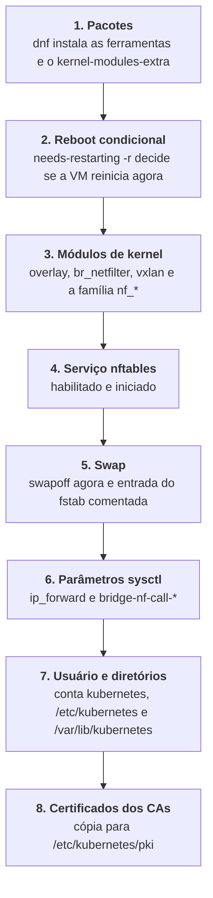
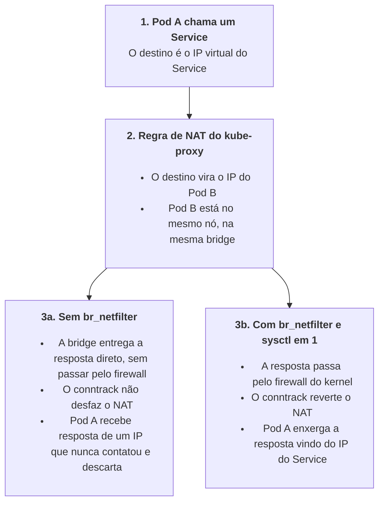

Uma VM AlmaLinux recém-saída do `vagrant up` é um ótimo servidor genérico: quieta, previsível e configurada para aplicações comuns. Ela não repassa pacotes entre interfaces, não deixa o firewall inspecionar o tráfego das pontes de rede, convive com swap sem remorso e nem sequer conhece os nomes das outras máquinas do laboratório. Para quem vai virar nó de Kubernetes, cada uma dessas características é um problema que precisa ser resolvido.

Neste post, vamos cobrir exatamente essa lacuna: tudo o que precisa mudar no sistema operacional de fábrica antes que o primeiro binário do Kubernetes encoste no disco. No `kubeadm`, essa etapa é mascarada como uma simples checagem de *preflight*. Aqui, sem instaladores automáticos, nós assumimos essa responsabilidade e deixamos o Ansible preparar cada nó de forma repetível, previsível e sem surpresas.

> [!NOTE] Nota da Série e Contexto de Laboratório
> Este post faz parte da série **"Kubernetes in a Box"**, onde dissecamos e construímos, do zero e de forma totalmente reproduzível via Ansible, um cluster Kubernetes completo, com alta disponibilidade, armazenamento persistente, rede moderna e observabilidade. Todo o código do projeto está disponível no repositório parceiro [vndmtrx/k8s-in-a-box](https://github.com/vndmtrx/k8s-in-a-box).
>
> **Aviso de escopo:** as decisões de arquitetura e parâmetros deste projeto foram pensadas sob medida para a nossa realidade de laboratório local em estações Linux com Vagrant e KVM/Libvirt. Elas priorizam aprendizado profundo e reprodutibilidade rápida sobre convenções corporativas de produção. O cluster foi originalmente projetado em versões anteriores e recentemente atualizado para o **Kubernetes v1.37.0**.



## Duas roles, três grupos de máquinas

Todo o código desta etapa está dividido em duas roles no repositório parceiro [^1], porque as máquinas do laboratório têm papéis e requisitos diferentes:

A [infra-sistema](https://github.com/vndmtrx/k8s-in-a-box/tree/main/ansible/infra-sistema) cuida do que qualquer máquina do laboratório precisa, inclusive as que nunca vão rodar `kubelet`. A [k8s-cluster-base](https://github.com/vndmtrx/k8s-in-a-box/tree/main/ansible/k8s-cluster-base) cuida apenas de quem vai ser nó.

```
todos (cluster.yml, tag cluster-sistema)
├── suporte
│   ├── loadbalancers  -> infra-sistema
│   └── nfs            -> infra-sistema
└── cluster            (cluster.yml, tag cluster-kubernetes-base)
    ├── managers       -> infra-sistema + k8s-cluster-base
    └── workers        -> infra-sistema + k8s-cluster-base

clientes (ops.yml, tag ops-sistema)
└── kubox              -> infra-sistema
```

O grupo `todos` recebe a `infra-sistema` no [cluster.yml](https://github.com/vndmtrx/k8s-in-a-box/blob/main/ansible/cluster.yml). O grupo `cluster` recebe, além dela, a `k8s-cluster-base`. E o `kubox`, que está fora de `todos` e mora no grupo `clientes`, recebe a `infra-sistema` pelo [ops.yml](https://github.com/vndmtrx/k8s-in-a-box/blob/main/ansible/ops.yml). É por isso que não existe `swapoff` nem `br_netfilter` no balanceador: ele não é nó, e carregar módulo de ponte numa máquina que só roda HAProxy seria enfeite.

Do lado do `Makefile`, as duas roles ficam em alvos diferentes:

```makefile
# Trecho do Makefile
infra: garante-config
	ANSIBLE_CONFIG="$(CFG)" ansible-playbook "$(PLAYBOOK)" $(ANSIBLE_VERBOSE) --tags cluster-artefatos,cluster-pki,cluster-sistema,cluster-balanceador,cluster-nfs

control-plane: garante-config
	ANSIBLE_CONFIG="$(CFG)" ansible-playbook "$(PLAYBOOK)" $(ANSIBLE_VERBOSE) --tags cluster-kubernetes-base,cluster-kubelet,cluster-etcd,cluster-kube-apiserver,cluster-kube-controller-manager,cluster-kube-scheduler
```

O `make infra` leva a `infra-sistema` (junto com artefatos, PKI, balanceador e NFS). O `make control-plane` abre com a `k8s-cluster-base` e segue para o kubelet e o resto do *control plane*. Dentro do `cluster.yml`, a ordem dos *plays* também importa: artefatos, PKI, sistema, balanceador, NFS e só então a base dos nós.

> [!WARNING] Rodar fora de ordem
> As duas roles dependem de coisas produzidas por *plays* anteriores. O Tailspin que a `infra-sistema` copia para as VMs é baixado antes, pela role `infra-artefatos` (tag `cluster-artefatos`), e os certificados dos CAs que a `k8s-cluster-base` distribui são gerados antes, pela `infra-pki` (tag `cluster-pki`). Se você rodar apenas `--tags cluster-sistema` ou `--tags cluster-kubernetes-base` num clone recém-feito, o Ansible vai reclamar de arquivo de origem inexistente.

## A role infra-sistema: o que toda máquina precisa

O arquivo que importa aqui é o [00-base.yml](https://github.com/vndmtrx/k8s-in-a-box/blob/main/ansible/infra-sistema/tasks/00-base.yml). São poucas tasks, mas cada uma resolve um problema que costuma aparecer no pior momento possível.

### SELinux permissivo, de novo

Lembra do `setenforce 0` escondido no `Vagrantfile`, lá na ? A `infra-sistema` repete a instrução, desta vez declarativa:

```yaml
# Trecho de ansible/infra-sistema/tasks/00-base.yml (nome da task encurtado)
- name: Colocar SELinux em modo permissivo
  become: true
  ansible.posix.selinux:
    policy: targeted
    state: permissive
```

Redundante? Um pouco, e de propósito. O módulo [^3] faz duas coisas: grava o modo no `/etc/selinux/config`, para sobreviver ao reboot, e aplica na hora o equivalente a um `setenforce 0`. A role não deve depender de quem criou a VM. Se você trocar de *box*, provisionar de outro jeito, ou se alguém rodar `setenforce 1` no meio do caminho, a próxima execução do playbook devolve a máquina ao estado combinado.

> [!NOTE] Permissivo continua sendo diferente de desligado
> No modo permissivo o kernel não bloqueia nada, mas continua auditando cada acesso que a política teria negado, e registra tudo no `audit.log`. É esse registro que alimenta a política customizada do projeto, compilada e instalada para o kubelet. Se quiser entender os detalhes dessa política, o repositório traz a documentação completa em [docs/selinux.md](https://github.com/vndmtrx/k8s-in-a-box/blob/main/docs/selinux.md).

### Pacotes, fuso horário e locale

A lista de pacotes em `defaults/main.yml` da role (`pacotes_extras`) não traz nada de Kubernetes, mas entrega a base operacional: utilitários de rede e shell (`mtr`, `nano`, `wget`, `bash-completion`), suporte a idiomas para o `pt_BR.UTF-8` e o `dnf-utils` (que traz o `needs-restarting`, usado mais adiante para decidir se o nó precisa reiniciar após atualizações de kernel).

Em seguida, o Ansible garante que todas as VMs estejam sob o mesmo fuso horário (`America/Sao_Paulo`) e locale. Fuso alinhado evita dor de cabeça na hora de correlacionar logs de componentes distribuídos como `etcd` e `kube-apiserver`.

> [!TIP] Dica
> Com `pt_BR.UTF-8`, mensagens de erro no terminal passam a vir traduzidas, o que atrapalha pesquisas de bugs. Para ver saídas técnicas no padrão em inglês, rode o comando precedido de `LC_ALL=C` (exemplo: `LC_ALL=C systemctl status chronyd`).

### O arquivo /etc/hosts gerado pelo inventário

Não existe servidor de DNS no laboratório. As VMs enxergam a internet pela `eth0` e conversam entre si pela `eth1`, e nada no meio traduz `worker1.k8sbox.local` para `172.24.0.41`. Quem faz esse papel é um `/etc/hosts` gerado a partir do próprio inventário, pelo template [hosts.j2](https://github.com/vndmtrx/k8s-in-a-box/blob/main/ansible/infra-sistema/templates/hosts.j2):

```jinja
# Trecho de ansible/infra-sistema/templates/hosts.j2
# Hostname da máquina
127.0.1.1 {{ inventory_hostname }}

# Entradas para os FQDNs dos endpoints
{{ keepalived_vip_ip }} {{ vip_api_fqdn }} {{ vip_etcd_fqdn }}

# Entradas das máquinas do cluster

{{ hostvars[host].ansible_host }} {{ hostvars[host].fqdn }}

```

O IP e o FQDN de cada máquina vêm de `ansible_host` e `fqdn`, exatamente os campos que você viu no `hosts-*.yml` da Parte 3. No topologia `mini`, o arquivo renderizado fica assim (a ordem das últimas linhas pode variar):

```
# Hostname da máquina
127.0.1.1 manager1

# Entradas para os FQDNs dos endpoints
172.24.0.10 api.k8sbox.local etcd.k8sbox.local

# Entradas das máquinas do cluster
172.24.0.21 loadbalancer1.k8sbox.local
172.24.0.25 nfs.k8sbox.local
172.24.0.31 manager1.k8sbox.local
172.24.0.41 worker1.k8sbox.local
172.24.0.42 worker2.k8sbox.local
```

Repare na linha do meio. O IP `172.24.0.10` é o VIP do Keepalived, configurado para o balanceador de carga. Mesmo antes do serviço subir, o nome `api.k8sbox.local` já aponta para ele em todas as máquinas desde agora. Quando o VIP responder, todo mundo já sabe onde ele mora. E é esse nome, não o IP de um manager individual, que o kube-proxy usa para falar com a API (`https://api.k8sbox.local:6443`) e que consta nos certificados emitidos para o cluster.

> [!TIP] Dica
> Para testar resolução de nomes, use `getent hosts api.k8sbox.local` e não `nslookup` ou `dig`. Essas duas ferramentas perguntam direto a um servidor DNS e ignoram o `/etc/hosts`, então elas dirão que o nome não existe mesmo quando qualquer aplicação do sistema o resolve normalmente. O `getent` passa pelo mesmo caminho que as aplicações (a ordem definida no `nsswitch.conf`, em que arquivos locais vêm antes do DNS).

### Tailspin: colorização de logs

Para fechar a `infra-sistema`, instalamos o [Tailspin](https://github.com/bensadeh/tailspin) [^4] (`tspin`). Ele destaca automaticamente IPs, datas, status HTTP e níveis de severidade na saída padrão, transformando a leitura do `journalctl` em algo muito mais legível quando a rede ou o kubelet começarem a chiar:

```bash
$ journalctl -u sshd --no-pager | tspin
```

O binário é baixado no host pela role de artefatos e descompactado em `/usr/local/bin` com verificação de idempotência para não baixar novamente se já existir. Diferente dos binários do Kubernetes, aqui usamos a URL `latest` sem checksum rígido — concessão aceitável para uma ferramenta de conveniência em lab local descartável.

## A role k8s-cluster-base: transformando uma VM em nó

Daqui em diante estamos apenas nas máquinas do grupo `cluster`, os managers e os workers. O [main.yml](https://github.com/vndmtrx/k8s-in-a-box/blob/main/ansible/k8s-cluster-base/tasks/main.yml) da role importa dois arquivos de tasks: [01-instalacao.yml](https://github.com/vndmtrx/k8s-in-a-box/blob/main/ansible/k8s-cluster-base/tasks/01-instalacao.yml) e [02-pki.yml](https://github.com/vndmtrx/k8s-in-a-box/blob/main/ansible/k8s-cluster-base/tasks/02-pki.yml). O primeiro é uma sequência em que a ordem não é estética:



Duas dependências de ordem merecem atenção. O reboot precisa vir antes dos módulos, e os módulos precisam vir antes do `sysctl`. Já vamos ver por quê.

### Os pacotes do nó

Em vez de uma lista de compras, vou agrupar pelo problema que cada pacote resolve. A variável é `pacotes_kubernetes`, nos [defaults da role](https://github.com/vndmtrx/k8s-in-a-box/blob/main/ansible/k8s-cluster-base/defaults/main.yml):

| Pacote | Por que está aqui |
|:---|:---|
| `kernel-modules-extra` | Módulos de kernel de uso menos comum, que nem sempre vêm instalados. É um seguro contra descobrir que falta um módulo de rede no meio de um pod. Para ver o que ele traz, `rpm -ql kernel-modules-extra` |
| `iproute` | O `ip` e o `ss`, base de qualquer diagnóstico de rede |
| `nftables` | O cliente `nft`, para ler as regras que o kube-proxy vai escrever |
| `iptables` e `iptables-nft` | O comando `iptables` com backend nf_tables. Muita ferramenta e muito plugin de CNI do ecossistema ainda chamam `iptables`, e esse pacote faz tudo cair no mesmo subsistema do kernel em vez de manter duas tabelas de regras em paralelo |
| `conntrack-tools` | O `conntrack -L` lista a tabela de conexões e o `conntrack -E` mostra eventos em tempo real. Essa tabela é o coração do NAT dos Services |
| `ethtool` | Inspeciona e ajusta a placa de rede. *Checksum offload* é suspeito clássico quando o tráfego VXLAN simplesmente some |
| `socat` | O canivete de redirecionar bytes entre dois pontos. Historicamente, foi o que fazia o `kubectl port-forward` funcionar quando o runtime precisava |
| `tar` e `xz` | O módulo `unarchive` do Ansible depende do `tar` no alvo, e o `xz` cobre tarballs comprimidos nesse formato |
| `skopeo` | Copia imagens de contêiner entre registries e arquivos sem precisar de daemon. A role do kubelet usa para o cache local de imagens que vimos na Parte 3 |

Nada disso inicia serviço ou altera comportamento do sistema. São ferramentas esperando para serem úteis.

### O reboot condicional

Logo depois da instalação de pacotes, a role pergunta se a máquina precisa reiniciar:

```yaml
# Trecho de ansible/k8s-cluster-base/tasks/01-instalacao.yml
- name: Verificar se precisa reiniciar pós-instalação de pacotes
  ansible.builtin.command: needs-restarting -r
  register: reboot_check_k8s
  ignore_errors: true
  changed_when: reboot_check_k8s.rc == 1
  failed_when: reboot_check_k8s.rc not in [0, 1]
  notify: Reiniciar VM

- name: Executar reboot imediato se necessário
  ansible.builtin.meta: flush_handlers
```

O `needs-restarting -r` devolve código de saída 0 quando está tudo em ordem e 1 quando algum componente central (kernel, glibc, systemd, entre outros) foi atualizado e o reboot é recomendado. O Ansible não tem como saber isso sozinho, então a task traduz: código 1 vira "changed", e "changed" dispara o `notify`.

Por padrão, handlers só executam no fim do *play*. O `meta: flush_handlers` força a execução agora, e o handler faz o reboot de verdade, esperando a máquina voltar:

```yaml
# Trecho de ansible/k8s-cluster-base/handlers/main.yml
- name: Reiniciar VM
  ansible.builtin.reboot:
    post_reboot_delay: 10
    reboot_timeout: 300
```

Reiniciar antes de qualquer outra coisa não é capricho. Se o `dnf` trouxe um kernel mais novo, os módulos instalados pertencem a ele, e o `modprobe` procura sempre em `/lib/modules/$(uname -r)`, ou seja, no kernel que está rodando. Carregar módulos sem reiniciar poderia resultar em "módulo não encontrado" por um motivo confuso.

### Módulos de kernel

A lista de módulos está em `modulos_kernel_kubernetes`:

| Módulo | Para que serve |
|:---|:---|
| `overlay` | O OverlayFS, sistema de arquivos em camadas que o runtime de contêineres usa para empilhar imagens e criar camadas graváveis efêmeras |
| `br_netfilter` | Faz o tráfego das pontes de rede passar pelo firewall do kernel. Detalhes na seção de `sysctl` |
| `vxlan` | Encapsulamento de rede usado por CNIs em modo *overlay*, como o Flannel e o Cilium em modo túnel |
| `ip_tables` e `ip6_tables` | As famílias clássicas do iptables, para quem ainda usa o backend legado (algumas imagens de contêiner trazem o próprio `iptables`) |
| `nf_tables` | O núcleo do nftables |
| `nf_nat` | Tradução de endereços, a base do DNAT dos Services |
| `nf_conntrack` e `xt_conntrack` | O rastreamento de conexões e a extensão que permite às regras de firewall consultar o estado de cada conexão |

Boa parte desses módulos seria carregada sob demanda pelo próprio kernel, mas listar explicitamente compra duas coisas: ambiente determinístico em todas as máquinas e falha antecipada. Um módulo que não existe estoura no Ansible, na hora, e não às três da manhã dentro de um pod.

A role registra a lista em dois lugares ao mesmo tempo:

```yaml
# Trecho de ansible/k8s-cluster-base/tasks/01-instalacao.yml
- name: Garantir configuração de módulos necessários
  ansible.builtin.copy:
    dest: /etc/modules-load.d/kubernetes.conf
    content: "{{ modulos_kernel_kubernetes | join('\n') }}\n"
    mode: "0644"
  notify: Recarregar módulos do kernel

- name: Carregar módulos explicitamente
  community.general.modprobe:
    name: "{{ item }}"
    state: present
    persistent: present
  loop: "{{ modulos_kernel_kubernetes }}"
```

O arquivo `/etc/modules-load.d/kubernetes.conf` é lido pelo `systemd-modules-load` a cada boot, e o conteúdo é só um módulo por linha:

```
overlay
br_netfilter
vxlan
ip_tables
ip6_tables
nf_tables
nf_nat
nf_conntrack
xt_conntrack
```

Já a task do `modprobe` [^6] carrega os módulos na hora, sem esperar o próximo boot, e o parâmetro `persistent: present` pede ao módulo do Ansible para também registrar cada um em `/etc/modules-load.d/`. Na prática, as duas coisas se sobrepõem. Se um dia a role for enxugada, uma delas pode sair sem que ninguém perceba.

### Por que swap e Kubernetes não se dão

Essa é a regra mais famosa da lista, e quase sempre repetida sem explicação. No Linux, os limites de memória de um contêiner são barreiras impostas pelo cgroup (*control group*): se o processo ultrapassa o teto estipulado, o kernel aciona o OOM Killer (*Out of Memory Killer*), finaliza o processo excedente e o orquestrador sobe outro em seu lugar. É um corte seco, mas rápido e previsível.

Agora some swap à equação:

* **O limite deixa de ser parede.** Um pod acima do teto pode ter páginas empurradas para o disco, em vez de morrer. Em vez de uma queda rápida, você ganha uma lentidão arrastada, difícil de enxergar.
* **O agendador planeja com RAM.** O *scheduler* decide onde encaixar um pod somando `requests` de memória. Se o nó empurra páginas para o disco por baixo dos panos, o plano de encaixe vira ficção.
* **O nó não se defende.** Os limiares de despejo (*eviction*) do kubelet olham para a memória disponível. Com swap, o nó pode ficar patinando no disco em vez de despejar pods a tempo.

Por padrão, o kubelet nem tenta conviver com isso: ele recusa iniciar se detectar swap ativo. A configuração `failSwapOn` [^7] tem como valor padrão `true`, e o template [kubelet-config.yml.j2](https://github.com/vndmtrx/k8s-in-a-box/blob/main/ansible/k8s-kubelet/templates/kubelet-config.yml.j2) do projeto mantém essa diretriz intacta. Se o swap estiver ligado quando o kubelet subir, ele simplesmente não inicializa.

A role cuida do swap em três tasks:

```yaml
# Trecho de ansible/k8s-cluster-base/tasks/01-instalacao.yml
- name: Verificar se swap está ativo
  ansible.builtin.command: swapon --show
  register: swap_status
  changed_when: false

- name: Desabilitar swap
  ansible.builtin.command: swapoff -a
  when: swap_status.stdout != ""
  changed_when: true

- name: Remover entrada de swap do /etc/fstab
  ansible.builtin.replace:
    path: /etc/fstab
    regexp: '^([^#].*?\sswap\s.*)'
    replace: '# \1'
```

A primeira task só observa: se `swapon --show` não imprimir nada, não há swap. A segunda só roda quando há, e liga o swap para fora na hora. A terceira é a que garante que o problema não volta depois de um reboot.

A expressão regular merece uma leitura calma. O padrão `^([^#].*?\sswap\s.*)` pega qualquer linha que **não** comece com `#` e que tenha a palavra `swap` cercada por espaços, e a substitui por ela mesma com `# ` na frente. O `[^#]` no início é o que torna a task idempotente: uma linha já comentada não casa mais, então a segunda execução não encontra nada para mudar.

> [!NOTE] Mas Dudu, o Kubernetes não suporta swap hoje?
> Suporta, e a [documentação oficial](https://kubernetes.io/docs/concepts/cluster-administration/swap-memory-management/) trata do assunto com detalhe. Mas o suporte é opcional, exige cgroup v2 e uma configuração explícita no kubelet (`failSwapOn: false` junto com `memorySwap`), além de decisões sobre quanto swap cada tipo de pod pode usar. Nada disso é o padrão, e nada disso é o que o projeto faz: o nosso kubelet mantém `memorySwap: {}` e o comportamento previsível de sempre. Quem quiser experimentar tem um bom ponto de partida na documentação.

> [!WARNING] Swap que não vem do fstab
> A task só comenta o que está no `/etc/fstab`. Swap criado por outras vias, como um `zram` gerado por *generator* do systemd ou uma unidade `.swap` escrita à mão, não é tocado e pode voltar no próximo boot. Se `swapon --show` voltar a mostrar algo depois de um reboot, rode `systemctl list-units --type=swap` para descobrir de onde ele está vindo.

### O serviço nftables

Uma distinção ajuda aqui: quem aplica as regras de filtragem é o subsistema `nf_tables` do kernel, sempre presente. O serviço `nftables.service` apenas garante o carregamento das tabelas base no boot. Habilitamos esse serviço porque o kube-proxy do projeto é configurado em `mode: nftables` (na role [addon-kube-proxy](https://github.com/vndmtrx/k8s-in-a-box/tree/main/ansible/addon-kube-proxy)). Esse modo dispensa o legado do iptables e exige kernel recente [^8], requisito que o AlmaLinux 10 atende com folga.

Repare no que **não** está nessa role: regras de filtragem do host. O projeto não configura firewall de máquina, e no laboratório isso funciona porque a rede `172.24.0.0/24` é privada e isolada. Em produção, isso precisaria virar regras explícitas para as portas do cluster, como as que listamos no `all.yml`: `6443` para a API, `2379` e `2380` para o etcd, e `10250` para o kubelet.

> [!WARNING] Cuidado ao reiniciar o nftables
> No AlmaLinux, o *unit* do `nftables.service` executa `nft flush ruleset` ao parar e ao recarregar (confira com `systemctl cat nftables`). Num nó em operação, um `systemctl restart nftables` apaga todas as regras da máquina, inclusive as do kube-proxy, até ele reescrever as suas. Se precisar mexer, prefira alterar o arquivo de regras com cuidado e validar com `nft -c -f` antes.

### Parâmetros de sysctl e a ponte que enxerga o firewall

Chegamos à task que dá mais "ah, então era isso". Três parâmetros, aplicados por loop:

```yaml
# Trecho de ansible/k8s-cluster-base/tasks/01-instalacao.yml
- name: Configurar parâmetros de rede para Kubernetes
  ansible.posix.sysctl:
    name: "{{ item.key }}"
    value: "{{ item.value }}"
    state: present
    reload: true
  loop:
    - { key: "net.ipv4.ip_forward", value: "1" }
    - { key: "net.bridge.bridge-nf-call-iptables", value: "1" }
    - { key: "net.bridge.bridge-nf-call-ip6tables", value: "1" }
```

O módulo `sysctl` [^9] do Ansible grava cada valor no `/etc/sysctl.conf`, para persistir entre boots, e recarrega as configurações logo em seguida (`reload: true`). Vamos por parâmetro:

| Parâmetro | O que faz |
|:---|:---|
| `net.ipv4.ip_forward = 1` | Por padrão, o Linux descarta pacotes que chegam numa interface com destino a outra. O nó precisa encaminhar tráfego entre pods, nós e Services, então o roteamento precisa estar ligado. É um requisito documentado pelo Kubernetes [^10] |
| `net.bridge.bridge-nf-call-iptables = 1` | Faz quadros IPv4 que cruzam uma *bridge* passarem pelo firewall do kernel. Os plugins de rede [^11] esperam esse valor |
| `net.bridge.bridge-nf-call-ip6tables = 1` | O mesmo para IPv6. O laboratório é IPv4, mas a linha custa nada e evita surpresa se alguém ligar dual-stack |

Agora o "porquê" da segunda linha, que é a que menos gente entende. Uma *bridge* Linux é um *switch* virtual que opera na camada 2. Por padrão, o firewall do kernel só enxerga tráfego de camada 3, então quadros que passam de uma porta da *bridge* para outra seguem direto, sem nenhuma regra de NAT ou de conexão olhar para eles. O módulo `br_netfilter` muda isso, e o parâmetro `bridge-nf-call-iptables` liga o comportamento [^12].

O cenário que quebra sem isso é um clássico de *hairpin*:



Sem o módulo, o Pod B responde diretamente ao Pod A pela *bridge*, sem que ninguém desfaça a tradução de endereço feita na ida. O Pod A espera uma resposta do IP do Service e recebe uma vinda do IP do Pod B. Descarta. A chamada simplesmente trava, e só quando o Service tem um *endpoint* no mesmo nó que quem chama. É o tipo de bug que "funciona na minha máquina" e quebra em produção quando o escalonador muda um pod de lugar.

Também por isso a ordem das tasks importa: as chaves `net.bridge.*` só existem no `/proc/sys` depois que o módulo `br_netfilter` é carregado. Rode o `sysctl` antes e o kernel responde `cannot stat /proc/sys/net/bridge/bridge-nf-call-iptables: No such file or directory`.

> [!NOTE] E com o Cilium, ainda precisa?
> O Cilium, nosso CNI padrão, não usa uma *bridge* Linux para conectar os pods, e sim *veth pairs* com programas eBPF. Nessa configuração, os parâmetros de ponte têm pouco efeito. Mantemos mesmo assim por três motivos: a pilha alternativa `canal` (Flannel mais Calico) é uma opção real do projeto, via `plugin_cni`, e o Flannel usa *bridge*; a documentação do Kubernetes pede; e custa duas linhas.

### Usuário, diretórios e os CAs

Os últimos passos da role preparam o terreno para os arquivos do cluster:

```yaml
# Trecho de ansible/k8s-cluster-base/tasks/01-instalacao.yml
- name: Criar usuário kubernetes
  ansible.builtin.user:
    name: kubernetes
    system: true
    shell: /usr/sbin/nologin
    home: /var/lib/kubernetes
    create_home: false

- name: Criar diretório de configuração
  ansible.builtin.file:
    path: "{{ item }}"
    state: directory
    owner: root
    group: kubernetes
    mode: "0750"
  loop:
    - /etc/kubernetes
    - /etc/kubernetes/pki

- name: Criar diretório de trabalho do Kubernetes
  ansible.builtin.file:
    path: /var/lib/kubernetes
    state: directory
    owner: kubernetes
    group: kubernetes
    mode: "0700"
```

A conta `kubernetes` é de sistema e não tem shell de login: ninguém entra por ela, ela só existe para ser dona de coisas. As permissões seguem o princípio do menor privilégio:

| Diretório | Dono | Modo | Quem consegue entrar |
|:---|:---|:---|:---|
| `/etc/kubernetes` | `root:kubernetes` | `0750` | root e membros do grupo `kubernetes` |
| `/etc/kubernetes/pki` | `root:kubernetes` | `0750` | root e membros do grupo `kubernetes` |
| `/var/lib/kubernetes` | `kubernetes:kubernetes` | `0700` | apenas a conta `kubernetes` (e root) |

Nas próximas partes, você vai ver certificados e chaves nascendo com dono `root`, grupo `kubernetes` e modo `0640` ou `0644`. A ideia é dar um dono e um grupo reconhecíveis aos arquivos do cluster, em vez de largar tudo como `root:root`, e deixar o acesso de leitura sob controle de quem pertence ao grupo.

O arquivo [02-pki.yml](https://github.com/vndmtrx/k8s-in-a-box/blob/main/ansible/k8s-cluster-base/tasks/02-pki.yml) fecha a role. É o primeiro contato da PKI com os nós: ele copia, a partir da pasta de artefatos do host, os certificados dos três CAs intermediários (etcd, kubernetes e front-proxy) para `/etc/kubernetes/pki`, com modo `0644`:

```yaml
# Trecho de ansible/k8s-cluster-base/tasks/02-pki.yml
- name: Copiar certificados dos CAs
  ansible.builtin.copy:
    src: "{{ item.src }}"
    dest: "{{ item.dest }}"
    owner: root
    group: kubernetes
    mode: "{{ item.mode }}"
  loop:
    - src: "{{ pki_cas.etcd.path_cert }}"
      dest: "/etc/kubernetes/pki/{{ pki_cas.etcd.path_cert | basename }}"
      mode: "0644"
    # (...) o mesmo para o certificado do CA kubernetes e do CA front-proxy
```

Os certificados são públicos, então `0644` é razoável. A geração das chaves, as autoridades certificadoras e as emissões de cada par são tratadas na role de PKI.

> [!WARNING] Chaves de CA espalhadas pelos nós
> A Root CA nunca sai do host, como vimos anteriormente. Mas a lista completa dessa task também copia as **chaves privadas** dos CAs intermediários `kubernetes` e `front-proxy` para todos os nós do grupo `cluster`, workers incluídos, com modo `0640` e grupo `kubernetes`. No laboratório descartável, o impacto é pequeno. Em produção, chave de CA fora do control plane é convite para problema: restrinja essas cópias aos managers ou, melhor, mantenha as chaves de assinatura longe das máquinas do cluster.

## Executando só o que importa

Se você quiser rodar exatamente o que este post cobre, sem seguir para o kubelet e o resto do *control plane*, o comando é um conjunto de tags:

```bash
$ ANSIBLE_CONFIG=./ansible/.ansible.cfg ansible-playbook ./ansible/cluster.yml \
    --tags cluster-artefatos,cluster-pki,cluster-sistema,cluster-kubernetes-base
```

As quatro tags correspondem às dependências que vimos: artefatos (baixa o Tailspin no host), PKI (gera os CAs), sistema (a `infra-sistema`) e `cluster-kubernetes-base` (a `k8s-cluster-base`). Pode haver um reboot no meio do caminho, quando o `needs-restarting` mandar. Se preferir o caminho completo de uma vez, `make k8s-in-a-box` faz tudo e você volta aqui para entender o que aconteceu.

## Diagnóstico e Troubleshooting

Todos os comandos abaixo rodam do host, a partir da raiz do repositório, com as VMs ligadas (`make up`). A saída mostra o laboratório `mini` (um manager e dois workers), e a ordem dos hosts pode variar.

### Swap desligado

```bash
$ ANSIBLE_CONFIG=./ansible/.ansible.cfg ansible cluster -m command -a "swapon --show"
manager1 | CHANGED | rc=0 >>

worker1 | CHANGED | rc=0 >>

worker2 | CHANGED | rc=0 >>
```

*Saída vazia depois do `>>` é o resultado esperado: nenhum dispositivo de swap ativo. Para dupla checagem, `free -h` deve mostrar a linha de swap zerada.*

### Módulos de kernel carregados

```bash
$ ANSIBLE_CONFIG=./ansible/.ansible.cfg ansible cluster -m shell \
    -a "lsmod | awk '{print \$1}' | grep -xE 'overlay|br_netfilter|vxlan'"
```

*Cada nó deve listar as três linhas, uma por módulo (a ordem varia). Se algum faltar, confira se o arquivo `/etc/modules-load.d/kubernetes.conf` existe e, em seguida, se a máquina reiniciou depois da instalação do kernel.*

### Parâmetros de sysctl

```bash
$ ANSIBLE_CONFIG=./ansible/.ansible.cfg ansible cluster -m command \
    -a "sysctl net.ipv4.ip_forward net.bridge.bridge-nf-call-iptables net.bridge.bridge-nf-call-ip6tables"
manager1 | CHANGED | rc=0 >>
net.ipv4.ip_forward = 1
net.bridge.bridge-nf-call-iptables = 1
net.bridge.bridge-nf-call-ip6tables = 1
```

*Os três valores precisam ser `1` em todos os nós. Se o comando reclamar de `cannot stat`, o módulo `br_netfilter` não está carregado.*

Para confirmar que os valores sobrevivem a um reboot, veja o que foi gravado no arquivo:

```bash
$ ANSIBLE_CONFIG=./ansible/.ansible.cfg ansible cluster -m shell \
    -a "grep -E 'ip_forward|bridge-nf' /etc/sysctl.conf"
```

### SELinux

```bash
$ ANSIBLE_CONFIG=./ansible/.ansible.cfg ansible todos -m command -a "getenforce"
manager1 | CHANGED | rc=0 >>
Permissive
```

*Todas as máquinas de `todos` devem responder `Permissive`. O `kubox` é checado separadamente, porque recebe a role por outro playbook.*

### Resolução de nomes

```bash
$ ANSIBLE_CONFIG=./ansible/.ansible.cfg ansible todos -m command -a "getent hosts api.k8sbox.local"
manager1 | CHANGED | rc=0 >>
172.24.0.10     api.k8sbox.local etcd.k8sbox.local
```

*Todas as máquinas precisam responder o IP do VIP. Lembre: use `getent`, não `nslookup`.*

### Usuário, diretórios e certificados dos CAs

```bash
$ ANSIBLE_CONFIG=./ansible/.ansible.cfg ansible cluster -b -m command \
    -a "stat -c '%U:%G %a %n' /etc/kubernetes /etc/kubernetes/pki /var/lib/kubernetes"
manager1 | CHANGED | rc=0 >>
root:kubernetes 750 /etc/kubernetes
root:kubernetes 750 /etc/kubernetes/pki
kubernetes:kubernetes 700 /var/lib/kubernetes
```

*O `-b` (become) é necessário porque os diretórios têm modo `0750` e o usuário `vagrant` não pertence ao grupo `kubernetes`.*

```bash
$ ANSIBLE_CONFIG=./ansible/.ansible.cfg ansible cluster -b -m shell \
    -a "stat -c '%a %U:%G %n' /etc/kubernetes/pki/*"
manager1 | CHANGED | rc=0 >>
644 root:kubernetes /etc/kubernetes/pki/ca-etcd-cert.pem
644 root:kubernetes /etc/kubernetes/pki/ca-front-proxy-cert.pem
640 root:kubernetes /etc/kubernetes/pki/ca-front-proxy-priv.pem
644 root:kubernetes /etc/kubernetes/pki/ca-k8s-cert.pem
640 root:kubernetes /etc/kubernetes/pki/ca-k8s-priv.pem
```

*Se você pediu o mesmo comando a um worker, vai ver a saída idêntica, e as linhas `priv` são exatamente o alerta que fizemos há pouco.*

Para a conta de sistema:

```bash
$ ANSIBLE_CONFIG=./ansible/.ansible.cfg ansible cluster -m shell \
    -a "getent passwd kubernetes | cut -d: -f1,6,7"
manager1 | CHANGED | rc=0 >>
kubernetes:/var/lib/kubernetes:/usr/sbin/nologin
```

### Tailspin instalado

```bash
$ ANSIBLE_CONFIG=./ansible/.ansible.cfg ansible todos -m shell -a "command -v tspin"
manager1 | CHANGED | rc=0 >>
/usr/local/bin/tspin
```

### Problemas comuns

| Sintoma | Causa provável | Solução |
|:---|:---|:---|
| `sysctl: cannot stat /proc/sys/net/bridge/bridge-nf-call-iptables: No such file or directory` | O módulo `br_netfilter` não está carregado | `sudo modprobe br_netfilter` e rodar de novo a tag `cluster-kubernetes-base` |
| Play falha em "Copiar certificados dos CAs" com arquivo de origem inexistente | A PKI ainda não foi gerada no host | Rodar antes a tag `cluster-pki` (ou o `make infra`) |
| Play falha ao copiar o Tailspin com arquivo de origem inexistente | O download no host ainda não aconteceu | Rodar antes a tag `cluster-artefatos` |
| `modprobe: FATAL: Module xt_conntrack not found in directory /lib/modules/...` | O kernel em execução não é o mesmo dos módulos instalados | Comparar `uname -r` com `rpm -q kernel-core kernel-modules-extra` e reiniciar a VM |
| O Ansible reclama de *timeout* depois do reboot | A VM demorou mais que os 300 segundos do handler, ou não voltou | `vagrant status` e `virsh list --all`; se travou, `vagrant reload <vm>` |
| O swap reaparece depois de reiniciar | Swap vindo de outra fonte que não o `/etc/fstab` | `systemctl list-units --type=swap` |
| `nslookup api.k8sbox.local` diz que o nome não existe, mas as aplicações resolvem | O `nslookup` ignora o `/etc/hosts` | Testar com `getent hosts api.k8sbox.local` |
| As regras de rede somem depois de mexer no serviço | O `nftables.service` roda `flush ruleset` ao parar e recarregar | Evitar `restart` em nós ativos; conferir com `systemctl cat nftables` |

## Conclusão

Neste ponto, as VMs deixaram de ser servidores genéricos e viraram candidatas a nó. Todas se enxergam pelo nome, os nós têm memória de verdade, o kernel sabe rotear e deixa o firewall espiar as pontes, e existem uma conta, três diretórios e três certificados de CA esperando o resto da família chegar.

O que **não** existe ainda é o mais importante: nenhum binário do Kubernetes, nenhum serviço do cluster rodando, nenhum certificado de componente. Só a fundação, que ninguém elogia e todo mundo sente quando falta.

Dá para perceber que esses três CAs apareceram sem muita explicação. Chaves, CSRs, cadeias de confiança, mTLS e SANs parecem vocabulário puramente acadêmico até virarem a causa de um nó que se recusa a entrar no cluster. No próximo post (), vamos parar de rodar automações e dissecar, com calma e sem código de role, por que componentes distribuídos precisam provar quem são e como a PKI sustenta toda a segurança do Kubernetes.

## Referências

[^1]: **Repositório k8s-in-a-box** {*GitHub*} ([Link](https://github.com/vndmtrx/k8s-in-a-box))

[^2]: **Kubernetes in a Box, Parte 3 - O Inventário Ansible e as Variáveis do Cluster** {*vndmtrx.github.io*} ()

[^3]: **ansible.posix.selinux module** {*Ansible Documentation*} ([Link](https://docs.ansible.com/ansible/latest/collections/ansible/posix/selinux_module.html))

[^4]: **Tailspin: a log file highlighter** {*GitHub*} ([Link](https://github.com/bensadeh/tailspin))

[^6]: **community.general.modprobe module** {*Ansible Documentation*} ([Link](https://docs.ansible.com/ansible/latest/collections/community/general/modprobe_module.html))

[^7]: **Kubelet Configuration (v1beta1)** {*Kubernetes Documentation*} ([Link](https://kubernetes.io/docs/reference/config-api/kubelet-config.v1beta1/))

[^8]: **Virtual IPs and Service Proxies** {*Kubernetes Documentation*} ([Link](https://kubernetes.io/docs/reference/networking/virtual-ips/))

[^9]: **ansible.posix.sysctl module** {*Ansible Documentation*} ([Link](https://docs.ansible.com/ansible/latest/collections/ansible/posix/sysctl_module.html))

[^10]: **Container Runtimes** {*Kubernetes Documentation*} ([Link](https://kubernetes.io/docs/setup/production-environment/container-runtimes/))

[^11]: **Network Plugins** {*Kubernetes Documentation*} ([Link](https://kubernetes.io/docs/concepts/extend-kubernetes/compute-storage-net/network-plugins/))

[^12]: **Ebtables/Iptables interaction on a Linux-based bridge** {*netfilter.org*} ([Link](https://ebtables.netfilter.org/documentation/bridge-nf.html))
