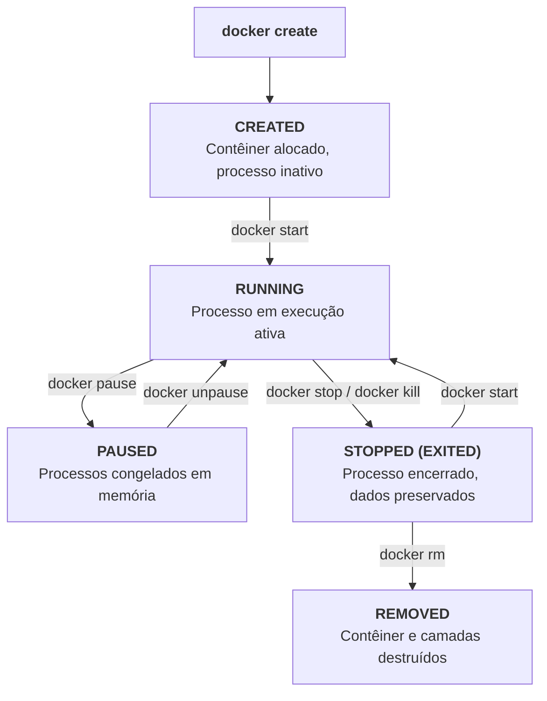
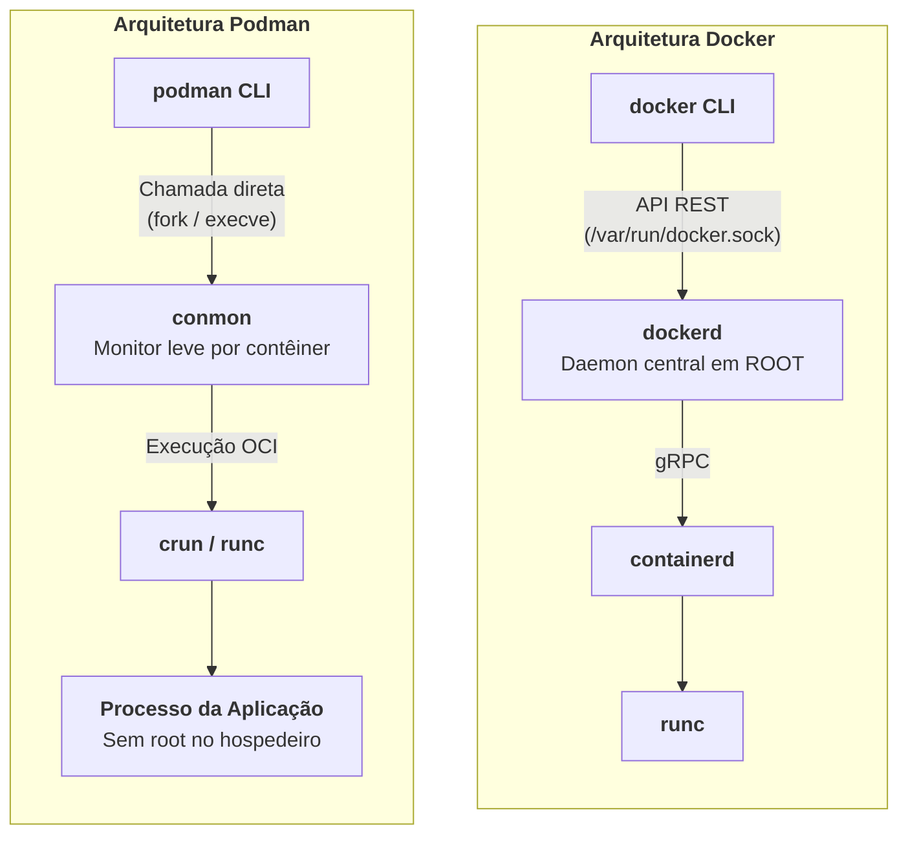

Na primeira parte desta série, a gente abriu o capô do kernel Linux e viu que contêineres não são máquinas virtuais: são processos comuns isolados por *namespaces*, limitados em hardware por *cgroups* v2 e servidos por camadas montadas via *OverlayFS*. Chegamos a empacotar tudo isso num script em shell de cinquenta linhas capaz de rodar um ambiente funcional do zero.

Na teoria tudo é lindo, mas no dia a dia da firma ninguém vai ficar digitando `unshare` na unha ou criando cgroup no `/sys/fs/cgroup` pra subir um microsserviço às duas da tarde (a não ser que vc seja muito masoquista). A gente usa ferramentas consolidadas pra automatizar esse ciclo: Docker, Docker Compose e Podman.

O foco agora é a aplicação prática. Vamos ver como as instruções de um `Dockerfile` se traduzem fisicamente nas fatias de disco que estudamos, como estruturar builds multi-stage pra não entregar imagem de 1.5 GB em produção, como os contêineres se conversam através de pontes de rede virtuais e como declarar ambientes completos com múltiplos serviços interligados sem enlouquecer.

Também vamos explorar a arquitetura sem daemons do Podman, aplicar práticas de menor privilégio pra evitar sustos com segurança e entender onde a orquestração em uma única máquina bate no teto, preparando o terreno para a série  e a Parte 14 da série .

> [!NOTE] Nota da Série
> Este post é a Parte 2 da série **"Contêineres de Cabo a Rabo"**. Se você caiu de paraquedas aqui, recomendo conferir o  para entender a evolução do conceito e a  para ver o que o kernel faz por baixo do capô. Compreender como o sistema lida com syscalls, limites de recursos e montagens torna as decisões práticas que tomaremos aqui muito mais diretas.



## Docker na Prática: A Anatomia de uma Imagem

No ecossistema Docker, o ponto de partida do empacotamento é o `Dockerfile`. Você bate o olho naquele arquivo de vinte linhas e parece uma listinha de compras no mercadinho: faz isso, copia aquilo, roda aquilo outro. Só que debaixo do capô, cada instrução tem um peso bem diferente na pilha de camadas do OverlayFS.

Como vimos na Parte 1, uma imagem de contêiner no padrão OCI nada mais é do que uma coleção de arquivos compactados (*tarballs*), onde cada camada guarda exclusivamente as diferenças em relação à anterior. O `Dockerfile` é a receita que orienta o motor de compilação (*build engine*) a produzir essas camadas.

Existe uma diferença fundamental que vale ter em mente: **nem toda instrução cria uma camada física no disco**. Algumas gravam arquivos novos ou modificados, enquanto outras apenas atualizam metadados no manifesto JSON da imagem.

A tabela a seguir detalha essa distinção para as instruções fundamentais:

| Instrução | O que faz no sistema | Cria Camada em Disco? | Tipo de Impacto |
| :--- | :--- | :--- | :--- |
| **FROM** | Define a imagem base de onde o processo parte | Sim | Importa a pilha de camadas da imagem de origem |
| **RUN** | Executa comandos de terminal durante a compilação | Sim | Grava todos os arquivos criados ou modificados |
| **COPY** | Copia arquivos do computador hospedeiro para a imagem | Sim | Grava os novos arquivos diretamente na camada |
| **ADD** | Copia arquivos, descompacta arquivos tar e baixa URLs | Sim | Grava o conteúdo descompactado ou baixado |
| **WORKDIR** | Define o diretório padrão de trabalho para os comandos | Não | Grava apenas metadado no manifesto JSON |
| **ENV** | Define variáveis de ambiente disponíveis na execução | Não | Grava apenas metadado no manifesto JSON |
| **EXPOSE** | Documenta as portas de rede que o processo pretende usar | Não | Metadado puramente informativo (não abre portas) |
| **USER** | Especifica com qual usuário ou UID o processo deve rodar | Não | Grava metadado de segurança no manifesto JSON |
| **CMD** | Define os parâmetros ou comando padrão de inicialização | Não | Grava metadado de execução no manifesto JSON |
| **ENTRYPOINT** | Define o executável fixo e permanente do contêiner | Não | Grava metadado de execução no manifesto JSON |

### CMD versus ENTRYPOINT

A quantidade de horas que a humanidade já perdeu tentando entender por que o contêiner subiu, não printou nada e morreu em dois segundos por causa da briga entre `CMD` e `ENTRYPOINT` dava pra colonizar Marte [^1].

Pense da seguinte forma: o **ENTRYPOINT** define o **executável principal** que o contêiner foi criado pra rodar. O **CMD** fornece os **argumentos padrão** passados para esse executável quando quem dispara o contêiner não especifica parâmetros na linha de comando.

Quando você roda `docker run imagem argumento1 argumento2`, os argumentos passados **substituem o CMD**, mas são anexados ao final do `ENTRYPOINT`.

A matriz de comportamento a seguir demonstra como essas combinações funcionam na prática:

| Configuração no Dockerfile | Executando `docker run app` | Executando `docker run app backup` |
| :--- | :--- | :--- |
| `CMD ["echo", "padrao"]` | Executa: `echo padrao` | Executa: `backup` (falha se backup não for executável) |
| `ENTRYPOINT ["myapp"]` | Executa: `myapp` (sem argumentos) | Executa: `myapp backup` |
| `ENTRYPOINT ["myapp"]` + `CMD ["--serve"]` | Executa: `myapp --serve` | Executa: `myapp backup` (substitui apenas o argumento padrão) |

Sempre utilize a sintaxe de vetor JSON (conhecida como *exec form*, entre colchetes e com aspas duplas, como `ENTRYPOINT ["java", "-jar", "app.jar"]`). Evite a sintaxe livre em string pura (*shell form*, como `ENTRYPOINT java -jar app.jar`), pois ela força o Docker a disparar um subprocesso `/bin/sh -c`. Resultado: o shell assume o PID 1, vira um intermediário que não repassa sinais do sistema operacional, e a sua aplicação simplesmente ignora o `SIGTERM` na hora de desligar.

### O Arquivo .dockerignore

Quando você executa `docker build -t minha-app .`, o cliente do Docker empacota o diretório atual inteiro e envia via socket pro daemon que vai compilar a imagem. Se você esquecer de configurar um arquivo `.dockerignore`, vai mandar pastas pesadíssimas sem necessidade: o histórico completo do `.git`, diretórios locais de compilação como `target/` e os infames gigabytes de `node_modules` (sim, já vi esteira de CI dobrar o tempo de build por causa desse descuido).

Mantenha um arquivo `.dockerignore` bem calibrado na raiz do projeto:

```
# .dockerignore: mantendo o contexto de compilação limpo
.git
.gitignore
.idea
.vscode
node_modules
target
build
*.log
.env
docker-compose*.yml
```
*O arquivo .dockerignore evita que credenciais, histórico de código e artefatos de compilação locais poluam o processo de build do Docker.*

### Compilação em Múltiplos Estágios: Multi-Stage Builds

No início da história do Docker, criar imagens enxutas era um teste de paciência. Ou você colocava o Maven, o JDK completo e ferramentas de compilação dentro da imagem final (gerando aquele monstro de 1.5 GB pra rodar um 'Hello World' em Spring Boot), ou inventava scripts mirabolantes no bash pra compilar no host e injetar só o artefato final no contêiner.

Os **Multi-stage Builds** [^2] resolveram essa dor de cabeça. Com múltiplos estágios no mesmo arquivo, você usa uma imagem base rica com todo o ferramental de compilação na primeira etapa e copia somente o binário final para uma imagem enxuta de execução.

Vejamos um exemplo prático aplicando esse padrão para uma aplicação Java com Spring Boot:

```dockerfile
# ===== Estágio 1: Ambiente de Compilação (Build) =====
FROM eclipse-temurin:21-jdk-alpine AS builder

WORKDIR /workspace

# Otimização de cache: copiar primeiro apenas o manifesto de dependências
COPY pom.xml .
COPY .mvn .mvn
COPY mvnw .

# Baixar dependências em uma camada isolada
RUN ./mvnw dependency:go-offline -B

# Copiar o código-fonte da aplicação
COPY src src

# Compilar o pacote da aplicação ignorando testes de unidade para velocidade
RUN ./mvnw clean package -DskipTests -B

# ===== Estágio 2: Ambiente de Execução Enxuto (Runtime) =====
FROM eclipse-temurin:21-jre-alpine AS runner

# Criação de usuário sem privilégios para segurança operacional
RUN addgroup -S appgroup && adduser -S appuser -G appgroup

WORKDIR /app

# Copiar exclusivamente o arquivo JAR gerado no estágio anterior
COPY --from=builder /workspace/target/*.jar /app/aplicacao.jar

# Ajustar permissões para o usuário sem privilégios
RUN chown -R appuser:appgroup /app
USER appuser

EXPOSE 8080

ENTRYPOINT ["java", "-jar", "/app/aplicacao.jar"]
```
*O uso de multi-stage builds permite compilar a aplicação no primeiro estágio e transferir apenas o artefato final para a imagem de produção.*

A diferença de tamanho é um tapa na cara. No primeiro estágio (`builder`), temos um JDK completo pesando mais de 600 MB com o Maven e ferramentas de build. No segundo estágio (`runner`), a gente carrega exclusivamente o runtime (JRE) sobre Alpine Linux, entregando uma imagem final de aproximadamente 160 MB. Sem compilador, sem Maven e sem código-fonte dando sopa no servidor de produção.

### Boas Práticas para Dockerfiles

Para manter compilações rápidas e imagens enxutas, siga estas cinco regras:

1. **Ordene as instruções por frequência de alteração**: O Docker invalida o cache de camadas a partir da primeira instrução cujos arquivos foram modificados. Copie manifestos de dependências (`pom.xml`, `package.json`, `go.mod`) e baixe os pacotes antes de copiar o código-fonte (`COPY src/ src/`).
2. **Combine atualização e instalação no mesmo RUN**: Em distros baseadas em Debian, nunca faça `RUN apt-get update` numa linha e `RUN apt-get install` na seguinte. Se a primeira camada ficar presa no cache, você vai instalar pacotes defasados achando que atualizou o sistema (e boa sorte caçando esse bug na esteira). Use sempre `RUN apt-get update && apt-get install -y --no-install-recommends pacote && rm -rf /var/lib/apt/lists/*`.
3. **Prefira imagens base mínimas**: Utilize variantes baseadas em Alpine Linux ou imagens como Google Distroless para reduzir a quantidade de utilitários de sistema e a superfície de ataque.
4. **Nunca execute como root**: Crie um usuário comum de sistema e declare-o com a diretiva `USER` antes do `ENTRYPOINT` (rodar aplicação web corporativa como root dentro de contêiner é pedir pra ter dor de cabeça).
5. **Use tags de versão explícitas**: Jamais use a tag `:latest` em produção. Fixe versões imutáveis para evitar que uma atualização surpresa quebre o deploy da madrugada.

## Ciclo de Vida e Operação de Contêineres

Subir um contêiner é fácil. O desafio real começa quando você precisa manter dezenas deles rodando de forma confiável, respondendo a falhas e sendo atualizados sem indisponibilidade. Para isso, precisamos dominar a máquina de estados que governa a vida de um contêiner no Docker.



A transição entre esses estados é coordenada por comandos específicos da CLI. Vamos examinar os parâmetros essenciais para rodar contêineres sem surpresas.

### As Flags Principais do docker run

O comando `docker run` cria e inicia o contêiner. Fora de testes rápidos no terminal, execute-o com parâmetros explícitos de isolamento e controle:

```bash
$ docker run -d \
    --name api-tarefas \
    -p 8080:8080 \
    -v dados-app:/var/dados \
    -e SPRING_PROFILES_ACTIVE=prod \
    --restart unless-stopped \
    --memory=512m \
    --cpus=1.5 \
    minha-api:1.0.0
```
*Cada parâmetro mapeia diretamente controles do kernel Linux:*
- `-d`: Executa o contêiner em segundo plano (*detached mode*), liberando o terminal.
- `--name api-tarefas`: Define um nome legível para o contêiner, facilitando o gerenciamento.
- `-p 8080:8080`: Mapeia a porta 8080 do hospedeiro para a porta 8080 interna do contêiner criando regras de redirecionamento de rede.
- `-v dados-app:/var/dados`: Conecta um volume persistente do Docker na pasta indicada, garantindo a sobrevivência dos dados.
- `-e SPRING_PROFILES_ACTIVE=prod`: Injeta variáveis de ambiente no processo do contêiner.
- `--restart unless-stopped`: Reinicia o contêiner automaticamente se o processo falhar ou após o reinício do hospedeiro.
- `--memory=512m` e `--cpus=1.5`: Aplica limites rígidos de cgroups para memória RAM e cotas de CPU (se você não limitar a memória, a JVM vai olhar pros 64 GB do host, achar que o mundo é dela e o OOM Killer do kernel vai entrar de voadora na sua aplicação).

> [!TIP] Comandos de Inspeção
> Três comandos resolvem a maior parte do diagnóstico no dia a dia: `docker exec -it <nome> sh` abre uma sessão dentro dos namespaces do processo (usando `nsenter` por baixo dos panos); `docker logs -f --tail 50 <nome>` acompanha a saída padrão (stdout/stderr) do PID 1; e `docker inspect <nome>` retorna o JSON com IP, variáveis, montagens e status da instância.

### docker stop versus docker kill

A forma como você encerra um contêiner determina se a aplicação finaliza com integridade ou com banco de dados corrompido:

- **`docker stop` (Finalização Graciosa)**: O Docker bate educadamente na porta enviando o sinal `SIGTERM` (código 15) para o PID 1 e concede 10 segundos de tolerância (*grace period*) pra aplicação parar de receber requisições, concluir as transações pendentes no banco e sair em paz. Se o processo travar ou fizer corpo mole, só aí o Docker apela pro `SIGKILL`.
- **`docker kill` (O Aríete)**: O Docker manda direto um `SIGKILL` (código 9) na jugular do processo. No Linux, `SIGKILL` não pode ser ignorado, tratado ou adiado por ninguém em espaço de usuário: o kernel puxa o tapete do processo no mesmo nanossegundo e desaloca a memória. Se tinha gravação no meio do caminho ou transação aberta, paciência.

Em esteiras de CI/CD e rotinas de manutenção, use sempre `docker stop` para permitir o término limpo das tarefas.

### Estratégias de Armazenamento: Volumes versus Bind Mounts versus tmpfs

Como vimos na Parte 1, a camada de escrita do OverlayFS é efêmera: ao remover o contêiner com `docker rm`, os dados gravados nela se perdem. Para persistir dados ou injetar arquivos do hospedeiro, o Docker disponibiliza três estratégias:

| Mecanismo | Sintaxe de Uso | Gerenciado pelo Docker? | Caso de Uso Recomendado |
| :--- | :--- | :--- | :--- |
| **Volumes Nomeados** | `-v meu-volume:/caminho` | Sim (em `/var/lib/docker/volumes/`) | Bancos de dados, uploads persistentes e arquivos de produção |
| **Bind Mounts** | `-v /caminho/host:/caminho` | Não (aponta para pasta arbitrária) | Código-fonte em desenvolvimento e arquivos de configuração do host |
| **tmpfs Mounts** | `--tmpfs /caminho` | N/A (vive estritamente na RAM) | Dados sensíveis, segredos efêmeros e caches temporários voláteis |

## Redes no Docker: Como Contêineres se Conversam

Na Parte 1, vimos que um namespace de rede recém-criado nasce isolado, contendo apenas a interface de *loopback*. Para conectar contêineres entre si e dar acesso à internet, o Docker utiliza diferentes drivers de rede:

| Driver de Rede | Mecanismo de Funcionamento | Quando Deve Ser Utilizado |
| :--- | :--- | :--- |
| **bridge** (Padrão) | Cria uma ponte virtual de rede gerenciada por software com sub-rede e NAT | Aplicações padrão isoladas no mesmo host |
| **host** | Remove o isolamento de rede; o processo divide as portas diretamente com o host | Aplicações que exigem altíssimo tráfego de rede e baixíssima latência |
| **none** | Desliga a pilha de rede, mantendo apenas a interface de loopback | Cargas isoladas de computação pura ou tarefas restritas de segurança |
| **overlay** | Cria uma rede virtual sobreposta interligando múltiplos servidores físicos | Orquestração de contêineres em cluster (como Docker Swarm) |
| **macvlan** | Atribui um endereço MAC real ao contêiner, fazendo-o parecer um host na LAN | Aplicações legadas que precisam se comunicar diretamente na rede física |

### Rede Bridge Customizada

Ao instalar o Docker, ele cria uma interface ponte padrão chamada `docker0`. Contêineres iniciados sem rede explícita são conectados nela.

No entanto, **evite ao máximo usar a bridge padrão para conectar serviços interdependentes**.

Na bridge padrão, o Docker não ativa resolução de nomes por DNS: os contêineres só se comunicam se conhecerem os endereços IP uns dos outros. E como contêiner reinicia e ganha IP novo o tempo todo, ficar chumbando endereço IP em arquivo de configuração é a receita perfeita pra passar raiva.

Quando você cria uma **rede bridge customizada** com `docker network create`, o Docker ativa a resolução de DNS interna automática. Os contêineres na mesma rede passam a se comunicar diretamente pelo nome:

```bash
# Criar uma rede bridge customizada dedicada
$ docker network create rede-aplicacao

# Subir um contêiner de banco de dados anexado a essa rede
$ docker run -d --name meu-postgres --network rede-aplicacao -e POSTGRES_PASSWORD=teste postgres:17-alpine

# Subir uma aplicação de teste na mesma rede e pingar o banco pelo NOME
$ docker run --rm --network rede-aplicacao alpine ping -c 3 meu-postgres
PING meu-postgres (172.19.0.2): 56 data bytes
64 bytes from 172.19.0.2: seq=0 ttl=64 time=0.082 ms
64 bytes from 172.19.0.2: seq=1 ttl=64 time=0.075 ms
64 bytes from 172.19.0.2: seq=2 ttl=64 time=0.078 ms
```
*O DNS interno do Docker resolve o hostname meu-postgres diretamente para o IP 172.19.0.2.*

### O Que Acontece por Baixo dos Panos: veth pairs e iptables

Conectando essa mecânica com os fundamentos da Parte 1, o Docker executa três etapas no kernel do hospedeiro:

1. Cria uma ponte de rede Linux (`bridge`).
2. Cria um par de interfaces virtuais conectadas (*veth pair*): a ponta `vethXXXX` fica atrelada à ponte no hospedeiro, e a outra ponta entra no namespace de rede do contêiner como `eth0`.
3. Adiciona regras de NAT no `iptables` (*IP Masquerading*). Quando o contêiner envia pacotes para fora, o kernel reescreve o endereço de origem com o IP do hospedeiro, permitindo que as respostas voltem com sucesso.

## Docker Compose: Orquestrando Stacks Locais

Conforme a aplicação ganha corpo, ela passa a depender de banco de dados relacional, cache em memória, fila de mensageria e painéis de administração. Subir tudo isso via múltiplos comandos `docker run` manuais, calculando portas, redes e variáveis de cabeça, é o caminho mais rápido para o estresse.

Para coordenar múltiplos contêineres de forma declarativa e versionável, a ferramenta padrão é o **Docker Compose** [^3].

Com o Compose, a infraestrutura local é descrita em um arquivo estruturado: o `compose.yaml` (antigo `docker-compose.yml`).

### Declarando a Stack com Compose

Abaixo temos um manifesto cobrindo um cenário bem comum: uma API Spring Boot, um banco de dados PostgreSQL com verificação de saúde (*healthcheck*), uma instância Redis com limite de memória e um painel Adminer ativado apenas sob demanda via perfis (*profiles*).

```yaml
# compose.yaml: Especificação declarativa de serviços
# Nota: o campo legado 'version' não é mais necessário nas versões modernas do Compose

services:
  app:
    build:
      context: .
      dockerfile: Dockerfile
    container_name: backend-api
    ports:
      - "8080:8080"
    environment:
      DB_HOST: db
      DB_PORT: 5432
      DB_NAME: tarefas_db
      DB_USER: tarefas_user
      DB_PASSWORD: ${DB_PASSWORD}
      REDIS_HOST: cache
    depends_on:
      db:
        condition: service_healthy
      cache:
        condition: service_started
    networks:
      - rede-backend
    restart: unless-stopped

  db:
    image: postgres:17-alpine
    container_name: postgres-dados
    environment:
      POSTGRES_DB: tarefas_db
      POSTGRES_USER: tarefas_user
      POSTGRES_PASSWORD: ${DB_PASSWORD}
    volumes:
      - dados-banco:/var/lib/postgresql/data
    healthcheck:
      test: ["CMD-SHELL", "pg_isready -U tarefas_user -d tarefas_db"]
      interval: 5s
      timeout: 3s
      retries: 5
      start_period: 10s
    networks:
      - rede-backend
    restart: unless-stopped

  cache:
    image: redis:7-alpine
    container_name: redis-cache
    command: redis-server --maxmemory 128mb --maxmemory-policy allkeys-lru
    networks:
      - rede-backend
    restart: unless-stopped

  adminer:
    image: adminer:latest
    container_name: painel-adminer
    ports:
      - "8090:8080"
    networks:
      - rede-backend
    profiles:
      - debug

volumes:
  dados-banco:

networks:
  rede-backend:
    driver: bridge
```
*Manifesto Compose integrando verificação de saúde entre serviços, volumes persistentes e perfis sob demanda.*

Para manter dados sensíveis fora do controle de versão (a não ser que você queira doar suas credenciais para bots de varredura do GitHub), mantenha as senhas em um arquivo `.env` fora do Git:

```bash
# .env: Configurações sensíveis para o ambiente local
DB_PASSWORD=devpassword123
```

### Pontos de Atenção no Compose

Preste atenção em três detalhes práticos desse manifesto que salvam vidas em homologação:

1. **A condição `service_healthy` no `depends_on`**: O clássico tropeço de quem começa com o Compose. O `depends_on` padrão apenas aguarda o processo filho nascer na tabela de processos. Só que o PostgreSQL leva vários segundos lendo arquivos, conferindo integridade e inicializando antes de começar a aceitar conexões TCP. Sem o `condition: service_healthy`, a aplicação web tenta conectar no segundo zero, toma `connection refused` na cara e encerra com falha. Com o healthcheck via `pg_isready`, o Compose segura a onda da aplicação até o banco confirmar que está pronto pra trabalhar.
2. **Perfis com `profiles`**: O serviço do Adminer foi marcado com o perfil `debug`. Ao rodar `docker compose up -d`, o Adminer não sobe por padrão, economizando memória e portas locais. Ele só inicia se você passar a flag `--profile debug`.
3. **Limitação de memória no Redis**: Passamos argumentos restringindo a memória máxima a 128 MB com política LRU (*Least Recently Used*), evitando que o cache devore a RAM da máquina de desenvolvimento.

### Comandos de Operação do Docker Compose

No fluxo diário de desenvolvimento, estes são os comandos mais utilizados:

```bash
# Subir toda a stack em segundo plano
$ docker compose up -d

# Recompilar a imagem da aplicação e subir as alterações
$ docker compose up -d --build

# Subir a stack incluindo o serviço de depuração (Adminer)
$ docker compose --profile debug up -d

# Visualizar o status de saúde e portas de todos os contêineres da stack
$ docker compose ps

# Acompanhar os logs contínuos de um serviço específico
$ docker compose logs -f app

# Executar uma sessão de terminal dentro do banco de dados da stack
$ docker compose exec db psql -U tarefas_user -d tarefas_db

# Parar a execução da stack mantendo os dados gravados nos volumes
$ docker compose down

# Parar e DESTRUIR todos os contêineres e volumes da stack (CUIDADO: apaga dados)
$ docker compose down -v
```
*O Docker Compose unifica o ciclo de vida de múltiplos serviços locais em comandos simples.*

## Podman: Sem Daemon e Sem Root

O Docker consolidou o uso de contêineres na indústria, mas trouxe duas decisões de design que sempre deixaram administradores de sistemas com a pulga atrás da orelha:

1. **Daemon Centralizado**: O Docker depende de um processo contínuo em segundo plano (`dockerd`). Se o daemon travar ou morrer, a comunicação com todos os contêineres é interrompida.
2. **O Fardo do Root**: Historicamente, o `dockerd` roda como `root`. Conceder acesso ao socket do Docker (`docker.sock`) para um desenvolvedor equivale, na prática, a entregar um terminal com `sudo` sem senha e rezar para ninguém fazer bobagem.

Para endereçar esses pontos com base nos padrões abertos da OCI, a Red Hat liderou a criação do **Podman** (*Pod Manager*) [^4].



A comparação visual mostra a mudança de modelo:
- O Podman **não possui daemon central**. Ele segue o modelo tradicional Unix: ao rodar `podman run`, o comando faz um *fork/exec* direto por meio de um monitor leve em C chamado `conmon`.
- O Podman é **rootless por padrão**. É possível executar contêineres a partir de uma conta de usuário comum, sem `sudo` e sem abrir portas privilegiadas no sistema operacional. Na esmagadora maioria dos casos, ele aceita a mesma sintaxe do Docker: você pode configurar um `alias docker=podman` no seu shell e enganar até seus scripts mais desconfiados.

### Como o Podman Mapeia Usuários com User Namespaces

Lembre-se do Exercício 1 da Parte 1, onde usamos *User Namespaces*. O Podman utiliza esse mesmo recurso do kernel Linux de forma automatizada:

```bash
# Executar um contêiner com Podman sem usar sudo
$ podman run --rm alpine whoami
root

# Consultar o mapeamento real de usuários efetuado pelo Podman no kernel
$ podman unshare cat /proc/self/uid_map
         0       1000          1
         1     100000      65536
```
*A saída demonstra o isolamento: o UID 0 dentro do contêiner corresponde ao UID 1000 (seu usuário comum) no hospedeiro.*

Se um processo dentro do contêiner tentar escapar para o sistema hospedeiro, para o kernel ele terá exatamente os privilégios do seu usuário comum. Não consegue alterar arquivos em `/etc`, carregar módulos de kernel ou mexer em dados de outros usuários.

### Pods no Podman

Outro diferencial do Podman é o suporte nativo ao conceito de **Pods**.

O Pod é a menor unidade de execução do Kubernetes: um grupo de contêineres que compartilham os mesmos namespaces de rede, IPC e armazenamento.

No Docker tradicional, contêineres operam sempre de forma avulsa. No Podman, você pode criar Pods locais equivalentes aos do Kubernetes:

```bash
# 1. Criar um Pod expondo a porta 8080 para o hospedeiro
$ podman pod create --name pod-web -p 8080:80

# 2. Adicionar uma aplicação web Nginx dentro do Pod
$ podman run -d --pod pod-web --name servidor-web nginx:alpine

# 3. Adicionar um contêiner auxiliar (sidecar) dentro do MESMO Pod
$ podman run -d --pod pod-web --name monitor-sidecar alpine sleep 3600

# 4. Do contêiner auxiliar, acessar o Nginx via localhost!
$ podman exec monitor-sidecar wget -qO- http://localhost:80 | head -n 4
<!DOCTYPE html>
<html>
<head>
<title>Welcome to nginx!</title>
```
*Como os contêineres compartilham o namespace de rede do Pod, eles se comunicam via loopback (localhost).*

Além disso, o Podman exporta essa configuração diretamente para YAML do Kubernetes:

```bash
# Gerar a especificação YAML do Kubernetes correspondente ao Pod criado
$ podman generate kube pod-web > pod-web.yaml

# Visualizar o arquivo pronto para ser implantado em um cluster de produção
$ head -n 20 pod-web.yaml
```

> [!TIP] Executando Pods no Debian e Ubuntu
> Em distribuições baseadas em Debian ou Ubuntu, instale o pacote `catatonit` (`sudo apt install catatonit`), que fornece o binário de *pause* exigido pelo Podman para gerenciar o ciclo de vida dos Pods. Além disso, para permitir o download com nomes curtos de imagens (como `nginx:alpine`), configure `unqualified-search-registries = ["docker.io"]` em `/etc/containers/registries.conf`.

| Característica de Design | Docker | Podman |
| :--- | :--- | :--- |
| **Arquitetura de Execução** | Baseada em daemon centralizado (`dockerd`) | Sem daemon (*fork/exec* direto via `conmon`) |
| **Execução Sem Root** | Suportada como modo alternativo configurável | Padrão e nativa desde o primeiro dia de design |
| **Compatibilidade de Comandos** | Referência original da indústria | Quase 100% compatível (`alias docker=podman`) |
| **Conceito Nativo de Pods** | Inexistente (apenas contêineres isolados) | Nativo e compatível com modelos do Kubernetes |
| **Exportação para Kubernetes** | Requer ferramentas de terceiros | Integrado via `podman generate kube` |
| **Integração com systemd** | Gerenciado via serviço de sistema do daemon | Gera arquivos de serviço individuais por contêiner |
| **Runtime OCI Padrão** | `runc` (escrito em Go) | `crun` (escrito em C, mais rápido e leve) |

## Segurança de Contêineres: O Que Pode Dar Errado

A conveniência de baixar e rodar imagens prontas costuma criar uma falsa sensação de blindagem. Executar uma aplicação dentro de um contêiner não a torna imune a invasões: ela ainda divide o mesmo kernel com o hospedeiro. Se o contêiner estiver mal configurado, a barreira de isolamento vira casca de ovo.

Abaixo estão quatro tropeços clássicos de segurança e como neutralizá-los.

### O Risco de Montar o Socket do Docker (/var/run/docker.sock)

Em tutoriais de esteiras de CI/CD ou painéis de administração web, você certamente já viu esta instrução inocente:
`docker run -v /var/run/docker.sock:/var/run/docker.sock ...`

**Não faça isso.** Montar `/var/run/docker.sock` dentro de um contêiner é o equivalente em segurança a colocar a chave mestra da sua casa debaixo do capacho com um bilhete dizendo *"favor não roubar"*.

O arquivo `/var/run/docker.sock` é o canal direto de controle do daemon do Docker. Como o daemon tradicional roda como `root`, quem tem permissão de leitura e escrita nesse arquivo controla o hospedeiro por completo.

Veja como é trivial escapar de um contêiner quando o socket está exposto:

```bash
# Simulação: o invasor está dentro do contêiner com o socket montado
# Ele usa o cliente Docker pra criar outro contêiner montando a raiz do host
$ docker run --rm -v /:/host-raiz alpine chroot /host-raiz whoami
root
```
*Montar o socket do Docker permite ao processo interno subir instâncias paralelas com acesso irrestrito ao sistema de arquivos do computador hospedeiro.*

Em três comandos o invasor virou `root` no hospedeiro. Se você precisa construir imagens dentro de esteiras de CI/CD (o famoso padrão *Docker-in-Docker*), utilize alternativas projetadas para rodar sem privilégios de root, como o **Buildah** [^5] da Red Hat.

### Limpeza de Vulnerabilidades em Imagens com Trivy

Outro descuido comum é puxar imagens base genéricas sem auditar o que vem dentro. Imagens como `node:20` ou `python:3.12` baseadas em distros completas trazem centenas de utilitários de sistema operacional que a sua aplicação nunca vai usar, e de brinde trazem dezenas de vulnerabilidades conhecidas (*CVEs*).

Para auditar essas falhas antes de subir a imagem pra produção, o padrão da indústria é o **Trivy** [^6]:

```bash
# Varrer uma imagem comum do ecossistema Node.js
$ trivy image --severity HIGH,CRITICAL node:22

# A saída exibirá dezenas de falhas graves em pacotes do sistema operacional
```

Ao trocar a base por variantes mínimas sobre Alpine Linux (`node:22-alpine`) ou imagens *Distroless*, a quantidade de utilitários de sistema despenca, e a maior parte dessas vulnerabilidades desaparece junto.

### Segredos no Dockerfile

Um erro que canso de ver em auditoria é desenvolvedor gravando senhas, tokens de API ou chaves privadas diretamente no Dockerfile. Uma linha como `ENV DB_PASSWORD=segredo123` tatua a credencial no histórico da imagem para todo o sempre.

Não adianta tentar apagar o arquivo com `RUN rm` no comando seguinte: como o OverlayFS funciona por fatias cumulativas, o arquivo continua existindo na camada anterior, e qualquer um com acesso à imagem extrai o valor de bandeja com um simples `docker history`:

```bash
# Visualizar o histórico completo de instruções da imagem
$ docker history minha-app:1.0.0 --no-trunc
IMAGE         CREATED BY                                      SIZE
...           ENV DB_PASSWORD=segredo123                       0B
...           RUN echo "$DB_PASSWORD" > /app/config.txt        15B
```
*Qualquer instrução ENV ou ARG fica registrada no histórico de camadas da imagem.*

O mesmo cuidado vale para `ARG`: embora variáveis de build não fiquem visíveis no ambiente do contêiner rodando, o valor delas fica gravado nos metadados da imagem no manifesto OCI.

Para lidar com credenciais de forma limpa:

1. **Variáveis de ambiente em tempo de execução**: Injete segredos no momento de rodar o contêiner com `-e` ou via arquivo `.env` no Compose. Esses valores vivem na memória do processo e não deixam rastro na imagem.
2. **Build secrets do BuildKit**: O Docker BuildKit suporta a diretiva `--mount=type=secret` em instruções `RUN`, expondo o segredo estritamente durante a execução daquele comando sem gravar nada em camadas:
   ```dockerfile
   RUN --mount=type=secret,id=db_pass \
       cat /run/secrets/db_pass > /tmp/setup && ./configure.sh && rm /tmp/setup
   ```
3. **Gerenciadores de segredos**: Em ambientes orquestrados de produção, recorra a mecanismos dedicados (Kubernetes Secrets) ou cofres externos como HashiCorp Vault.

### Princípio do Menor Privilégio com Linux Capabilities

No Linux clássico, o modelo de segurança era no estilo 8 ou 80: ou você era um usuário comum sem poder de nada, ou era o `root` com a chave de todo o castelo.

Para acabar com essa festa, o kernel introduziu as **Capabilities** [^7]. Elas dividem os privilégios do superusuário em permissões pontuais e independentes (como abrir portas abaixo de 1024, acertar o relógio do sistema ou carregar módulos de kernel).

O Docker já descarta diversas capabilities perigosas por padrão ao subir um contêiner, mas muitos serviços ainda rodam com mais poderes do que realmente precisam.

A postura recomendada pra contêineres em produção é a técnica do **Drop All**: você joga fora todas as capabilities concedidas e devolve exclusivamente o que o serviço precisa pra não quebrar:

```bash
# Executar contêiner web removendo todos os privilégios e mantendo apenas a abertura de portas
$ docker run -d \
    --name web-seguro \
    --cap-drop=ALL \
    --cap-add=NET_BIND_SERVICE \
    --read-only \
    --tmpfs /tmp \
    --security-opt=no-new-privileges \
    -p 80:80 \
    nginx:alpine
```
*A combinação de cap-drop com sistema de arquivos somente leitura impede a gravação ou execução de binários arbitrários no disco do contêiner.*

Cada parâmetro atua como uma barreira defensiva:
- `--cap-drop=ALL`: Remove todas as permissões especiais do processo.
- `--cap-add=NET_BIND_SERVICE`: Devolve apenas a capacidade de escutar em portas abaixo de 1024.
- `--read-only`: Torna o sistema de arquivos do contêiner imutável em disco (se um invasor tentar baixar um script ou minerador de cripto no `/tmp`, toma erro de sistema de arquivos somente leitura na hora).
- `--tmpfs /tmp`: Monta uma pasta temporária em memória RAM para arquivos voláteis que o processo precisa cuspir em tempo de execução.
- `--security-opt=no-new-privileges`: Impede que processos filhos ganhem privilégios adicionais via binários *setuid*.

#### Hardening no Docker Compose com Âncoras YAML

No dia a dia da equipe, ninguém vai ficar digitando vinte flags manuais toda vez que for subir um contêiner no terminal (se depender disso, em duas semanas alguém esquece e o serviço sobe escancarado). Essas restrições precisam morar em manifestos versionados no repositório. Como defendemos no artigo sobre o , a paridade entre ambientes pede que o mesmo aperto de segurança de produção seja reproduzido na máquina de desenvolvimento.

As mesmas restrições da linha de comando têm suporte direto na especificação do Docker Compose:

```yaml
services:
  web:
    image: nginx:alpine
    ports:
      - "80:80"
    security_opt:
      - no-new-privileges:true
    cap_drop:
      - ALL
    cap_add:
      - NET_BIND_SERVICE
    read_only: true
    tmpfs:
      - /tmp:rw,noexec,nosuid,size=64M
```
*A declaração no Compose reproduz as mesmas restrições de kernel da linha de comando.*

Para evitar a repetição desse bloco em múltiplos serviços dentro do mesmo manifesto, a especificação do Compose [^11] permite usar as famigeradas **âncoras YAML** (`&` e `*`), um recurso nativo do formato que muita gente esquece que existe, mas que evita quilômetros de copia e cola.

Com isso, você define o conjunto base de restrições (*hardening baseline*) uma única vez no topo do arquivo e o reaproveita usando o operador de mesclagem (`<<`):

```yaml
# Perfil base de segurança reutilizável (Hardening Baseline)
x-security-defaults: &security-defaults
  security_opt:
    - no-new-privileges:true
  cap_drop:
    - ALL
  read_only: true
  tmpfs:
    - /tmp:rw,noexec,nosuid,size=100M
  restart: unless-stopped

services:
  api:
    image: minha-api:1.0.0
    <<: *security-defaults
    ports:
      - "8080:8080"
    # A API herda o baseline: roda sem capabilities extras e com disco imutável

  proxy:
    image: nginx:alpine
    <<: *security-defaults
    ports:
      - "80:80"
    # Herda o baseline e adiciona exclusivamente a permissão de abrir portas baixas
    cap_add:
      - NET_BIND_SERVICE
```
*Com âncoras YAML, o endurecimento de segurança é compartilhado pela stack sem duplicação de blocos.*

Essa abordagem declarativa antecipa o modelo que veremos na série : no Kubernetes, esse padrão de menor privilégio é configurado nos blocos `securityContext` de cada Pod.

## Exercícios

Para fixar os conceitos na ponta dos dedos (porque ler tutorial sem abrir o terminal é a melhor receita pra esquecer tudo meia hora depois), separei três desafios rápidos pra você rodar na sua máquina:

**1. Persistência de dados com volumes em bancos relacionais**

Crie um contêiner executando o PostgreSQL utilizando um volume nomeado para persistir seus dados:

```bash
$ docker run -d --name pg-banco \
    -e POSTGRES_PASSWORD=segredo123 \
    -v dados-postgres:/var/lib/postgresql/data \
    postgres:17-alpine
```

Aguarde alguns segundos para a inicialização e acesse o banco criando uma tabela e gravando um registro de teste:

```bash
$ docker exec -i pg-banco psql -U postgres -c "CREATE TABLE clientes (id serial PRIMARY KEY, nome varchar(50)); INSERT INTO clientes (nome) VALUES ('Empresa Exemplo');"
```

Em seguida, derrube o contêiner na voadora sem dó com `docker rm -f pg-banco`. Por fim, suba um contêiner novo com outro nome (`pg-novo`), conectando o mesmo volume `dados-postgres`, e consulte os registros da tabela `clientes`. E aí, os dados viraram fumaça ou sobreviveram ao massacre? Por quê?

<details markdown="1">
<summary>Ver resposta</summary>

Ao executar o comando de consulta no novo contêiner:

```bash
$ docker exec -i pg-novo psql -U postgres -c "SELECT * FROM clientes;"
```

A tabela volta intacta, com o registro `'Empresa Exemplo'` sorrindo pra você no terminal.

Isso acontece porque o volume nomeado `dados-postgres` não mora na camada efêmera do OverlayFS. Ele é um diretório gerenciado pelo Docker que fica seguro no disco do hospedeiro (geralmente sob `/var/lib/docker/volumes/dados-postgres/_data`). Quando você matou o primeiro contêiner na força bruta com `-f`, o volume continuou intacto no disco. Ao subir o segundo contêiner apontando pro mesmo volume, o novo processo do PostgreSQL simplesmente encontrou a base preexistente e seguiu a vida sem perda de um único byte.

*Para limpar o volume de testes após o exercício, execute `docker rm -f pg-novo && docker volume rm dados-postgres`.*

</details>

**2. Segregação de redes e proxy reverso no Compose**

Como você alteraria o arquivo `compose.yaml` apresentado nesta seção para colocar um Nginx como proxy reverso na frente da aplicação, isolando as redes de forma que:

1. O Nginx escute na porta 80 do computador hospedeiro e repasse o tráfego para `http://app:8080`.
2. A aplicação participe de duas redes: `rede-publica` (onde fala com o Nginx) e `rede-privada` (onde fala com o banco e o Redis).
3. O Nginx NÃO consiga, em hipótese alguma, estabelecer conexões diretas com o banco de dados PostgreSQL (se o Nginx for comprometido, o invasor não enxerga o banco).

<details markdown="1">
<summary>Ver resposta</summary>

Para implementar esse isolamento em camadas (*Defense in Depth*), declare duas redes no arquivo Compose:

```yaml
networks:
  rede-publica:
  rede-privada:
```

Em seguida, configure as participações de rede de cada serviço:
- O serviço `nginx` é mapeado exclusivamente na `rede-publica`.
- O serviço `app` é mapeado em ambas as redes (`rede-publica` e `rede-privada`).
- Os serviços `db` e `cache` são mapeados exclusivamente na `rede-privada`.

Com essa arquitetura, mesmo que um invasor assuma o controle do Nginx por alguma falha zero-day, ele estará preso em um namespace de rede que simplesmente não tem rotas nem visibilidade física para alcançar a porta 5432 do banco.

</details>

**3. Comparação de superfície de ataque com Trivy**

Instale ou execute o utilitário Trivy via contêiner para comparar a quantidade de encrencas entre duas imagens oficiais da mesma tecnologia:

```bash
$ docker run --rm aquasec/trivy:latest image --severity CRITICAL python:3.12
$ docker run --rm aquasec/trivy:latest image --severity CRITICAL python:3.12-alpine
```

Compare os relatórios obtidos. Quantas vulnerabilidades críticas foram encontradas em cada imagem e de onde vem esse abismo de diferença?

<details markdown="1">
<summary>Ver resposta</summary>

Na imagem `python:3.12` padrão (baseada em Debian GNU/Linux), o Trivy frequentemente cospe uma lista assustadora de vulnerabilidades críticas e dezenas de falhas de severidade alta em compiladores, utilitários e bibliotecas de sistema que a sua aplicação nem sabe que existem.

Na imagem `python:3.12-alpine`, o número de vulnerabilidades críticas despenca para zero ou para um número residual. Isso ocorre porque o Alpine Linux utiliza a biblioteca enxuta `musl libc` e o conjunto mínimo de ferramentas do `BusyBox`, jogando fora centenas de pacotes desnecessários. Menos tranqueira rodando no disco significa diretamente menor superfície de ataque em produção.

</details>

## O Caminho para a Orquestração

Ao longo desta série, a gente abriu a caixa de ferramentas dos contêineres de ponta a ponta: desde as chamadas de sistema mais profundas do kernel Linux até a orquestração local com Compose e a arquitetura sem daemons do Podman.

Esse arranjo atende perfeitamente o ambiente de desenvolvimento, testes automatizados e serviços simples em um servidor único.

Mas a vida real tem a péssima mania de complicar as coisas: a carga cresce, o tráfego explode, o servidor pifa e o estagiário tropeça no cabo de força da máquina. É aí que o modelo de servidor único bate no teto:
1. **Ponto Único de Falha Físico**: Se o servidor parar, todos os contêineres caem juntos e levam o negócio pro buraco.
2. **Escala Manual**: O Compose não distribui instâncias entre diferentes servidores nem balanceia o tráfego de rede entre nós.
3. **Falta de Reagendamento Automático**: Se um contêiner cair por sobrecarga ou falha de hardware, o Compose não vai recriá-lo num servidor vizinho com recursos livres.

Para resolver a orquestração distribuída em escala sem que você precise passar as madrugadas de plantão rezando, o mercado adotou os orquestradores de contêineres, tendo o **Kubernetes** [^8] como principal referência.

Vale notar: **o Kubernetes não tem pó de pirlimpimpim nem inventou uma física nova para contêineres**. 

Todo o funcionamento de um cluster Kubernetes nada mais é do que coordenar em escala de rede as mesmíssimas primitivas que a gente destrinchou aqui:
- O **Pod** é a união de múltiplos contêineres compartilhando os mesmos *namespaces* de rede e IPC, exatamente como vimos nos Pods do Podman.
- As diretivas de **Resource Requests e Limits** nos manifestos do Kubernetes são repassadas diretamente aos arquivos `cpu.max` e `memory.max` do *cgroups* v2 em cada nó.
- As imagens baixadas pelo Kubernetes seguem a especificação de camadas da **OCI**, implementadas via OverlayFS.
- A comunicação entre nós e Pods via plugins CNI (*Container Network Interface*) utiliza os mesmos pares de interfaces virtuais *veth* e regras de roteamento que analisamos na seção de redes do Docker.

Compreendendo o contêiner no sistema operacional, o Kubernetes deixa de parecer aquele leviatã indecifrável de dezenas de siglas e vira o que ele realmente é: um plano de controle distribuído gerenciando as primitivas do bom e velho Linux.

Com essa base prática estabelecida, dominamos o empacotamento, a execução e a segurança de contêineres no dia a dia. Mas o que acontece quando a aplicação capota em produção dentro de uma imagem mínima ou distroless, sem shell nem utilitários de diagnóstico instalados? Esse é o foco do próximo e último capítulo da série: um mergulho em autópsia forense e troubleshooting avançado diretamente pelo kernel e pelo `/proc`.

## Referências

[^1]: **Dockerfile Reference Guide** {*Docker Documentation, docs.docker.com*} ([Link](https://docs.docker.com/reference/dockerfile/))

[^2]: **Multi-Stage Builds Documentation** {*Docker Documentation, docs.docker.com*} ([Link](https://docs.docker.com/build/building/multi-stage/))

[^3]: **The Compose Specification** {*Docker Documentation / Compose Spec Community*} ([Link](https://docs.docker.com/compose/compose-file/))

[^4]: **Podman Official Documentation and Architecture Guide** {*Containers Organization / Red Hat*} ([Link](https://docs.podman.io/en/latest/))

[^5]: **Buildah: Building OCI-compliant Container Images Without Daemons** {*Containers Organization, buildah.io*} ([Link](https://buildah.io/))

[^6]: **Trivy: Comprehensive Security Scanner for Container Images** {*Aqua Security, trivy.dev*} ([Link](https://trivy.dev/))

[^7]: **capabilities(7) - Overview of Linux Capabilities** {*Linux Programmer's Manual, manpages.org*} ([Link](https://manpages.org/capabilities/7))

[^8]: **Kubernetes Container Runtimes and Architecture Documentation** {*The Kubernetes Authors, kubernetes.io*} ([Link](https://kubernetes.io/docs/setup/production-environment/container-runtimes/))

[^9]: **CIS Docker Benchmark v1.6.0** {*Center for Internet Security (CIS)*} ([Link](https://www.cisecurity.org/benchmark/docker))

[^10]: **Using Docker-in-Docker for your CI or testing environment? Think twice.** {*Jérôme Petazzoni, jpetazzo.github.io, 2015*} ([Link](https://jpetazzo.github.io/2015/09/03/do-not-use-docker-in-docker-for-ci/))

[^11]: **Compose Specification: Extension Fields and YAML Fragments** {*Docker Documentation, docs.docker.com*} ([Link](https://docs.docker.com/reference/compose-file/fragments/))
