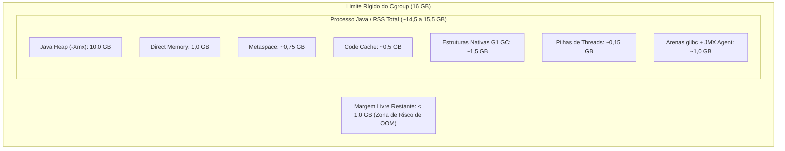

Sexta-feira, ambiente de produção. O alerta do sistema de monitoramento dispara com a delicadeza de uma sirene de ataque aéreo: um dos serviços centrais da infraestrutura parou de responder, a réplica caiu sumariamente com status de falha e o orquestrador subiu um contêiner substituto no lugar para estancar a sangria. 

O painel da aplicação jura de pés juntos que o consumo de memória estava sob controle, bem abaixo do teto configurado para a máquina virtual de execução. No entanto, o contêiner tinha um limite rígido de 16 GB estipulado na infraestrutura e simplesmente desapareceu do mapa sem deixar uma única linha de erro fatal nos arquivos de registro tradicionais.

Você abre o terminal com a tranquilidade de quem vai resolver o enigma em dois minutos. Executa um comando interativo para entrar no contêiner recém-criado, digita o velho e bom `ps aux` para auditar a árvore de processos e o sistema devolve uma bofetada em seco:

```text
bash: ps: command not found
```

Você respira fundo, tenta apelar para o `free -m` ou `top` para verificar a pressão de memória e recebe outro aviso de comando inexistente. Tenta rodar `ss -tulpn` para conferir portas e nada. Procura o gerenciador de pacotes para instalar utilitários de suporte e descobre que o contêiner não tem conexão com a internet externa e opera sob um usuário desprovido de privilégios administrativos. Para piorar, em imagens construídas sobre bases mínimas ou *distroless*, nem sequer existe um interpretador `/bin/sh` disponível para abrir uma sessão.

Neste momento, muitos operadores entram em pânico ou partem para soluções desastrosas: recompilam imagens adicionando pacotes desnecessários em produção ou reiniciam serviços às cegas sem entender a causa raiz.

A boa notícia é que você não precisa de nenhuma ferramenta cosmética instalada dentro do contêiner para arrancar a verdade do sistema operacional. Como provamos nos capítulos anteriores desta série, contêineres não são máquinas virtuais isoladas em outro plano dimensional: são apenas processos comuns do Linux governados por *namespaces* e *cgroups*. O kernel enxerga absolutamente tudo.

> [!NOTE] Nota da Série
> Este post é o quarto capítulo da série **"Contêineres de Cabo a Rabo"**. Se você acompanhou o , a  e a , já domina o isolamento de processos e a montagem de imagens enxutas. Aqui vamos levar esse conhecimento ao limite operacional: como realizar uma autópsia forense completa de memória, processos e conexões de rede em contêineres desprovidos de utilitários de linha de comando.



## A Autópsia do Contêiner Morto: Decifrando o Exit Code 137

Quando um contêiner encerra de forma anômala em um ambiente de produção orquestrado (seja via Docker Standalone, Swarm ou Kubernetes), a primeira tentação da equipe de suporte é olhar os arquivos de log da aplicação. 

Em um caso real recente que investiguei em uma stack institucional crítica de processamento de pagamentos, os últimos registros mostravam operações rotineiras de sincronização. Havia algumas exceções corriqueiras de serviços externos fora do ar, mas nada que justificasse uma parada abrupta da aplicação. De repente, os logs simplesmente paravam. O contêiner anterior aparecia como encerrado e uma nova réplica assumia o tráfego.

Para entender a causa da morte de um contêiner, precisamos perguntar diretamente ao motor de execução através da inspeção do seu estado armazenado.

```bash
docker inspect <container_id_antigo> | jq '.[0].State, .[0].HostConfig.Memory'
```

Ao inspecionar o contêiner falecido, nos deparamos com o seguinte raio-X estrutural:

```json
{
  "Status": "exited",
  "Running": false,
  "Paused": false,
  "Restarting": false,
  "OOMKilled": true,
  "Dead": false,
  "Pid": 0,
  "ExitCode": 137,
  "Error": "",
  "StartedAt": "2026-09-18T14:08:12.441920102Z",
  "FinishedAt": "2026-10-02T10:00:42.083779806Z"
}
17179869184
```

Dois valores neste retorno encerram qualquer debate sobre a natureza da parada:

1. **`ExitCode: 137`**: No padrão de encerramento do Unix e Linux, quando um processo termina por causa de um sinal fatal enviado pelo sistema, seu código de saída é calculado pela fórmula `128 + N`, onde `N` é o número do sinal. O número do sinal `SIGKILL` é 9. Logo, $128 + 9 = 137$. O processo não pediu para sair; ele foi executado sumariamente sem direito a limpeza de estado ou encerramento gracioso.
2. **`OOMKilled: true`**: Um código de saída 137 também pode ocorrer se um operador desavisado rodar `docker kill` ou enviar um sinal manual. Mas quando a flag `OOMKilled` está marcada como verdadeira, temos o veredito incontestável: o subsistema de memória do kernel Linux invocou o temido **Out of Memory Killer** para abater o processo que desrespeitou as fronteiras de recursos.

A linha final traz o teto imposto na configuração da máquina hospedeira: `17179869184 bytes`, que representam precisamente 16 GB de memória RAM alocados via diretiva de cgroup.

O mistério estava instaurado. A aplicação era uma API corporativa rodando em Java com servidor Tomcat. Olhando a variável de ambiente `CATALINA_OPTS` embutida na imagem, a instrução de tamanho máximo de memória era categórica:

```bash
-Xms6g -Xmx10g -XX:MaxDirectMemorySize=1g -XX:MaxMetaspaceSize=768m
```

A pergunta que ecoava na sala de operações era evidente: se o limite de heap configurado para o software era de apenas 10 GB, por que raios o contêiner estourou o limite de 16 GB e foi assassinado pelo kernel?

Para responder a isso, precisávamos entrar no contêiner substituto e auditar o comportamento da memória. Foi aí que o segundo obstáculo apareceu.

## O Choque da Realidade: Cgroups v1 vs Cgroups v2

Ao abrir uma sessão interativa no novo contêiner para conferir os dados de hardware, os utilitários clássicos de diagnóstico falharam por completo. Não havia pacote de utilitários instalado.

Em situações normais, administradores acostumados com sistemas Linux antigos tentam ler o consumo diretamente na hierarquia virtual de controle de recursos. A memória no padrão clássico ficava sob um caminho bem conhecido:

```bash
cat /sys/fs/cgroup/memory/memory.usage_in_bytes
```

No nosso contêiner, esse comando devolveu:

```text
cat: /sys/fs/cgroup/memory/memory.usage_in_bytes: No such file or directory
```

Não se tratava de um erro de digitação. As distribuições Linux modernas (Debian 12, Ubuntu 22.04 em diante, RHEL 9 e derivados) adotaram por padrão a especificação unificada do **cgroups v2** [^1]. Conforme estudamos na Parte 1 da série, o cgroups v2 eliminou a floresta de subdiretórios dispersos para cada controlador (cpu, memory, blkio) e organizou tudo em uma árvore hierárquica única.

No cgroups v2, a interface de controle do subsistema de memória fica montada na raiz do pseudo-sistema de arquivos `/sys/fs/cgroup/`. Os nomes dos arquivos mudaram radicalmente para um formato muito mais intuitivo e padronizado:

```text
Cgroups v1 (Legado): /sys/fs/cgroup/memory/memory.usage_in_bytes
Cgroups v2 (Atual):   /sys/fs/cgroup/memory.current
```

Ao consultar o arquivo correto na nova especificação, o resultado apareceu de imediato:

```bash
cat /sys/fs/cgroup/memory.current
```

```text
9699663872
```

O contêiner substituto havia subido há poucos minutos e já estava consumindo **9.699.663.872 bytes** (aproximadamente **9,03 GB**) de memória física alocada.

Para entender a distribuição dessa memória sem precisar de nenhum comando externo, recorremos ao arquivo de estatísticas detalhadas fornecido pelo próprio kernel:

```bash
cat /sys/fs/cgroup/memory.stat
```

A saída desse arquivo entrega uma riqueza de detalhes que muitos utilitários gráficos de monitoramento sequer conseguem traduzir:

```text
anon 9518325760
file 136572928
kernel 44392448
kernel_stack 1916928
pagetables 19533824
sec_pagetables 0
percpu 69680
sock 12288
vmalloc 32768
shmem 0
zswap 0
zswapped 0
file_mapped 5255168
file_dirty 24576
file_writeback 0
swapcached 0
anon_thp 9307160576
inactive_anon 9518374912
active_anon 24576
inactive_file 74813440
active_file 61759488
slab 22700576
```

Dois indicadores desta tabela contam a história completa do ambiente:

* **`anon 9518325760` (~8,86 GB)**: A métrica *anonymous memory* representa páginas de memória alocadas diretamente pelos processos que não possuem vínculo com arquivos em disco (heap de linguagens, pilhas de execução, estruturas dinâmicas). Dos 9,03 GB em uso, **98,1%** correspondiam a alocações anônimas puras da aplicação.
* **`file 136572928` (~130 MB)**: O consumo com *page cache* (arquivos abertos, logs transitórios ou leituras em disco mantidas em cache pelo kernel) era desprezível. Isso descartava imediatamente a clássica suspeita de que buffers de disco ou arquivos de log em crescimento contínuo estavam inflando o contêiner.
* **`anon_thp 9307160576` (~8,66 GB)**: Revela que o kernel Linux estava usando ativamente *Transparent Huge Pages* (páginas de 2 MB em vez dos tradicionais 4 KB) para sustentar a grande massa de memória da aplicação, otimizando o custo de tradução de endereços na tabela de páginas.

Restava uma pergunta incômoda: será que esses 9 GB pertenciam apenas à aplicação Java ou existia outro processo invasor consumindo recursos silenciosamente dentro daquele contêiner?

## Dissecando Processos pelo proc sem o Comando ps

Sem o comando `ps`, como verificar quem está rodando dentro do contêiner e quanto cada processo consome individualmente?

A resposta mora no diretório `/proc` [^2]. No Linux, `/proc` não é uma pasta física gravada no disco; é um sistema de arquivos virtual sintetizado em tempo real pelo kernel para expor o estado dos processos e as configurações da máquina. Cada diretório cujo nome é composto exclusivamente por dígitos numéricos corresponde a um Identificador de Processo (PID) ativo dentro do *PID namespace* atual.

Podemos listar todos os processos ativos com uma expansão nativa do próprio shell, sem invocar nenhum binário externo:

```bash
ls -d /proc/[0-9]*
```

A saída no nosso contêiner retornou:

```text
/proc/1  /proc/4585  /proc/4814  /proc/4925  /proc/7
```

Havia apenas cinco entradas numéricas. Três delas (`4585`, `4814`, `4925`) correspondiam à nossa própria sessão interativa de shell recém-aberta e aos utilitários que estávamos rodando para investigar. Sobravam duas figuras centrais: o **PID 1** e o **PID 7**.

### Inspecionando o PID 1

No Unix, o PID 1 é o processo ancestral de todos os outros. Para descobrir qual binário deu origem a ele e quais argumentos foram passados, lemos o arquivo `cmdline`. Como os argumentos no kernel são separados por bytes nulos (`\0`), usamos uma substituição simples com o utilitário `tr`:

```bash
cat /proc/1/cmdline | tr '\0' ' '; echo ""
```

```text
/sbin/docker-init -- catalina.sh run
```

O PID 1 era apenas o `docker-init`, o intermediário minimalista embutido pelo Docker (baseado no projeto Tini) para encaminhar sinais e adotar processos órfãos. 

Para checar quanta memória ele consumia, olhamos o arquivo `status`:

```bash
cat /proc/1/status | grep -E "VmRSS|VmHWM|VmSize|Threads"
```

```text
VmSize:     1056 kB
VmHWM:       640 kB
VmRSS:       640 kB
Threads:        1
```

O `docker-init` consumia míseros **640 kB** de memória física residente (`VmRSS`) e possuía uma única thread. Ele era inocente.

### Inspecionando o PID 7

Chegamos então ao processo de número 7. Ao ler sua linha de comando completa:

```bash
cat /proc/7/cmdline | tr '\0' ' '; echo ""
```

Vimos a chamada massiva de inicialização do Java:

```text
/usr/lib/jvm/java-1.8.0-amazon-corretto/bin/java -Djava.util.logging.config.file=/usr/local/tomcat/conf/logging.properties -Djava.util.logging.manager=org.apache.logging.log4j.jul.LogManager -Djdk.tls.ephemeralDHKeySize=2048 -Djava.protocol.handler.pkgs=org.apache.catalina.webresources -Dsun.io.useCanonCaches=false -Dorg.apache.catalina.security.SecurityListener.UMASK=0027 -javaagent:/opt/jmx_exporter/jmx_prometheus_javaagent.jar=12345:/opt/jmx_exporter/exporter.yaml -Xms6g -Xmx10g -XX:MetaspaceSize=128m -XX:MaxMetaspaceSize=768m -XX:InitialCodeCacheSize=64m -XX:ReservedCodeCacheSize=512m -XX:MaxDirectMemorySize=1g -Xss512k -XX:+UseG1GC -XX:MaxGCPauseMillis=150 -classpath :/opt/log4j2/lib/*:/opt/log4j2/conf:/usr/local/tomcat/bin/bootstrap.jar:/usr/local/tomcat/bin/tomcat-juli.jar -Dcatalina.base=/usr/local/tomcat -Dcatalina.home=/usr/local/tomcat -Djava.io.tmpdir=/usr/local/tomcat/temp org.apache.catalina.startup.Bootstrap start
```

E ao consultar o seu consumo de recursos em `/proc/7/status`:

```bash
cat /proc/7/status | grep -E "VmRSS|VmHWM|VmSize|Threads"
```

```text
VmSize: 17265472 kB
VmHWM:   9329924 kB
VmRSS:   9318752 kB
Threads:        119
```

Aqui a verdade ficou escancarada sob a ótica do sistema operacional:

* **`VmRSS: 9318752 kB` (~8,88 GB)**: A métrica *Resident Set Size* representa a porção exata de memória RAM física do computador ocupada pelo processo naquele instante. Praticamente todo o consumo registrado no cgroup pertencia a ele.
* **`VmSize: 17265472 kB` (~16,46 GB)**: A memória virtual total mapeada no espaço de endereçamento do processo ultrapassava 16 GB. O Java reserva blocos contíguos de memória virtual para trabalhar, mapeando fisicamente as páginas conforme a demanda cresce.
* **`Threads: 119`**: O processo operava com mais de uma centena de tarefas paralelas ativas.

### Criando um ps Artesanal com Shell Script

Se você precisar listar todos os processos de um contêiner desprovido de ferramentas de uma só vez, formate um laço simples em shell diretamente no prompt:

```bash
for pid in /proc/[0-9]*; do
  p=$(basename "$pid")
  cmd=$(tr '\0' ' ' < "$pid/cmdline" 2>/dev/null | cut -c 1-60)
  rss=$(grep -s VmRSS "$pid/status" | awk '{print $2, $3}')
  threads=$(grep -s Threads "$pid/status" | awk '{print $2}')
  if [ -n "$cmd" ]; then
    printf "PID: %-6s | Threads: %-4s | RSS: %-10s | CMD: %s\n" "$p" "$threads" "$rss" "$cmd"
  fi
done
```

Este comando devolve uma tabela limpa e organizada sem depender de pacotes externos:

```text
PID: 1      | Threads: 1    | RSS: 640 kB     | /sbin/docker-init -- catalina.sh run
PID: 7      | Threads: 119  | RSS: 9318752 kB | /usr/lib/jvm/java-1.8.0-amazon-corretto/bin/java -Djava.util.log
```

O diagnóstico dos processos estava concluído: não havia concorrência interna, daemons paralelos ou scripts desgovernados. O Tomcat e sua JVM eram os únicos responsáveis por toda a memória alocada.

Mas isso nos levava de volta ao coração do mistério: por que uma aplicação configurada com heap máxima de 10 GB estava sufocando um contêiner de 16 GB?

## O Mito do Xmx: Por que 16 GB não Bastam para 10 GB de Heap

O maior equívoco na arquitetura e sustentação de microsserviços em contêineres é acreditar na seguinte falácia:

$$\text{Memória do Contêiner} \approx \text{-Xmx}$$

Desenvolvedores e engenheiros de DevOps frequentemente configuram a flag `-Xmx` para dimensionar o consumo do serviço e ajustam o limite de memória do contêiner Docker com uma margem tímida de 500 MB ou 1 GB acima desse valor. Essa prática é uma sentença de morte programada para o contêiner em regime de alta carga.

A métrica `-Xmx` define estritamente o limite superior do **Java Heap**, que é a região onde residem os objetos criados pelo código da aplicação. No entanto, a JVM é um software complexo escrito em C++ que necessita de regiões massivas de **Memória Off-Heap e Memória Nativa** para operar.



Vamos dissecar a anatomia dessas regiões não capturadas pelo `-Xmx`:

### 1. Direct Memory e Buffers de Rede
Configurada no nosso exemplo com `-XX:MaxDirectMemorySize=1g`, essa região é alocada fora do controle de coleta de lixo do Java via chamadas diretas de C (`malloc`). É utilizada extensivamente por frameworks assíncronos e servidores HTTP baseados em NIO (como Netty ou os conectores NIO do Tomcat) para transferência de pacotes de rede em alta performance sem cópia intermediária de buffers.

### 2. Metaspace e Code Cache
* **Metaspace (`-XX:MaxMetaspaceSize=768m`)**: Armazena metadados de classes carregadas em tempo de execução, tabelas de métodos e anotações. Em aplicações que utilizam frameworks corporativos densos como Spring, Hibernate e bibliotecas de serialização JSON, o carregamento dinâmico de centenas de classes consome centenas de megabytes.
* **Code Cache (`-XX:ReservedCodeCacheSize=512m`)**: Memória nativa reservada para o compilador *Just-In-Time* (JIT) armazenar código de máquina nativo gerado a partir do bytecode Java mais executado.

### 3. As Estruturas Nativas do Garbage Collector (G1 GC)
O coletor de lixo moderno padrão do Java, o **G1 GC** (`-XX:+UseG1GC`), fatiou o heap em milhares de regiões menores para realizar pausas ultracurtas e previsíveis. Para saber quais objetos de uma região apontam para objetos em outras regiões sem precisar varrer todo o heap, o G1 mantém estruturas de controle em memória puramente nativa chamadas **Remembered Sets (RSets)** e **Card Tables**.

O custo de memória dessas tabelas nativas varia historicamente entre **10% e 15% do tamanho total do heap configurado** [^3]. Em um heap de 10 GB, as estruturas do G1 GC podem abocanhar facilmente entre **1,0 GB e 1,5 GB adicionais de RAM física**, completamente invisíveis na contabilidade do heap.

### 4. Pilhas de Execução de Threads e a Flag Xss
Cada thread criada no sistema aloca uma pilha nativa dedicada no sistema operacional, definida pela flag `-Xss512k`. Com 119 threads ativas no início, o consumo inicial era de cerca de 60 MB. Em horários de pico sob centenas de conexões simultâneas de clientes web, 300 threads podem consumir mais de 150 MB apenas em pilhas de execução.

### 5. O Agente JMX do Prometheus
Na linha de comando do nosso processo, havia o parâmetro:

```text
-javaagent:/opt/jmx_exporter/jmx_prometheus_javaagent.jar=12345:/opt/jmx_exporter/exporter.yaml
```

O exportador de métricas para o Prometheus não é um processo externo; ele atua como um agente anexado que roda dentro do mesmo processo Java, interceptando chamadas e expondo um servidor HTTP interno na porta 12345. Isso significa que seus buffers de exportação, classes internas e threads de raspagem de métricas somam-se diretamente ao RSS do mesmo processo.

### 6. Fragmentação e Arenas de Memória da Glibc
A biblioteca padrão de C do Linux (`glibc`) utiliza um alocador de memória baseado em arenas para evitar contenção de travas (*locks*) entre threads concorrentes. Por padrão, em arquiteturas de 64 bits, a glibc cria até **8 arenas por núcleo de processador**. 

Cada arena reserva blocos contíguos de memória virtual. Quando threads simultâneas realizam alocações e liberações constantes de memória nativa, a fragmentação interna impede que as páginas liberadas sejam devolvidas prontamente ao kernel Linux, criando um inchaço progressivo que pode adicionar mais de 1 GB de consumo ao processo ao longo de dias de execução.

### A Conta que Explica o Desastre

Somando todos os componentes da aplicação em regime de carga contínua:

| Componente de Memória | Configuração Informada | Consumo Físico Projetado |
| :--- | :--- | :--- |
| Java Heap Máxima | `-Xmx10g` | 10,0 GB |
| Direct Memory (NIO/Buffers) | `-XX:MaxDirectMemorySize=1g` | 1,0 GB |
| Metaspace | `-XX:MaxMetaspaceSize=768m` | ~0,75 GB |
| Code Cache (Compilação JIT) | `-XX:ReservedCodeCacheSize=512m` | ~0,5 GB |
| Estruturas Nativas do G1 GC | Card Tables e RSets nativos | ~1,2 a 1,5 GB |
| Pilhas de Threads | 200 a 300 threads sob `-Xss512k` | ~0,15 GB |
| JMX Exporter e Arenas glibc | Fragmentação nativa e monitoramento | ~0,8 a 1,5 GB |
| **Total Real Projetado (RSS)** | - | **14,4 a 15,4 GB** |

Com o limite rígido do contêiner configurado em **16 GB**, a margem operacional livre ficava em torno de meros **600 MB a 1 GB**.

No instante em que a rotina periódica da aplicação recebeu uma requisição processando uma lista massiva com centenas de registros simultâneos, a alocação rápida de buffers de serialização e conexões temporárias empurrou o consumo além dos 16 GB. O kernel não perdoou: acionou o OOM Killer e exterminou o serviço em 11 segundos.

## Auditoria Interna de Execução com jcmd

Para confrontar a visão externa do kernel com o que a máquina virtual enxergava internamente, aproveitamos que o binário do Java Runtime vinha acompanhado do utilitário `jcmd` [^4].

Sem instalar nada, executamos a ferramenta apontando para o PID 7:

```bash
$JAVA_HOME/bin/jcmd 7 GC.heap_info
```

A saída entregou a radiografia dos blocos de memória interna:

```text
7:
 garbage-first heap   total 8155136K, used 2699615K [0x0000000550800000, 0x0000000550c03e38, 0x00000007d0800000)
  region size 4096K, 509 young (2084864K), 7 survivors (28672K)
 Metaspace       used 156677K, capacity 171500K, committed 171776K, reserved 1202176K
  class space    used 17395K, capacity 19623K, committed 19712K, reserved 1048576K
```

A interpretação desses valores consolida toda a análise:

* **Heap Comprometida:** `total 8155136K` (~7,77 GB). A JVM já havia requisitado quase 8 GB de memória virtual do sistema operacional para o heap logo na inicialização.
* **Heap Usada Efetivamente:** `used 2699615K` (~2,57 GB). Em termos de objetos vivos em memória, a aplicação utilizava apenas um terço do reservado.
* **A Diferença Reveladora:** Se a heap comprometida era de 7,77 GB e o RSS do processo no `/proc/7/status` marcava 9,31 GB, a diferença matemática direta de **~1,54 GB** correspondia puramente a memória nativa e off-heap já consumida na largada.

## Além do Java: O Comportamento em Django, Laravel, Node.js e Go

Embora o ecossistema Java seja o exemplo mais clássico de divergência entre a memória do processo e o teto do cgroup por causa do tamanho massivo das suas estruturas nativas, o mesmo drama do OOM Killer silencioso se repete em praticamente qualquer outra linguagem corporativa. Cada tecnologia possui seu próprio modelo de concorrência e sua pegadinha específica de alocação de memória quando engaiolada em contêineres.

### 1. Python e Django com Gunicorn e Celery

A diferença arquitetural mais marcante entre o Java e o Python reside no modelo de processos. Enquanto o Tomcat opera com um único processo e mais de cem threads compartilhando o mesmo espaço de memória, servidores Python WSGI e ASGI como Gunicorn [^5] ou uWSGI operam historicamente sob o modelo *pre-fork*.

Um processo mestre inicializa o código base e faz o *fork* de múltiplos processos trabalhadores (*workers*):

```text
/proc/1    -> gunicorn: master [meu_projeto.wsgi]
/proc/12   -> gunicorn: worker [meu_projeto.wsgi]
/proc/13   -> gunicorn: worker [meu_projeto.wsgi]
/proc/14   -> gunicorn: worker [meu_projeto.wsgi]
/proc/15   -> gunicorn: worker [meu_projeto.wsgi]
```

Quando você inspeciona esse contêiner sem ferramentas via `ls -d /proc/[0-9]*`, a lista não mostra apenas dois PIDs: aparecem dezenas de números. Se você ler `/proc/<PID>/status`, o campo `PPID` de cada worker aponta diretamente para o PID 1 do mestre.

A armadilha aqui é a multiplicação matemática:

* Em aplicações Django que processam relatórios, manipulam grandes conjuntos de dados com Pandas ou utilizam drivers C de bancos de dados relacionais, o gerenciador de memória do Python (`pymalloc`) raramente devolve memória física ao kernel após picos de alocação.
* Cada worker pode nascer consumindo modestos 90 MB de RSS. Ao atender requisições concorrentes volumosas, cada processo incha gradualmente para 450 MB.
* Se a sua configuração definiu 8 workers: $8 \times 450\text{ MB} = 3,6\text{ GB}$.
* Se o limite de memória do contêiner no Docker Compose foi cravado em 3 GB, o kernel Linux escolherá a esmo um dos workers ou o próprio mestre para abater via OOM Killer, gerando quedas intermitentes de conexão e erros 502 no balanceador de carga.

A proteção indispensável para servidores Python em contêineres é forçar a reciclagem periódica dos processos através das flags do Gunicorn:

```bash
gunicorn --workers 8 --max-requests 1000 --max-requests-jitter 100 meu_projeto.wsgi
```

Com isso, cada worker reinicia de forma graciosa após atender mil requisições, devolvendo a memória ao sistema operacional antes de encostar no limite do cgroup. O mesmo cuidado se aplica a filas com Celery, onde a flag `--max-tasks-per-child=100` impede que workers assíncronos consumam toda a RAM do contêiner por retenção de memória em tarefas longas.

### 2. PHP e Laravel com PHP-FPM e Octane

No ecossistema PHP, encontramos uma das maiores fontes de confusão sobre limites de hardware: a famosa diretiva `memory_limit` do arquivo `php.ini`.

Desenvolvedores habituados a configurar `memory_limit = 512M` frequentemente assumem que essa linha define o consumo máximo da aplicação no servidor. Essa interpretação é perigosa: no **PHP-FPM**, esse valor representa o limite **por requisição em cada processo individual**, e não o total do contêiner.

Se a sua configuração de pool (`www.conf`) permitir 20 filhos concorrentes:

```ini
pm = dynamic
pm.max_children = 20
```

Em um momento de tráfego intenso com upload de arquivos pesados ou processamento de lotes de relatórios no Eloquent, 20 processos consumindo até 512 MB podem exigir:

$$20 \times 512\text{ MB} = 10,24\text{ GB}$$

Se o seu contêiner Docker foi provisionado com um limite rígido de 4 GB, o cgroup estrangulará o pool imediatamente com exit code 137.

No caso do **Laravel Octane** (rodando sobre Swoole ou RoadRunner), o paradigma muda: a aplicação não morre ao final de cada requisição HTTP. Ela permanece viva na memória RAM para entregar respostas com latência ultrabaixa. Se um desenvolvedor registrar instâncias em *singletons*, anexar listeners de eventos sem limpeza ou acumular dados em variáveis estáticas globais, a memória do processo sofrerá um vazamento contínuo. 

No `/proc`, você verá o `VmRSS` do processo do Octane crescer de forma ininterrupta até a intervenção do OOM Killer. A mitigação necessária em contêineres é ativar o parâmetro `--max-requests=500` no comando de inicialização do Octane para forçar reinicializações preventivas.

### 3. Node.js e os Buffers Nativos Fora da V8

No Node.js, o mito comum gira em torno do parâmetro `node --max-old-space-size=2048`. Os desenvolvedores acreditam que essa instrução blinda o contêiner em 2 GB de memória RAM.

Entretanto, esse parâmetro governa exclusivamente o *heap* gerenciado pelo garbage collector da máquina virtual V8. Toda vez que a sua API processa transmissões de arquivos em *streams*, manipula buffers binários via `Buffer.from()` ou utiliza pacotes com bibliotecas compartilhadas em C++ nativo (como compressão de imagens via Sharp ou drivers criptográficos), as alocações ocorrem fora do heap da V8, através do alocador de C da biblioteca `libuv`.

No console do contêiner, uma chamada interna a `process.memoryUsage().heapUsed` pode relatar confortáveis 400 MB de objetos JavaScript, enquanto o arquivo `/sys/fs/cgroup/memory.current` acusa 3,8 GB de consumo físico real, à beira do colapso.

### 4. Go e a Variável GOMEMLIMIT

Por fim, o ecossistema Go (Golang) fornece um dos exemplos mais emblemáticos de como runtimes modernos precisaram se adaptar à realidade dos contêineres.

O coletor de lixo do Go é projetado para operar com baixíssima latência. Historicamente, ele decidia o momento de executar um ciclo de coleta baseado na variável `GOGC` (que, por padrão, dispara o GC quando o heap dobra de tamanho em relação ao ciclo anterior) e na memória total disponível vista na máquina física.

Em um servidor corporativo com 128 GB de memória RAM rodando um contêiner Go limitado a 1 GB via cgroup, o runtime olhava para o hardware do host e assumia que havia memória de sobra. O resultado era trágico: o coletor de lixo adiava o ciclo de limpeza esperando o heap expandir, e o cgroup do Linux executava o processo por OOM antes mesmo do Go tentar liberar memória.

Para sanar essa desarmonia entre o runtime da linguagem e o isolamento de recursos do kernel, o time do Go introduziu a variável de ambiente **`GOMEMLIMIT`** [^6]. Em contêineres, definir um teto seguro (geralmente entre 80% e 90% do limite do cgroup) sincroniza o runtime com o kernel:

```yaml
    environment:
      - GOMEMLIMIT=900MiB
```

Quando o consumo de memória se aproxima desse limiar, o runtime do Go dispara ciclos de coleta de lixo preventivos com prioridade máxima, evitando que o contêiner encoste no teto fatal do cgroup.

## Inspecionando de Fora: O Poder do nsenter e do proc do Host

Até agora, nossa investigação ocorreu dentro de um contêiner que ainda contava com um interpretador `bash` funcional. Mas e quando a imagem foi gerada a partir do `scratch`, de bases `distroless` do Google ou de imagens endurecidas sem nenhum interpretador de comandos?

Se você tentar executar:

```bash
docker exec -it <container_id> sh
```

O motor retornará:

```text
OCI runtime exec failed: exec: "sh": executable file not found in $PATH: unknown
```

Neste cenário extremo, a inspeção deve ser feita **a partir da máquina hospedeira (host)**. O host possui todas as ferramentas do mundo: `ps`, `top`, `ss`, `tcpdump`, `strace`, `lsof`. Só precisamos aprender a conectar as ferramentas do host ao contexto isolado do contêiner.

### 1. Descobrindo o PID do Processo Raiz no Host

Toda a mágica começa capturando o identificador do processo sob o ponto de vista do host:

```bash
PID=$(docker inspect -f '{{.State.Pid}}' <container_id>)
echo "O PID do contêiner no host é: $PID"
```

### 2. Acessando o Sistema de Arquivos sem Entrar no Contêiner

O kernel Linux mapeia todo o sistema de arquivos aparente de qualquer processo em `/proc/<PID>/root/`. Isso significa que você pode navegar pelas pastas internas de um contêiner distroless diretamente pelo terminal do host:

```bash
sudo ls -la /proc/$PID/root/
sudo cat /proc/$PID/root/etc/resolv.conf
sudo grep -i "error" /proc/$PID/root/usr/local/tomcat/logs/catalina.out
```

Você pode editar arquivos de configuração, inspecionar logs ou copiar arquivos usando ferramentas como `vim`, `grep` e `sed` do host sem jamais tocar na imagem original.

### 3. Injetando Ferramentas com nsenter

O utilitário `nsenter` [^7] permite entrar nos *namespaces* de um processo alvo utilizando os binários da máquina hospedeira.

Se o contêiner não possui o comando `ss` para checar portas abertas, rodamos o `ss` do host dentro do *network namespace* do contêiner:

```bash
sudo nsenter -t $PID -n ss -tulpn
```

O comando executará o utilitário do host, mas as interfaces, portas e sockets consultados serão exclusivamente aqueles isolados dentro do contêiner.

Quer capturar o tráfego de rede daquele contêiner em tempo real sem instalar `tcpdump` dentro dele?

```bash
sudo nsenter -t $PID -n tcpdump -i eth0 -nn -c 20
```

Quer enxergar a árvore de processos exatamente como o contêiner a enxerga, mas usando o `ps` do host?

```bash
sudo nsenter -t $PID -p ps aux
```

O `nsenter` é a ferramenta definitiva para desmistificar qualquer alegação de que contêineres são caixas pretas inescrutáveis.

## Diagnóstico em Rede e o Padrão Sidecar

Quando estamos operando em ambientes remotos ou em clusters onde o acesso SSH direto ao nó hospedeiro é restrito por políticas de segurança, a estratégia ideal para depurar contêineres mínimos é o **padrão contêiner amigo (sidecar)**.

### Depurando no Docker via Compartilhamento de Namespaces

O Docker permite anexar um contêiner novo aos *namespaces* de um contêiner já existente que está rodando em produção.

A imagem `nicolaka/netshoot` [^8] é amplamente reconhecida como o canivete suíço definitivo para diagnósticos de rede e sistemas. Podemos disparar uma instância efêmera acoplada à rede do nosso contêiner alvo:

```bash
docker run -it --rm --net=container:<target_container_id> nicolaka/netshoot ss -tulpn
```

Como o novo contêiner compartilha o mesmo *network namespace*, ele enxerga a mesma interface virtual `eth0`, as mesmas tabelas de roteamento e as mesmas conexões ativas.

Se precisarmos auditar a árvore de processos:

```bash
docker run -it --rm --pid=container:<target_container_id> nicolaka/netshoot htop
```

O `htop` rodará dentro da imagem rica do `netshoot`, mas exibirá os processos da aplicação alvo em tempo real.

### Depurando no Kubernetes com Contêineres Efêmeros

No Kubernetes, o recurso nativo correspondente é o comando `kubectl debug` [^9], que injeta um contêiner efêmero dentro de um Pod em execução sem precisar reiniciar ou recriar a carga de trabalho:

```bash
kubectl debug -it <pod_name> --image=nicolaka/netshoot --target=<container_name>
```

A flag `--target` instrui o kubelet a compartilhar o *PID namespace* do contêiner alvo com o contêiner de diagnóstico. Assim que a sessão abrir, você terá um arsenal completo de ferramentas (`ps`, `ss`, `curl`, `gdb`, `perf`) operando sobre a aplicação que roda em distroless.

## Plano de Ação: Ajustes Definitivos de Infraestrutura e Runtime

Com a causa mortis do contêiner comprovada matematicamente e os dados forenses coletados, a solução do problema de produção deixou de ser uma aposta e tornou-se uma intervenção direta dividida em duas frentes:

### 1. Ajuste de Infraestrutura (Caminho Recomendado)

Se a máquina servidora hospedeira possuir folga de memória RAM disponível, a solução ideal é elevar o limite do contêiner para comportar com folga confortável os 10 GB de heap somados ao footprint nativo:

```yaml
# docker-compose.yml / Docker Swarm
services:
  app-pagamentos:
    image: repo.empresa.com.br/app-core:latest
    deploy:
      resources:
        limits:
          memory: 20G
        reservations:
          memory: 14G
```

Ao subir o limite para **20 GB**, a aplicação ganha mais de 5 GB de margem segura para oscilações de pico, alocação de buffers temporários e crescimento das tabelas de GC sem risco de acionar o OOM Killer.

### 2. Mitigação da Fragmentação Nativa da Glibc

Para estancar o inchaço provocado por dezenas de arenas de alocação de memória C em aplicações concorrentes com muitas threads, a prática recomendada pela engenharia de sistemas é limitar o número de arenas através de variável de ambiente:

```yaml
    environment:
      - MALLOC_ARENA_MAX=2
```

Essa diretiva restringe o alocador da glibc a apenas duas arenas de memória, reduzindo drasticamente a fragmentação nativa e contendo o crescimento silencioso do RSS sem causar degradação perceptível de desempenho para o perfil do serviço.

### 3. Alternativa para Hosts com Restrição Severa de RAM

Se o limite de 16 GB na máquina for inegociável por restrições físicas de hardware, a única solução matematicamente viável é reduzir a fatia do heap nas configurações de inicialização da JVM:

```text
-Xms6g -Xmx8g -XX:MaxDirectMemorySize=1g -XX:MaxMetaspaceSize=512m
```

Reduzindo o `-Xmx` para 8 GB, o RSS total projetado cai para cerca de 12,5 GB a 13,5 GB, restaurando a folga mínima de segurança de 3 GB exigida pelo kernel Linux para absorver picos de tráfego.

## Exercícios

Para fixar a dinâmica de diagnóstico forense sem utilitários, inspeção do `/proc`, cgroups v2 e injeção com `nsenter`, execute os desafios práticos abaixo no seu terminal Linux.

**1. Diagnóstico de Cgroups sem Ferramentas**

Suba um contêiner baseado em uma imagem enxuta (como Alpine ou Debian Minimal) limitando a memória a 256 MB:

```bash
docker run -d --name lab-cgroup --memory=256m alpine sleep 3600
```

Abra uma sessão de shell no contêiner e descubra se o hospedeiro está utilizando cgroups v1 ou v2 lendo diretamente os arquivos de sistema em `/sys/fs/cgroup/`. Em seguida, verifique o consumo atual de memória em bytes e calcule a porcentagem correspondente ao limite configurado de 256 MB.

<details markdown="1">
<summary>Ver resposta</summary>

No padrão cgroups v2, os controladores unificados ficam diretamente na raiz de `/sys/fs/cgroup/` e o consumo atual fica exposto no arquivo `memory.current` (com o teto em `memory.max`). Se o ambiente ainda rodasse cgroups v1 legado, existiria a pasta dedicada `/sys/fs/cgroup/memory/` com o arquivo `memory.usage_in_bytes`.

Conectando-se ao contêiner:

```bash
$ docker exec -it lab-cgroup sh
/ # if [ -f /sys/fs/cgroup/memory.current ]; then
      echo "Ambiente com Cgroups v2 detectado"
      uso=$(cat /sys/fs/cgroup/memory.current)
      max=$(cat /sys/fs/cgroup/memory.max)
    else
      echo "Ambiente legado com Cgroups v1 detectado"
      uso=$(cat /sys/fs/cgroup/memory/memory.usage_in_bytes)
      max=$(cat /sys/fs/cgroup/memory/memory.limit_in_bytes)
    fi
/ # echo "Uso atual: $((uso / 1024 / 1024)) MB de $((max / 1024 / 1024)) MB ($((uso * 100 / max))%)"
```

Como o processo `sleep` aloca pouquíssimas páginas anônimas de memória e quase nenhum cache em disco, o consumo físico real oscila em torno de 1 a 2 MB, representando menos de 1% do teto máximo de 256 MB estipulado para o cgroup.

</details>

**2. Criando o seu Inspecionador de Processos**

Execute um contêiner rodando múltiplos comandos em segundo plano sem o pacote `procps` instalado:

```bash
docker run -d --name lab-proc alpine sh -c "sleep 3600 & sleep 3600 & wait"
```

Escreva um script em shell de até dez linhas que percorra as pastas de `/proc` e imprima apenas: o PID, o comando executado e a memória residente (`VmRSS`) convertida em megabytes.

<details markdown="1">
<summary>Ver resposta</summary>

Conecte-se ao contêiner com `docker exec -it lab-proc sh` e execute o seguinte laço iterativo diretamente no prompt:

```bash
for p in /proc/[0-9]*; do
  pid=$(basename "$p")
  cmd=$(tr '\0' ' ' < "$p/cmdline" 2>/dev/null | cut -c 1-35)
  rss_kb=$(grep -s VmRSS "$p/status" | awk '{print $2}')
  if [ -n "$rss_kb" ]; then
    rss_mb=$((rss_kb / 1024))
    printf "PID %-5s | RSS: %3d MB | %s\n" "$pid" "$rss_mb" "$cmd"
  fi
done
```

O `/proc` virtualiza em tempo real o *PID namespace* daquele contêiner. O arquivo `cmdline` entrega os parâmetros passados na inicialização (delimitados por bytes nulos `\0`, que o `tr` converte em espaços legíveis) e o arquivo `status` reporta os contadores de memória do kernel, onde o `VmRSS` reflete exatamente a memória física residente alocada.

</details>

**3. Injeção Forense com nsenter**

Suba um contêiner em modo *detached* sem expor portas para o host e sem utilitários de rede instalados:

```bash
docker run -d --name lab-nsenter alpine sleep 3600
```

A partir do seu host, descubra o PID do processo raiz do contêiner usando `docker inspect`. Em seguida, utilize o comando `nsenter` para executar o comando `ip addr` ou `ss` do seu sistema operacional hospedeiro dentro do *network namespace* desse contêiner, identificando o endereço IP interno atribuído a ele pela ponte virtual.

<details markdown="1">
<summary>Ver resposta</summary>

No terminal do hospedeiro (host):

```bash
$ PID=$(docker inspect -f '{{.State.Pid}}' lab-nsenter)
$ echo "PID do processo no host: $PID"
$ sudo nsenter -t $PID -n ip addr show dev eth0
```

Com a flag `-n` (`--net`), o `nsenter` conecta o processo do comando `ip` (que é um binário que existe e roda no sistema operacional hospedeiro) ao *network namespace* isolado do contêiner. Isso permite auditar interfaces, rotas, regras de firewall e conexões ativas (`sudo nsenter -t $PID -n ss -tulpn`) mesmo em imagens construídas a partir de `scratch` ou *distroless*, completamente desprovidas de shell e comandos de rede.

</details>

## Referências

[^1]: **cgroup-v2 Documentation** {*The Linux Kernel Archives, kernel.org*} ([Link](https://docs.kernel.org/admin-guide/cgroup-v2.html))

[^2]: **proc(5) - Process Information Pseudo-Filesystem** {*Linux Programmer's Manual, man7.org*} ([Link](https://man7.org/linux/man-pages/man5/proc.5.html))

[^3]: **Garbage-First (G1) Garbage Collector** {*Oracle Java Documentation, docs.oracle.com*} ([Link](https://docs.oracle.com/en/java/javase/25/gctuning/garbage-first-g1-garbage-collector1.html))

[^4]: **The jcmd Command** {*Oracle Java Documentation, docs.oracle.com*} ([Link](https://docs.oracle.com/en/java/javase/25/docs/specs/man/jcmd.html))

[^5]: **Gunicorn Design and Worker Processes Architecture** {*Gunicorn Documentation, gunicorn.org*} ([Link](https://docs.gunicorn.org/design/))

[^6]: **A Guide to the Go Garbage Collector and GOMEMLIMIT** {*The Go Authors, go.dev*} ([Link](https://go.dev/doc/gc-guide))

[^7]: **nsenter(1) - Run Program with Namespaces of Other Processes** {*Linux Programmer's Manual, man7.org*} ([Link](https://man7.org/linux/man-pages/man1/nsenter.1.html))

[^8]: **Netshoot: A Docker + Kubernetes Network Trouble-Shooting Swiss Army Knife** {*Nicolaka, GitHub*} ([Link](https://github.com/nicolaka/netshoot))

[^9]: **Debugging Pods and Nodes with Ephemeral Containers** {*The Kubernetes Authors, kubernetes.io*} ([Link](https://kubernetes.io/docs/tasks/debug/debug-application/debug-running-pod/))
