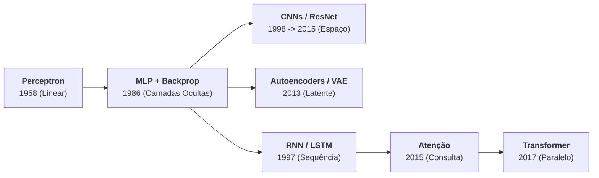
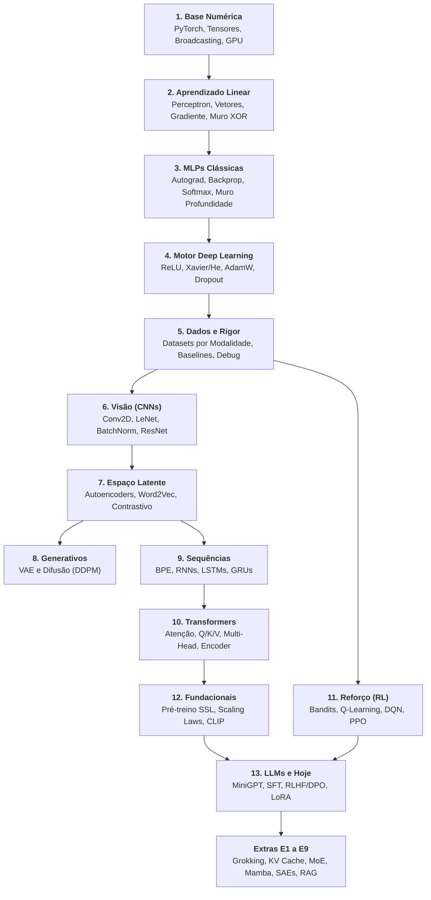

Quando alguém decide estudar Inteligência Artificial hoje, a sensação é a de cair de paraquedas no meio de uma festa que começou há oitenta anos. Todo mundo fala de *Transformers*, *LoRA*, *Grokking*, *Diffusion* e *RLHF* como se essas coisas tivessem brotado prontas do chão em 2022. Quem tenta acompanhar pegando um tutorial aleatório de PyTorch normalmente acaba copiando blocos prontos de código sem fazer ideia de por que existe um `zero_grad()`, por que uma rede precisa de não linearidade ou por que trocamos recorrência por atenção.

> [!NOTE] Nota da Série
> Este post faz parte da série **Mente Latente**, onde construímos Aprendizado de Máquina tijolo por tijolo com **PyTorch**, dos primeiros tensores e do Perceptron até Transformers e nossa própria Mini-LLM. Os notebooks de exploração, módulos reutilizáveis e testes `pytest` de cada capítulo ficarão organizados no repositório parceiro [vndmtrx/mente_latente](https://github.com/vndmtrx/mente_latente).

Eu bati a cabeça exatamente nisso durante um bom tempo. Inclusive, quem leu  acompanhou de perto o meu primeiro trabalho na disciplina de Inteligência Artificial do mestrado em Ciência da Computação, quando saí da zona de conforto da infraestrutura pra encarar buscas em grafos, hipercubos de 23 dimensões e otimização contínua.

Foi justamente aquela experiência (e o esforço de desmistificar cada conceito sem fingir que a matemática era óbvia) que serviu de motivação para montar esta série. A coisa só começou a fazer sentido quando parei de tentar pular pro final do filme e resolvi montar cada peça na ordem em que os problemas foram surgindo, testando, quebrando e consertando no caminho.

Antes de abrirmos o Jupyter e escrevermos a primeira linha de código da série **Mente Latente**, precisamos de um mapa do território. Este Post 0 é a nossa linha do tempo progressiva: uma revisão histórica das grandes ondas do Aprendizado de Máquina, os nomes que destravaram cada gargalo, os muros que fizeram a área congelar duas vezes e as viradas que nos trouxeram até os modelos atuais. Tudo o que você vai ler aqui não é curiosidade de museu. Quase cada marco desta linha do tempo vai virar código real, testado com `pytest` e quebrado de propósito no Jupyter ao longo dos nossos capítulos.

> [!TIP] Aviso de Leitura
> Pegue um café, chame sua LLM preferida se quiser ir tirando dúvidas paralelas e venha sem pressa: vamos atravessar mais de oitenta anos de história da computação num texto longo pensado para servir de mapa de consulta ao longo de toda a série.



## Onda 1: A Pré-História e o Sonho do Neurônio Artificial (1943 a 1969)

Muita gente acha que Aprendizado de Máquina é coisa da era da nuvem e das placas de vídeo caras. Na verdade, as ideias centrais nasceram quando computadores ainda ocupavam salas inteiras e funcionavam a válvula. Essa primeira onda foi marcada por um otimismo quase ingênuo: a crença de que bastava imitar um neurônio biológico em circuito elétrico para que a inteligência brotasse sozinha.

### McCulloch, Pitts e o Neurônio Lógico (1943)

Tudo começa num encontro improvável em Chicago: Warren McCulloch, um neurofisiologista obcecado por entender como o cérebro produz pensamento, e Walter Pitts, um jovem lógico prodígio autodidata que tinha fugido de casa ainda adolescente e dormia na biblioteca da universidade. Em 1943, os dois publicaram um artigo curto e denso que propôs o primeiro modelo matemático de um neurônio artificial[^1].

A ideia era elegante de tão enxuta. O neurônio recebia sinais binários (0 ou 1, ligado ou desligado), somava os sinais excitatórios, descontava os inibitórios e disparava saída 1 caso a soma ultrapassasse um limiar fixo. Com esse bloquinho minúsculo, eles provaram que redes interligadas desses neurônios lógicos conseguiam calcular qualquer função booleana (AND, OR, NOT) e, em teoria, qualquer computação lógica. Foi a primeira ponte formal entre biologia, lógica matemática e computação.

Só tinha um detalhe incômodo: aquele neurônio não aprendia absolutamente nada.

Os limiares e conexões precisavam ser projetados e ajustados à mão por um ser humano, como um circuito digital comum. Mesmo assim, a semente mais poderosa da área estava plantada: talvez "pensar" não precisasse de um processador central gigantesco cheio de regras, mas pudesse emergir de muitas unidades simples trabalhando em rede.

### Alan Turing e a Pergunta que Mudou Tudo (1950)

Sete anos depois, quando computadores eletrônicos ainda eram raridades militares que precisavam de salas climatizadas inteiras, Alan Turing publicou *Computing Machinery and Intelligence*[^2] na revista filosófica *Mind*. Quase todo mundo lembra da primeira página, onde ele dribla a pergunta vaga "máquinas podem pensar?" propondo o Jogo da Imitação (que o mundo apelidou de Teste de Turing).

Só que o trecho mais visionário daquele artigo está lá pro final, e muita gente passa batido por ele. Turing faz as contas do tamanho do cérebro humano e conclui que tentar programar uma "mente adulta" diretamente, escrevendo na mão todo o conhecimento e todas as regras do mundo, seria trabalho insano e inviável.

A proposta dele foi inverter completamente o jogo. Em vez de simular um adulto pronto, por que não construir uma "máquina-criança" com estrutura relativamente simples e educá-la por meio de tentativa, erro, punições e recompensas? Em pleno 1950, antes mesmo de existir a palavra *software* no uso cotidiano, Turing já tinha descrito com clareza assustadora a filosofia por trás do aprendizado estatístico e do aprendizado por reforço.

### Arthur Samuel e o Nome Aprendizado de Máquina (1952 a 1959)

Enquanto os teóricos discutiam filosofia, Arthur Samuel, pesquisador da IBM trabalhando no mainframe IBM 704, resolveu colocar a mão na massa num problema concreto: ensinar um computador a jogar damas. Se você tentar programar damas escrevendo regras fixas de estratégia, o programa joga no máximo tão bem quanto você (e olhe lá). Samuel decidiu testar outra rota: escreveu uma função de avaliação ponderada por pesos numéricos (contando vantagem de peças, controle do centro, mobilidade) e colocou o programa para jogar milhares de partidas contra cópias de si mesmo.

A cada partida, o programa ajustava os pesos dessa função conforme o resultado, além de memorizar posições já avaliadas (*rote learning*) para olhar mais jogadas à frente sem desperdiçar processamento. Em 1959, ao publicar os resultados no periódico técnico da IBM[^3], Samuel popularizou o termo *Machine Learning* (Aprendizado de Máquina) e deixou a definição que sobrevive intacta até hoje: o campo que dá aos computadores a capacidade de aprender sem serem explicitamente programados.

O programa de Samuel chegou a ganhar demonstração na TV pela IBM e, em 1962, venceu um forte jogador humano (Robert Nealey, campeão estadual de Connecticut). Pela primeira vez, um computador tinha superado o próprio programador numa tarefa estratégica usando experiência acumulada.

### Frank Rosenblatt e o Perceptron (1957 a 1958)

Se McCulloch e Pitts criaram o neurônio fixo e Samuel mostrou o aprendizado em jogos, o psicólogo Frank Rosenblatt juntou as duas metades. Em 1957, trabalhando no Cornell Aeronautical Laboratory (financiado pela Marinha dos EUA), Rosenblatt inventou o **Perceptron**[^4]: um modelo de neurônio artificial que finalmente tinha uma regra automática para ajustar seus próprios pesos toda vez que errava a classificação de um exemplo.

E não ficou só no papel. Rosenblatt construiu o **Mark I Perceptron**, uma máquina física do tamanho de um armário cheio de cabos trançados, uma "retina" de 400 fotocélulas (uma câmera de 20 por 20 pixels!) e bancos de potenciômetros acoplados a pequenos motores elétricos. Quando a máquina errava ao identificar uma forma geométrica ou uma letra, os motores giravam fisicamente os potenciômetros para alterar os pesos. Ver um algoritmo de aprendizado rodando em engrenagens e fios dá outra dimensão pro que fazemos hoje em uma linha de PyTorch.

A imprensa dos EUA perdeu a linha na época. O *New York Times* publicou uma matéria celebrando o "embrião de um computador eletrônico que a Marinha espera que seja capaz de andar, falar, ver, escrever, reproduzir a si mesmo e ter consciência de sua própria existência".

Na prática, o que o Perceptron fazia era bem mais pé no chão (e ainda assim poderoso): ele traçava um hiperplano (uma linha reta no plano 2D) separando duas classes de dados usando uma soma ponderada simples das entradas.

### Bernard Widrow, Ted Hoff e o ADALINE (1960)

Logo depois de Rosenblatt, em Stanford, Bernard Widrow e seu aluno de doutorado Ted Hoff (o mesmo Ted Hoff que uma década depois lideraria a invenção do primeiro microprocessador na Intel, o 4004) criaram o **ADALINE** (*Adaptive Linear Neuron*)[^31]. À primeira vista, parecia quase igual ao Perceptron, mas havia uma diferença sutil que mudou tudo.

O Perceptron só corrigia os pesos olhando para a saída binária final (depois da função degrau): ou acertou (erro zero) ou errou (ajusta). Já o ADALINE media o erro usando a saída contínua *antes* do degrau, buscando minimizar o erro quadrático médio através da chamada Regra Delta (ou algoritmo LMS, *Least Mean Squares*).

Essa troca parece detalhe de implementação, mas foi um divisor de águas. Medir o erro numa superfície contínua e suave permitiu calcular a inclinação desse erro e dar passos proporcionais na direção da descida: estava aberta a porta para o **Gradiente Descendente**.

### Minsky, Papert e o Muro do XOR (1969)

A festa otimista dos anos 1950 e 1960 acabou de forma brusca em 1969. Marvin Minsky (um dos pais da IA no MIT, que por ironia havia sido colega de colégio de Frank Rosenblatt) e Seymour Papert publicaram o livro *Perceptrons: An Introduction to Computational Geometry*[^5]. Em vez de opinar, eles aplicaram geometria rigorosa e provaram matematicamente algo devastador para o hype da época: um Perceptron de camada única é estritamente incapaz de aprender qualquer função que não seja linearmente separável.

O golpe fatal veio no exemplo mais simples possível: a porta lógica **XOR** (ou exclusivo). Tente desenhar os quatro pontos do XOR num papel: `(0,0)` e `(1,1)` dão saída `0`; `(0,1)` e `(1,0)` dão saída `1`. Você pode girar uma régua o dia inteiro sobre esse papel e nunca vai conseguir traçar uma única linha reta que deixe os zeros de um lado e os uns do outro. Minsky e Papert sabiam perfeitamente que redes com múltiplas camadas resolveriam o XOR sem esforço, mas deixaram registrado o ceticismo de que ninguém sabia treinar essas camadas ocultas de forma geral e eficiente.

O efeito no mundo real foi imediato. O financiamento secou e o pessimismo tomou conta dos departamentos de pesquisa. Na história da computação, esses ciclos em que o entusiasmo quebra, o dinheiro some e a área congela ficaram conhecidos como **Invernos da IA** (e é assim que vamos chamá-los daqui para frente). Estava inaugurado o **Primeiro Inverno da IA**.

> [!NOTE] A Ironia de Seymour Papert
> O mesmo Seymour Papert que coescreveu o livro responsável por frear as redes neurais em 1969 dedicou o resto da vida à educação no MIT, criando a linguagem Logo e o **Construcionismo** (aprender construindo, quebrando e depurando objetos reais). É exatamente essa filosofia de Papert que vai guiar a nossa bancada no Jupyter ao longo de toda a série.

## Onda 2: A Era Simbólica e o Renascimento Conexionista (1970 a 1995)

Com as redes neurais praticamente banidas das verbas de pesquisa, a década de 1970 e o início dos anos 1980 foram dominados pela chamada IA Simbólica (os famosos *Sistemas Especialistas*). Se não dava pra fazer a máquina aprender padrões estatísticos, a aposta passou a ser o caminho oposto: entrevistar especialistas humanos (médicos, geólogos, engenheiros, advogados) e traduzir o conhecimento deles em milhares de regras lógicas escritas à mão.

### Sistemas Especialistas e o Segundo Inverno da IA (Anos 1970 e 1980)

No começo, a abordagem brilhou em nichos bem fechados. Sistemas como o **MYCIN** (criado em Stanford para diagnosticar infecções bacterianas no sangue e sugerir antibióticos) e o **XCON** (usado pela DEC para configurar pedidos de servidores VAX) chegaram a rivalizar com especialistas humanos em testes controlados. Empresas correram para comprar "máquinas Lisp" dedicadas e contratar "engenheiros do conhecimento" a peso de ouro.

Só que a realidade cobrou a conta rápido. Manter dezenas de milhares de regras manuais cheias de exceções, interações escondidas e contradições virou um pesadelo de engenharia de software. O mundo real é barulhento, ambíguo e cheio de casos de borda que simplesmente não cabem em árvores rígidas de `if/else`. Quando ficou claro que os sistemas especialistas eram caros de manter, frágeis fora do script e incapazes de aprender com novos dados, o mercado desabou de novo no fim dos anos 1980, inaugurando o **Segundo Inverno da IA**.

Mas, longe dos holofotes e do dinheiro fácil, um pequeno grupo de pesquisadores teimosos continuava cavando o caminho das redes neurais.

### Backpropagation e a Queda do Muro do XOR (1970 a 1986)

O nó que travava tudo desde 1969 era o problema da atribuição de crédito: numa rede com várias camadas empilhadas, quando a saída final erra, quanta "culpa" pertence a cada peso lá da primeira camada oculta? A solução matemática já tinha aparecido em contextos de teoria de controle nos anos 1960, na dissertação de mestrado de Seppo Linnainmaa (1970, publicada em inglês em 1976[^29]) descrevendo o modo reverso da diferenciação automática e na tese de doutorado de Paul Werbos em 1974[^30]. Mas a ideia só explodiu na computação em 1986, quando David Rumelhart, Geoffrey Hinton e Ronald Williams publicaram o artigo clássico na revista *Nature*[^6] demonstrando que o método funcionava de verdade para aprender representações internas úteis.

O algoritmo de **Backpropagation** (retropropagação do erro) aplica a regra da cadeia do cálculo de trás para frente, empurrando o gradiente do erro da última camada até a primeira. Com ativações suaves e diferenciáveis (como Sigmoid e Tanh) no lugar do degrau duro do Perceptron, treinar uma **MLP** (*Multi-Layer Perceptron*) com camadas ocultas finalmente se tornou prático.

O muro do XOR caiu. A rede conseguia dobrar o espaço geométrico na camada oculta e separar classes que nenhuma reta sozinha jamais separaria.

> [!NOTE] Em 2 Linhas: O que é Gradiente?
> Pense no gradiente como uma bússola numérica: para cada peso da rede, ele aponta qual direção faz o erro subir e qual é a inclinação da ladeira. Para a rede aprender, basta dar um passo na direção oposta (descendo a ladeira) até o erro diminuir.

### O Teorema da Aproximação Universal (1989)

Com o entusiasmo renovado pelas MLPs, os matemáticos quiseram saber qual era o limite teórico dessa arquitetura. Em 1989, George Cybenko[^7] (e logo depois Kurt Hornik, Maxwell Stinchcombe e Halbert White) demonstrou o **Teorema da Aproximação Universal**: uma rede neural feedforward com apenas *uma* camada oculta finita e uma função de ativação não linear contínua consegue aproximar qualquer função contínua em um domínio compacto com a precisão que você quiser.

Parece o fim da história, né? Só que não.

O teorema é um resultado de *existência*, não uma receita de bolo. Ele garante que os pesos existem, mas não diz se você vai precisar de 50 neurônios ou de 50 bilhões de neurônios nessa única camada larga, nem garante que o Gradiente Descendente consiga encontrá-los a partir de dados finitos. Na prática, o que a década seguinte provaria é que empilhar camadas (profundidade) e respeitar a geometria do dado (viés indutivo) é exponencialmente mais eficiente do que construir uma única camada monstruosamente larga.

### Kunihiko Fukushima, Yann LeCun e a LeNet (1980 a 1998)

Na visão computacional, essa lição ficou escancarada cedo. Se você pega uma imagem pequena de 28 por 28 pixels e achata tudo num vetor de 784 números para jogar numa MLP comum, joga no lixo uma informação óbvia: pixels vizinhos formam bordas, cantos e traços, e um dígito "7" continua sendo "7" mesmo se você deslocá-lo dois pixels para a direita.

Inspirado na descoberta de David Hubel e Torsten Wiesel sobre o córtex visual dos gatos (células simples e complexas respondendo a regiões locais), o pesquisador japonês Kunihiko Fukushima propôs em 1980 o **Neocognitron**[^32], já trazendo a ideia de campos receptivos locais. Nos laboratórios da Bell Labs, **Yann LeCun** e seus colaboradores combinaram essa arquitetura hierárquica com o treinamento por Backpropagation, criando as **Redes Neurais Convolucionais (CNNs)** e culminando na famosa **LeNet-5** em 1998[^8].

Em vez de ligar todo pixel a todo neurônio, a CNN desliza pequenos filtros (matrizes 5 por 5) pela imagem inteira compartilhando os mesmos pesos, e usa camadas de *pooling* para reduzir a resolução mantendo o essencial. Não era brinquedo acadêmico: a LeNet foi colocada em produção real nos bancos dos EUA lendo milhões de cheques manuscritos por dia, e deixou de legado o famoso dataset **MNIST** (70 mil dígitos manuscritos).

### Q-Learning, TD-Learning e a Base do Reforço (1988 a 1992)

Enquanto MLPs e CNNs brilhavam no aprendizado supervisionado (onde um humano precisa rotular cada exemplo de antemão), outra vertente amadurecia em paralelo com uma ambição muito diferente: o **Aprendizado por Reforço** (*Reinforcement Learning*). A premissa é a seguinte: e se ninguém te disser qual é a resposta certa a cada passo, mas o ambiente só te der uma recompensa ou punição vários passos depois?

Richard Sutton formalizou o aprendizado por Diferença Temporal (*TD-Learning*, 1988)[^33], permitindo atualizar estimativas de valor passo a passo sem esperar o jogo acabar. Um ano depois, na sua tese de doutorado, Chris Watkins criou o **Q-Learning** (1989, formalizado em artigo com Peter Dayan em 1992[^34]), um algoritmo elegante que aprende o valor ótimo de cada ação em cada estado mesmo sem conhecer as regras internas do ambiente. Em 1992, Gerald Tesauro na IBM usou TD-Learning com uma rede neural no **TD-Gammon**, que aprendeu a jogar gamão em nível de mestre mundial jogando contra si mesmo. Todo esse alicerce foi consolidado por Richard Sutton e Andrew Barto no livro que até hoje é a bíblia da área[^9].

### O Muro da Profundidade e o Reinado Estatístico (Anos 1990)

Apesar do sucesso da LeNet e do Backpropagation, na prática ninguém conseguia treinar redes neurais com mais de três ou quatro camadas nos anos 1990. Quando você empilhava muitas camadas usando ativações Sigmoid ou Tanh, a derivada dessas funções era sempre menor que 1 (na Sigmoid, no máximo 0,25). Multiplicar números menores que 0,25 dez vezes seguidas durante a retropropagação fazia o gradiente encolher exponencialmente até virar praticamente zero nas primeiras camadas: o temido **Vanishing Gradient** (desvanecimento do gradiente). As camadas finais até se mexiam, enquanto as iniciais ficavam congeladas no ruído aleatório.

Enquanto as redes neurais patinavam nesse muro e exigiam poder computacional que os processadores da época não entregavam, o Aprendizado de Máquina estatístico clássico tomou conta do mercado. Vladimir Vapnik e Corinna Cortes apresentaram as **SVMs** (*Support Vector Machines*, 1995)[^35], que resolviam problemas não lineares com garantias matemáticas limpas usando o *Kernel Trick* (projetando os dados para dimensões maiores sem pagar o custo explícito). Pouco depois, Leo Breiman criou as **Random Forests** (2001)[^36] e o *Gradient Boosting* se consolidou como o rei absoluto de dados tabulares (aliás, até hoje em tabelas estruturadas pequenas, árvores de decisão com boosting dão um baile em redes neurais).

Durante mais de uma década, redes neurais perderam prestígio e enfrentaram forte resistência nas grandes conferências de visão computacional e IA frente ao domínio das SVMs.

## Onda 3: Sequências, Memória e o Despertar da Profundidade (1997 a 2012)

Enquanto as SVMs reinavam no mercado, três frentes silenciosas preparavam o terreno para a maior virada da história da computação: arquiteturas com memória, bancos de dados gigantescos e o hardware certo para multiplicar matrizes em massa.

### Hochreiter, Schmidhuber e a LSTM (1997)

Para dados que têm ordem no tempo (texto, áudio, séries climáticas, cotações financeiras), uma MLP comum não servia: ela trata cada entrada de forma isolada, sem memória do que veio antes. As **Redes Neurais Recorrentes (RNNs)** surgiram com uma ideia intuitiva: manter um "estado oculto" (um vetor de memória) que é atualizado a cada passo e passado adiante para o passo seguinte.

Na prática, porém, a RNN simples sofria do mesmo veneno que travou as MLPs fundas, só que esticado no tempo. Quando você retropropagava o erro por uma frase de trinta palavras (*Backpropagation Through Time*), o gradiente multiplicado repetidamente ou encolhia até desaparecer (*vanishing*) ou crescia até estourar em `NaN` (*exploding*). Resultado: a rede esquecia o sujeito no começo da frase quando chegava no verbo lá no fim.

Em 1997, Sepp Hochreiter (que já tinha identificado o problema na sua dissertação de diploma em 1991) e Jürgen Schmidhuber publicaram a **LSTM** (*Long Short-Term Memory*)[^10]. A sacada foi separar a memória de longo prazo (*cell state*) e protegê-la com portões treináveis (esquecimento, entrada e saída) que funcionam como válvulas: a rede aprende o que vale guardar por cinquenta passos e o que pode jogar fora agora. O gradiente ganhou uma "via expressa" linear pelo tempo (e anos depois, em 2014, Kyunghyun Cho propôs a **GRU**[^37], uma variante mais enxuta da mesma ideia).

### O Renascimento do Deep Learning e o ImageNet (2006 a 2009)

A partir de 2006, um trio que nunca desistiu das redes neurais durante os Invernos da IA (Geoffrey Hinton em Toronto, Yoshua Bengio em Montreal e Yann LeCun em Nova York) começou a virar a maré. Hinton mostrou que era possível treinar redes profundas com pré-treino não supervisionado camada por camada (*Deep Belief Networks*)[^38] e a comunidade adotou um novo nome para escapar do estigma dos anos 1990: **Deep Learning**.

Só que algoritmo sozinho não faz milagre sem combustível. Esse combustível chegou em 2009, quando **Fei-Fei Li** e sua equipe (iniciando o projeto em Princeton e levando-o adiante em Stanford) lançaram o **ImageNet**[^11]. Na época, o consenso da área era focar quase exclusivamente em algoritmos melhores sobre datasets minúsculos de poucas dezenas de milhares de imagens. Fei-Fei Li apostou no contrário: organizou uma taxonomia baseada no WordNet e coordenou milhares de anotadores humanos para construir um banco que nasceu com mais de 3 milhões de imagens e cresceu até passar de 14 milhões de fotos rotuladas em milhares de categorias.

O ImageNet virou o campo de provas anual da visão computacional (ILSVRC) e provou uma verdade desconfortável para muitos teóricos: em muitos problemas, aumentar a escala e a diversidade dos dados muda qualitativamente o que o modelo consegue aprender.

### ReLU e Inicialização Destravam os Gradientes (2010 a 2012)

Enquanto os dados cresciam, duas descobertas de engenharia aparentemente simples demoliram de vez o Muro da Profundidade dos anos 1990 sem precisar daquela ginástica complexa de pré-treino camada por camada:

* **Inicialização consciente de variância:** em 2010, Xavier Glorot e Yoshua Bengio[^39] mostraram que inicializar os pesos aleatoriamente sem calibrar a variância pelo número de entradas e saídas fazia o sinal ou explodir ou morrer antes mesmo da primeira época terminar. Nascia a inicialização de **Xavier/Glorot** (seguida em 2015 pela inicialização de **Kaiming He**[^40], calibrada para a ReLU).
* **A simplicidade brutal da ReLU:** trocar as curvas suaves e lentas da Sigmoid e da Tanh pela função retificadora `max(0, x)` resolveu o esmagamento do gradiente na região positiva (derivada constante igual a 1!).

Parece bobo olhando de fora, mas essas duas trocas bastaram para transformar redes profundas que antes ficavam congeladas em modelos que convergiam de forma estável do zero.

### AlexNet e o Big Bang das GPUs (2012)

Em setembro de 2012, todas essas peças se encontraram no mesmo lugar. Alex Krizhevsky (um aluno de doutorado rodando experimentos em um computador montado no quarto), Ilya Sutskever e Geoffrey Hinton inscreveram a **AlexNet**[^12] na competição do ImageNet. A arquitetura juntava tudo: uma CNN profunda com 8 camadas, ativações **ReLU**, **Dropout** (desligando neurônios aleatoriamente no treino para impedir decoreba), **Data Augmentation** (girando e recortando imagens para multiplicar os exemplos) e o golpe de mestre de infraestrutura: kernels CUDA escritos na unha para dividir o treino em **duas placas de vídeo gamer (NVIDIA GTX 580 com 3 GB de VRAM cada)**.

O resultado chocou a sala inteira. O segundo colocado (um sistema tradicional cheio de engenharia manual de descritores visuais) ficou em 26,2% de erro top-5. A AlexNet cravou 15,3%.

Não foi uma melhora incremental. Foi um atropelamento.

No ano seguinte, quase todas as equipes da competição abandonaram os métodos clássicos e migraram para CNNs em GPU. As placas de vídeo deixaram de ser hardware de videogame e viraram os motores de álgebra linear da era moderna.

> [!TIP] Em 2 Linhas: Por que GPU e não CPU?
> Uma CPU tem poucos núcleos muito rápidos e versáteis, excelentes para lógica sequencial cheia de desvios. Uma GPU tem milhares de núcleos mais simples trabalhando juntos, feitos sob medida para fazer milhões de multiplicações e somas de matrizes ao mesmo tempo, que é exatamente o que uma rede neural faz o dia inteiro.

## Onda 4: A Explosão das Arquiteturas e da Representação (2013 a 2016)

Depois da AlexNet, a comunidade percebeu que tinha nas mãos um motor capaz de aprender representações ricas direto dos dados brutos, sem engenheiros gastando meses criando extratores manuais de características. Em apenas quatro anos frenéticos, nasceram quase todos os blocos modernos que ainda empilhamos hoje no PyTorch.

### Word2Vec e a Geometria do Significado (2013)

No processamento de linguagem natural, palavras ainda eram tratadas muitas vezes como rótulos atômicos desconectados (vetores *one-hot* gigantes onde "gato" e "cachorro" eram tão distantes entre si quanto "gato" e "carburador"). Em 2013, Tomas Mikolov e sua equipe no Google publicaram o **Word2Vec**[^13], operacionalizando em escala uma ideia antiga da linguística (a hipótese distribucional: você conhece uma palavra pela companhia que ela guarda).

Usando redes neurais surpreendentemente rasas e rápidas (*Skip-Gram* e *CBOW*) treinadas apenas para prever palavras vizinhas em bilhões de frases, o subproduto foram vetores densos de poucas centenas de dimensões (**Embeddings**). O espaço vetorial aprendeu sozinho relações semânticas e gramaticais que viravam aritmética simples: pegar o vetor de `rei`, subtrair `homem` e somar `mulher` apontava diretamente para `rainha`.

> [!NOTE] Em 2 Linhas: O que são Embeddings?
> Um *embedding* é um vetor de coordenadas numéricas que representa uma palavra, imagem ou conceito dentro de um espaço geométrico. Durante o treino, a rede ajusta essas coordenadas para que itens com significados parecidos fiquem próximos uns dos outros.

### VAEs, GANs e as Máquinas que Criam (2013 a 2014)

Até ali, quase toda a atenção prática estava em modelos *discriminativos*: dar uma entrada e prever um rótulo ou um número. Entre o fim de 2013 e 2014, duas ideias colocaram os modelos *generativos* (máquinas capazes de inventar dados novos plausíveis) no centro do palco:

* **VAE (Variational Autoencoder, 2013):** Diederik Kingma e Max Welling[^14] pegaram o Autoencoder clássico (que só comprimia e reconstruía imagens) e forçaram o gargalo latente a seguir uma distribuição probabilística contínua usando *KL-Divergence*. Para conseguir passar o gradiente através de uma amostragem aleatória, introduziram o famoso **truque da reparametrização**.
* **GAN (Generative Adversarial Network, 2014):** Ian Goodfellow e colegas[^15] (numa ideia que, segundo a lenda, nasceu numa discussão de bar em Montreal) colocaram duas redes em guerra: um Gerador tentando falsificar imagens realistas e um Discriminador tentando detectar a falsificação. As GANs produziram rostos fotorrealistas impressionantes, mas ficaram famosas por serem um pesadelo temperamental de estabilizar no treino.

### DQN e o Reforço Profundo (2013 a 2016)

Em dezembro de 2013, uma startup londrina relativamente pequena chamada DeepMind publicou um artigo que deixou a comunidade de boca aberta: **DQN** (*Deep Q-Network*)[^16]. Eles juntaram uma CNN com o Q-Learning de 1989 e colocaram o agente para jogar dezenas de jogos clássicos de Atari 2600 (como *Breakout* e *Space Invaders*) recebendo apenas os pixels crus da tela e a pontuação no placar, sem nenhuma regra do jogo programada.

O segredo para a rede neural não divergir enquanto aprendia jogando foram dois truques de engenharia simples: guardar experiências passadas num *Experience Replay Buffer* (para quebrar a correlação entre frames consecutivos) e manter uma *Target Network* congelada por alguns passos. O agente não só superou humanos em vários jogos como descobriu estratégias criativas (como cavar um túnel lateral no *Breakout*). Três anos depois, em 2016, a mesma DeepMind chocou o mundo com o **AlphaGo**[^41] derrotando o campeão mundial Lee Sedol no jogo de Go, incluindo o famoso *Lance 37* da segunda partida, uma jogada tão fora do padrão humano que os comentaristas acharam inicialmente que o programa tinha travado.

### Otimizadores Modernos, BatchNorm e ResNet (2014 a 2015)

Enquanto as aplicações ganhavam manchetes, a engenharia de treinamento viveu um biênio de ouro com três peças que hoje você encontra em praticamente qualquer script PyTorch:

* **Adam (2014):** Diederik Kingma e Jimmy Ba[^23] juntaram a inércia do Momentum com a adaptação de passo por parâmetro do RMSProp num otimizador que convergia rápido e com pouca sintonia manual (mais tarde refinado por Ilya Loshchilov e Frank Hutter para o **AdamW**[^42], corrigindo a forma como o *weight decay* interagia com o passo adaptativo).
* **Batch Normalization (2015):** Sergey Ioffe e Christian Szegedy[^24] propuseram normalizar as ativações intermediárias de cada *mini-batch* durante o treino, permitindo taxas de aprendizado bem maiores e redes muito menos sensíveis à inicialização.
* **ResNet (2015):** Kaiming He e sua equipe na Microsoft[^17] observaram um paradoxo bizarro: quando você empilhava 56 camadas convolucionais em vez de 20, até o **erro de treino** ficava pior (não era *overfitting*, era degradação pura do fluxo de sinal). A solução foi absurdamente simples: adicionar uma conexão de atalho somando a entrada direto à saída do bloco (`x + F(x)`), de modo que a camada só precisasse aprender o *resíduo*. A ResNet venceu o ImageNet de 2015 com 152 camadas e destravou a profundidade quase ilimitada.

### Seq2Seq e o Mecanismo de Atenção (2014 a 2015)

Na tradução automática (por exemplo, transformar uma frase em inglês numa frase em francês ou português de tamanho diferente), Ilya Sutskever, Oriol Vinyals e Quoc Le[^43] (e em paralelo Kyunghyun Cho) popularizaram a arquitetura **Seq2Seq**: uma LSTM codificadora lia toda a frase de origem e comprimia o significado inteiro num único vetor de tamanho fixo; outra LSTM decodificadora recebia esse vetor solitário e tentava descompactar a frase traduzida palavra por palavra.

Funcionava razoavelmente bem em frases curtas. Em parágrafos longos, a qualidade despencava: era como tentar resumir um capítulo inteiro de um livro num único post-it e pedir para alguém reescrever o capítulo olhando só pro post-it.

Em 2015, Dzmitry Bahdanau, Kyunghyun Cho e Yoshua Bengio[^18] quebraram esse gargalo inventando o **Mecanismo de Atenção**. Em vez de jogar fora os estados intermediários do codificador, eles deixaram o decodificador "olhar para trás" e calcular pesos dinâmicos indicando em quais palavras da frase original focar a cada palavra gerada. A tradução automática deu um salto imediato, e sem perceber eles tinham acabado de acender o pavio da maior revolução arquitetural da década seguinte.

## Onda 5: A Era Transformer e os Modelos Fundacionais (2017 a 2022)

As LSTMs com atenção funcionavam bem, mas tinham um defeito fatal para o hardware moderno: eram sequenciais. Para calcular o passo 500 de uma frase, você precisava esperar os 499 anteriores terminarem. As GPUs ficavam ociosas esperando o laço no tempo.

### Attention Is All You Need (2017)

Em junho de 2017, um grupo de oito pesquisadores do Google Brain e do Google Research (Ashish Vaswani, Noam Shazeer, Niki Parmar, Jakob Uszkoreit, Llion Jones, Aidan Gomez, Lukasz Kaiser e Illia Polosukhin) publicou um dos artigos mais influentes da ciência da computação: *Attention Is All You Need*[^19]. A proposta era quase uma heresia na época: jogar fora completamente as RNNs, LSTMs e convoluções temporais e construir uma arquitetura inteira baseada apenas em **Self-Attention** (autoatenção).

Nascia o **Transformer**. Em vez de ler uma frase palavra por palavra esperando o estado oculto chegar do começo ao fim, o Transformer projeta cada token em três vetores (*Query*, *Key* e *Value*) e deixa todos os tokens olharem uns para os outros ao mesmo tempo por meio de multiplicações de matrizes (`Q @ K.T`). Para não perder a noção de ordem já que não existe mais laço temporal, eles injetaram ondas senoidais de frequências diferentes (**Positional Encoding**, funcionando como engrenagens de um calendário). Empilharam várias cabeças de atenção em paralelo (**Multi-Head Attention**), amarraram tudo com conexões residuais da ResNet e trocaram BatchNorm por **LayerNorm**.

O impacto em hardware foi imediato. Pela primeira vez, modelos de linguagem conseguiam ocupar 100% da capacidade paralela de clusters gigantes de GPUs e TPUs durante o treinamento, derrubando o limite que travava as redes recorrentes.

> [!NOTE] Em 2 Linhas: O que é um Token?
> Redes neurais não leem letras nem frases diretamente: antes de entrar no modelo, o texto é fatiado em pequenos blocos chamados **tokens** (palavras curtas, sílabas ou sinais de pontuação) e cada bloco vira um número inteiro numa tabela de vocabulário.

### A Bifurcação BERT vs GPT e o Pré-Treino Autossupervisionado (2018 a 2020)

O Transformer original de 2017 tinha dois lados (Encoder e Decoder) porque foi desenhado para tradução. Só que, entre 2018 e 2020, a comunidade percebeu que cada metade sozinha era uma potência quando pré-treinada em montanhas de texto sem nenhum rótulo humano (*Self-Supervised Learning*):

* **BERT (Google, 2018):** pegou apenas o **Encoder** bidirecional[^44] e treinou o modelo num jogo de "complete a lacuna" (*Masked Language Modeling*), escondendo 15% das palavras de cada frase. Como ele enxergava o contexto à esquerda e à direita ao mesmo tempo, esmagou praticamente todos os benchmarks clássicos de compreensão de texto, busca e classificação.
* **Série GPT (OpenAI, 2018 a 2020):** apostou no **Decoder** com máscara causal (uma matriz triangular que proíbe cada token de espiar o futuro) e numa única tarefa que parecia simples demais para gerar inteligência: prever qual é o próximo token da frase.

O **GPT-2** (2019, 1,5 bilhão de parâmetros) já assustou gerando textos longos coerentes. Mas foi com o **GPT-3** em 2020 (175 bilhões de parâmetros)[^20] que apareceu algo que pegou até os próprios pesquisadores de surpresa: o **In-Context Learning**. Sem atualizar um único peso da rede, sem rodar `.backward()`, bastava colocar dois ou três exemplos no *prompt* (*few-shot*) e o modelo resolvia tarefas inéditas de tradução, resumo, classificação e código para as quais nunca tinha sido treinado explicitamente.

O paradigma de "um modelo treinado do zero por tarefa" acabava de perder o monopólio. Nascia a era dos **Modelos Fundacionais**.

### Leis de Escala e Multimodalidade (2020 a 2021)

Ao mesmo tempo em que os modelos cresciam, os pesquisadores perceberam que treinar redes gigantes não precisava ser pura aposta no escuro. Em 2020, Jared Kaplan e colegas na OpenAI[^45] (e depois a DeepMind com o famoso estudo *Chinchilla* em 2022[^25]) mediram empiricamente o comportamento da perda e descobriram as **Leis de Escala** (*Scaling Laws*): o erro de um Transformer cai segundo curvas suaves e previsíveis conforme você aumenta em equilíbrio três ingredientes: número de parâmetros, quantidade de tokens de treino e orçamento computacional.

Em paralelo, a barreira entre texto e imagem começou a derreter. Em 2021, a OpenAI lançou o **CLIP**[^26], usando aprendizado contrastivo (*InfoNCE*) em 400 milhões de pares de imagem e legenda coletados da internet. Em vez de classificar fotos em mil categorias fixas como no ImageNet, o CLIP alinhou o codificador de imagem e o codificador de texto no **mesmo espaço vetorial latente**. Isso permitiu busca semântica visual, classificação *zero-shot* e serviu de ponte para os geradores de imagem guiados por texto.

### Modelos de Difusão e a Revolução Visual (2020 a 2022)

No mundo visual, as GANs dos anos 2010 tinham um problema crônico: eram instáveis, sofriam colapso de modos (gerando sempre as mesmas variações) e exigiam uma dança delicada entre Gerador e Discriminador. Em 2020, Jonathan Ho, Ajay Jain e Pieter Abbeel popularizaram os **DDPMs** (*Denoising Diffusion Probabilistic Models*)[^21], inspirados no processo físico de difusão.

A sacada da Difusão é brilhante pela simplicidade do objetivo de treino: pegue uma imagem limpa e vá adicionando um pouquinho de ruído gaussiano em centenas de passos até sobrar apenas estática pura de TV fora do ar; depois, treine uma rede neural (normalmente uma U-Net) para olhar para uma imagem ruidosa e prever exatamente qual ruído foi adicionado ali. Na hora de gerar uma imagem inédita, você começa de ruído puro aleatório e pede para a rede limpar o ruído passo a passo. Quando pesquisadores combinaram isso com compressão em espaço latente (**Latent Diffusion / Stable Diffusion**, 2022)[^46] e condicionamento por texto via CLIP, a geração de imagens deu um salto assustador em qualidade e estabilidade.

### RLHF, PPO e a Virada para Assistentes (2022)

Mesmo depois do GPT-3, havia um abismo entre um *Modelo Base* e um assistente útil. Um modelo treinado só para prever o próximo token é um imitador estatístico da internet: se você escrever *"Explique a gravidade para uma criança"*, ele pode muito bem completar com *"Explique a relatividade para um adolescente. Explique a mecânica quântica..."*, porque isso parece uma lista de exercícios que ele viu no treino.

A virada que mudou a relação do público com a IA veio em 2022 (primeiro no *InstructGPT*[^47], depois no *ChatGPT*) combinando duas etapas de pós-treino:

1. **SFT (Supervised Fine-Tuning):** treinar o modelo base em milhares de diálogos escritos por humanos, aplicando máscara na perda para ensinar o formato de pergunta e resposta.
2. **Reward Modeling + RLHF:** treinar um modelo de recompensa com rankings de preferências humanas e usar **PPO** (*Proximal Policy Optimization*, criado por John Schulman em 2017[^48]) para ajustar a política do LLM até que ele gerasse respostas úteis, diretas e seguras.

Foi essa costura inesperada entre Transformers e o Aprendizado por Reforço de Sutton & Barto que tirou os LLMs dos laboratórios e os colocou na mão de centenas de milhões de pessoas.

| Grande Muro | Década | O que travava a área | O que destravou | Onde construímos na série |
| :--- | :--- | :--- | :--- | :--- |
| **Muro do XOR** | 1969 | Camada única só traça retas | MLPs + Backpropagation | Fases 2 e 3 |
| **Muro da Profundidade** | Anos 1990 | Vanishing gradient em Sigmoid/Tanh | ReLU, Xavier/He, GPUs, BatchNorm e ResNet | Fases 4 e 6 |
| **Gargalo Sequencial** | Anos 2010 | Vetor único no Seq2Seq e laço temporal nas RNNs | Atenção e Self-Attention paralela (Transformer) | Fases 9 e 10 |
| **Barreira de Alinhamento** | 2020 a 2022 | Modelo base apenas completa texto | SFT + RLHF (PPO) e DPO | Fases 11 e 13 |

## Onda 6: A Fronteira Atual e o que Ainda Estamos Descobrindo (2022 a 2026)

Se você acha que a história terminou no Transformer de 2017 e no ChatGPT de 2022, prepare-se: os últimos anos trouxeram tanto engenharia de sobrevivência (para fazer esses monstros caberem em hardware real) quanto descobertas empíricas que colocaram em xeque certezas antigas dos livros de estatística.

### Eficiência, Adaptação e Código Aberto

Ninguém treina um modelo de 70 bilhões de parâmetros do zero em casa (a conta de energia e GPUs passa fácil de milhões de dólares). O que democratizou a IA de pesos abertos (como as famílias LLaMA, Qwen, Gemma e DeepSeek) foi uma enxurrada de engenharia focada em eficiência:

* **LoRA e QLoRA:** em 2021, Edward Hu e colaboradores[^27] mostraram que, para adaptar um modelo gigante a uma tarefa nova, você não precisa atualizar bilhões de pesos. Basta congelar o modelo original e treinar apenas duas matrizes minúsculas de baixo posto (`W + B @ A`), cortando drasticamente a VRAM necessária (e com **QLoRA**[^49], fazendo isso sobre pesos quantizados em 4 bits!).
* **Anatomia Moderna de LLMs:** quase nenhum LLM atual usa o Transformer de 2017 intacto. A indústria convergiu para ajustes pontuais de estabilidade e velocidade: **RMSNorm** no lugar de LayerNorm, **SwiGLU** no bloco feed-forward, **RoPE** (codificação posicional rotativa) e **KV Cache**, que guarda chaves e valores já calculados para não refazer a conta quadrática da frase inteira a cada novo token gerado.
* **Mixture of Experts (MoE):** por que acionar 100% dos neurônios para responder um simples "bom dia"? Em arquiteturas MoE, um pequeno roteador escolhe apenas alguns blocos "especialistas" por token, permitindo escalar o total de parâmetros do modelo sem explodir o custo de inferência.

> [!TIP] Em 2 Linhas: Pré-Treino vs Fine-Tuning
> O **pré-treino** é a formação geral e caríssima do modelo lendo bilhões de exemplos para aprender a estrutura da linguagem ou das imagens. O **fine-tuning** é a especialização barata feita depois, ajustando esse modelo base com um conjunto pequeno de dados para uma tarefa ou estilo específico.

### Fenômenos que Quebram os Livros Clássicos

Nem tudo que aconteceu recentemente foi só engenharia de escala. Dois fenômenos empíricos obrigaram a comunidade científica a revisar a teoria clássica de generalização:

* **Double Descent:** durante décadas, todo curso de estatística e ML ensinou o dogma da "curva em U": aumente a complexidade do modelo e o erro de teste cai até um ponto ótimo; passe daí e o *overfitting* destrói tudo. Pesquisadores (como Mikhail Belkin et al.[^28]) demonstraram que, no regime altamente superparametrizado das redes profundas modernas, depois que o modelo passa do ponto em que decora 100% do treino, continuar aumentando parâmetros faz o erro de teste **voltar a cair** numa segunda descida.
* **Grokking (Power et al., 2022):** talvez o fenômeno mais fascinante dos últimos anos[^22]. Treinando Transformers pequenos em tarefas algorítmicas (como soma modular `a + b mod p`), os pesquisadores observaram a rede decorar 100% do treino rapidamente enquanto a acurácia de validação ficava travada perto de 0% (chute aleatório). Se você usasse *Early Stopping* clássico, desligaria o treino ali. Só que, deixando rodar por milhares de épocas sob a pressão constante do *Weight Decay* (puxando pesos grandes para baixo), o modelo de repente abandona a tabela decorada, descobre o circuito algorítmico real e a validação salta de 0% para 100% quase na vertical.

### Pós-Transformer, Interpretabilidade e Raciocínio

Na fronteira de 2024 a 2026, três frentes abertas mostram que ainda estamos longe do ponto final:

* **Além da Atenção Quadrática:** o custo de memória e cálculo da Self-Attention cresce com o quadrado do tamanho do contexto. Arquiteturas como **State Space Models** (com destaque para o **Mamba**[^50]) tentam recuperar a eficiência linear das RNNs no tempo de inferência sem abrir mão do treinamento paralelo em GPU.
* **Interpretabilidade Mecanística:** redes neurais ainda são em grande parte caixas-pretas porque um mesmo neurônio costuma participar de vários conceitos diferentes ao mesmo tempo (*superposição*). Pesquisadores estão usando **Sparse Autoencoders (SAEs)** (parentes diretos dos Autoencoders clássicos) para desembaraçar essas ativações e isolar "circuitos" legíveis dentro de LLMs.
* **Raciocínio e Test-Time Compute:** métodos de alinhamento mais diretos que o RLHF clássico (como **DPO**[^51], que dispensa o modelo de recompensa separado, e **GRPO**[^52], que usa recompensas verificáveis em matemática e código) inauguraram a fase dos modelos de raciocínio: em vez de cuspir a resposta de bate-pronto, o modelo gasta mais computação *na hora da inferência* gerando cadeias de pensamento e corrigindo os próprios passos antes de responder.

## De Brinquedo de Nerd a Bolha Bilionária: Como a Percepção Mudou

Se você acompanhou essa linha do tempo até aqui, talvez tenha notado uma ironia curiosa. Quase todas as peças que sustentam a IA atual já existiam bem antes da febre recente. Convoluções estavam aí desde os anos 1990. O Transformer nasceu em 2017. O GPT-3 já escrevia textos assustadoramente coerentes em 2020. Mesmo assim, até poucos anos atrás, a percepção da sociedade sobre Aprendizado de Máquina era completamente diferente.

Para quem estava fora dos laboratórios, isso tudo parecia assunto de nerd ou curiosidade científica sem muita utilidade prática. Quando o Google mostrou o **DeepDream** em 2015[^53], gerando aquelas imagens psicodélicas cheias de olhos e cachorros derretidos a partir das ativações de uma CNN, a internet deu risada, achou bonito, chamou de "sonho de computador" e seguiu a vida. Quando o AlphaGo venceu no tabuleiro em 2016, o consenso geral era: legal, ganhou num jogo difícil, mas o que isso muda na minha segunda-feira? O Aprendizado de Máquina já rodava em silêncio nos bastidores (recomendando vídeo, filtrando spam, prevendo fraude de cartão), mas permanecia invisível.

O primeiro susto público veio no meio de 2022, com a onda de geração de imagens (**DALL-E 2**, **Midjourney** e **Stable Diffusion**). De repente, qualquer pessoa digitava uma frase e recebia uma ilustração em segundos (com direito à clássica zoeira das mãos com seis dedos). Ainda assim, muita gente tratou aquilo como ferramenta de nicho ou fábrica de memes.

A virada cultural de verdade aconteceu em 30 de novembro de 2022, com o lançamento do **ChatGPT** pela OpenAI. E aqui vale corrigir um mito comum: o ChatGPT não trouxe uma arquitetura revolucionária inventada naquela semana. Por baixo do capô, ele era um Transformer Decoder da família GPT-3.5. O golpe de mestre foi juntar o alinhamento (SFT + RLHF) com uma interface ridiculamente acessível: uma caixa de texto gratuita falando em linguagem natural. Em dois meses, bateu a marca de cem milhões de usuários.

Da noite para o dia, a chave virou.

Termos que antes só circulavam em seminários de pós-graduação e artigos do arXiv (*Transformer*, *Atenção*, *Tokens*, *Embeddings*, *Fine-Tuning*, *Grokking*) viraram assunto de reunião de diretoria, palestra de vendas e mesa de bar. O tema passou de pesquisa acadêmica obscura a superstar global, puxando consigo uma corrida bilionária por GPUs, data centers e uma bolha especulativa de marketing onde qualquer empresa que colasse um adesivo de "IA" no produto via o valor de mercado disparar (mesmo quando, por trás da cortina, havia só um `if/else` glorificado ou uma chamada simples de API).

É exatamente no meio desse barulho todo que aprender os fundamentos faz diferença. Quem só consome o hype fica refém de promessas mágicas e termos da moda. Quando você abre o Jupyter, monta o Perceptron, vê o gradiente explodir, implementa a atenção na mão e treina sua própria Mini-LLM, o misticismo evapora. Você passa a enxergar claramente o que é avanço técnico real e o que é fumaça de mercado.

## O Mapa da Nossa Jornada na Série Mente Latente

Olhando para trás, dá para enxergar que nada na IA moderna é feitiçaria isolada. Cada geração resolveu uma dor concreta da geração anterior. É exatamente essa cadeia de causa e efeito que vamos reconstruir no código ao longo das **13 Fases (98 capítulos)** + **9 Extras** da série **Mente Latente**:

As regras do jogo para os próximos posts são simples:

1. **Experimentação acima do formalismo seco:** matemática entra quando destrava o código; o foco é testar, plotar gráficos e ver acontecer no Jupyter.
2. **Zero saltos mágicos:** toda simplificação (como o bias virando `w0 * 1`, a transposta `X @ W.T` ou o `log-sum-exp`) será aberta de forma explícita antes de virar uma linha compacta.
3. **Construir -> Quebrar -> Consertar -> Construir:** seguindo o espírito construcionista de Seymour Papert, vamos quebrar nossos modelos de propósito (estourar `eta`, causar *Dying ReLU*, vazar dados) para aprender depurando.
4. **Módulos reutilizáveis:** cada capítulo vira um pacote Python (`cap_01_introducao`, `cap_02_tensores_basico`...) testado com `pytest`, de onde os capítulos seguintes importam os tijolos que você mesmo construiu.

No próximo post (**Capítulo 01**), abrimos a caixa de ferramentas: vamos entender o papel do PyTorch, configurar nosso ambiente com `uv` e Docker/Jupyter e rodar nosso primeiro *Hello World* tensorial com `pytest` verde.

## Referências

[^1]: **A Logical Calculus of the Ideas Immanent in Nervous Activity** {*McCulloch & Pitts, 1943*} ([Bulletin of Mathematical Biophysics](https://link.springer.com/article/10.1007/BF02478259))
[^2]: **Computing Machinery and Intelligence** {*Alan M. Turing, 1950*} ([Mind / DOI](https://doi.org/10.1093/mind/LIX.236.433))
[^3]: **Some Studies in Machine Learning Using the Game of Checkers** {*Arthur L. Samuel, 1959*} ([IBM Journal of Research and Development / DOI](https://doi.org/10.1147/rd.33.0210))
[^4]: **The Perceptron: A Probabilistic Model for Information Storage and Organization in the Brain** {*Frank Rosenblatt, 1958*} ([Psychological Review / DOI](https://doi.org/10.1037/h0042519))
[^5]: **Perceptrons: An Introduction to Computational Geometry** {*Marvin Minsky & Seymour Papert, 1969*} ([MIT Press / DOI](https://doi.org/10.7551/mitpress/11301.001.0001))
[^6]: **Learning representations by back-propagating errors** {*Rumelhart, Hinton & Williams, 1986*} ([Nature](https://www.nature.com/articles/323533a0))
[^7]: **Approximation by superpositions of a sigmoidal function** {*George Cybenko, 1989*} ([Mathematics of Control, Signals and Systems](https://link.springer.com/article/10.1007/BF02551274))
[^8]: **Gradient-Based Learning Applied to Document Recognition** {*LeCun, Bottou, Bengio & Haffner, 1998*} ([Proceedings of the IEEE / DOI](https://doi.org/10.1109/5.726791))
[^9]: **Reinforcement Learning: An Introduction** {*Richard S. Sutton & Andrew G. Barto*} ([MIT Press / Incomplete Ideas](http://incompleteideas.net/book/the-book-2nd.html))
[^10]: **Long Short-Term Memory** {*Sepp Hochreiter & Jürgen Schmidhuber, 1997*} ([Neural Computation / DOI](https://doi.org/10.1162/neco.1997.9.8.1735))
[^11]: **ImageNet: A Large-Scale Hierarchical Image Database** {*Deng, Dong, Socher, Li, Li & Fei-Fei, 2009*} ([CVPR / DOI](https://doi.org/10.1109/CVPR.2009.5206848))
[^12]: **ImageNet Classification with Deep Convolutional Neural Networks** {*Krizhevsky, Sutskever & Hinton, 2012*} ([NeurIPS](https://papers.nips.cc/paper_files/paper/2012/hash/c399862d3b9d6b76c8436e924a68c45b-Abstract.html))
[^13]: **Efficient Estimation of Word Representations in Vector Space** {*Mikolov, Chen, Corrado & Dean, 2013*} ([arXiv:1301.3781](https://arxiv.org/abs/1301.3781))
[^14]: **Auto-Encoding Variational Bayes** {*Diederik P. Kingma & Max Welling, 2013*} ([arXiv:1312.6114](https://arxiv.org/abs/1312.6114))
[^15]: **Generative Adversarial Networks** {*Goodfellow et al., 2014*} ([arXiv:1406.2661](https://arxiv.org/abs/1406.2661))
[^16]: **Playing Atari with Deep Reinforcement Learning** {*Mnih et al., DeepMind, 2013*} ([arXiv:1312.5602](https://arxiv.org/abs/1312.5602))
[^17]: **Deep Residual Learning for Image Recognition** {*He, Zhang, Ren & Sun, 2015*} ([arXiv:1512.03385](https://arxiv.org/abs/1512.03385))
[^18]: **Neural Machine Translation by Jointly Learning to Align and Translate** {*Bahdanau, Cho & Bengio, 2014*} ([arXiv:1409.0473](https://arxiv.org/abs/1409.0473))
[^19]: **Attention Is All You Need** {*Vaswani et al., 2017*} ([arXiv:1706.03762](https://arxiv.org/abs/1706.03762))
[^20]: **Language Models are Few-Shot Learners** {*Brown et al., OpenAI, 2020*} ([arXiv:2005.14165](https://arxiv.org/abs/2005.14165))
[^21]: **Denoising Diffusion Probabilistic Models** {*Ho, Jain & Abbeel, 2020*} ([arXiv:2006.11239](https://arxiv.org/abs/2006.11239))
[^22]: **Grokking: Generalization Beyond Overfitting on Small Algorithmic Datasets** {*Power et al., OpenAI, 2022*} ([arXiv:2201.02177](https://arxiv.org/abs/2201.02177))
[^23]: **Adam: A Method for Stochastic Optimization** {*Diederik P. Kingma & Jimmy Ba, 2014*} ([arXiv:1412.6980](https://arxiv.org/abs/1412.6980))
[^24]: **Batch Normalization: Accelerating Deep Network Training by Reducing Internal Covariate Shift** {*Sergey Ioffe & Christian Szegedy, 2015*} ([arXiv:1502.03167](https://arxiv.org/abs/1502.03167))
[^25]: **Training Compute-Optimal Large Language Models (Chinchilla)** {*Hoffmann et al., DeepMind, 2022*} ([arXiv:2203.15556](https://arxiv.org/abs/2203.15556))
[^26]: **Learning Transferable Visual Models From Natural Language Supervision (CLIP)** {*Radford et al., OpenAI, 2021*} ([arXiv:2103.00020](https://arxiv.org/abs/2103.00020))
[^27]: **LoRA: Low-Rank Adaptation of Large Language Models** {*Hu et al., Microsoft, 2021*} ([arXiv:2106.09685](https://arxiv.org/abs/2106.09685))
[^28]: **Reconciling modern machine learning practice and the bias-variance trade-off (Double Descent)** {*Belkin, Hsu, Ma & Mandal, 2019*} ([arXiv:1812.11118](https://arxiv.org/abs/1812.11118))
[^29]: **Taylor expansion of the accumulated rounding error** {*Seppo Linnainmaa, 1976, expandindo a dissertação de 1970*} ([BIT Numerical Mathematics / DOI](https://doi.org/10.1007/BF01931367))
[^30]: **Beyond Regression: New Tools for Prediction and Analysis in the Behavioral Sciences** {*Paul J. Werbos, Ph.D. Dissertation, Harvard University, 1974*} ([Semantic Scholar](https://api.semanticscholar.org/CorpusID:207975157))
[^31]: **Adaptive Switching Circuits** {*Bernard Widrow & Marcian E. Hoff, 1960*} ([IRE WESCON / DTIC DOI](https://doi.org/10.21236/AD0241531))
[^32]: **Neocognitron: A self-organizing neural network model for a mechanism of pattern recognition unaffected by shift in position** {*Kunihiko Fukushima, 1980*} ([Biological Cybernetics / DOI](https://doi.org/10.1007/BF00344251))
[^33]: **Learning to predict by the methods of temporal differences** {*Richard S. Sutton, 1988*} ([Machine Learning / DOI](https://doi.org/10.1007/BF00115009))
[^34]: **Q-learning** {*Christopher J. C. H. Watkins & Peter Dayan, 1992*} ([Machine Learning / DOI](https://doi.org/10.1007/BF00992698))
[^35]: **Support-Vector Networks** {*Corinna Cortes & Vladimir Vapnik, 1995*} ([Machine Learning / DOI](https://doi.org/10.1007/BF00994018))
[^36]: **Random Forests** {*Leo Breiman, 2001*} ([Machine Learning / DOI](https://doi.org/10.1023/A:1010933404324))
[^37]: **Learning Phrase Representations using RNN Encoder-Decoder for Statistical Machine Translation (GRU)** {*Cho et al., 2014*} ([arXiv:1406.1078](https://arxiv.org/abs/1406.1078))
[^38]: **A Fast Learning Algorithm for Deep Belief Nets** {*Geoffrey E. Hinton, Simon Osindero & Yee-Whye Teh, 2006*} ([Neural Computation / DOI](https://doi.org/10.1162/neco.2006.18.7.1527))
[^39]: **Understanding the difficulty of training deep feedforward neural networks** {*Xavier Glorot & Yoshua Bengio, 2010*} ([AISTATS / PMLR](https://proceedings.mlr.press/v9/glorot10a.html))
[^40]: **Delving Deep into Rectifiers: Surpassing Human-Level Performance on ImageNet Classification** {*Kaiming He et al., 2015*} ([arXiv:1502.01852](https://arxiv.org/abs/1502.01852))
[^41]: **Mastering the game of Go with deep neural networks and tree search (AlphaGo)** {*David Silver et al., DeepMind, 2016*} ([Nature / DOI](https://doi.org/10.1038/nature16961))
[^42]: **Decoupled Weight Decay Regularization (AdamW)** {*Ilya Loshchilov & Frank Hutter, 2017*} ([arXiv:1711.05101](https://arxiv.org/abs/1711.05101))
[^43]: **Sequence to Sequence Learning with Neural Networks** {*Ilya Sutskever, Oriol Vinyals & Quoc V. Le, 2014*} ([arXiv:1409.3215](https://arxiv.org/abs/1409.3215))
[^44]: **BERT: Pre-training of Deep Bidirectional Transformers for Language Understanding** {*Devlin, Chang, Lee & Toutanova, Google, 2018*} ([arXiv:1810.04805](https://arxiv.org/abs/1810.04805))
[^45]: **Scaling Laws for Neural Language Models** {*Jared Kaplan et al., OpenAI, 2020*} ([arXiv:2001.08361](https://arxiv.org/abs/2001.08361))
[^46]: **High-Resolution Image Synthesis with Latent Diffusion Models** {*Rombach, Blattmann, Lorenz, Esser & Ommer, 2022*} ([arXiv:2112.10752](https://arxiv.org/abs/2112.10752))
[^47]: **Training language models to follow instructions with human feedback (InstructGPT)** {*Ouyang et al., OpenAI, 2022*} ([arXiv:2203.02155](https://arxiv.org/abs/2203.02155))
[^48]: **Proximal Policy Optimization Algorithms (PPO)** {*John Schulman et al., OpenAI, 2017*} ([arXiv:1707.06347](https://arxiv.org/abs/1707.06347))
[^49]: **QLoRA: Efficient Finetuning of Quantized LLMs** {*Tim Dettmers et al., 2023*} ([arXiv:2305.14314](https://arxiv.org/abs/2305.14314))
[^50]: **Mamba: Linear-Time Sequence Modeling with Selective State Spaces** {*Albert Gu & Tri Dao, 2023*} ([arXiv:2312.00752](https://arxiv.org/abs/2312.00752))
[^51]: **Direct Preference Optimization: Your Language Model is Secretly a Reward Model (DPO)** {*Rafael Rafailov et al., 2023*} ([arXiv:2305.18290](https://arxiv.org/abs/2305.18290))
[^52]: **DeepSeekMath: Pushing the Limits of Mathematical Reasoning in Open Language Models (GRPO)** {*Zhihong Shao et al., DeepSeek, 2024*} ([arXiv:2402.03300](https://arxiv.org/abs/2402.03300))
[^53]: **Inceptionism: Going Deeper into Neural Networks (DeepDream)** {*Alexander Mordvintsev, Christopher Olah & Mike Tyka, Google Research, 2015*} ([Google Research Blog](https://research.google/blog/inceptionism-going-deeper-into-neural-networks/))
